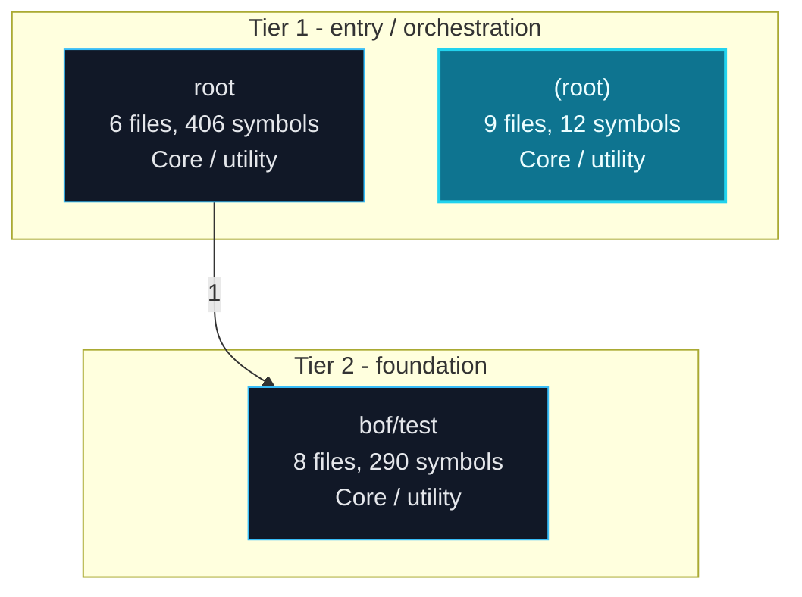
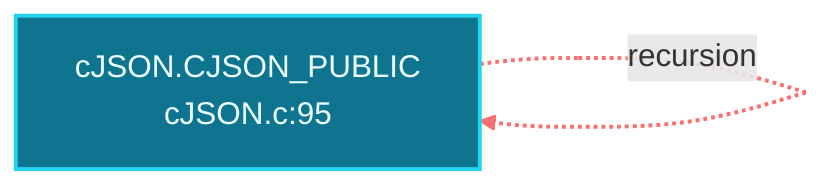
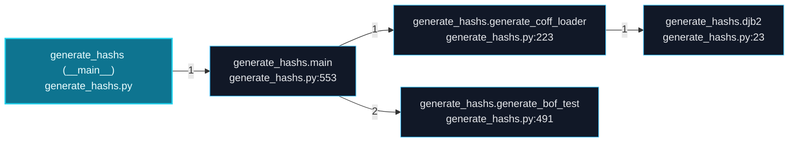
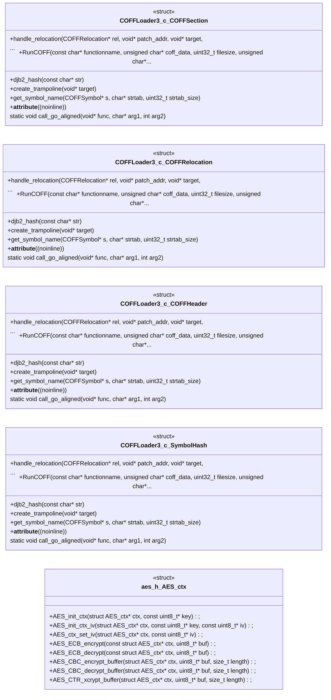
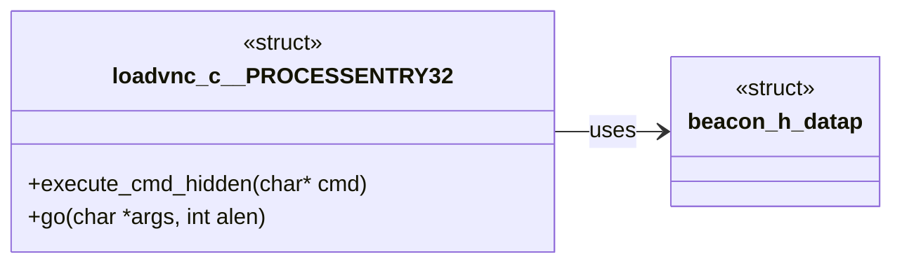
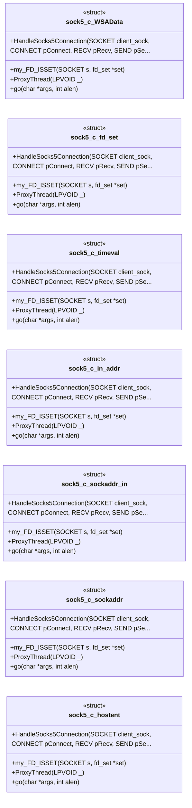
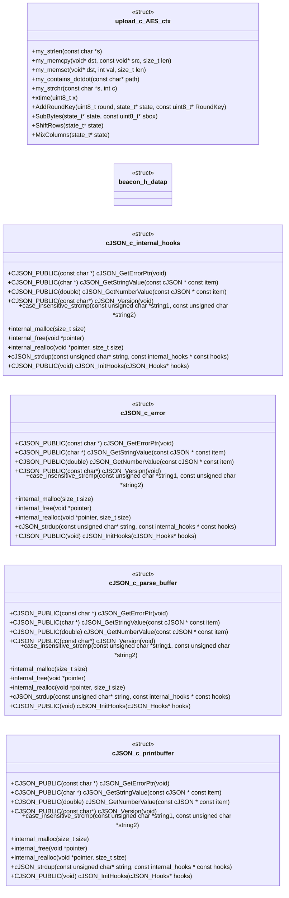
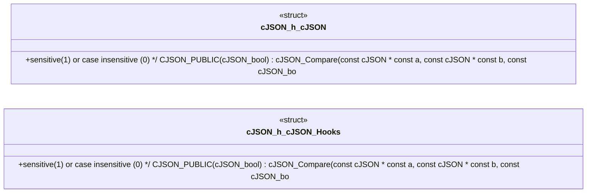

# Polyglot Codebase Knowledge Graph

> Generated offline by **readmenator**. 41 files, 875 symbols, 108 imports. Supports C, C++, Python, Go, Rust, JS/TS, Java, C#, Shell, PHP, Dart, GDScript, Nim, ASM, Ruby, Swift, Kotlin, Scala, Lua, Elixir.
> No LLMs. No tokens. Pure static analysis. See more [here](https://github.com/grisuno/ReadMenator)

**Start here:** Statistics Dashboard for scope, God Nodes for blast radius, Architecture Reference for per-file API. Agents: prefer `readmenator-agent/INDEX.md` + `SYMBOLS.md`.

**Wiki:** prefer `readmenator-wiki/index.md` for progressive disclosure: one synthesis page per community, `connections.json` with EXTRACTED vs INFERRED confidence, `queries.md` log, `REPORT.md` audit.

**Confidence:** EXTRACTED = parsed from source, INFERRED = heuristic bridge, AMBIGUOUS = reported, never hidden. See `readmenator-wiki/REPORT.md`.

**Total Files Parsed:** 41 | **Total Symbols Extracted:** 875 | **Total Imports:** 108
 | **Resolved Imports:** 25

<!-- ranking_model: v1.0 | weights: {ppr:0.45,auth:0.2,test:0.15,doc:0.1,fresh:0.1} | alpha:0.85 | commit:0cda7db | date:2026-07-18 -->


## Table of Contents

1. [Statistics Dashboard](#statistics-dashboard)
2. [Architectural Layers](#architectural-layers)
3. [Architecture Overview](#architecture-overview)
4. [Execution Flows](#execution-flows)
5. [Ranked Context](#ranked-context)
6. [God Nodes](#god-nodes)
7. [Community Analysis](#community-analysis)
8. [Surprising Connections](#surprising-connections)
9. [Suggested Questions](#suggested-questions)
10. [Force-Graph Explorer](#force-graph-explorer)
11. [Corpus Analytics](#corpus-analytics)
12. [Taint Propagation Map](#taint-propagation-map)
13. [Hotspot Analysis](#hotspot-analysis)
14. [Change Impact Analysis](#change-impact-analysis)
15. [Suggested Linting Rules](#suggested-linting-rules)
16. [Dataflow Analysis](#dataflow-analysis)
17. [Concept Graph](#concept-graph)
18. [Orphans](#orphans)
19. [Query Recipes](#query-recipes)
20. [Structural Knowledge Map](#structural-knowledge-map)
21. [UML Class Diagram](#uml-class-diagram)
22. [Code Property Graph](#code-property-graph)
23. [Architecture Reference](#architecture-reference)
    - [C (23 files)](#c-23-files)
    - [H (8 files)](#h-8-files)
    - [PY (3 files)](#py-3-files)
    - [SH (7 files)](#sh-7-files)

---

## Statistics Dashboard

| Metric | Value |
|--------|-------|
| Total Files | 41 |
| Total Symbols | 875 |
| Total Imports | 108 |
| Call Edges | 96 |
| Inheritance Edges | 0 |
| Languages | 4 |
| Avg Symbols/File | 21.3 |
| Avg Imports/File | 2.6 |
| Resolved Imports | 25 |

### Top Files by Import Count (Fan-Out)

| File | Imports | Symbols | Language |
|------|---------|---------|----------|
| `beacon.c` | 27 | 179 | c |
| `cJSON.c` | 9 | 125 | c |
| `COFFLoader3.c` | 6 | 258 | c |
| `tel.py` | 6 | 6 | py |
| `generate_hashs.py` | 6 | 4 | py |
| `disablelog.c` | 5 | 9 | c |
| `scan_shellcode.c` | 3 | 9 | c |
| `vncrelay.c` | 3 | 8 | c |
| `aes.c` | 2 | 43 | c |
| `aes.h` | 2 | 21 | h |

### Top Files by Imported-By Count (Fan-In)

| File | Imported By | Symbols | Language |
|------|-------------|---------|----------|
| `beacon.h` | 20 | 4 | h |
| `aes.h` | 2 | 21 | h |
| `cJSON.h` | 2 | 37 | h |
| `COFFLoader.h` | 1 | 1 | h |

---

## Architectural Layers

Auto-detected from path patterns, naming conventions, and imported frameworks.

| Layer | Files |
|-------|-------|
| utility | 23 |
| testing | 18 |

### utility

- `COFFLoader.h` (h, 1 symbols)
- `COFFLoader3.c` (c, 258 symbols)
- `aes.c` (c, 43 symbols)
- `aes.h` (h, 21 symbols)
- `app.py` (py, 0 symbols)
- `beacon.c` (c, 179 symbols)
- `beacon.h` (h, 4 symbols)
- `beacon.h` (h, 4 symbols)
- `calc.c` (c, 6 symbols)
- `beacon.h` (h, 4 symbols)
- `etw.c` (c, 5 symbols)
- `beacon.h` (h, 4 symbols)
- `whoami.c` (c, 5 symbols)
- `cJSON.c` (c, 125 symbols)
- `cJSON.h` (h, 37 symbols)
- *... and 8 more*

### testing

- `Test.c` (c, 1 symbols)
- `amsibypass.c` (c, 5 symbols)
- `beacon.h` (h, 4 symbols)
- `cmdwhoami.c` (c, 4 symbols)
- `disablelog.c` (c, 9 symbols)
- `getenv.c` (c, 2 symbols)
- `loadvnc.c` (c, 8 symbols)
- `make_table.c` (c, 2 symbols)
- `persist.c` (c, 4 symbols)
- `persistsvc.c` (c, 13 symbols)
- `scan_shellcode.c` (c, 9 symbols)
- `shellcode.c` (c, 3 symbols)
- `sock5.c` (c, 41 symbols)
- `tel.py` (py, 6 symbols)
- `uacbypass.c` (c, 5 symbols)
- *... and 3 more*

---

## Architecture Overview

3 components stacked in 2 dependency tiers (weighted Eades-Lin-Smyth ordering: arrows point from dependent to dependency, top to bottom). Labels are import counts, thick arrows the top quartile; 0 transitively implied edges are omitted. Dashed red arrows are upward dependencies: the smallest set of imports that closes every cycle and breaks the layering. Cyan components hold entry points. Interactive version: `readmenator-apidocs/index.html#/flows`.



---

## Execution Flows

Entry points are scored from `__main__` guards, `main` functions, entry-style names and files, and call-graph sources. Each flow walks resolved calls in call-site order (depth <= 4, <= 40 steps); numbers give the call order, dashed arrows revisit an already expanded callee, red arrows are recursion. Interactive version with zoom and per-node docs: `readmenator-apidocs/index.html#/flows`.

### `cJSON.CJSON_PUBLIC`

`cJSON.c:1134`, score 13: call-graph source with 6 calls; call-graph source with 3 calls; call-graph source with 4 calls.

Call tree:



### `generate_hashs (__main__)`

`generate_hashs.py:595`, score 8: `if __name__ == "__main__"` guard.

Call tree:



---

## Ranked Context

Files ranked by composite score for the current query context. The ranking combines Personalized PageRank (query relevance), global authority, test coverage, documentation coverage, and code freshness. Model: v1.0.

| Rank | File | Composite | PPR | Authority | Test | Doc |
|------|------|-----------|-----|-----------|------|-----|
| 1 | `gen_dll_rev.sh` | 0.2000 | 0.0000 | 0.0000 | 0.00 | 2.00 |
| 2 | `gen_dll_ss.sh` | 0.2000 | 0.0000 | 0.0000 | 0.00 | 2.00 |
| 3 | `gen_key.sh` | 0.2000 | 0.0000 | 0.0000 | 0.00 | 2.00 |
| 4 | `gen_module.sh` | 0.1500 | 0.0000 | 0.0000 | 0.00 | 1.50 |
| 5 | `beacon.h` | 0.1296 | 0.1994 | 0.1994 | 0.00 | 0.00 |
| 6 | `app.py` | 0.1000 | 0.0000 | 0.0000 | 0.00 | 1.00 |
| 7 | `gen_beacon.sh` | 0.1000 | 0.0000 | 0.0000 | 0.00 | 1.00 |
| 8 | `gen_dll.sh` | 0.1000 | 0.0000 | 0.0000 | 0.00 | 1.00 |
| 9 | `beacon.h` | 0.0984 | 0.1514 | 0.1514 | 0.00 | 0.00 |
| 10 | `uacbypass.c` | 0.0733 | 0.0205 | 0.0205 | 0.00 | 0.60 |

---

## God Nodes

Most architecturally central files ranked by combined import/export degree and symbol richness.

| File | Score | Connections | PageRank |
|------|-------|-------------|----------|
| `beacon.h` | 40.4 | | 0.1994 |
| `beacon.h` | 30.4 | | 0.1514 |
| `COFFLoader3.c` | 27.8 | | 0.0000 |
| `beacon.c` | 25.9 | | 0.0000 |
| `cJSON.c` | 14.5 | | 0.0000 |
| `sock5.c` | 8.1 | | 0.0000 |
| `upload.c` | 8.1 | | 0.0000 |
| `cJSON.h` | 7.7 | | 0.0000 |
| `aes.c` | 6.3 | | 0.0000 |
| `aes.h` | 6.1 | | 0.0000 |

---

## Community Analysis

Files grouped by import-based community detection. Cohesion measures how tightly connected each community is internally.

### bof/test (Cohesion: 0.97)

**24 files** in this community:

- `COFFLoader3.c` (c, 258 symbols)
- `beacon.h` (h, 4 symbols)
- `beacon.h` (h, 4 symbols)
- `calc.c` (c, 6 symbols)
- `beacon.h` (h, 4 symbols)
- `etw.c` (c, 5 symbols)
- `Test.c` (c, 1 symbols)
- `amsibypass.c` (c, 5 symbols)
- `beacon.h` (h, 4 symbols)
- `cmdwhoami.c` (c, 4 symbols)
- `disablelog.c` (c, 9 symbols)
- `getenv.c` (c, 2 symbols)
- `loadvnc.c` (c, 8 symbols)
- `persist.c` (c, 4 symbols)
- `persistsvc.c` (c, 13 symbols)
- `scan_shellcode.c` (c, 9 symbols)
- `shellcode.c` (c, 3 symbols)
- `sock5.c` (c, 41 symbols)
- `uacbypass.c` (c, 5 symbols)
- `upload.c` (c, 41 symbols)
- ... and 4 more files

### root (Cohesion: 0.83)

**6 files** in this community:

- `COFFLoader.h` (h, 1 symbols)
- `aes.c` (c, 43 symbols)
- `aes.h` (h, 21 symbols)
- `beacon.c` (c, 179 symbols)
- `cJSON.c` (c, 125 symbols)
- `cJSON.h` (h, 37 symbols)

---

## Surprising Connections

Files in different communities connected through 3+ indirect hops.

- `aes.c` <-> `beacon.h` (5 hops, across 2 communities)
- `aes.c` <-> `beacon.h` (5 hops, across 2 communities)
- `aes.c` <-> `beacon.h` (5 hops, across 2 communities)
- `aes.c` <-> `beacon.h` (5 hops, across 2 communities)
- `beacon.h` <-> `cJSON.c` (5 hops, across 2 communities)

---

## Suggested Questions

Auto-generated exploration prompts based on graph structure:

- What does beacon.h depend on, and what depends on it? (20 connections)
- What does beacon.h depend on, and what depends on it? (15 connections)
- What does COFFLoader3.c depend on, and what depends on it? (1 connections)
- How are the 24 files in 'bof/test' related to each other?
- Why are aes.c and beacon.h connected through 5 hops across 2 communities?

---

## Force-Graph Explorer

Heterogeneous explorer payload (files, communities, layers, externals) rendered with force-graph physics, stable family colors, log2 node sizing, and convex-hull community overlays. Open `readmenator-maps/graph-force.html` (linked from the maps gallery) or run `explorer`.

- Nodes: 88 (community: 2, external: 43, file: 41, layer: 2)
- Edges: 204

---

## Corpus Analytics

Attribution funnel and distributions for the explorer dashboard.

- Files: 41 | With symbols: 38 | Attributed: 30 | God nodes: 10 | Symbols: 875

- Layer `utility`: 23 files
- Layer `testing`: 18 files

- Language `c`: 23 files
- Language `h`: 8 files
- Language `sh`: 7 files
- Language `py`: 3 files

---

## Taint Propagation Map

Taint analysis traces how dangerous imports propagate through the codebase via transitive dependencies. Source files import dangerous modules directly; sink files receive the danger indirectly.

**Taint Sources:** 1 | **Taint Sinks:** 1 | **Propagation Paths:** 1

- `tel.py` imports `requests` (0 hop to `tel.py`) [medium]
  Path: tel.py

---

## Hotspot Analysis

Files ranked by combined complexity (symbol count) and centrality (connection count). High-scoring files are architecturally critical and may need refactoring attention.

| File | Complexity | Centrality | Combined | Symbols | Connections |
|------|-----------|------------|----------|---------|-------------|
| `gen_dll_rev.sh` | 0.004 | 0.000 | 0.002 | 1 | 0 |
| `gen_dll_ss.sh` | 0.004 | 0.000 | 0.002 | 1 | 0 |
| `gen_key.sh` | 0.004 | 0.000 | 0.002 | 1 | 0 |
| `gen_module.sh` | 0.008 | 0.000 | 0.003 | 2 | 0 |
| `beacon.h` | 0.015 | 0.742 | 0.451 | 4 | 23 |
| `app.py` | 0.000 | 0.032 | 0.019 | 0 | 1 |
| `gen_beacon.sh` | 0.012 | 0.000 | 0.005 | 3 | 0 |
| `gen_dll.sh` | 0.000 | 0.000 | 0.000 | 0 | 0 |
| `beacon.h` | 0.015 | 0.516 | 0.316 | 4 | 16 |
| `uacbypass.c` | 0.019 | 0.097 | 0.066 | 5 | 3 |
| `beacon.c` | 0.694 | 1.000 | 0.877 | 179 | 31 |
| `COFFLoader3.c` | 1.000 | 0.226 | 0.535 | 258 | 7 |
| `cJSON.c` | 0.484 | 0.323 | 0.387 | 125 | 10 |
| `cJSON.h` | 0.143 | 0.161 | 0.154 | 37 | 5 |
| `aes.h` | 0.081 | 0.194 | 0.149 | 21 | 6 |

---

## Dataflow Analysis

Procedural intra-function dataflow findings (zero tokens, regex-based heuristics, all INFERRED). Each lead is grounded at file:line for manual review.

**15 findings** (DEAD_STORE: 4, UNCHECKED_ALLOC: 11).

| File | Function | Line | Kind | Variable | Description |
|------|----------|------|------|----------|-------------|
| `beacon.c` | `extract_shellcode` | 1603 | `UNCHECKED_ALLOC` | `sc` | Result of allocator stored in `sc` is never checked against NULL. |
| `beacon.c` | `ReverseShell` | 1727 | `UNCHECKED_ALLOC` | `s` | Result of allocator stored in `s` is never checked against NULL. |
| `beacon.c` | `discoverLocalHosts` | 2028 | `UNCHECKED_ALLOC` | `reply` | Result of allocator stored in `reply` is never checked against NULL. |
| `beacon.c` | `proxy_thread` | 2086 | `UNCHECKED_ALLOC` | `server` | Result of allocator stored in `server` is never checked against NULL. |
| `beacon.c` | `startProxy` | 2266 | `UNCHECKED_ALLOC` | `listenSock` | Result of allocator stored in `listenSock` is never checked against NULL. |
| `beacon.c` | `executeUACBypass` | 3860 | `DEAD_STORE` | `maliciousCmd` | `maliciousCmd` assigned at line 3860 but never read afterwards. |
| `beacon.c` | `scanPort` | 3911 | `UNCHECKED_ALLOC` | `s` | Result of allocator stored in `s` is never checked against NULL. |
| `cJSON.c` | `print_array` | 1654 | `DEAD_STORE` | `output_pointer` | `output_pointer` assigned at line 1654 but never read afterwards. |
| `cJSON.c` | `print_object` | 1887 | `DEAD_STORE` | `output_pointer` | `output_pointer` assigned at line 1887 but never read afterwards. |
| `gen_beacon.sh` | `xor_string` | 4116 | `DEAD_STORE` | `maliciousCmd` | `maliciousCmd` assigned at line 4116 but never read afterwards. |
| `gen_beacon.sh` | `xor_string` | 1859 | `UNCHECKED_ALLOC` | `sc` | Result of allocator stored in `sc` is never checked against NULL. |
| `gen_beacon.sh` | `xor_string` | 4167 | `UNCHECKED_ALLOC` | `s` | Result of allocator stored in `s` is never checked against NULL. |
| `gen_beacon.sh` | `xor_string` | 2284 | `UNCHECKED_ALLOC` | `reply` | Result of allocator stored in `reply` is never checked against NULL. |
| `gen_beacon.sh` | `xor_string` | 2342 | `UNCHECKED_ALLOC` | `server` | Result of allocator stored in `server` is never checked against NULL. |
| `gen_beacon.sh` | `xor_string` | 2522 | `UNCHECKED_ALLOC` | `listenSock` | Result of allocator stored in `listenSock` is never checked against NULL. |

---

## Concept Graph

Semantic second-brain layer: nouns are concept nodes, verbs are edges. Each noun maps atomically to a file set (EXTRACTED); each verb aggregates structural imports, calls, and inherits into consumes, invokes, extends, depends_on, or bridges (INFERRED).

**50 concepts, 100 relations.**

| Concept | Files | Mentions |
|---------|-------|----------|
| `bof` | 25 | 30 |
| `get` | 20 | 99 |
| `imp` | 18 | 286 |
| `address` | 15 | 15 |
| `load` | 14 | 16 |
| `proc` | 14 | 14 |
| `library` | 13 | 15 |
| `handle` | 12 | 26 |
| `funci` | 12 | 23 |
| `beacon` | 11 | 39 |
| `close` | 10 | 16 |
| `imports` | 10 | 11 |
| `principal` | 10 | 11 |
| `output` | 9 | 37 |
| `error` | 9 | 14 |
| `key` | 8 | 25 |
| `version` | 8 | 22 |
| `directos` | 8 | 9 |
| `buffer` | 7 | 94 |
| `module` | 7 | 17 |
| `gen` | 7 | 16 |
| `virtual` | 7 | 15 |
| `set` | 6 | 42 |
| `define` | 6 | 26 |
| `size` | 6 | 25 |
| `name` | 6 | 18 |
| `callback` | 6 | 13 |
| `bytes` | 6 | 10 |
| `next` | 6 | 10 |
| `copy` | 6 | 8 |

### Verb Edges

| Source | Verb | Target | Strength | Evidence |
|--------|------|--------|----------|----------|
| `bof` | `consumes` | `beacon` | 1.00 | 10 |
| `bof` | `depends_on` | `beacon` | 1.00 | 10 |
| `bof` | `consumes` | `callback` | 1.00 | 10 |
| `bof` | `depends_on` | `callback` | 1.00 | 10 |
| `bof` | `consumes` | `datap` | 1.00 | 10 |
| `bof` | `depends_on` | `datap` | 1.00 | 10 |
| `bof` | `consumes` | `error` | 1.00 | 10 |
| `bof` | `depends_on` | `error` | 1.00 | 10 |
| `bof` | `consumes` | `output` | 1.00 | 10 |
| `bof` | `depends_on` | `output` | 1.00 | 10 |
| `imp` | `consumes` | `beacon` | 1.00 | 10 |
| `imp` | `depends_on` | `beacon` | 1.00 | 10 |
| `imp` | `consumes` | `callback` | 1.00 | 10 |
| `imp` | `depends_on` | `callback` | 1.00 | 10 |
| `imp` | `consumes` | `datap` | 1.00 | 10 |
| `imp` | `depends_on` | `datap` | 1.00 | 10 |
| `imp` | `consumes` | `error` | 1.00 | 10 |
| `imp` | `depends_on` | `error` | 1.00 | 10 |
| `imp` | `consumes` | `output` | 1.00 | 10 |
| `imp` | `depends_on` | `output` | 1.00 | 10 |
| `get` | `consumes` | `beacon` | 0.94 | 10 |
| `get` | `depends_on` | `beacon` | 0.94 | 10 |
| `get` | `consumes` | `callback` | 0.94 | 10 |
| `get` | `depends_on` | `callback` | 0.94 | 10 |
| `get` | `consumes` | `datap` | 0.94 | 10 |
| `get` | `depends_on` | `datap` | 0.94 | 10 |
| `get` | `consumes` | `error` | 0.94 | 10 |
| `get` | `depends_on` | `error` | 0.94 | 10 |
| `get` | `consumes` | `output` | 0.94 | 10 |
| `get` | `depends_on` | `output` | 0.94 | 10 |

### Dialectic Prompts

- Thesis: `address` centralizes 15 files; Antithesis: `bof` pulls 25 files with 13 shared (Jaccard 0.48); Synthesis: should they merge, split by layer, or keep `depends_on` explicit?
- Thesis: `address` centralizes 15 files; Antithesis: `close` pulls 10 files with 9 shared (Jaccard 0.56); Synthesis: should they merge, split by layer, or keep `bridges` explicit?
- Thesis: `address` centralizes 15 files; Antithesis: `directos` pulls 8 files with 8 shared (Jaccard 0.53); Synthesis: should they merge, split by layer, or keep `bridges` explicit?
- Thesis: `address` centralizes 15 files; Antithesis: `funci` pulls 12 files with 9 shared (Jaccard 0.50); Synthesis: should they merge, split by layer, or keep `bridges` explicit?
- Thesis: `address` centralizes 15 files; Antithesis: `get` pulls 20 files with 15 shared (Jaccard 0.75); Synthesis: should they merge, split by layer, or keep `bridges` explicit?
- Thesis: `address` centralizes 15 files; Antithesis: `handle` pulls 12 files with 11 shared (Jaccard 0.69); Synthesis: should they merge, split by layer, or keep `bridges` explicit?
- Thesis: `address` centralizes 15 files; Antithesis: `imp` pulls 18 files with 14 shared (Jaccard 0.74); Synthesis: should they merge, split by layer, or keep `bridges` explicit?
- Thesis: `address` centralizes 15 files; Antithesis: `imports` pulls 10 files with 9 shared (Jaccard 0.56); Synthesis: should they merge, split by layer, or keep `bridges` explicit?
- Thesis: `address` centralizes 15 files; Antithesis: `lean` pulls 6 files with 5 shared (Jaccard 0.31); Synthesis: should they merge, split by layer, or keep `bridges` explicit?
- Thesis: `address` centralizes 15 files; Antithesis: `library` pulls 13 files with 13 shared (Jaccard 0.87); Synthesis: should they merge, split by layer, or keep `bridges` explicit?

---

## Change Impact Analysis

Files sorted by how many other files would be affected if they changed. High-impact files should be changed with caution.

| File | Direct Dependents | Transitive Dependents | Total Impact |
|------|------------------|----------------------|--------------|
| `beacon.h` | 15 | 0 | 15 |
| `aes.h` | 2 | 0 | 2 |
| `beacon.h` | 2 | 0 | 2 |
| `cJSON.h` | 2 | 0 | 2 |
| `COFFLoader.h` | 1 | 0 | 1 |
| `beacon.h` | 1 | 0 | 1 |
| `beacon.h` | 1 | 0 | 1 |
| `beacon.h` | 1 | 0 | 1 |
| `COFFLoader3.c` | 0 | 0 | 0 |
| `aes.c` | 0 | 0 | 0 |
| `app.py` | 0 | 0 | 0 |
| `beacon.c` | 0 | 0 | 0 |
| `calc.c` | 0 | 0 | 0 |
| `etw.c` | 0 | 0 | 0 |
| `Test.c` | 0 | 0 | 0 |

---

## Suggested Linting Rules

Automatically suggested linting and security rules based on patterns detected in the codebase. These can be exported as Semgrep rules using the `--export-rules` flag.

| Rule ID | Severity | Description | Language | Matches |
|---------|----------|-------------|----------|---------|
| `RM006` | error | Hardcoded credential detected | multi | 4 |
| `RM001` | info | Large number of functions in h: 9 total | h | 9 |
| `RM002` | info | Large number of functions in c: 294 total | c | 294 |
| `RM003` | info | Large number of functions in py: 10 total | py | 10 |
| `RM004` | info | Large number of functions in sh: 8 total | sh | 8 |
| `RM005` | info | Print statement found (consider logging instead) | python | 17 |

---

## Orphans

Files with no documentation or low connectivity. These are candidates for documentation investment or cleanup.

- `beacon.h` (4 symbols, no doc)
- `beacon.h` (4 symbols, no doc)
- `COFFLoader.h` (1 symbols, no doc)
- `beacon.h` (4 symbols, no doc)
- `beacon.h` (4 symbols, no doc)
- `Test.c` (1 symbols, no doc)
- `cmdwhoami.c` (4 symbols, no doc)
- `disablelog.c` (9 symbols, no doc)
- `getenv.c` (2 symbols, no doc)
- `make_table.c` (2 symbols, no doc)
- `persist.c` (4 symbols, no doc)
- `shellcode.c` (3 symbols, no doc)
- `winver.c` (2 symbols, no doc)
- `beacon.h` (4 symbols, no doc)
- `install.sh` (0 symbols, no doc)

---

## Query Recipes

Example queries you can run against this knowledge base using the ranking engine:

```
# Find files most relevant to a concept
readmenator query "Where is the import resolver implemented?"

# Rank files by relevance to a topic
readmenator query "How does documentation generation work?"

# Explain why a file ranks highly
readmenator query "explain readmenator/_documentation.py"

# Trace dependency paths with ranked context
readmenator query "path from CLI to exporter"
```

The ranking model uses the following signals:

- **Personalized PageRank** (45% weight): query-specific relevance via seed propagation
- **Global Authority** (20% weight): structural importance via standard PageRank
- **Test Coverage** (15% weight): fraction of symbols referenced in test files
- **Doc Coverage** (10% weight): presence of docstrings and file-level docs
- **Freshness** (10% weight): recent modification activity

Results include score decomposition and justification paths for each ranked item.

---

## Structural Knowledge Map

> **Note:** The visual graph below has been intelligently pruned to the top 300 most relevant nodes to prevent rendering crashes. Full details of all files are documented in the Architecture Reference.

```mermaid
graph LR
    classDef mod fill:#1e1e1e,stroke:#ff6666,stroke-width:2px,color:#fff;
    classDef cls fill:#2d2d2d,stroke:#4ec9b0,stroke-width:2px,color:#fff;
    classDef fn fill:#333,stroke:#dcdcaa,stroke-width:1px,color:#dcdcaa;
    classDef ext fill:#111,stroke:#666,stroke-dasharray:5 5,color:#aaa;
    subgraph community_1 ["root"]
    beacon_c["beacon.c (c)"]
    class beacon_c mod;
    beacon_c__UNICODE_STRING["_UNICODE_STRING"]
    class beacon_c__UNICODE_STRING cls;
    beacon_c --> beacon_c__UNICODE_STRING
    beacon_c__OBJECT_ATTRIBUTES["_OBJECT_ATTRIBUTES"]
    class beacon_c__OBJECT_ATTRIBUTES cls;
    beacon_c --> beacon_c__OBJECT_ATTRIBUTES
    beacon_c__IO_STATUS_BLOCK["_IO_STATUS_BLOCK"]
    class beacon_c__IO_STATUS_BLOCK cls;
    beacon_c --> beacon_c__IO_STATUS_BLOCK
    beacon_c__PROCESS_BASIC_INFORMATION["_PROCESS_BASIC_INFORMATION"]
    class beacon_c__PROCESS_BASIC_INFORMATION cls;
    beacon_c --> beacon_c__PROCESS_BASIC_INFORMATION
    beacon_c__LDR_DATA_TABLE_ENTRY["_LDR_DATA_TABLE_ENTRY"]
    class beacon_c__LDR_DATA_TABLE_ENTRY cls;
    beacon_c --> beacon_c__LDR_DATA_TABLE_ENTRY
    cJSON_c["cJSON.c (c)"]
    class cJSON_c mod;
    end
    subgraph community_0 ["bof/test"]
    COFFLoader3_c["COFFLoader3.c (c)"]
    class COFFLoader3_c mod;
    bof_test_disablelog_c["disablelog.c (c)"]
    class bof_test_disablelog_c mod;
    bof_test_tel_py["tel.py (py)"]
    class bof_test_tel_py mod;
    generate_hashs_py["generate_hashs.py (py)"]
    class generate_hashs_py mod;
    bof_test_scan_shellcode_c["scan_shellcode.c (c)"]
    class bof_test_scan_shellcode_c mod;
    bof_test_vncrelay_c["vncrelay.c (c)"]
    class bof_test_vncrelay_c mod;
    aes_c["aes.c (c)"]
    class aes_c mod;
    bof_test_sock5_c["sock5.c (c)"]
    class bof_test_sock5_c mod;
    bof_test_upload_c["upload.c (c)"]
    class bof_test_upload_c mod;
    bof_test_persistsvc_c["persistsvc.c (c)"]
    class bof_test_persistsvc_c mod;
    bof_test_loadvnc_c["loadvnc.c (c)"]
    class bof_test_loadvnc_c mod;
    bof_calc_calc_c["calc.c (c)"]
    class bof_calc_calc_c mod;
    bof_etw_etw_c["etw.c (c)"]
    class bof_etw_etw_c mod;
    bof_test_amsibypass_c["amsibypass.c (c)"]
    class bof_test_amsibypass_c mod;
    bof_test_uacbypass_c["uacbypass.c (c)"]
    class bof_test_uacbypass_c mod;
    bof_whoami_whoami_c["whoami.c (c)"]
    class bof_whoami_whoami_c mod;
    bof_test_cmdwhoami_c["cmdwhoami.c (c)"]
    class bof_test_cmdwhoami_c mod;
    bof_test_persist_c["persist.c (c)"]
    class bof_test_persist_c mod;
    bof_test_shellcode_c["shellcode.c (c)"]
    class bof_test_shellcode_c mod;
    bof_test_getenv_c["getenv.c (c)"]
    class bof_test_getenv_c mod;
    bof_test_winver_c["winver.c (c)"]
    class bof_test_winver_c mod;
    aes_h["aes.h (h)"]
    class aes_h mod;
    bof_test_make_table_c["make_table.c (c)"]
    class bof_test_make_table_c mod;
    bof_test_Test_c["Test.c (c)"]
    class bof_test_Test_c mod;
    cJSON_h["cJSON.h (h)"]
    class cJSON_h mod;
    beacon_h["beacon.h (h)"]
    class beacon_h mod;
    bof_calc_beacon_h["beacon.h (h)"]
    class bof_calc_beacon_h mod;
    bof_etw_beacon_h["beacon.h (h)"]
    class bof_etw_beacon_h mod;
    bof_test_beacon_h["beacon.h (h)"]
    class bof_test_beacon_h mod;
    bof_whoami_beacon_h["beacon.h (h)"]
    class bof_whoami_beacon_h mod;
    COFFLoader_h["COFFLoader.h (h)"]
    class COFFLoader_h mod;
    app_py["app.py (py)"]
    class app_py mod;
    gen_beacon_sh["gen_beacon.sh (sh)"]
    class gen_beacon_sh mod;
    gen_module_sh["gen_module.sh (sh)"]
    class gen_module_sh mod;
    gen_dll_rev_sh["gen_dll_rev.sh (sh)"]
    class gen_dll_rev_sh mod;
    gen_dll_ss_sh["gen_dll_ss.sh (sh)"]
    class gen_dll_ss_sh mod;
    gen_key_sh["gen_key.sh (sh)"]
    class gen_key_sh mod;
    gen_dll_sh["gen_dll.sh (sh)"]
    class gen_dll_sh mod;
    install_sh["install.sh (sh)"]
    class install_sh mod;
    end
    COFFLoader3_c ~~~ bof_test_persistsvc_c
    bof_test_disablelog_c ~~~ bof_test_loadvnc_c
    bof_test_scan_shellcode_c ~~~ bof_calc_calc_c
    bof_test_vncrelay_c ~~~ bof_etw_etw_c
    bof_test_sock5_c ~~~ bof_test_amsibypass_c
    bof_test_upload_c ~~~ bof_test_uacbypass_c
    bof_test_persistsvc_c ~~~ bof_whoami_whoami_c
    bof_test_loadvnc_c ~~~ bof_test_cmdwhoami_c
    bof_calc_calc_c ~~~ bof_test_persist_c
    bof_etw_etw_c ~~~ bof_test_shellcode_c
    bof_test_amsibypass_c ~~~ bof_test_getenv_c
    bof_test_uacbypass_c ~~~ bof_test_winver_c
    bof_whoami_whoami_c ~~~ bof_test_Test_c
    bof_test_cmdwhoami_c ~~~ beacon_h
    bof_test_persist_c ~~~ bof_calc_beacon_h
    bof_test_shellcode_c ~~~ bof_etw_beacon_h
    bof_test_getenv_c ~~~ bof_test_beacon_h
    bof_test_winver_c ~~~ bof_whoami_beacon_h
    bof_test_tel_py ~~~ gen_dll_rev_sh
    generate_hashs_py ~~~ gen_dll_ss_sh
    bof_test_make_table_c ~~~ gen_key_sh
    app_py ~~~ gen_dll_sh
    gen_beacon_sh ~~~ install_sh
    COFFLoader3_c -- resolved_imports --> beacon_h
    aes_c -- resolved_imports --> aes_h
    beacon_c -- resolved_imports --> aes_h
    beacon_c -- resolved_imports --> cJSON_h
    beacon_c -- resolved_imports --> beacon_h
    beacon_c -- resolved_imports --> COFFLoader_h
    bof_calc_calc_c -- resolved_imports --> bof_calc_beacon_h
    bof_etw_etw_c -- resolved_imports --> bof_etw_beacon_h
    bof_test_Test_c -- resolved_imports --> bof_test_beacon_h
    bof_test_amsibypass_c -- resolved_imports --> bof_test_beacon_h
    bof_test_cmdwhoami_c -- resolved_imports --> bof_test_beacon_h
    bof_test_disablelog_c -- resolved_imports --> bof_test_beacon_h
    bof_test_getenv_c -- resolved_imports --> bof_test_beacon_h
    bof_test_loadvnc_c -- resolved_imports --> bof_test_beacon_h
    bof_test_persist_c -- resolved_imports --> bof_test_beacon_h
    bof_test_persistsvc_c -- resolved_imports --> bof_test_beacon_h
    bof_test_scan_shellcode_c -- resolved_imports --> bof_test_beacon_h
    bof_test_shellcode_c -- resolved_imports --> bof_test_beacon_h
    bof_test_sock5_c -- resolved_imports --> bof_test_beacon_h
    bof_test_uacbypass_c -- resolved_imports --> bof_test_beacon_h
    bof_test_upload_c -- resolved_imports --> bof_test_beacon_h
    bof_test_vncrelay_c -- resolved_imports --> bof_test_beacon_h
    bof_test_winver_c -- resolved_imports --> bof_test_beacon_h
    bof_whoami_whoami_c -- resolved_imports --> bof_whoami_beacon_h
    cJSON_c -- resolved_imports --> cJSON_h
    ext_windows_h["windows.h"]
    class ext_windows_h ext;
    COFFLoader_h -.->|imports| ext_windows_h
    COFFLoader3_c -.->|imports| ext_windows_h
    ext_stdio_h["stdio.h"]
    class ext_stdio_h ext;
    COFFLoader3_c -.->|imports| ext_stdio_h
    ext_stdlib_h["stdlib.h"]
    class ext_stdlib_h ext;
    COFFLoader3_c -.->|imports| ext_stdlib_h
    ext_string_h["string.h"]
    class ext_string_h ext;
    COFFLoader3_c -.->|imports| ext_string_h
    ext_stdint_h["stdint.h"]
    class ext_stdint_h ext;
    COFFLoader3_c -.->|imports| ext_stdint_h
    ext_beacon_h["beacon.h"]
    class ext_beacon_h ext;
    COFFLoader3_c -.->|imports| ext_beacon_h
    ext_aes_h["aes.h"]
    class ext_aes_h ext;
    aes_c -.->|imports| ext_aes_h
    aes_c -.->|imports| ext_string_h
    aes_h -.->|imports| ext_stdint_h
    ext_stddef_h["stddef.h"]
    class ext_stddef_h ext;
    aes_h -.->|imports| ext_stddef_h
    ext_os["os"]
    class ext_os ext;
    app_py -.->|imports| ext_os
    ext_winsock2_h["winsock2.h"]
    class ext_winsock2_h ext;
    beacon_c -.->|imports| ext_winsock2_h
    ext_ws2tcpip_h["ws2tcpip.h"]
    class ext_ws2tcpip_h ext;
    beacon_c -.->|imports| ext_ws2tcpip_h
    beacon_c -.->|imports| ext_windows_h
    ext_winnt_h["winnt.h"]
    class ext_winnt_h ext;
    beacon_c -.->|imports| ext_winnt_h
    ext_winhttp_h["winhttp.h"]
    class ext_winhttp_h ext;
    beacon_c -.->|imports| ext_winhttp_h
    ext_wincrypt_h["wincrypt.h"]
    class ext_wincrypt_h ext;
    beacon_c -.->|imports| ext_wincrypt_h
    ext_ntstatus_h["ntstatus.h"]
    class ext_ntstatus_h ext;
    beacon_c -.->|imports| ext_ntstatus_h
    ext_tlhelp32_h["tlhelp32.h"]
    class ext_tlhelp32_h ext;
    beacon_c -.->|imports| ext_tlhelp32_h
    beacon_c -.->|imports| ext_stdio_h
    beacon_c -.->|imports| ext_stdlib_h
    beacon_c -.->|imports| ext_string_h
    ext_io_h["io.h"]
    class ext_io_h ext;
    beacon_c -.->|imports| ext_io_h
    ext_process_h["process.h"]
    class ext_process_h ext;
    beacon_c -.->|imports| ext_process_h
    ext_time_h["time.h"]
    class ext_time_h ext;
    beacon_c -.->|imports| ext_time_h
    ext_iphlpapi_h["iphlpapi.h"]
    class ext_iphlpapi_h ext;
    beacon_c -.->|imports| ext_iphlpapi_h
    ext_icmpapi_h["icmpapi.h"]
    class ext_icmpapi_h ext;
    beacon_c -.->|imports| ext_icmpapi_h
    ext_bcrypt_h["bcrypt.h"]
    class ext_bcrypt_h ext;
    beacon_c -.->|imports| ext_bcrypt_h
    ext_shlobj_h["shlobj.h"]
    class ext_shlobj_h ext;
    beacon_c -.->|imports| ext_shlobj_h
    ext_objbase_h["objbase.h"]
    class ext_objbase_h ext;
    beacon_c -.->|imports| ext_objbase_h
```



---

## UML Class Diagram

Auto-generated Mermaid class diagrams from parsed class-level symbols, split into groups of at most 6 classes so each diagram stays readable. Per-module class diagrams with exact members live in `readmenator-apidocs/modules/`.

#### `COFFLoader3.c`, `aes.h`



#### `beacon.c`



```mermaid
classDiagram
  direction LR
  class beacon_c__UNICODE_STRING {
    <<struct>>
    +UTF8ToWide(const char* utf8)
    +RVAtoRawOffset(DWORD_PTR RVA, PIMAGE_SECTION_HEADER section)
    +GetSyscallStub(
    LPCSTR functionName,
    PIMAGE_EXPORT_DIRECTORY exportDirectory,
    LP...
    +InitializeUnhookedSyscalls()
    +CreateFileA_Unhooked(LPCSTR lpFileName, DWORD dwDesiredAccess, DWORD dwShareMode, LPSECURI...
    +WriteProcessMemory_Unhooked(
    HANDLE hProcess,
    LPVOID lpBaseAddress,
    LPCVOID lpBu...
    +ExceptionFilter(EXCEPTION_POINTERS *ExceptionInfo)
    +get_shell_cmd()
    +__declspec(dllexport) void BeaconDataParse(datap *parser, char *buffer, int size)
    +__declspec(dllexport) char * BeaconDataPtr(datap * parser, int size)
  }
  class beacon_c__OBJECT_ATTRIBUTES {
    <<struct>>
    +UTF8ToWide(const char* utf8)
    +RVAtoRawOffset(DWORD_PTR RVA, PIMAGE_SECTION_HEADER section)
    +GetSyscallStub(
    LPCSTR functionName,
    PIMAGE_EXPORT_DIRECTORY exportDirectory,
    LP...
    +InitializeUnhookedSyscalls()
    +CreateFileA_Unhooked(LPCSTR lpFileName, DWORD dwDesiredAccess, DWORD dwShareMode, LPSECURI...
    +WriteProcessMemory_Unhooked(
    HANDLE hProcess,
    LPVOID lpBaseAddress,
    LPCVOID lpBu...
    +ExceptionFilter(EXCEPTION_POINTERS *ExceptionInfo)
    +get_shell_cmd()
    +__declspec(dllexport) void BeaconDataParse(datap *parser, char *buffer, int size)
    +__declspec(dllexport) char * BeaconDataPtr(datap * parser, int size)
  }
  class beacon_c__IO_STATUS_BLOCK {
    <<struct>>
    +UTF8ToWide(const char* utf8)
    +RVAtoRawOffset(DWORD_PTR RVA, PIMAGE_SECTION_HEADER section)
    +GetSyscallStub(
    LPCSTR functionName,
    PIMAGE_EXPORT_DIRECTORY exportDirectory,
    LP...
    +InitializeUnhookedSyscalls()
    +CreateFileA_Unhooked(LPCSTR lpFileName, DWORD dwDesiredAccess, DWORD dwShareMode, LPSECURI...
    +WriteProcessMemory_Unhooked(
    HANDLE hProcess,
    LPVOID lpBaseAddress,
    LPCVOID lpBu...
    +ExceptionFilter(EXCEPTION_POINTERS *ExceptionInfo)
    +get_shell_cmd()
    +__declspec(dllexport) void BeaconDataParse(datap *parser, char *buffer, int size)
    +__declspec(dllexport) char * BeaconDataPtr(datap * parser, int size)
  }
  class beacon_c__PROCESS_BASIC_INFORMATION {
    <<struct>>
    +UTF8ToWide(const char* utf8)
    +RVAtoRawOffset(DWORD_PTR RVA, PIMAGE_SECTION_HEADER section)
    +GetSyscallStub(
    LPCSTR functionName,
    PIMAGE_EXPORT_DIRECTORY exportDirectory,
    LP...
    +InitializeUnhookedSyscalls()
    +CreateFileA_Unhooked(LPCSTR lpFileName, DWORD dwDesiredAccess, DWORD dwShareMode, LPSECURI...
    +WriteProcessMemory_Unhooked(
    HANDLE hProcess,
    LPVOID lpBaseAddress,
    LPCVOID lpBu...
    +ExceptionFilter(EXCEPTION_POINTERS *ExceptionInfo)
    +get_shell_cmd()
    +__declspec(dllexport) void BeaconDataParse(datap *parser, char *buffer, int size)
    +__declspec(dllexport) char * BeaconDataPtr(datap * parser, int size)
  }
  class beacon_c__LDR_DATA_TABLE_ENTRY {
    <<struct>>
    +UTF8ToWide(const char* utf8)
    +RVAtoRawOffset(DWORD_PTR RVA, PIMAGE_SECTION_HEADER section)
    +GetSyscallStub(
    LPCSTR functionName,
    PIMAGE_EXPORT_DIRECTORY exportDirectory,
    LP...
    +InitializeUnhookedSyscalls()
    +CreateFileA_Unhooked(LPCSTR lpFileName, DWORD dwDesiredAccess, DWORD dwShareMode, LPSECURI...
    +WriteProcessMemory_Unhooked(
    HANDLE hProcess,
    LPVOID lpBaseAddress,
    LPCVOID lpBu...
    +ExceptionFilter(EXCEPTION_POINTERS *ExceptionInfo)
    +get_shell_cmd()
    +__declspec(dllexport) void BeaconDataParse(datap *parser, char *buffer, int size)
    +__declspec(dllexport) char * BeaconDataPtr(datap * parser, int size)
  }
  class beacon_c__PEB_LDR_DATA {
    <<struct>>
    +UTF8ToWide(const char* utf8)
    +RVAtoRawOffset(DWORD_PTR RVA, PIMAGE_SECTION_HEADER section)
    +GetSyscallStub(
    LPCSTR functionName,
    PIMAGE_EXPORT_DIRECTORY exportDirectory,
    LP...
    +InitializeUnhookedSyscalls()
    +CreateFileA_Unhooked(LPCSTR lpFileName, DWORD dwDesiredAccess, DWORD dwShareMode, LPSECURI...
    +WriteProcessMemory_Unhooked(
    HANDLE hProcess,
    LPVOID lpBaseAddress,
    LPCVOID lpBu...
    +ExceptionFilter(EXCEPTION_POINTERS *ExceptionInfo)
    +get_shell_cmd()
    +__declspec(dllexport) void BeaconDataParse(datap *parser, char *buffer, int size)
    +__declspec(dllexport) char * BeaconDataPtr(datap * parser, int size)
  }
  class beacon_c__PEB {
    <<struct>>
    +UTF8ToWide(const char* utf8)
    +RVAtoRawOffset(DWORD_PTR RVA, PIMAGE_SECTION_HEADER section)
    +GetSyscallStub(
    LPCSTR functionName,
    PIMAGE_EXPORT_DIRECTORY exportDirectory,
    LP...
    +InitializeUnhookedSyscalls()
    +CreateFileA_Unhooked(LPCSTR lpFileName, DWORD dwDesiredAccess, DWORD dwShareMode, LPSECURI...
    +WriteProcessMemory_Unhooked(
    HANDLE hProcess,
    LPVOID lpBaseAddress,
    LPCVOID lpBu...
    +ExceptionFilter(EXCEPTION_POINTERS *ExceptionInfo)
    +get_shell_cmd()
    +__declspec(dllexport) void BeaconDataParse(datap *parser, char *buffer, int size)
    +__declspec(dllexport) char * BeaconDataPtr(datap * parser, int size)
  }
  class beacon_c_ProxySession {
    <<struct>>
    +UTF8ToWide(const char* utf8)
    +RVAtoRawOffset(DWORD_PTR RVA, PIMAGE_SECTION_HEADER section)
    +GetSyscallStub(
    LPCSTR functionName,
    PIMAGE_EXPORT_DIRECTORY exportDirectory,
    LP...
    +InitializeUnhookedSyscalls()
    +CreateFileA_Unhooked(LPCSTR lpFileName, DWORD dwDesiredAccess, DWORD dwShareMode, LPSECURI...
    +WriteProcessMemory_Unhooked(
    HANDLE hProcess,
    LPVOID lpBaseAddress,
    LPCVOID lpBu...
    +ExceptionFilter(EXCEPTION_POINTERS *ExceptionInfo)
    +get_shell_cmd()
    +__declspec(dllexport) void BeaconDataParse(datap *parser, char *buffer, int size)
    +__declspec(dllexport) char * BeaconDataPtr(datap * parser, int size)
  }
  class beacon_c_ProxyThreadData {
    <<struct>>
    +UTF8ToWide(const char* utf8)
    +RVAtoRawOffset(DWORD_PTR RVA, PIMAGE_SECTION_HEADER section)
    +GetSyscallStub(
    LPCSTR functionName,
    PIMAGE_EXPORT_DIRECTORY exportDirectory,
    LP...
    +InitializeUnhookedSyscalls()
    +CreateFileA_Unhooked(LPCSTR lpFileName, DWORD dwDesiredAccess, DWORD dwShareMode, LPSECURI...
    +WriteProcessMemory_Unhooked(
    HANDLE hProcess,
    LPVOID lpBaseAddress,
    LPCVOID lpBu...
    +ExceptionFilter(EXCEPTION_POINTERS *ExceptionInfo)
    +get_shell_cmd()
    +__declspec(dllexport) void BeaconDataParse(datap *parser, char *buffer, int size)
    +__declspec(dllexport) char * BeaconDataPtr(datap * parser, int size)
  }
  class beacon_c_ReverseArgs {
    <<struct>>
    +UTF8ToWide(const char* utf8)
    +RVAtoRawOffset(DWORD_PTR RVA, PIMAGE_SECTION_HEADER section)
    +GetSyscallStub(
    LPCSTR functionName,
    PIMAGE_EXPORT_DIRECTORY exportDirectory,
    LP...
    +InitializeUnhookedSyscalls()
    +CreateFileA_Unhooked(LPCSTR lpFileName, DWORD dwDesiredAccess, DWORD dwShareMode, LPSECURI...
    +WriteProcessMemory_Unhooked(
    HANDLE hProcess,
    LPVOID lpBaseAddress,
    LPCVOID lpBu...
    +ExceptionFilter(EXCEPTION_POINTERS *ExceptionInfo)
    +get_shell_cmd()
    +__declspec(dllexport) void BeaconDataParse(datap *parser, char *buffer, int size)
    +__declspec(dllexport) char * BeaconDataPtr(datap * parser, int size)
  }
  class beacon_c_PortScannerArgs {
    <<struct>>
    +UTF8ToWide(const char* utf8)
    +RVAtoRawOffset(DWORD_PTR RVA, PIMAGE_SECTION_HEADER section)
    +GetSyscallStub(
    LPCSTR functionName,
    PIMAGE_EXPORT_DIRECTORY exportDirectory,
    LP...
    +InitializeUnhookedSyscalls()
    +CreateFileA_Unhooked(LPCSTR lpFileName, DWORD dwDesiredAccess, DWORD dwShareMode, LPSECURI...
    +WriteProcessMemory_Unhooked(
    HANDLE hProcess,
    LPVOID lpBaseAddress,
    LPCVOID lpBu...
    +ExceptionFilter(EXCEPTION_POINTERS *ExceptionInfo)
    +get_shell_cmd()
    +__declspec(dllexport) void BeaconDataParse(datap *parser, char *buffer, int size)
    +__declspec(dllexport) char * BeaconDataPtr(datap * parser, int size)
  }
  class beacon_c_LazyDataType {
    <<struct>>
    +UTF8ToWide(const char* utf8)
    +RVAtoRawOffset(DWORD_PTR RVA, PIMAGE_SECTION_HEADER section)
    +GetSyscallStub(
    LPCSTR functionName,
    PIMAGE_EXPORT_DIRECTORY exportDirectory,
    LP...
    +InitializeUnhookedSyscalls()
    +CreateFileA_Unhooked(LPCSTR lpFileName, DWORD dwDesiredAccess, DWORD dwShareMode, LPSECURI...
    +WriteProcessMemory_Unhooked(
    HANDLE hProcess,
    LPVOID lpBaseAddress,
    LPCVOID lpBu...
    +ExceptionFilter(EXCEPTION_POINTERS *ExceptionInfo)
    +get_shell_cmd()
    +__declspec(dllexport) void BeaconDataParse(datap *parser, char *buffer, int size)
    +__declspec(dllexport) char * BeaconDataPtr(datap * parser, int size)
  }
  class beacon_c_ProxyListener {
    <<struct>>
    +UTF8ToWide(const char* utf8)
    +RVAtoRawOffset(DWORD_PTR RVA, PIMAGE_SECTION_HEADER section)
    +GetSyscallStub(
    LPCSTR functionName,
    PIMAGE_EXPORT_DIRECTORY exportDirectory,
    LP...
    +InitializeUnhookedSyscalls()
    +CreateFileA_Unhooked(LPCSTR lpFileName, DWORD dwDesiredAccess, DWORD dwShareMode, LPSECURI...
    +WriteProcessMemory_Unhooked(
    HANDLE hProcess,
    LPVOID lpBaseAddress,
    LPCVOID lpBu...
    +ExceptionFilter(EXCEPTION_POINTERS *ExceptionInfo)
    +get_shell_cmd()
    +__declspec(dllexport) void BeaconDataParse(datap *parser, char *buffer, int size)
    +__declspec(dllexport) char * BeaconDataPtr(datap * parser, int size)
  }
  class beacon_c_PacketEncryptionContext {
    <<struct>>
    +UTF8ToWide(const char* utf8)
    +RVAtoRawOffset(DWORD_PTR RVA, PIMAGE_SECTION_HEADER section)
    +GetSyscallStub(
    LPCSTR functionName,
    PIMAGE_EXPORT_DIRECTORY exportDirectory,
    LP...
    +InitializeUnhookedSyscalls()
    +CreateFileA_Unhooked(LPCSTR lpFileName, DWORD dwDesiredAccess, DWORD dwShareMode, LPSECURI...
    +WriteProcessMemory_Unhooked(
    HANDLE hProcess,
    LPVOID lpBaseAddress,
    LPCVOID lpBu...
    +ExceptionFilter(EXCEPTION_POINTERS *ExceptionInfo)
    +get_shell_cmd()
    +__declspec(dllexport) void BeaconDataParse(datap *parser, char *buffer, int size)
    +__declspec(dllexport) char * BeaconDataPtr(datap * parser, int size)
  }
  class beacon_c_PortResult {
    <<struct>>
    +UTF8ToWide(const char* utf8)
    +RVAtoRawOffset(DWORD_PTR RVA, PIMAGE_SECTION_HEADER section)
    +GetSyscallStub(
    LPCSTR functionName,
    PIMAGE_EXPORT_DIRECTORY exportDirectory,
    LP...
    +InitializeUnhookedSyscalls()
    +CreateFileA_Unhooked(LPCSTR lpFileName, DWORD dwDesiredAccess, DWORD dwShareMode, LPSECURI...
    +WriteProcessMemory_Unhooked(
    HANDLE hProcess,
    LPVOID lpBaseAddress,
    LPCVOID lpBu...
    +ExceptionFilter(EXCEPTION_POINTERS *ExceptionInfo)
    +get_shell_cmd()
    +__declspec(dllexport) void BeaconDataParse(datap *parser, char *buffer, int size)
    +__declspec(dllexport) char * BeaconDataPtr(datap * parser, int size)
  }
```

#### `beacon.h`, `bof/calc/beacon.h`, `bof/etw/beacon.h`, `bof/test/beacon.h`, `bof/test/loadvnc.c`



#### `bof/test/sock5.c`



#### `bof/test/upload.c`, `bof/whoami/beacon.h`, `cJSON.c`



#### `cJSON.h`



---

## Code Property Graph

Machine-readable Code Property Graph (CPG) in JSON-LD format. This block allows AI agents to parse the full structural graph without additional file reads. Compatible with GraphRAG pipelines.

```json
{"@context": "https://schema.org", "analysis": {"communities": [{"cohesion": 0.974, "id": 0, "label": "bof/test", "size": 24}, {"cohesion": 0.833, "id": 1, "label": "root", "size": 6}], "god_nodes": [{"node_id": "beacon.h", "score": 40.4}, {"node_id": "bof/test/beacon.h", "score": 30.4}, {"node_id": "COFFLoader3.c", "score": 27.8}, {"node_id": "beacon.c", "score": 25.9}, {"node_id": "cJSON.c", "score": 14.5}, {"node_id": "bof/test/sock5.c", "score": 8.1}, {"node_id": "bof/test/upload.c", "score": 8.1}, {"node_id": "cJSON.h", "score": 7.7}, {"node_id": "aes.c", "score": 6.3}, {"node_id": "aes.h", "score": 6.1}], "surprising_connections": [{"hops": 5, "source": "aes.c", "target": "bof/calc/beacon.h"}, {"hops": 5, "source": "aes.c", "target": "bof/etw/beacon.h"}, {"hops": 5, "source": "aes.c", "target": "bof/test/beacon.h"}, {"hops": 5, "source": "aes.c", "target": "bof/whoami/beacon.h"}, {"hops": 5, "source": "bof/calc/beacon.h", "target": "cJSON.c"}]}, "edges": [{"confidence": "EXTRACTED", "relation": "imports", "source": "COFFLoader.h", "target": "windows.h"}, {"confidence": "EXTRACTED", "relation": "imports", "source": "COFFLoader3.c", "target": "windows.h"}, {"confidence": "EXTRACTED", "relation": "imports", "source": "COFFLoader3.c", "target": "stdio.h"}, {"confidence": "EXTRACTED", "relation": "imports", "source": "COFFLoader3.c", "target": "stdlib.h"}, {"confidence": "EXTRACTED", "relation": "imports", "source": "COFFLoader3.c", "target": "string.h"}, {"confidence": "EXTRACTED", "relation": "imports", "source": "COFFLoader3.c", "target": "stdint.h"}, {"confidence": "EXTRACTED", "relation": "imports", "source": "COFFLoader3.c", "target": "beacon.h"}, {"confidence": "EXTRACTED", "relation": "imports", "source": "aes.c", "target": "aes.h"}, {"confidence": "EXTRACTED", "relation": "imports", "source": "aes.c", "target": "string.h"}, {"confidence": "EXTRACTED", "relation": "imports", "source": "aes.h", "target": "stdint.h"}, {"confidence": "EXTRACTED", "relation": "imports", "source": "aes.h", "target": "stddef.h"}, {"confidence": "EXTRACTED", "relation": "imports", "source": "app.py", "target": "os"}, {"confidence": "EXTRACTED", "relation": "imports", "source": "beacon.c", "target": "winsock2.h"}, {"confidence": "EXTRACTED", "relation": "imports", "source": "beacon.c", "target": "ws2tcpip.h"}, {"confidence": "EXTRACTED", "relation": "imports", "source": "beacon.c", "target": "windows.h"}, {"confidence": "EXTRACTED", "relation": "imports", "source": "beacon.c", "target": "winnt.h"}, {"confidence": "EXTRACTED", "relation": "imports", "source": "beacon.c", "target": "winhttp.h"}, {"confidence": "EXTRACTED", "relation": "imports", "source": "beacon.c", "target": "wincrypt.h"}, {"confidence": "EXTRACTED", "relation": "imports", "source": "beacon.c", "target": "ntstatus.h"}, {"confidence": "EXTRACTED", "relation": "imports", "source": "beacon.c", "target": "tlhelp32.h"}, {"confidence": "EXTRACTED", "relation": "imports", "source": "beacon.c", "target": "stdio.h"}, {"confidence": "EXTRACTED", "relation": "imports", "source": "beacon.c", "target": "stdlib.h"}, {"confidence": "EXTRACTED", "relation": "imports", "source": "beacon.c", "target": "string.h"}, {"confidence": "EXTRACTED", "relation": "imports", "source": "beacon.c", "target": "io.h"}, {"confidence": "EXTRACTED", "relation": "imports", "source": "beacon.c", "target": "process.h"}, {"confidence": "EXTRACTED", "relation": "imports", "source": "beacon.c", "target": "time.h"}, {"confidence": "EXTRACTED", "relation": "imports", "source": "beacon.c", "target": "iphlpapi.h"}, {"confidence": "EXTRACTED", "relation": "imports", "source": "beacon.c", "target": "icmpapi.h"}, {"confidence": "EXTRACTED", "relation": "imports", "source": "beacon.c", "target": "bcrypt.h"}, {"confidence": "EXTRACTED", "relation": "imports", "source": "beacon.c", "target": "shlobj.h"}, {"confidence": "EXTRACTED", "relation": "imports", "source": "beacon.c", "target": "objbase.h"}, {"confidence": "EXTRACTED", "relation": "imports", "source": "beacon.c", "target": "shellapi.h"}, {"confidence": "EXTRACTED", "relation": "imports", "source": "beacon.c", "target": "winioctl.h"}, {"confidence": "EXTRACTED", "relation": "imports", "source": "beacon.c", "target": "setjmp.h"}, {"confidence": "EXTRACTED", "relation": "imports", "source": "beacon.c", "target": "psapi.h"}, {"confidence": "EXTRACTED", "relation": "imports", "source": "beacon.c", "target": "aes.h"}, {"confidence": "EXTRACTED", "relation": "imports", "source": "beacon.c", "target": "cJSON.h"}, {"confidence": "EXTRACTED", "relation": "imports", "source": "beacon.c", "target": "beacon.h"}, {"confidence": "EXTRACTED", "relation": "imports", "source": "beacon.c", "target": "COFFLoader.h"}, {"confidence": "EXTRACTED", "relation": "imports", "source": "beacon.h", "target": "windows.h"}, {"confidence": "EXTRACTED", "relation": "imports", "source": "bof/calc/beacon.h", "target": "windows.h"}, {"confidence": "EXTRACTED", "relation": "imports", "source": "bof/calc/calc.c", "target": "windows.h"}, {"confidence": "EXTRACTED", "relation": "imports", "source": "bof/calc/calc.c", "target": "beacon.h"}, {"confidence": "EXTRACTED", "relation": "imports", "source": "bof/etw/beacon.h", "target": "windows.h"}, {"confidence": "EXTRACTED", "relation": "imports", "source": "bof/etw/etw.c", "target": "windows.h"}, {"confidence": "EXTRACTED", "relation": "imports", "source": "bof/etw/etw.c", "target": "beacon.h"}, {"confidence": "EXTRACTED", "relation": "imports", "source": "bof/test/Test.c", "target": "beacon.h"}, {"confidence": "EXTRACTED", "relation": "imports", "source": "bof/test/amsibypass.c", "target": "windows.h"}, {"confidence": "EXTRACTED", "relation": "imports", "source": "bof/test/amsibypass.c", "target": "beacon.h"}, {"confidence": "EXTRACTED", "relation": "imports", "source": "bof/test/beacon.h", "target": "windows.h"}, {"confidence": "EXTRACTED", "relation": "imports", "source": "bof/test/cmdwhoami.c", "target": "windows.h"}, {"confidence": "EXTRACTED", "relation": "imports", "source": "bof/test/cmdwhoami.c", "target": "beacon.h"}, {"confidence": "EXTRACTED", "relation": "imports", "source": "bof/test/disablelog.c", "target": "windows.h"}, {"confidence": "EXTRACTED", "relation": "imports", "source": "bof/test/disablelog.c", "target": "tlhelp32.h"}, {"confidence": "EXTRACTED", "relation": "imports", "source": "bof/test/disablelog.c", "target": "psapi.h"}, {"confidence": "EXTRACTED", "relation": "imports", "source": "bof/test/disablelog.c", "target": "winternl.h"}, {"confidence": "EXTRACTED", "relation": "imports", "source": "bof/test/disablelog.c", "target": "beacon.h"}, {"confidence": "EXTRACTED", "relation": "imports", "source": "bof/test/getenv.c", "target": "windows.h"}, {"confidence": "EXTRACTED", "relation": "imports", "source": "bof/test/getenv.c", "target": "beacon.h"}, {"confidence": "EXTRACTED", "relation": "imports", "source": "bof/test/loadvnc.c", "target": "windows.h"}, {"confidence": "EXTRACTED", "relation": "imports", "source": "bof/test/loadvnc.c", "target": "beacon.h"}, {"confidence": "EXTRACTED", "relation": "imports", "source": "bof/test/make_table.c", "target": "stdint.h"}, {"confidence": "EXTRACTED", "relation": "imports", "source": "bof/test/make_table.c", "target": "stdio.h"}, {"confidence": "EXTRACTED", "relation": "imports", "source": "bof/test/persist.c", "target": "windows.h"}, {"confidence": "EXTRACTED", "relation": "imports", "source": "bof/test/persist.c", "target": "beacon.h"}, {"confidence": "EXTRACTED", "relation": "imports", "source": "bof/test/persistsvc.c", "target": "windows.h"}, {"confidence": "EXTRACTED", "relation": "imports", "source": "bof/test/persistsvc.c", "target": "beacon.h"}, {"confidence": "EXTRACTED", "relation": "imports", "source": "bof/test/scan_shellcode.c", "target": "windows.h"}, {"confidence": "EXTRACTED", "relation": "imports", "source": "bof/test/scan_shellcode.c", "target": "tlhelp32.h"}, {"confidence": "EXTRACTED", "relation": "imports", "source": "bof/test/scan_shellcode.c", "target": "beacon.h"}, {"confidence": "EXTRACTED", "relation": "imports", "source": "bof/test/shellcode.c", "target": "windows.h"}, {"confidence": "EXTRACTED", "relation": "imports", "source": "bof/test/shellcode.c", "target": "beacon.h"}, {"confidence": "EXTRACTED", "relation": "imports", "source": "bof/test/sock5.c", "target": "windows.h"}, {"confidence": "EXTRACTED", "relation": "imports", "source": "bof/test/sock5.c", "target": "beacon.h"}, {"confidence": "EXTRACTED", "relation": "imports", "source": "bof/test/tel.py", "target": "requests"}, {"confidence": "EXTRACTED", "relation": "imports", "source": "bof/test/tel.py", "target": "re"}, {"confidence": "EXTRACTED", "relation": "imports", "source": "bof/test/tel.py", "target": "uuid"}, {"confidence": "EXTRACTED", "relation": "imports", "source": "bof/test/tel.py", "target": "json"}, {"confidence": "EXTRACTED", "relation": "imports", "source": "bof/test/tel.py", "target": "Crypto.Cipher"}, {"confidence": "EXTRACTED", "relation": "imports", "source": "bof/test/tel.py", "target": "datetime"}, {"confidence": "EXTRACTED", "relation": "imports", "source": "bof/test/uacbypass.c", "target": "windows.h"}, {"confidence": "EXTRACTED", "relation": "imports", "source": "bof/test/uacbypass.c", "target": "beacon.h"}, {"confidence": "EXTRACTED", "relation": "imports", "source": "bof/test/upload.c", "target": "windows.h"}, {"confidence": "EXTRACTED", "relation": "imports", "source": "bof/test/upload.c", "target": "beacon.h"}, {"confidence": "EXTRACTED", "relation": "imports", "source": "bof/test/vncrelay.c", "target": "winsock2.h"}, {"confidence": "EXTRACTED", "relation": "imports", "source": "bof/test/vncrelay.c", "target": "windows.h"}, {"confidence": "EXTRACTED", "relation": "imports", "source": "bof/test/vncrelay.c", "target": "beacon.h"}, {"confidence": "EXTRACTED", "relation": "imports", "source": "bof/test/winver.c", "target": "windows.h"}, {"confidence": "EXTRACTED", "relation": "imports", "source": "bof/test/winver.c", "target": "beacon.h"}, {"confidence": "EXTRACTED", "relation": "imports", "source": "bof/whoami/beacon.h", "target": "windows.h"}, {"confidence": "EXTRACTED", "relation": "imports", "source": "bof/whoami/whoami.c", "target": "windows.h"}, {"confidence": "EXTRACTED", "relation": "imports", "source": "bof/whoami/whoami.c", "target": "beacon.h"}, {"confidence": "EXTRACTED", "relation": "imports", "source": "cJSON.c", "target": "string.h"}, {"confidence": "EXTRACTED", "relation": "imports", "source": "cJSON.c", "target": "stdio.h"}, {"confidence": "EXTRACTED", "relation": "imports", "source": "cJSON.c", "target": "math.h"}, {"confidence": "EXTRACTED", "relation": "imports", "source": "cJSON.c", "target": "stdlib.h"}, {"confidence": "EXTRACTED", "relation": "imports", "source": "cJSON.c", "target": "limits.h"}, {"confidence": "EXTRACTED", "relation": "imports", "source": "cJSON.c", "target": "ctype.h"}, {"confidence": "EXTRACTED", "relation": "imports", "source": "cJSON.c", "target": "float.h"}, {"confidence": "EXTRACTED", "relation": "imports", "source": "cJSON.c", "target": "locale.h"}, {"confidence": "EXTRACTED", "relation": "imports", "source": "cJSON.c", "target": "cJSON.h"}, {"confidence": "EXTRACTED", "relation": "imports", "source": "cJSON.h", "target": "stddef.h"}, {"confidence": "EXTRACTED", "relation": "imports", "source": "generate_hashs.py", "target": "argparse"}, {"confidence": "EXTRACTED", "relation": "imports", "source": "generate_hashs.py", "target": "sys"}, {"confidence": "EXTRACTED", "relation": "imports", "source": "generate_hashs.py", "target": "re"}, {"confidence": "EXTRACTED", "relation": "imports", "source": "generate_hashs.py", "target": "pygments"}, {"confidence": "EXTRACTED", "relation": "imports", "source": "generate_hashs.py", "target": "pygments.lexers"}, {"confidence": "EXTRACTED", "relation": "imports", "source": "generate_hashs.py", "target": "pygments.formatters"}, {"confidence": "EXTRACTED", "relation": "resolved_imports", "source": "COFFLoader3.c", "target": "beacon.h"}, {"confidence": "EXTRACTED", "relation": "resolved_imports", "source": "aes.c", "target": "aes.h"}, {"confidence": "EXTRACTED", "relation": "resolved_imports", "source": "beacon.c", "target": "aes.h"}, {"confidence": "EXTRACTED", "relation": "resolved_imports", "source": "beacon.c", "target": "cJSON.h"}, {"confidence": "EXTRACTED", "relation": "resolved_imports", "source": "beacon.c", "target": "beacon.h"}, {"confidence": "EXTRACTED", "relation": "resolved_imports", "source": "beacon.c", "target": "COFFLoader.h"}, {"confidence": "EXTRACTED", "relation": "resolved_imports", "source": "bof/calc/calc.c", "target": "bof/calc/beacon.h"}, {"confidence": "EXTRACTED", "relation": "resolved_imports", "source": "bof/etw/etw.c", "target": "bof/etw/beacon.h"}, {"confidence": "EXTRACTED", "relation": "resolved_imports", "source": "bof/test/Test.c", "target": "bof/test/beacon.h"}, {"confidence": "EXTRACTED", "relation": "resolved_imports", "source": "bof/test/amsibypass.c", "target": "bof/test/beacon.h"}, {"confidence": "EXTRACTED", "relation": "resolved_imports", "source": "bof/test/cmdwhoami.c", "target": "bof/test/beacon.h"}, {"confidence": "EXTRACTED", "relation": "resolved_imports", "source": "bof/test/disablelog.c", "target": "bof/test/beacon.h"}, {"confidence": "EXTRACTED", "relation": "resolved_imports", "source": "bof/test/getenv.c", "target": "bof/test/beacon.h"}, {"confidence": "EXTRACTED", "relation": "resolved_imports", "source": "bof/test/loadvnc.c", "target": "bof/test/beacon.h"}, {"confidence": "EXTRACTED", "relation": "resolved_imports", "source": "bof/test/persist.c", "target": "bof/test/beacon.h"}, {"confidence": "EXTRACTED", "relation": "resolved_imports", "source": "bof/test/persistsvc.c", "target": "bof/test/beacon.h"}, {"confidence": "EXTRACTED", "relation": "resolved_imports", "source": "bof/test/scan_shellcode.c", "target": "bof/test/beacon.h"}, {"confidence": "EXTRACTED", "relation": "resolved_imports", "source": "bof/test/shellcode.c", "target": "bof/test/beacon.h"}, {"confidence": "EXTRACTED", "relation": "resolved_imports", "source": "bof/test/sock5.c", "target": "bof/test/beacon.h"}, {"confidence": "EXTRACTED", "relation": "resolved_imports", "source": "bof/test/uacbypass.c", "target": "bof/test/beacon.h"}, {"confidence": "EXTRACTED", "relation": "resolved_imports", "source": "bof/test/upload.c", "target": "bof/test/beacon.h"}, {"confidence": "EXTRACTED", "relation": "resolved_imports", "source": "bof/test/vncrelay.c", "target": "bof/test/beacon.h"}, {"confidence": "EXTRACTED", "relation": "resolved_imports", "source": "bof/test/winver.c", "target": "bof/test/beacon.h"}, {"confidence": "EXTRACTED", "relation": "resolved_imports", "source": "bof/whoami/whoami.c", "target": "bof/whoami/beacon.h"}, {"confidence": "EXTRACTED", "relation": "resolved_imports", "source": "cJSON.c", "target": "cJSON.h"}], "generator": "readmenator", "metadata": {"edge_count": 229, "file_count": 41, "language_count": 4, "symbol_count": 875}, "nodes": [{"id": "COFFLoader.h", "kind": "module", "label": "COFFLoader.h", "language": "h", "sha256": "fb8f42ff4d8704ce", "symbol_count": 1, "symbols": [{"kind": "macro", "line": 21, "name": "COFFLOADER_H", "signature": "#define COFFLOADER_H"}]}, {"id": "COFFLoader3.c", "kind": "module", "label": "COFFLoader3.c", "language": "c", "sha256": "340e4ba48f54dca7", "symbol_count": 258, "symbols": [{"kind": "struct", "line": 586, "name": "COFFSection"}, {"kind": "struct", "line": 599, "name": "COFFRelocation"}, {"kind": "struct", "line": 620, "name": "COFFHeader"}, {"doc": "=== Tabla de símbolos por hash ===", "kind": "struct", "line": 642, "name": "SymbolHash"}, {"doc": "=== Función hash DJB2 ===", "kind": "function", "line": 632, "name": "djb2_hash", "signature": "static uint32_t djb2_hash(const char* str)"}, {"kind": "function", "line": 913, "name": "create_trampoline", "signature": "static void* create_trampoline(void* target)"}, {"kind": "function", "line": 940, "name": "handle_relocation", "signature": "BOOL handle_relocation(COFFRelocation* rel, void* patch_addr, void* target, \n                    ..."}, {"kind": "function", "line": 1080, "name": "get_symbol_name", "signature": "static char* get_symbol_name(COFFSymbol* s, char* strtab, uint32_t strtab_size)"}, {"kind": "function", "line": 1103, "name": "__attribute__", "signature": "__attribute__((noinline))\nstatic void call_go_aligned(void* func, char* arg1, int arg2)"}, {"doc": "=== Cargador COFF  ===", "kind": "function", "line": 1112, "name": "RunCOFF", "signature": "int RunCOFF(const char* functionname, unsigned char* coff_data, uint32_t filesize, unsigned char*..."}, {"kind": "variable", "line": 332, "name": "__imp_BeaconPrintf", "signature": "extern PVOID __imp_BeaconPrintf;"}, {"kind": "variable", "line": 333, "name": "__imp_BeaconOutput", "signature": "extern PVOID __imp_BeaconOutput;"}, {"kind": "variable", "line": 334, "name": "__imp_BeaconDataParse", "signature": "extern PVOID __imp_BeaconDataParse;"}, {"kind": "variable", "line": 335, "name": "__imp_BeaconDataInt", "signature": "extern PVOID __imp_BeaconDataInt;"}, {"kind": "variable", "line": 336, "name": "__imp_BeaconDataShort", "signature": "extern PVOID __imp_BeaconDataShort;"}, {"kind": "variable", "line": 337, "name": "__imp_BeaconDataExtract", "signature": "extern PVOID __imp_BeaconDataExtract;"}, {"kind": "variable", "line": 338, "name": "__imp_LoadLibraryA", "signature": "extern PVOID __imp_LoadLibraryA;"}, {"kind": "variable", "line": 339, "name": "__imp_LoadLibraryW", "signature": "extern PVOID __imp_LoadLibraryW;"}, {"kind": "variable", "line": 340, "name": "__imp_GetModuleHandleA", "signature": "extern PVOID __imp_GetModuleHandleA;"}, {"kind": "variable", "line": 341, "name": "__imp_GetModuleHandleW", "signature": "extern PVOID __imp_GetModuleHandleW;"}, {"kind": "variable", "line": 342, "name": "__imp_GetProcAddress", "signature": "extern PVOID __imp_GetProcAddress;"}, {"kind": "variable", "line": 343, "name": "__imp_GetLastError", "signature": "extern PVOID __imp_GetLastError;"}, {"kind": "variable", "line": 344, "name": "__imp_CloseHandle", "signature": "extern PVOID __imp_CloseHandle;"}, {"kind": "variable", "line": 345, "name": "__imp_ExitProcess", "signature": "extern PVOID __imp_ExitProcess;"}, {"kind": "variable", "line": 346, "name": "__imp_ExitThread", "signature": "extern PVOID __imp_ExitThread;"}, {"kind": "variable", "line": 347, "name": "__imp_Sleep", "signature": "extern PVOID __imp_Sleep;"}, {"kind": "variable", "line": 348, "name": "__imp_CreateThread", "signature": "extern PVOID __imp_CreateThread;"}, {"kind": "variable", "line": 349, "name": "__imp_GetCurrentProcess", "signature": "extern PVOID __imp_GetCurrentProcess;"}, {"kind": "variable", "line": 350, "name": "__imp_GetCurrentProcessId", "signature": "extern PVOID __imp_GetCurrentProcessId;"}, {"kind": "variable", "line": 351, "name": "__imp_GetCurrentThreadId", "signature": "extern PVOID __imp_GetCurrentThreadId;"}, {"kind": "variable", "line": 352, "name": "__imp_GetTickCount", "signature": "extern PVOID __imp_GetTickCount;"}, {"kind": "variable", "line": 353, "name": "__imp_GetTickCount64", "signature": "extern PVOID __imp_GetTickCount64;"}, {"kind": "variable", "line": 354, "name": "__imp_CreateFileA", "signature": "extern PVOID __imp_CreateFileA;"}, {"kind": "variable", "line": 355, "name": "__imp_CreateFileW", "signature": "extern PVOID __imp_CreateFileW;"}, {"kind": "variable", "line": 356, "name": "__imp_ReadFile", "signature": "extern PVOID __imp_ReadFile;"}, {"kind": "variable", "line": 357, "name": "__imp_WriteFile", "signature": "extern PVOID __imp_WriteFile;"}, {"kind": "variable", "line": 358, "name": "__imp_SetFilePointer", "signature": "extern PVOID __imp_SetFilePointer;"}, {"kind": "variable", "line": 359, "name": "__imp_SetEndOfFile", "signature": "extern PVOID __imp_SetEndOfFile;"}, {"kind": "variable", "line": 360, "name": "__imp_DeleteFileA", "signature": "extern PVOID __imp_DeleteFileA;"}, {"kind": "variable", "line": 361, "name": "__imp_DeleteFileW", "signature": "extern PVOID __imp_DeleteFileW;"}, {"kind": "variable", "line": 362, "name": "__imp_MoveFileA", "signature": "extern PVOID __imp_MoveFileA;"}, {"kind": "variable", "line": 363, "name": "__imp_MoveFileW", "signature": "extern PVOID __imp_MoveFileW;"}, {"kind": "variable", "line": 364, "name": "__imp_CopyFileA", "signature": "extern PVOID __imp_CopyFileA;"}, {"kind": "variable", "line": 365, "name": "__imp_CopyFileW", "signature": "extern PVOID __imp_CopyFileW;"}, {"kind": "variable", "line": 366, "name": "__imp_GetFileSize", "signature": "extern PVOID __imp_GetFileSize;"}, {"kind": "variable", "line": 367, "name": "__imp_GetFileSizeEx", "signature": "extern PVOID __imp_GetFileSizeEx;"}, {"kind": "variable", "line": 368, "name": "__imp_CreateDirectoryA", "signature": "extern PVOID __imp_CreateDirectoryA;"}, {"kind": "variable", "line": 369, "name": "__imp_CreateDirectoryW", "signature": "extern PVOID __imp_CreateDirectoryW;"}, {"kind": "variable", "line": 370, "name": "__imp_RemoveDirectoryA", "signature": "extern PVOID __imp_RemoveDirectoryA;"}, {"kind": "variable", "line": 371, "name": "__imp_RemoveDirectoryW", "signature": "extern PVOID __imp_RemoveDirectoryW;"}, {"kind": "variable", "line": 372, "name": "__imp_FindFirstFileA", "signature": "extern PVOID __imp_FindFirstFileA;"}, {"kind": "variable", "line": 373, "name": "__imp_FindFirstFileW", "signature": "extern PVOID __imp_FindFirstFileW;"}, {"kind": "variable", "line": 374, "name": "__imp_FindNextFileA", "signature": "extern PVOID __imp_FindNextFileA;"}, {"kind": "variable", "line": 375, "name": "__imp_FindNextFileW", "signature": "extern PVOID __imp_FindNextFileW;"}, {"kind": "variable", "line": 376, "name": "__imp_FindClose", "signature": "extern PVOID __imp_FindClose;"}, {"kind": "variable", "line": 377, "name": "__imp_GetFileAttributesA", "signature": "extern PVOID __imp_GetFileAttributesA;"}, {"kind": "variable", "line": 378, "name": "__imp_GetFileAttributesW", "signature": "extern PVOID __imp_GetFileAttributesW;"}, {"kind": "variable", "line": 379, "name": "__imp_SetFileAttributesA", "signature": "extern PVOID __imp_SetFileAttributesA;"}, {"kind": "variable", "line": 380, "name": "__imp_SetFileAttributesW", "signature": "extern PVOID __imp_SetFileAttributesW;"}, {"kind": "variable", "line": 381, "name": "__imp_GetSystemDirectoryA", "signature": "extern PVOID __imp_GetSystemDirectoryA;"}, {"kind": "variable", "line": 382, "name": "__imp_GetSystemDirectoryW", "signature": "extern PVOID __imp_GetSystemDirectoryW;"}, {"kind": "variable", "line": 383, "name": "__imp_GetWindowsDirectoryA", "signature": "extern PVOID __imp_GetWindowsDirectoryA;"}, {"kind": "variable", "line": 384, "name": "__imp_GetWindowsDirectoryW", "signature": "extern PVOID __imp_GetWindowsDirectoryW;"}, {"kind": "variable", "line": 385, "name": "__imp_GetTempPathA", "signature": "extern PVOID __imp_GetTempPathA;"}, {"kind": "variable", "line": 386, "name": "__imp_GetTempPathW", "signature": "extern PVOID __imp_GetTempPathW;"}, {"kind": "variable", "line": 387, "name": "__imp_GetComputerNameA", "signature": "extern PVOID __imp_GetComputerNameA;"}, {"kind": "variable", "line": 388, "name": "__imp_GetComputerNameW", "signature": "extern PVOID __imp_GetComputerNameW;"}, {"kind": "variable", "line": 389, "name": "__imp_GetUserNameA", "signature": "extern PVOID __imp_GetUserNameA;"}, {"kind": "variable", "line": 390, "name": "__imp_GetUserNameW", "signature": "extern PVOID __imp_GetUserNameW;"}, {"kind": "variable", "line": 391, "name": "__imp_GetVersionExA", "signature": "extern PVOID __imp_GetVersionExA;"}, {"kind": "variable", "line": 392, "name": "__imp_GetVersionExW", "signature": "extern PVOID __imp_GetVersionExW;"}, {"kind": "variable", "line": 393, "name": "__imp_GetNativeSystemInfo", "signature": "extern PVOID __imp_GetNativeSystemInfo;"}, {"kind": "variable", "line": 394, "name": "__imp_VirtualAlloc", "signature": "extern PVOID __imp_VirtualAlloc;"}, {"kind": "variable", "line": 395, "name": "__imp_VirtualFree", "signature": "extern PVOID __imp_VirtualFree;"}, {"kind": "variable", "line": 396, "name": "__imp_VirtualProtect", "signature": "extern PVOID __imp_VirtualProtect;"}, {"kind": "variable", "line": 397, "name": "__imp_VirtualQuery", "signature": "extern PVOID __imp_VirtualQuery;"}, {"kind": "variable", "line": 398, "name": "__imp_HeapAlloc", "signature": "extern PVOID __imp_HeapAlloc;"}, {"kind": "variable", "line": 399, "name": "__imp_HeapFree", "signature": "extern PVOID __imp_HeapFree;"}, {"kind": "variable", "line": 400, "name": "__imp_LocalAlloc", "signature": "extern PVOID __imp_LocalAlloc;"}, {"kind": "variable", "line": 401, "name": "__imp_LocalFree", "signature": "extern PVOID __imp_LocalFree;"}, {"kind": "variable", "line": 402, "name": "__imp_GlobalAlloc", "signature": "extern PVOID __imp_GlobalAlloc;"}, {"kind": "variable", "line": 403, "name": "__imp_GlobalFree", "signature": "extern PVOID __imp_GlobalFree;"}, {"kind": "variable", "line": 404, "name": "__imp_RtlMoveMemory", "signature": "extern PVOID __imp_RtlMoveMemory;"}, {"kind": "variable", "line": 405, "name": "__imp_RtlCopyMemory", "signature": "extern PVOID __imp_RtlCopyMemory;"}, {"kind": "variable", "line": 406, "name": "__imp_RtlFillMemory", "signature": "extern PVOID __imp_RtlFillMemory;"}, {"kind": "variable", "line": 407, "name": "__imp_RtlZeroMemory", "signature": "extern PVOID __imp_RtlZeroMemory;"}, {"kind": "variable", "line": 408, "name": "__imp_lstrlenA", "signature": "extern PVOID __imp_lstrlenA;"}, {"kind": "variable", "line": 409, "name": "__imp_lstrlenW", "signature": "extern PVOID __imp_lstrlenW;"}, {"kind": "variable", "line": 410, "name": "__imp_lstrcpyA", "signature": "extern PVOID __imp_lstrcpyA;"}, {"kind": "variable", "line": 411, "name": "__imp_lstrcpyW", "signature": "extern PVOID __imp_lstrcpyW;"}, {"kind": "variable", "line": 412, "name": "__imp_lstrcatA", "signature": "extern PVOID __imp_lstrcatA;"}, {"kind": "variable", "line": 413, "name": "__imp_lstrcatW", "signature": "extern PVOID __imp_lstrcatW;"}, {"kind": "variable", "line": 414, "name": "__imp_lstrcmpA", "signature": "extern PVOID __imp_lstrcmpA;"}, {"kind": "variable", "line": 415, "name": "__imp_lstrcmpW", "signature": "extern PVOID __imp_lstrcmpW;"}, {"kind": "variable", "line": 416, "name": "__imp_lstrcmpiA", "signature": "extern PVOID __imp_lstrcmpiA;"}, {"kind": "variable", "line": 417, "name": "__imp_lstrcmpiW", "signature": "extern PVOID __imp_lstrcmpiW;"}, {"kind": "variable", "line": 418, "name": "__imp_MultiByteToWideChar", "signature": "extern PVOID __imp_MultiByteToWideChar;"}, {"kind": "variable", "line": 419, "name": "__imp_WideCharToMultiByte", "signature": "extern PVOID __imp_WideCharToMultiByte;"}, {"kind": "variable", "line": 420, "name": "__imp_FormatMessageA", "signature": "extern PVOID __imp_FormatMessageA;"}, {"kind": "variable", "line": 421, "name": "__imp_FormatMessageW", "signature": "extern PVOID __imp_FormatMessageW;"}, {"kind": "variable", "line": 422, "name": "__imp_GetEnvironmentVariableA", "signature": "extern PVOID __imp_GetEnvironmentVariableA;"}, {"kind": "variable", "line": 423, "name": "__imp_GetEnvironmentVariableW", "signature": "extern PVOID __imp_GetEnvironmentVariableW;"}, {"kind": "variable", "line": 424, "name": "__imp_SetEnvironmentVariableA", "signature": "extern PVOID __imp_SetEnvironmentVariableA;"}, {"kind": "variable", "line": 425, "name": "__imp_SetEnvironmentVariableW", "signature": "extern PVOID __imp_SetEnvironmentVariableW;"}, {"kind": "variable", "line": 426, "name": "__imp_ExpandEnvironmentStringsA", "signature": "extern PVOID __imp_ExpandEnvironmentStringsA;"}, {"kind": "variable", "line": 427, "name": "__imp_ExpandEnvironmentStringsW", "signature": "extern PVOID __imp_ExpandEnvironmentStringsW;"}, {"kind": "variable", "line": 428, "name": "__imp_GetCommandLineA", "signature": "extern PVOID __imp_GetCommandLineA;"}, {"kind": "variable", "line": 429, "name": "__imp_GetCommandLineW", "signature": "extern PVOID __imp_GetCommandLineW;"}, {"kind": "variable", "line": 430, "name": "__imp_GetModuleFileNameA", "signature": "extern PVOID __imp_GetModuleFileNameA;"}, {"kind": "variable", "line": 431, "name": "__imp_GetModuleFileNameW", "signature": "extern PVOID __imp_GetModuleFileNameW;"}, {"kind": "variable", "line": 432, "name": "__imp_GetStartupInfoA", "signature": "extern PVOID __imp_GetStartupInfoA;"}, {"kind": "variable", "line": 433, "name": "__imp_GetStartupInfoW", "signature": "extern PVOID __imp_GetStartupInfoW;"}, {"kind": "variable", "line": 434, "name": "__imp_FreeLibrary", "signature": "extern PVOID __imp_FreeLibrary;"}, {"kind": "variable", "line": 435, "name": "__imp_GetConsoleWindow", "signature": "extern PVOID __imp_GetConsoleWindow;"}, {"kind": "variable", "line": 436, "name": "__imp_AllocConsole", "signature": "extern PVOID __imp_AllocConsole;"}, {"kind": "variable", "line": 437, "name": "__imp_FreeConsole", "signature": "extern PVOID __imp_FreeConsole;"}, {"kind": "variable", "line": 438, "name": "__imp_AttachConsole", "signature": "extern PVOID __imp_AttachConsole;"}, {"kind": "variable", "line": 439, "name": "__imp_IsDebuggerPresent", "signature": "extern PVOID __imp_IsDebuggerPresent;"}, {"kind": "variable", "line": 440, "name": "__imp_CheckRemoteDebuggerPresent", "signature": "extern PVOID __imp_CheckRemoteDebuggerPresent;"}, {"kind": "variable", "line": 441, "name": "__imp_OutputDebugStringA", "signature": "extern PVOID __imp_OutputDebugStringA;"}, {"kind": "variable", "line": 442, "name": "__imp_OutputDebugStringW", "signature": "extern PVOID __imp_OutputDebugStringW;"}, {"kind": "variable", "line": 443, "name": "__imp_OpenProcess", "signature": "extern PVOID __imp_OpenProcess;"}, {"kind": "variable", "line": 444, "name": "__imp_OpenProcessToken", "signature": "extern PVOID __imp_OpenProcessToken;"}, {"kind": "variable", "line": 445, "name": "__imp_DuplicateTokenEx", "signature": "extern PVOID __imp_DuplicateTokenEx;"}, {"kind": "variable", "line": 446, "name": "__imp_ImpersonateLoggedOnUser", "signature": "extern PVOID __imp_ImpersonateLoggedOnUser;"}, {"kind": "variable", "line": 447, "name": "__imp_RevertToSelf", "signature": "extern PVOID __imp_RevertToSelf;"}, {"kind": "variable", "line": 448, "name": "__imp_LookupPrivilegeValueA", "signature": "extern PVOID __imp_LookupPrivilegeValueA;"}, {"kind": "variable", "line": 449, "name": "__imp_LookupPrivilegeValueW", "signature": "extern PVOID __imp_LookupPrivilegeValueW;"}, {"kind": "variable", "line": 450, "name": "__imp_AdjustTokenPrivileges", "signature": "extern PVOID __imp_AdjustTokenPrivileges;"}, {"kind": "variable", "line": 451, "name": "__imp_CreateProcessAsUserA", "signature": "extern PVOID __imp_CreateProcessAsUserA;"}, {"kind": "variable", "line": 452, "name": "__imp_CreateProcessAsUserW", "signature": "extern PVOID __imp_CreateProcessAsUserW;"}, {"kind": "variable", "line": 453, "name": "__imp_RegOpenKeyExA", "signature": "extern PVOID __imp_RegOpenKeyExA;"}, {"kind": "variable", "line": 454, "name": "__imp_RegOpenKeyExW", "signature": "extern PVOID __imp_RegOpenKeyExW;"}, {"kind": "variable", "line": 455, "name": "__imp_RegCreateKeyExA", "signature": "extern PVOID __imp_RegCreateKeyExA;"}, {"kind": "variable", "line": 456, "name": "__imp_RegCreateKeyExW", "signature": "extern PVOID __imp_RegCreateKeyExW;"}, {"kind": "variable", "line": 457, "name": "__imp_RegSetValueExA", "signature": "extern PVOID __imp_RegSetValueExA;"}, {"kind": "variable", "line": 458, "name": "__imp_RegSetValueExW", "signature": "extern PVOID __imp_RegSetValueExW;"}, {"kind": "variable", "line": 459, "name": "__imp_RegQueryValueExA", "signature": "extern PVOID __imp_RegQueryValueExA;"}, {"kind": "variable", "line": 460, "name": "__imp_RegQueryValueExW", "signature": "extern PVOID __imp_RegQueryValueExW;"}, {"kind": "variable", "line": 461, "name": "__imp_RegDeleteValueA", "signature": "extern PVOID __imp_RegDeleteValueA;"}, {"kind": "variable", "line": 462, "name": "__imp_RegDeleteValueW", "signature": "extern PVOID __imp_RegDeleteValueW;"}, {"kind": "variable", "line": 463, "name": "__imp_RegCloseKey", "signature": "extern PVOID __imp_RegCloseKey;"}, {"kind": "variable", "line": 464, "name": "__imp_RegEnumKeyExA", "signature": "extern PVOID __imp_RegEnumKeyExA;"}, {"kind": "variable", "line": 465, "name": "__imp_RegEnumKeyExW", "signature": "extern PVOID __imp_RegEnumKeyExW;"}, {"kind": "variable", "line": 466, "name": "__imp_RegEnumValueA", "signature": "extern PVOID __imp_RegEnumValueA;"}, {"kind": "variable", "line": 467, "name": "__imp_RegEnumValueW", "signature": "extern PVOID __imp_RegEnumValueW;"}, {"kind": "variable", "line": 468, "name": "__imp_CryptAcquireContextA", "signature": "extern PVOID __imp_CryptAcquireContextA;"}, {"kind": "variable", "line": 469, "name": "__imp_CryptAcquireContextW", "signature": "extern PVOID __imp_CryptAcquireContextW;"}, {"kind": "variable", "line": 470, "name": "__imp_CryptCreateHash", "signature": "extern PVOID __imp_CryptCreateHash;"}, {"kind": "variable", "line": 471, "name": "__imp_CryptHashData", "signature": "extern PVOID __imp_CryptHashData;"}, {"kind": "variable", "line": 472, "name": "__imp_CryptDeriveKey", "signature": "extern PVOID __imp_CryptDeriveKey;"}, {"kind": "variable", "line": 473, "name": "__imp_CryptEncrypt", "signature": "extern PVOID __imp_CryptEncrypt;"}, {"kind": "variable", "line": 474, "name": "__imp_CryptDecrypt", "signature": "extern PVOID __imp_CryptDecrypt;"}, {"kind": "variable", "line": 475, "name": "__imp_CryptReleaseContext", "signature": "extern PVOID __imp_CryptReleaseContext;"}, {"kind": "variable", "line": 476, "name": "__imp_CryptDestroyHash", "signature": "extern PVOID __imp_CryptDestroyHash;"}, {"kind": "variable", "line": 477, "name": "__imp_CryptDestroyKey", "signature": "extern PVOID __imp_CryptDestroyKey;"}, {"kind": "variable", "line": 478, "name": "__imp_CryptGenRandom", "signature": "extern PVOID __imp_CryptGenRandom;"}, {"kind": "variable", "line": 479, "name": "__imp_CoInitializeEx", "signature": "extern PVOID __imp_CoInitializeEx;"}, {"kind": "variable", "line": 480, "name": "__imp_CoUninitialize", "signature": "extern PVOID __imp_CoUninitialize;"}, {"kind": "variable", "line": 481, "name": "__imp_CoCreateInstance", "signature": "extern PVOID __imp_CoCreateInstance;"}, {"kind": "variable", "line": 482, "name": "__imp_CoTaskMemFree", "signature": "extern PVOID __imp_CoTaskMemFree;"}, {"kind": "variable", "line": 483, "name": "__imp_IIDFromString", "signature": "extern PVOID __imp_IIDFromString;"}, {"kind": "variable", "line": 484, "name": "__imp_StringFromGUID2", "signature": "extern PVOID __imp_StringFromGUID2;"}, {"kind": "variable", "line": 485, "name": "__imp_VariantInit", "signature": "extern PVOID __imp_VariantInit;"}, {"kind": "variable", "line": 486, "name": "__imp_VariantClear", "signature": "extern PVOID __imp_VariantClear;"}, {"kind": "variable", "line": 487, "name": "__imp_VariantChangeType", "signature": "extern PVOID __imp_VariantChangeType;"}, {"kind": "variable", "line": 488, "name": "__imp_SysAllocString", "signature": "extern PVOID __imp_SysAllocString;"}, {"kind": "variable", "line": 489, "name": "__imp_SysFreeString", "signature": "extern PVOID __imp_SysFreeString;"}, {"kind": "variable", "line": 490, "name": "__imp_SysStringLen", "signature": "extern PVOID __imp_SysStringLen;"}, {"kind": "variable", "line": 491, "name": "__imp_SHGetFolderPathA", "signature": "extern PVOID __imp_SHGetFolderPathA;"}, {"kind": "variable", "line": 492, "name": "__imp_SHGetFolderPathW", "signature": "extern PVOID __imp_SHGetFolderPathW;"}, {"kind": "variable", "line": 493, "name": "__imp_SHGetKnownFolderPath", "signature": "extern PVOID __imp_SHGetKnownFolderPath;"}, {"kind": "variable", "line": 494, "name": "__imp_PathFileExistsA", "signature": "extern PVOID __imp_PathFileExistsA;"}, {"kind": "variable", "line": 495, "name": "__imp_PathFileExistsW", "signature": "extern PVOID __imp_PathFileExistsW;"}, {"kind": "variable", "line": 496, "name": "__imp_PathCombineA", "signature": "extern PVOID __imp_PathCombineA;"}, {"kind": "variable", "line": 497, "name": "__imp_PathCombineW", "signature": "extern PVOID __imp_PathCombineW;"}, {"kind": "variable", "line": 498, "name": "__imp_GetDesktopWindow", "signature": "extern PVOID __imp_GetDesktopWindow;"}, {"kind": "variable", "line": 499, "name": "__imp_GetShellWindow", "signature": "extern PVOID __imp_GetShellWindow;"}, {"kind": "variable", "line": 500, "name": "__imp_FindWindowA", "signature": "extern PVOID __imp_FindWindowA;"}, {"kind": "variable", "line": 501, "name": "__imp_FindWindowW", "signature": "extern PVOID __imp_FindWindowW;"}, {"kind": "variable", "line": 502, "name": "__imp_EnumWindows", "signature": "extern PVOID __imp_EnumWindows;"}, {"kind": "variable", "line": 503, "name": "__imp_GetWindowTextA", "signature": "extern PVOID __imp_GetWindowTextA;"}, {"kind": "variable", "line": 504, "name": "__imp_GetWindowTextW", "signature": "extern PVOID __imp_GetWindowTextW;"}, {"kind": "variable", "line": 505, "name": "__imp_GetClassNameA", "signature": "extern PVOID __imp_GetClassNameA;"}, {"kind": "variable", "line": 506, "name": "__imp_GetClassNameW", "signature": "extern PVOID __imp_GetClassNameW;"}, {"kind": "variable", "line": 507, "name": "__imp_SendMessageA", "signature": "extern PVOID __imp_SendMessageA;"}, {"kind": "variable", "line": 508, "name": "__imp_SendMessageW", "signature": "extern PVOID __imp_SendMessageW;"}, {"kind": "variable", "line": 509, "name": "__imp_EnumProcesses", "signature": "extern PVOID __imp_EnumProcesses;"}, {"kind": "variable", "line": 510, "name": "__imp_EnumProcessModules", "signature": "extern PVOID __imp_EnumProcessModules;"}, {"kind": "variable", "line": 511, "name": "__imp_GetModuleBaseNameA", "signature": "extern PVOID __imp_GetModuleBaseNameA;"}, {"kind": "variable", "line": 512, "name": "__imp_GetModuleBaseNameW", "signature": "extern PVOID __imp_GetModuleBaseNameW;"}, {"kind": "variable", "line": 513, "name": "__imp_GetModuleInformation", "signature": "extern PVOID __imp_GetModuleInformation;"}, {"kind": "variable", "line": 514, "name": "__imp_WSASocketA", "signature": "extern PVOID __imp_WSASocketA;"}, {"kind": "variable", "line": 515, "name": "__imp_WSASocketW", "signature": "extern PVOID __imp_WSASocketW;"}, {"kind": "variable", "line": 516, "name": "__imp_WSAStartup", "signature": "extern PVOID __imp_WSAStartup;"}, {"kind": "variable", "line": 517, "name": "__imp_WSACleanup", "signature": "extern PVOID __imp_WSACleanup;"}, {"kind": "variable", "line": 518, "name": "__imp_bind", "signature": "extern PVOID __imp_bind;"}, {"kind": "variable", "line": 519, "name": "__imp_listen", "signature": "extern PVOID __imp_listen;"}, {"kind": "variable", "line": 520, "name": "__imp_accept", "signature": "extern PVOID __imp_accept;"}, {"kind": "variable", "line": 521, "name": "__imp_connect", "signature": "extern PVOID __imp_connect;"}, {"kind": "variable", "line": 522, "name": "__imp_send", "signature": "extern PVOID __imp_send;"}, {"kind": "variable", "line": 523, "name": "__imp_recv", "signature": "extern PVOID __imp_recv;"}, {"kind": "variable", "line": 524, "name": "__imp_closesocket", "signature": "extern PVOID __imp_closesocket;"}, {"kind": "variable", "line": 525, "name": "__imp_ioctlsocket", "signature": "extern PVOID __imp_ioctlsocket;"}, {"kind": "variable", "line": 526, "name": "__imp_gethostname", "signature": "extern PVOID __imp_gethostname;"}, {"kind": "variable", "line": 527, "name": "__imp_gethostbyname", "signature": "extern PVOID __imp_gethostbyname;"}, {"kind": "variable", "line": 528, "name": "__imp_getaddrinfo", "signature": "extern PVOID __imp_getaddrinfo;"}, {"kind": "variable", "line": 529, "name": "__imp_freeaddrinfo", "signature": "extern PVOID __imp_freeaddrinfo;"}, {"kind": "variable", "line": 530, "name": "__imp_htons", "signature": "extern PVOID __imp_htons;"}, {"kind": "variable", "line": 531, "name": "__imp_ntohs", "signature": "extern PVOID __imp_ntohs;"}, {"kind": "variable", "line": 532, "name": "__imp_htonl", "signature": "extern PVOID __imp_htonl;"}, {"kind": "variable", "line": 533, "name": "__imp_ntohl", "signature": "extern PVOID __imp_ntohl;"}, {"kind": "variable", "line": 534, "name": "__imp_NetUserEnum", "signature": "extern PVOID __imp_NetUserEnum;"}, {"kind": "variable", "line": 535, "name": "__imp_NetLocalGroupEnum", "signature": "extern PVOID __imp_NetLocalGroupEnum;"}, {"kind": "variable", "line": 536, "name": "__imp_NetShareEnum", "signature": "extern PVOID __imp_NetShareEnum;"}, {"kind": "variable", "line": 537, "name": "__imp_NetWkstaUserEnum", "signature": "extern PVOID __imp_NetWkstaUserEnum;"}, {"kind": "variable", "line": 538, "name": "__imp_NetSessionEnum", "signature": "extern PVOID __imp_NetSessionEnum;"}, {"kind": "variable", "line": 539, "name": "__imp_NetApiBufferFree", "signature": "extern PVOID __imp_NetApiBufferFree;"}, {"kind": "variable", "line": 540, "name": "__imp_WNetOpenEnumA", "signature": "extern PVOID __imp_WNetOpenEnumA;"}, {"kind": "variable", "line": 541, "name": "__imp_WNetOpenEnumW", "signature": "extern PVOID __imp_WNetOpenEnumW;"}, {"kind": "variable", "line": 542, "name": "__imp_WNetEnumResourceA", "signature": "extern PVOID __imp_WNetEnumResourceA;"}, {"kind": "variable", "line": 543, "name": "__imp_WNetEnumResourceW", "signature": "extern PVOID __imp_WNetEnumResourceW;"}, {"kind": "variable", "line": 544, "name": "__imp_WNetCloseEnum", "signature": "extern PVOID __imp_WNetCloseEnum;"}, {"kind": "variable", "line": 545, "name": "__imp__stricmp", "signature": "extern PVOID __imp__stricmp;"}, {"kind": "variable", "line": 546, "name": "__imp_Process32Next", "signature": "extern PVOID __imp_Process32Next;"}, {"kind": "variable", "line": 547, "name": "__imp_IsWow64Process", "signature": "extern PVOID __imp_IsWow64Process;"}, {"kind": "variable", "line": 548, "name": "__imp_Process32First", "signature": "extern PVOID __imp_Process32First;"}, {"kind": "variable", "line": 549, "name": "__imp_CreateToolhelp32Snapshot", "signature": "extern PVOID __imp_CreateToolhelp32Snapshot;"}, {"kind": "variable", "line": 550, "name": "__imp_select", "signature": "extern PVOID __imp_select;"}, {"kind": "variable", "line": 551, "name": "__imp_CreateProcessA", "signature": "extern PVOID __imp_CreateProcessA;"}, {"kind": "variable", "line": 552, "name": "__imp_CreateProcessW", "signature": "extern PVOID __imp_CreateProcessW;"}, {"kind": "variable", "line": 553, "name": "__imp_SuspendThread", "signature": "extern PVOID __imp_SuspendThread;"}, {"kind": "variable", "line": 554, "name": "__imp_OpenThread", "signature": "extern PVOID __imp_OpenThread;"}, {"kind": "variable", "line": 555, "name": "__imp_Thread32First", "signature": "extern PVOID __imp_Thread32First;"}, {"kind": "variable", "line": 556, "name": "__imp_Thread32Next", "signature": "extern PVOID __imp_Thread32Next;"}, {"kind": "variable", "line": 557, "name": "__imp_NtQueryInformationThread", "signature": "extern PVOID __imp_NtQueryInformationThread;"}, {"kind": "variable", "line": 561, "name": "g_pNtCreateFileUnhooked", "signature": "extern PVOID g_pNtCreateFileUnhooked;"}, {"kind": "variable", "line": 562, "name": "g_pNtWriteVirtualMemoryUnhooked", "signature": "extern PVOID g_pNtWriteVirtualMemoryUnhooked;"}, {"kind": "variable", "line": 563, "name": "g_pNtProtectVirtualMemoryUnhooked", "signature": "extern PVOID g_pNtProtectVirtualMemoryUnhooked;"}, {"kind": "variable", "line": 564, "name": "g_pNtResumeThreadUnhooked", "signature": "extern PVOID g_pNtResumeThreadUnhooked;"}, {"kind": "variable", "line": 565, "name": "g_pNtCreateThreadExUnhooked", "signature": "extern PVOID g_pNtCreateThreadExUnhooked;"}, {"kind": "macro", "line": 568, "name": "IMAGE_REL_AMD64_ABSOLUTE", "signature": "#define IMAGE_REL_AMD64_ABSOLUTE"}, {"kind": "macro", "line": 569, "name": "IMAGE_REL_AMD64_ADDR64", "signature": "#define IMAGE_REL_AMD64_ADDR64"}, {"kind": "macro", "line": 570, "name": "IMAGE_REL_AMD64_ADDR32", "signature": "#define IMAGE_REL_AMD64_ADDR32"}, {"kind": "macro", "line": 571, "name": "IMAGE_REL_AMD64_ADDR32NB", "signature": "#define IMAGE_REL_AMD64_ADDR32NB"}, {"kind": "macro", "line": 572, "name": "IMAGE_REL_AMD64_REL32", "signature": "#define IMAGE_REL_AMD64_REL32"}, {"kind": "macro", "line": 573, "name": "IMAGE_REL_AMD64_REL32_1", "signature": "#define IMAGE_REL_AMD64_REL32_1"}, {"kind": "macro", "line": 574, "name": "IMAGE_REL_AMD64_REL32_2", "signature": "#define IMAGE_REL_AMD64_REL32_2"}, {"kind": "macro", "line": 575, "name": "IMAGE_REL_AMD64_REL32_3", "signature": "#define IMAGE_REL_AMD64_REL32_3"}, {"kind": "macro", "line": 576, "name": "IMAGE_REL_AMD64_REL32_4", "signature": "#define IMAGE_REL_AMD64_REL32_4"}, {"kind": "macro", "line": 577, "name": "IMAGE_REL_AMD64_REL32_5", "signature": "#define IMAGE_REL_AMD64_REL32_5"}, {"kind": "macro", "line": 578, "name": "IMAGE_REL_AMD64_SECTION", "signature": "#define IMAGE_REL_AMD64_SECTION"}, {"kind": "macro", "line": 579, "name": "IMAGE_REL_AMD64_SECREL", "signature": "#define IMAGE_REL_AMD64_SECREL"}, {"kind": "macro", "line": 580, "name": "IMAGE_REL_AMD64_SECREL7", "signature": "#define IMAGE_REL_AMD64_SECREL7"}, {"kind": "macro", "line": 581, "name": "IMAGE_REL_AMD64_TOKEN", "signature": "#define IMAGE_REL_AMD64_TOKEN"}, {"kind": "macro", "line": 582, "name": "IMAGE_REL_AMD64_SREL32", "signature": "#define IMAGE_REL_AMD64_SREL32"}, {"kind": "macro", "line": 583, "name": "IMAGE_REL_AMD64_PAIR", "signature": "#define IMAGE_REL_AMD64_PAIR"}, {"kind": "macro", "line": 584, "name": "IMAGE_REL_AMD64_SSPAN32", "signature": "#define IMAGE_REL_AMD64_SSPAN32"}]}, {"doc": "aes.c - tiny-AES-c (https://github.com/kokke/tiny-AES-c)", "id": "aes.c", "kind": "module", "label": "aes.c", "language": "c", "sha256": "12e247148b2d6453", "symbol_count": 43, "symbols": [{"kind": "function", "line": 13, "name": "getSBoxValue", "signature": "static uint8_t getSBoxValue(uint8_t num)"}, {"kind": "function", "line": 35, "name": "getSBoxInvert", "signature": "static uint8_t getSBoxInvert(uint8_t num)"}, {"kind": "function", "line": 57, "name": "Td0", "signature": "static uint8_t Td0(int x)"}, {"kind": "function", "line": 58, "name": "Td1", "signature": "static uint8_t Td1(int x)"}, {"kind": "function", "line": 59, "name": "Td2", "signature": "static uint8_t Td2(int x)"}, {"kind": "function", "line": 60, "name": "Td3", "signature": "static uint8_t Td3(int x)"}, {"kind": "function", "line": 61, "name": "Td4", "signature": "static uint8_t Td4(int x)"}, {"doc": "This function produces Nb(Nr+1) round keys. The round keys are used in each round to decrypt the states.", "kind": "function", "line": 166, "name": "KeyExpansion", "signature": "static void KeyExpansion(uint8_t* RoundKey, const uint8_t* Key)"}, {"kind": "function", "line": 239, "name": "AES_init_ctx", "signature": "void AES_init_ctx(struct AES_ctx* ctx, const uint8_t* key)"}, {"doc": "if (defined(CBC) && (CBC == 1)) || (defined(CTR) && (CTR == 1))", "kind": "function", "line": 244, "name": "AES_init_ctx_iv", "signature": "void AES_init_ctx_iv(struct AES_ctx* ctx, const uint8_t* key, const uint8_t* iv)"}, {"kind": "function", "line": 249, "name": "AES_ctx_set_iv", "signature": "void AES_ctx_set_iv(struct AES_ctx* ctx, const uint8_t* iv)"}, {"doc": "This function adds the round key to state. The round key is added to the state by an XOR function.", "kind": "function", "line": 257, "name": "AddRoundKey", "signature": "static void AddRoundKey(uint8_t round, state_t* state, const uint8_t* RoundKey)"}, {"doc": "The SubBytes Function Substitutes the values in the state matrix with values in an S-box.", "kind": "function", "line": 271, "name": "SubBytes", "signature": "static void SubBytes(state_t* state)"}, {"doc": "The ShiftRows() function shifts the rows in the state to the left. Each row is shifted with different offset. Offset = Row number. So the first row is not shifted.", "kind": "function", "line": 286, "name": "ShiftRows", "signature": "static void ShiftRows(state_t* state)"}, {"kind": "function", "line": 314, "name": "xtime", "signature": "static uint8_t xtime(uint8_t x)"}, {"doc": "MixColumns function mixes the columns of the state matrix", "kind": "function", "line": 320, "name": "MixColumns", "signature": "static void MixColumns(state_t* state)"}, {"doc": "Multiply is used to multiply numbers in the field GF(2^8) Note: The last call to xtime() is unneeded, but often ends up generating a smaller binary The compiler seems to be able to vectorize the operation better this way. See https://github.com/kokke/tiny-AES-c/pull/34 if MULTIPLY_AS_A_FUNCTION", "kind": "function", "line": 340, "name": "Multiply", "signature": "static uint8_t Multiply(uint8_t x, uint8_t y)"}, {"doc": "MixColumns function mixes the columns of the state matrix. The method used to multiply may be difficult to understand for the inexperienced. Please use the references to gain more information.", "kind": "function", "line": 370, "name": "InvMixColumns", "signature": "static void InvMixColumns(state_t* state)"}, {"doc": "The SubBytes Function Substitutes the values in the state matrix with values in an S-box.", "kind": "function", "line": 391, "name": "InvSubBytes", "signature": "static void InvSubBytes(state_t* state)"}, {"kind": "function", "line": 403, "name": "InvShiftRows", "signature": "static void InvShiftRows(state_t* state)"}, {"doc": "Cipher is the main function that encrypts the PlainText.", "kind": "function", "line": 433, "name": "Cipher", "signature": "static void Cipher(state_t* state, const uint8_t* RoundKey)"}, {"doc": "if (defined(CBC) && CBC == 1) || (defined(ECB) && ECB == 1)", "kind": "function", "line": 459, "name": "InvCipher", "signature": "static void InvCipher(state_t* state, const uint8_t* RoundKey)"}, {"kind": "function", "line": 490, "name": "AES_ECB_encrypt", "signature": "void AES_ECB_encrypt(const struct AES_ctx* ctx, uint8_t* buf)"}, {"kind": "function", "line": 496, "name": "AES_ECB_decrypt", "signature": "void AES_ECB_decrypt(const struct AES_ctx* ctx, uint8_t* buf)"}, {"kind": "function", "line": 512, "name": "XorWithIv", "signature": "static void XorWithIv(uint8_t* buf, const uint8_t* Iv)"}, {"kind": "function", "line": 521, "name": "AES_CBC_encrypt_buffer", "signature": "void AES_CBC_encrypt_buffer(struct AES_ctx *ctx, uint8_t* buf, size_t length)"}, {"kind": "function", "line": 536, "name": "AES_CBC_decrypt_buffer", "signature": "void AES_CBC_decrypt_buffer(struct AES_ctx* ctx, uint8_t* buf, size_t length)"}, {"doc": "XorWithIv(buf, ctx->Iv); memcpy(ctx->Iv, storeNextIv, AES_BLOCKLEN); buf += AES_BLOCKLEN; } } #endif // #if defined(CBC) && (CBC == 1) #if defined(CTR) && (CTR == 1) /* Symmetrical operation: same function for encrypting as for decrypting. Note any IV/nonce should never be reused with the same key", "kind": "function", "line": 558, "name": "AES_CTR_xcrypt_buffer", "signature": "void AES_CTR_xcrypt_buffer(struct AES_ctx* ctx, uint8_t* buf, size_t length)"}, {"kind": "macro", "line": 5, "name": "Nb", "signature": "#define Nb"}, {"kind": "macro", "line": 9, "name": "KEYLEN_256", "signature": "#define KEYLEN_256"}, {"kind": "macro", "line": 10, "name": "RKLENGTH", "signature": "#define RKLENGTH"}, {"kind": "macro", "line": 11, "name": "BLOCKLEN", "signature": "#define BLOCKLEN"}, {"kind": "macro", "line": 67, "name": "Nb", "signature": "#define Nb"}, {"kind": "macro", "line": 70, "name": "Nk", "signature": "#define Nk"}, {"kind": "macro", "line": 71, "name": "Nr", "signature": "#define Nr"}, {"kind": "macro", "line": 73, "name": "Nk", "signature": "#define Nk"}, {"kind": "macro", "line": 74, "name": "Nr", "signature": "#define Nr"}, {"kind": "macro", "line": 76, "name": "Nk", "signature": "#define Nk"}, {"kind": "macro", "line": 77, "name": "Nr", "signature": "#define Nr"}, {"kind": "macro", "line": 84, "name": "MULTIPLY_AS_A_FUNCTION", "signature": "#define MULTIPLY_AS_A_FUNCTION"}, {"kind": "macro", "line": 163, "name": "getSBoxValue", "signature": "#define getSBoxValue(num)"}, {"kind": "macro", "line": 349, "name": "Multiply", "signature": "#define Multiply(x, y)"}, {"kind": "macro", "line": 365, "name": "getSBoxInvert", "signature": "#define getSBoxInvert(num)"}]}, {"doc": "#define the macros below to 1/0 to enable/disable the mode of operation.", "id": "aes.h", "kind": "module", "label": "aes.h", "language": "h", "sha256": "e1e91ab2bbec246c", "symbol_count": 21, "symbols": [{"kind": "struct", "line": 33, "name": "AES_ctx"}, {"kind": "function", "line": 41, "name": "AES_init_ctx", "signature": "void AES_init_ctx(struct AES_ctx* ctx, const uint8_t* key);"}, {"doc": "if (defined(CBC) && (CBC == 1)) || (defined(CTR) && (CTR == 1))", "kind": "function", "line": 43, "name": "AES_init_ctx_iv", "signature": "void AES_init_ctx_iv(struct AES_ctx* ctx, const uint8_t* key, const uint8_t* iv);"}, {"kind": "function", "line": 44, "name": "AES_ctx_set_iv", "signature": "void AES_ctx_set_iv(struct AES_ctx* ctx, const uint8_t* iv);"}, {"doc": "if defined(ECB) && (ECB == 1)", "kind": "function", "line": 48, "name": "AES_ECB_encrypt", "signature": "void AES_ECB_encrypt(const struct AES_ctx* ctx, uint8_t* buf);"}, {"kind": "function", "line": 49, "name": "AES_ECB_decrypt", "signature": "void AES_ECB_decrypt(const struct AES_ctx* ctx, uint8_t* buf);"}, {"doc": "if defined(CBC) && (CBC == 1)", "kind": "function", "line": 53, "name": "AES_CBC_encrypt_buffer", "signature": "void AES_CBC_encrypt_buffer(struct AES_ctx* ctx, uint8_t* buf, size_t length);"}, {"kind": "function", "line": 54, "name": "AES_CBC_decrypt_buffer", "signature": "void AES_CBC_decrypt_buffer(struct AES_ctx* ctx, uint8_t* buf, size_t length);"}, {"doc": "if defined(CTR) && (CTR == 1)", "kind": "function", "line": 58, "name": "AES_CTR_xcrypt_buffer", "signature": "void AES_CTR_xcrypt_buffer(struct AES_ctx* ctx, uint8_t* buf, size_t length);"}, {"kind": "macro", "line": 2, "name": "_AES_H_", "signature": "#define _AES_H_"}, {"kind": "macro", "line": 9, "name": "CBC", "signature": "#define CBC"}, {"kind": "macro", "line": 12, "name": "ECB", "signature": "#define ECB"}, {"kind": "macro", "line": 15, "name": "CTR", "signature": "#define CTR"}, {"kind": "macro", "line": 18, "name": "AES256", "signature": "#define AES256"}, {"kind": "macro", "line": 20, "name": "AES_BLOCKLEN", "signature": "#define AES_BLOCKLEN"}, {"kind": "macro", "line": 23, "name": "AES_KEYLEN", "signature": "#define AES_KEYLEN"}, {"kind": "macro", "line": 24, "name": "AES_keyExpSize", "signature": "#define AES_keyExpSize"}, {"kind": "macro", "line": 26, "name": "AES_KEYLEN", "signature": "#define AES_KEYLEN"}, {"kind": "macro", "line": 27, "name": "AES_keyExpSize", "signature": "#define AES_keyExpSize"}, {"kind": "macro", "line": 29, "name": "AES_KEYLEN", "signature": "#define AES_KEYLEN"}, {"kind": "macro", "line": 30, "name": "AES_keyExpSize", "signature": "#define AES_keyExpSize"}]}, {"doc": "This file is part of Black Basalt Beacon.  Black Basalt Beacon is free software: you can redistribute it and/or modify it under the terms of the GNU General Public License as published by the Free Software Foundation, either version 3 of the License, or (at your option) any later version.  Black Basalt Beacon is distributed in the hope that it will be useful, but WITHOUT ANY WARRANTY; without even the implied warranty of MERCHANTABILITY or FITNESS FOR A PARTICULAR PURPOSE.  See the GNU General Public License for more details.  You should have received a copy of the GNU General Public License along with Black Basalt Beacon.  If not, see <https://www.gnu.org/licenses/>.  Copyright (c) LazyOwn RedTeam 2025. All rights reserved.", "id": "app.py", "kind": "module", "label": "app.py", "language": "py", "sha256": "57b21bdb023585b8", "symbol_count": 0, "symbols": []}, {"id": "beacon.c", "kind": "module", "label": "beacon.c", "language": "c", "sha256": "6f023329702171b4", "symbol_count": 179, "symbols": [{"kind": "struct", "line": 54, "name": "_UNICODE_STRING"}, {"kind": "struct", "line": 60, "name": "_OBJECT_ATTRIBUTES"}, {"kind": "struct", "line": 69, "name": "_IO_STATUS_BLOCK"}, {"kind": "struct", "line": 183, "name": "_PROCESS_BASIC_INFORMATION"}, {"kind": "struct", "line": 676, "name": "_LDR_DATA_TABLE_ENTRY"}, {"kind": "struct", "line": 686, "name": "_PEB_LDR_DATA"}, {"kind": "struct", "line": 695, "name": "_PEB"}, {"kind": "struct", "line": 193, "name": "ProxySession"}, {"kind": "struct", "line": 201, "name": "ProxyThreadData"}, {"kind": "struct", "line": 210, "name": "ReverseArgs"}, {"kind": "struct", "line": 215, "name": "PortScannerArgs"}, {"kind": "struct", "line": 222, "name": "LazyDataType"}, {"kind": "struct", "line": 230, "name": "ProxyListener"}, {"kind": "struct", "line": 737, "name": "PacketEncryptionContext"}, {"kind": "struct", "line": 751, "name": "PortResult"}, {"doc": "================================================================================================= NTAPI TYPE DEFINITIONS (required for NtCreateFile) ================================================================================================= ifndef _NTDEF_", "kind": "type_alias", "line": 36, "name": "NTSTATUS", "signature": "typedef LONG NTSTATUS;"}, {"doc": "ifndef _NTSTATUS_DEFINED define _NTSTATUS_DEFINED", "kind": "type_alias", "line": 42, "name": "NTSTATUS", "signature": "typedef LONG NTSTATUS;"}, {"kind": "type_alias", "line": 53, "name": "Length", "signature": "typedef struct _UNICODE_STRING { USHORT Length;"}, {"kind": "type_alias", "line": 59, "name": "Length", "signature": "typedef struct _OBJECT_ATTRIBUTES { ULONG Length;"}, {"kind": "type_alias", "line": 68, "name": "Status", "signature": "typedef struct _IO_STATUS_BLOCK { union { NTSTATUS Status;"}, {"doc": "define CHECK_ERROR(cond, msg)     do {         if (!(cond)) {             printf(\"[-] %s: %lu\\n\", msg, GetLastError());             return FALSE;         }     } while(0)", "kind": "type_alias", "line": 181, "name": "ExitStatus", "signature": "typedef struct _PROCESS_BASIC_INFORMATION { LONG ExitStatus;"}, {"doc": "=== ESTRUCTURAS NECESARIAS (MinGW-safe) ===", "kind": "type_alias", "line": 674, "name": "InMemoryOrderLinks", "signature": "typedef struct _LDR_DATA_TABLE_ENTRY { LIST_ENTRY InMemoryOrderLinks;"}, {"kind": "type_alias", "line": 685, "name": "Length", "signature": "typedef struct _PEB_LDR_DATA { DWORD Length;"}, {"kind": "type_alias", "line": 694, "name": "Reserved1", "signature": "typedef struct _PEB { BYTE Reserved1[2];"}, {"doc": "ifndef NTSTATUS", "kind": "type_alias", "line": 704, "name": "NTSTATUS", "signature": "typedef LONG NTSTATUS;"}, {"kind": "type_alias", "line": 712, "name": "NTSTATUS", "signature": "typedef LONG NTSTATUS;"}, {"doc": "Convierte UTF-8 a wide string", "kind": "function", "line": 94, "name": "UTF8ToWide", "signature": "WCHAR* UTF8ToWide(const char* utf8)"}, {"doc": "Convierte RVA a offset en archivo", "kind": "function", "line": 334, "name": "RVAtoRawOffset", "signature": "PVOID RVAtoRawOffset(DWORD_PTR RVA, PIMAGE_SECTION_HEADER section)"}, {"doc": "Encuentra y copia el stub de la syscall", "kind": "function", "line": 340, "name": "GetSyscallStub", "signature": "BOOL GetSyscallStub(\n    LPCSTR functionName,\n    PIMAGE_EXPORT_DIRECTORY exportDirectory,\n    LP..."}, {"doc": "Inicializa los stubs unhooked desde disco", "kind": "function", "line": 375, "name": "InitializeUnhookedSyscalls", "signature": "BOOL InitializeUnhookedSyscalls()"}, {"doc": "Wrapper para reemplazar CreateFileA con NtCreateFile unhooked", "kind": "function", "line": 557, "name": "CreateFileA_Unhooked", "signature": "HANDLE CreateFileA_Unhooked(LPCSTR lpFileName, DWORD dwDesiredAccess, DWORD dwShareMode, LPSECURI..."}, {"doc": "Wrapper para reemplazar WriteProcessMemory con NtWriteVirtualMemory unhooked", "kind": "function", "line": 609, "name": "WriteProcessMemory_Unhooked", "signature": "BOOL WriteProcessMemory_Unhooked(\n    HANDLE hProcess,\n    LPVOID lpBaseAddress,\n    LPCVOID lpBu..."}, {"kind": "function", "line": 665, "name": "ExceptionFilter", "signature": "static LONG WINAPI ExceptionFilter(EXCEPTION_POINTERS *ExceptionInfo)"}, {"kind": "function", "line": 743, "name": "get_shell_cmd", "signature": "const char* get_shell_cmd()"}, {"kind": "function", "line": 824, "name": "__declspec", "signature": "__declspec(dllexport) void BeaconDataParse(datap *parser, char *buffer, int size)"}, {"kind": "function", "line": 841, "name": "__declspec", "signature": "__declspec(dllexport) char * BeaconDataPtr(datap * parser, int size)"}, {"kind": "function", "line": 849, "name": "__declspec", "signature": "__declspec(dllexport) int BeaconDataInt(datap * parser)"}, {"kind": "function", "line": 854, "name": "__declspec", "signature": "__declspec(dllexport) short BeaconDataShort(datap * parser)"}, {"kind": "function", "line": 859, "name": "__declspec", "signature": "__declspec(dllexport) int BeaconDataLength(datap * parser)"}, {"kind": "function", "line": 864, "name": "__declspec", "signature": "__declspec(dllexport) char * BeaconDataExtract(datap * parser, int * size)"}, {"kind": "function", "line": 874, "name": "__declspec", "signature": "__declspec(dllexport) void BeaconPrintf(int type, const char * fmt, ...)"}, {"kind": "function", "line": 922, "name": "__declspec", "signature": "__declspec(dllexport) void BeaconOutput(int type, const char * data, int len)"}, {"doc": "=== MAP DLL NAME TO REAL DLL ===", "kind": "function", "line": 939, "name": "MapDllNameToModule", "signature": "HMODULE MapDllNameToModule(char* dllName)"}, {"kind": "function", "line": 967, "name": "GetSyscallNumber", "signature": "DWORD GetSyscallNumber(PVOID func_addr)"}, {"kind": "function", "line": 979, "name": "HellsGate", "signature": "DWORD HellsGate(DWORD ssn)"}, {"kind": "function", "line": 984, "name": "__attribute__", "signature": "__attribute__((naked))\nNTSTATUS HellDescent(\n    DWORD64 arg1, DWORD64 arg2, DWORD64 arg3,\n    DW..."}, {"kind": "function", "line": 1000, "name": "GetProcessIdByName", "signature": "DWORD GetProcessIdByName(const char* processName)"}, {"doc": "=== EJECUTAR TLS CALLBACKS ===", "kind": "function", "line": 1018, "name": "ExecuteTLSCallbacks", "signature": "void ExecuteTLSCallbacks(PVOID moduleBase)"}, {"doc": "=== Carga un módulo en memoria ===", "kind": "function", "line": 1035, "name": "MapModuleToMemory", "signature": "PVOID MapModuleToMemory(unsigned char* fileBuffer, DWORD fileSize)"}, {"doc": "=== Ejecuta el módulo (DllMain o EntryPoint) ===", "kind": "function", "line": 1124, "name": "ExecuteModule", "signature": "BOOL ExecuteModule(PVOID moduleBase)"}, {"doc": "=== Carga y ejecuta un módulo desde URL ===", "kind": "function", "line": 1169, "name": "LoadModuleFromURL", "signature": "BOOL LoadModuleFromURL(const char* url)"}, {"doc": "=== XOR ===", "kind": "function", "line": 1213, "name": "xor_string", "signature": "void xor_string(char* data, size_t len, char key)"}, {"doc": "=== ANTI-ANALYSIS ===", "kind": "function", "line": 1220, "name": "anti_analysis", "signature": "BOOL anti_analysis()"}, {"kind": "function", "line": 1244, "name": "load_lazyconf", "signature": "BOOL load_lazyconf()"}, {"kind": "function", "line": 1482, "name": "GetNtdllBase", "signature": "HMODULE GetNtdllBase()"}, {"kind": "function", "line": 1530, "name": "isVMByMAC", "signature": "BOOL isVMByMAC()"}, {"doc": "=== EXTRAER SHELLCODE ===", "kind": "function", "line": 1601, "name": "extract_shellcode", "signature": "int extract_shellcode(const char* input, size_t len, unsigned char** out)"}, {"doc": "Función para convertir hex a bytes", "kind": "function", "line": 1632, "name": "hex_char_to_byte", "signature": "BYTE hex_char_to_byte(char c)"}, {"kind": "function", "line": 1639, "name": "hex_to_bytes", "signature": "void hex_to_bytes(const char* hex, BYTE* output, size_t len)"}, {"doc": "=== executeLoader ===", "kind": "function", "line": 1646, "name": "executeLoader", "signature": "void executeLoader(void *arg)"}, {"doc": "======================== FUNCIÓN DE INYECCIÓN DE SHELL ========================", "kind": "function", "line": 1702, "name": "ReverseShell", "signature": "void __cdecl ReverseShell(void* arg)"}, {"doc": "=== Hilo para leer salida del proceso (como en el ejemplo que funciona) ===", "kind": "function", "line": 1811, "name": "ReadFromProcess", "signature": "DWORD WINAPI ReadFromProcess(LPVOID lpParam)"}, {"kind": "function", "line": 1885, "name": "GetJitteredSleep", "signature": "DWORD GetJitteredSleep(DWORD base_ms)"}, {"kind": "function", "line": 1890, "name": "GetUsefulSoftware", "signature": "char* GetUsefulSoftware()"}, {"kind": "function", "line": 1925, "name": "base64_encode", "signature": "char* base64_encode(const unsigned char* data, size_t inputLen)"}, {"kind": "function", "line": 1961, "name": "base64_decode", "signature": "char* base64_decode(const char* input, size_t* out_len)"}, {"kind": "function", "line": 1994, "name": "discoverLocalHosts", "signature": "void discoverLocalHosts()"}, {"kind": "function", "line": 2051, "name": "initProxy", "signature": "void initProxy()"}, {"doc": "Función para reenviar datos entre sockets", "kind": "function", "line": 2061, "name": "relay_thread", "signature": "void WINAPI relay_thread(void* param)"}, {"doc": "Tu función proxy_thread usando tus estructuras exactas", "kind": "function", "line": 2082, "name": "proxy_thread", "signature": "void WINAPI proxy_thread(void* param)"}, {"doc": "Thread para aceptar conexiones", "kind": "function", "line": 2153, "name": "proxy_accept_thread", "signature": "void WINAPI proxy_accept_thread(void* param)"}, {"kind": "function", "line": 2221, "name": "startProxy", "signature": "BOOL startProxy(const char* listenAddr, const char* targetAddr)"}, {"kind": "function", "line": 2308, "name": "stopProxy", "signature": "BOOL stopProxy(const char* listenAddr)"}, {"kind": "function", "line": 2360, "name": "cleanupProxy", "signature": "void cleanupProxy()"}, {"doc": "Función simplificada para compresión de directorios", "kind": "function", "line": 2392, "name": "compressDirectory", "signature": "BOOL compressDirectory(const char* dirPath)"}, {"doc": "Para netconfig", "kind": "function", "line": 2402, "name": "getNetworkConfig", "signature": "char* getNetworkConfig()"}, {"kind": "function", "line": 2406, "name": "UploadFileToC2", "signature": "BOOL UploadFileToC2(const char* url, const char* filePath)"}, {"doc": "=== handleUpload: envía del beacon al C2 ===", "kind": "function", "line": 2578, "name": "handleUpload", "signature": "BOOL handleUpload(const char* command)"}, {"doc": "Función para verificar si un archivo existe", "kind": "function", "line": 2599, "name": "FileExistsA", "signature": "BOOL FileExistsA(const char* filePath)"}, {"doc": "selfdestruct.c", "kind": "function", "line": 2604, "name": "selfDestruct", "signature": "void selfDestruct()"}, {"kind": "function", "line": 2660, "name": "stristr", "signature": "char* stristr(const char* str, const char* pattern)"}, {"kind": "function", "line": 2676, "name": "isSensitiveFile", "signature": "int isSensitiveFile(const char* filename)"}, {"kind": "function", "line": 2723, "name": "searchCredentials", "signature": "char* searchCredentials(const char* basePath)"}, {"doc": "Ofusca los timestamps de un archivo", "kind": "function", "line": 2852, "name": "obfuscateFileTimestamp", "signature": "BOOL obfuscateFileTimestamp(const char* filepath)"}, {"doc": "Recorre directorios buscando archivos sensibles", "kind": "function", "line": 2882, "name": "obfuscateFileTimestamps", "signature": "void obfuscateFileTimestamps(const char* basePath, int depth)"}, {"doc": "traffic.c", "kind": "function", "line": 2946, "name": "simulateLegitimateTraffic", "signature": "void simulateLegitimateTraffic(void* param)"}, {"kind": "function", "line": 3025, "name": "restartClient", "signature": "void restartClient()"}, {"kind": "function", "line": 3066, "name": "checkDebuggers", "signature": "BOOL checkDebuggers()"}, {"kind": "function", "line": 3128, "name": "MapPEToMemory", "signature": "unsigned char* MapPEToMemory(unsigned char* rawPE, DWORD rawSize, DWORD* mappedSize)"}, {"kind": "function", "line": 3151, "name": "downloadAndExecute", "signature": "BOOL downloadAndExecute(const char* url, const char* targetProcess)"}, {"kind": "function", "line": 3201, "name": "DecryptPacket", "signature": "BOOL DecryptPacket(BYTE* buffer, DWORD* buffer_len)"}, {"kind": "function", "line": 3297, "name": "GetIPs", "signature": "char* GetIPs()"}, {"kind": "function", "line": 3331, "name": "GetHostname", "signature": "char* GetHostname()"}, {"kind": "function", "line": 3347, "name": "GetUsername", "signature": "char* GetUsername()"}, {"kind": "function", "line": 3364, "name": "patchAMSI", "signature": "BOOL patchAMSI(void)"}, {"doc": "==================================================================== PE HELPERS (usando winnt.h) ====================================================================", "kind": "function", "line": 3382, "name": "get_nt_headers", "signature": "PIMAGE_NT_HEADERS get_nt_headers(BYTE* buffer)"}, {"kind": "function", "line": 3391, "name": "is_64bit", "signature": "BOOL is_64bit(BYTE* buffer)"}, {"kind": "function", "line": 3397, "name": "get_image_size", "signature": "DWORD get_image_size(BYTE* buffer)"}, {"kind": "function", "line": 3403, "name": "get_entry_point_rva", "signature": "DWORD get_entry_point_rva(BYTE* buffer)"}, {"kind": "function", "line": 3409, "name": "pe_buffer_to_virtual_image", "signature": "BYTE* pe_buffer_to_virtual_image(BYTE* raw_buffer, DWORD* out_size)"}, {"kind": "function", "line": 3439, "name": "create_suspended_process", "signature": "BOOL create_suspended_process(char* path, PROCESS_INFORMATION* pi)"}, {"kind": "function", "line": 3446, "name": "get_remote_image_base", "signature": "ULONGLONG get_remote_image_base(PROCESS_INFORMATION* pi, BOOL is_32bit_target)"}, {"kind": "function", "line": 3540, "name": "update_remote_entry_point", "signature": "BOOL update_remote_entry_point(PROCESS_INFORMATION* pi, ULONGLONG entry_point_va, BOOL is_32bit)"}, {"doc": "==================================================================== MAIN FUNCTION: overWrite ====================================================================", "kind": "function", "line": 3567, "name": "overWrite", "signature": "void overWrite(const char* targetPath, const char* payloadPath)"}, {"doc": "Limpia el historial de comandos de la consola actual", "kind": "function", "line": 3674, "name": "cleanSystemLogs", "signature": "void cleanSystemLogs()"}, {"doc": "ensurePersistence.c", "kind": "function", "line": 3711, "name": "ensurePersistence", "signature": "BOOL ensurePersistence()"}, {"doc": "isSandboxEnvironment.c", "kind": "function", "line": 3772, "name": "isSandboxEnvironment", "signature": "BOOL isSandboxEnvironment()"}, {"kind": "function", "line": 3842, "name": "tryPrivilegeEscalation", "signature": "void tryPrivilegeEscalation()"}, {"kind": "function", "line": 3847, "name": "executeUACBypass", "signature": "BOOL executeUACBypass(const char* payloadPath)"}, {"kind": "function", "line": 3900, "name": "scanPort", "signature": "void scanPort(void* arg)"}, {"doc": "PortScanner.c", "kind": "function", "line": 3951, "name": "PortScanner", "signature": "void PortScanner(char* targetIP, int* ports, int numPorts)"}, {"kind": "function", "line": 3996, "name": "PortScannerWrapper", "signature": "void PortScannerWrapper(void* arg)"}, {"doc": "=== INYECCIÓN EARLY BIRD + SYSCALL ===", "kind": "function", "line": 4019, "name": "EarlyBirdInject", "signature": "BOOL EarlyBirdInject(unsigned char* shellcode, int shellcode_len)"}, {"kind": "function", "line": 4228, "name": "init_aes_context", "signature": "PacketEncryptionContext* init_aes_context(const char* key_hex)"}, {"doc": "retry_http_request.c", "kind": "function", "line": 4246, "name": "retry_http_request", "signature": "char* retry_http_request(const char* url, const char* method, const char* data, int max_retries)"}, {"doc": "exec_cmd.c", "kind": "function", "line": 4500, "name": "exec_cmd", "signature": "char* exec_cmd(const char* cmd)"}, {"doc": "c2.c (reemplaza la función actual)", "kind": "function", "line": 4528, "name": "GetC2Command", "signature": "char* GetC2Command(const char* host, const char* path)"}, {"kind": "function", "line": 4675, "name": "DownloadToBuffer", "signature": "unsigned char* DownloadToBuffer(const char* url, DWORD* fileSize)"}, {"kind": "function", "line": 4751, "name": "DownloadFromURL", "signature": "BOOL DownloadFromURL(const char* url, const char* filepath)"}, {"kind": "function", "line": 4782, "name": "encrypt_data", "signature": "char* encrypt_data(const char* data)"}, {"kind": "function", "line": 4840, "name": "isValidUUID", "signature": "BOOL isValidUUID(const char* uuid)"}, {"kind": "function", "line": 4865, "name": "deleteFilesDelay", "signature": "void deleteFilesDelay(void* arg)"}, {"kind": "function", "line": 4879, "name": "executeCommand", "signature": "void executeCommand(void* cmdPtr)"}, {"kind": "function", "line": 4888, "name": "handleAtomic", "signature": "void handleAtomic(char* command)"}, {"doc": "=== handleDownload: descarga del C2 al beacon ===", "kind": "function", "line": 5011, "name": "handleDownload", "signature": "BOOL handleDownload(const char* command)"}, {"kind": "function", "line": 5031, "name": "SerializeBeaconString", "signature": "void SerializeBeaconString(char* buffer, int* offset, const char* str)"}, {"kind": "function", "line": 5040, "name": "BeaconDataSerializeString", "signature": "void BeaconDataSerializeString(char* buffer, int* offset, const char* str)"}, {"kind": "function", "line": 5048, "name": "go", "signature": "void go(unsigned char * bof_data, int bof_size, char * args, int args_len)"}, {"kind": "function", "line": 5065, "name": "hooked", "signature": "int hooked()"}, {"doc": "Función principal de manejo de comandos", "kind": "function", "line": 5132, "name": "handleAdversary", "signature": "void handleAdversary(char* command)"}, {"doc": "main.c", "kind": "function", "line": 5633, "name": "main", "signature": "int main()"}, {"kind": "macro", "line": 1, "name": "PSAPI_VERSION", "signature": "#define PSAPI_VERSION"}, {"kind": "macro", "line": 2, "name": "WIN32_LEAN_AND_MEAN", "signature": "#define WIN32_LEAN_AND_MEAN"}, {"kind": "macro", "line": 41, "name": "_NTSTATUS_DEFINED", "signature": "#define _NTSTATUS_DEFINED"}, {"kind": "macro", "line": 46, "name": "NT_SUCCESS", "signature": "#define NT_SUCCESS(Status)"}, {"kind": "macro", "line": 77, "name": "OBJ_CASE_INSENSITIVE", "signature": "#define OBJ_CASE_INSENSITIVE"}, {"kind": "macro", "line": 79, "name": "FILE_SYNCHRONOUS_IO_NONALERT", "signature": "#define FILE_SYNCHRONOUS_IO_NONALERT"}, {"kind": "macro", "line": 81, "name": "FILE_NON_DIRECTORY_FILE", "signature": "#define FILE_NON_DIRECTORY_FILE"}, {"kind": "macro", "line": 82, "name": "FILE_DIRECTORY_FILE", "signature": "#define FILE_DIRECTORY_FILE"}, {"kind": "macro", "line": 125, "name": "XOR_KEY", "signature": "#define XOR_KEY"}, {"kind": "macro", "line": 126, "name": "DEBUG", "signature": "#define DEBUG"}, {"kind": "macro", "line": 127, "name": "TIMEOUT", "signature": "#define TIMEOUT"}, {"kind": "macro", "line": 128, "name": "MAX_RESPONSE_SIZE", "signature": "#define MAX_RESPONSE_SIZE"}, {"kind": "macro", "line": 129, "name": "C2_URL", "signature": "#define C2_URL"}, {"kind": "macro", "line": 130, "name": "MALEABLE", "signature": "#define MALEABLE"}, {"kind": "macro", "line": 131, "name": "CLIENT_ID", "signature": "#define CLIENT_ID"}, {"kind": "macro", "line": 132, "name": "SLEEP_BASE", "signature": "#define SLEEP_BASE"}, {"kind": "macro", "line": 133, "name": "MIN_JITTER", "signature": "#define MIN_JITTER"}, {"kind": "macro", "line": 134, "name": "MAX_JITTER", "signature": "#define MAX_JITTER"}, {"kind": "macro", "line": 135, "name": "MAX_RETRIES", "signature": "#define MAX_RETRIES"}, {"kind": "macro", "line": 136, "name": "C2_HOST", "signature": "#define C2_HOST"}, {"kind": "macro", "line": 137, "name": "LC2_HOST", "signature": "#define LC2_HOST"}, {"kind": "macro", "line": 138, "name": "C2_USER", "signature": "#define C2_USER"}, {"kind": "macro", "line": 139, "name": "C2_PASS", "signature": "#define C2_PASS"}, {"kind": "macro", "line": 140, "name": "C2_PORT", "signature": "#define C2_PORT"}, {"kind": "macro", "line": 141, "name": "CONFIG_PATH", "signature": "#define CONFIG_PATH"}, {"kind": "macro", "line": 142, "name": "C2_PATH", "signature": "#define C2_PATH"}, {"kind": "macro", "line": 143, "name": "LC2_PATH", "signature": "#define LC2_PATH"}, {"kind": "macro", "line": 145, "name": "min", "signature": "#define min(a,b)"}, {"kind": "macro", "line": 148, "name": "SECURITY_FLAG_IGNORE_REVOCATION", "signature": "#define SECURITY_FLAG_IGNORE_REVOCATION"}, {"kind": "macro", "line": 151, "name": "INVALID_SOCKET", "signature": "#define INVALID_SOCKET"}, {"kind": "macro", "line": 153, "name": "USER_AGENT", "signature": "#define USER_AGENT"}, {"kind": "macro", "line": 154, "name": "USER_AGENT_A", "signature": "#define USER_AGENT_A"}, {"kind": "macro", "line": 155, "name": "IMAGE_DOS_SIGNATURE", "signature": "#define IMAGE_DOS_SIGNATURE"}, {"kind": "macro", "line": 156, "name": "IMAGE_NT_SIGNATURE", "signature": "#define IMAGE_NT_SIGNATURE"}, {"kind": "macro", "line": 157, "name": "IMAGE_NT_OPTIONAL_HDR32_MAGIC", "signature": "#define IMAGE_NT_OPTIONAL_HDR32_MAGIC"}, {"kind": "macro", "line": 158, "name": "IMAGE_NT_OPTIONAL_HDR64_MAGIC", "signature": "#define IMAGE_NT_OPTIONAL_HDR64_MAGIC"}, {"kind": "macro", "line": 160, "name": "SECURITY_FLAG_IGNORE_CERT_WRONG_USAGE", "signature": "#define SECURITY_FLAG_IGNORE_CERT_WRONG_USAGE"}, {"kind": "macro", "line": 163, "name": "SECURITY_FLAG_IGNORE_INVALID_POLICY", "signature": "#define SECURITY_FLAG_IGNORE_INVALID_POLICY"}, {"kind": "macro", "line": 166, "name": "_SECURITY_PACKAGE_DEFINITION_", "signature": "#define _SECURITY_PACKAGE_DEFINITION_"}, {"kind": "macro", "line": 169, "name": "_PROCESS_BASIC_INFORMATION_", "signature": "#define _PROCESS_BASIC_INFORMATION_"}, {"kind": "macro", "line": 171, "name": "_SP_LSA_MODE_INITIALIZE_DEFINED_", "signature": "#define _SP_LSA_MODE_INITIALIZE_DEFINED_"}, {"kind": "macro", "line": 177, "name": "ProcessBasicInformation", "signature": "#define ProcessBasicInformation"}, {"kind": "macro", "line": 180, "name": "CHECK_ERROR", "signature": "#define CHECK_ERROR(cond, msg)"}, {"kind": "macro", "line": 280, "name": "SYSCALL_STUB_SIZE", "signature": "#define SYSCALL_STUB_SIZE"}, {"kind": "macro", "line": 643, "name": "NUM_USER_AGENTS", "signature": "#define NUM_USER_AGENTS"}, {"kind": "macro", "line": 652, "name": "NUM_URLS", "signature": "#define NUM_URLS"}, {"kind": "macro", "line": 659, "name": "NUM_UAS", "signature": "#define NUM_UAS"}, {"kind": "macro", "line": 708, "name": "NT_SUCCESS", "signature": "#define NT_SUCCESS(Status)"}]}, {"id": "beacon.h", "kind": "module", "label": "beacon.h", "language": "h", "sha256": "7bf62900a9cdae47", "symbol_count": 4, "symbols": [{"kind": "struct", "line": 25, "name": "datap"}, {"kind": "macro", "line": 21, "name": "BEACON_H", "signature": "#define BEACON_H"}, {"kind": "macro", "line": 41, "name": "CALLBACK_OUTPUT", "signature": "#define CALLBACK_OUTPUT"}, {"kind": "macro", "line": 42, "name": "CALLBACK_ERROR", "signature": "#define CALLBACK_ERROR"}]}, {"id": "bof/calc/beacon.h", "kind": "module", "label": "beacon.h", "language": "h", "sha256": "999fd68c034ff4ab", "symbol_count": 4, "symbols": [{"kind": "struct", "line": 25, "name": "datap"}, {"kind": "macro", "line": 21, "name": "BEACON_H", "signature": "#define BEACON_H"}, {"kind": "macro", "line": 41, "name": "CALLBACK_OUTPUT", "signature": "#define CALLBACK_OUTPUT"}, {"kind": "macro", "line": 42, "name": "CALLBACK_ERROR", "signature": "#define CALLBACK_ERROR"}]}, {"id": "bof/calc/calc.c", "kind": "module", "label": "calc.c", "language": "c", "sha256": "0af0d47c3a77f7cd", "symbol_count": 6, "symbols": [{"doc": "================================ FUNCIÓN PRINCIPAL ================================", "kind": "function", "line": 34, "name": "go", "signature": "void go(char *args, int alen)"}, {"doc": "================================ IMPORTS DIRECTOS ================================", "kind": "variable", "line": 26, "name": "__imp_GetModuleHandleA", "signature": "extern FARPROC __imp_GetModuleHandleA;"}, {"kind": "variable", "line": 27, "name": "__imp_GetProcAddress", "signature": "extern FARPROC __imp_GetProcAddress;"}, {"kind": "variable", "line": 28, "name": "__imp_LoadLibraryA", "signature": "extern FARPROC __imp_LoadLibraryA;"}, {"kind": "variable", "line": 29, "name": "__imp_GetComputerNameA", "signature": "extern FARPROC __imp_GetComputerNameA;"}, {"kind": "variable", "line": 30, "name": "__imp_CloseHandle", "signature": "extern FARPROC __imp_CloseHandle;"}]}, {"id": "bof/etw/beacon.h", "kind": "module", "label": "beacon.h", "language": "h", "sha256": "73e4412ef1b359dd", "symbol_count": 4, "symbols": [{"kind": "struct", "line": 25, "name": "datap"}, {"kind": "macro", "line": 21, "name": "BEACON_H", "signature": "#define BEACON_H"}, {"kind": "macro", "line": 41, "name": "CALLBACK_OUTPUT", "signature": "#define CALLBACK_OUTPUT"}, {"kind": "macro", "line": 42, "name": "CALLBACK_ERROR", "signature": "#define CALLBACK_ERROR"}]}, {"id": "bof/etw/etw.c", "kind": "module", "label": "etw.c", "language": "c", "sha256": "5027fc7b285855b1", "symbol_count": 5, "symbols": [{"kind": "function", "line": 26, "name": "go", "signature": "void go(char *a,int l)"}, {"doc": "include <windows.h> include \"beacon.h\"", "kind": "variable", "line": 22, "name": "__imp_GetModuleHandleA", "signature": "extern PVOID __imp_GetModuleHandleA;"}, {"kind": "variable", "line": 23, "name": "__imp_GetProcAddress", "signature": "extern PVOID __imp_GetProcAddress;"}, {"kind": "variable", "line": 24, "name": "__imp_VirtualProtect", "signature": "extern PVOID __imp_VirtualProtect;"}, {"kind": "variable", "line": 25, "name": "__imp_RtlCopyMemory", "signature": "extern PVOID __imp_RtlCopyMemory;"}]}, {"id": "bof/test/Test.c", "kind": "module", "label": "Test.c", "language": "c", "sha256": "67be641c41f23622", "symbol_count": 1, "symbols": [{"kind": "function", "line": 3, "name": "go", "signature": "void go(char *args, int alen)"}]}, {"id": "bof/test/amsibypass.c", "kind": "module", "label": "amsibypass.c", "language": "c", "sha256": "41ce083250555650", "symbol_count": 5, "symbols": [{"doc": "================================ FUNCIÓN PRINCIPAL ================================", "kind": "function", "line": 34, "name": "go", "signature": "void go(char *args, int alen)"}, {"doc": "================================ IMPORTS DIRECTOS ================================", "kind": "variable", "line": 26, "name": "__imp_LoadLibraryA", "signature": "extern PVOID __imp_LoadLibraryA;"}, {"kind": "variable", "line": 27, "name": "__imp_GetProcAddress", "signature": "extern PVOID __imp_GetProcAddress;"}, {"kind": "variable", "line": 28, "name": "__imp_VirtualProtect", "signature": "extern PVOID __imp_VirtualProtect;"}, {"kind": "variable", "line": 29, "name": "__imp_RtlCopyMemory", "signature": "extern PVOID __imp_RtlCopyMemory;"}]}, {"id": "bof/test/beacon.h", "kind": "module", "label": "beacon.h", "language": "h", "sha256": "7544d638e4621997", "symbol_count": 4, "symbols": [{"kind": "struct", "line": 25, "name": "datap"}, {"kind": "macro", "line": 21, "name": "BEACON_H", "signature": "#define BEACON_H"}, {"kind": "macro", "line": 41, "name": "CALLBACK_OUTPUT", "signature": "#define CALLBACK_OUTPUT"}, {"kind": "macro", "line": 42, "name": "CALLBACK_ERROR", "signature": "#define CALLBACK_ERROR"}]}, {"id": "bof/test/cmdwhoami.c", "kind": "module", "label": "cmdwhoami.c", "language": "c", "sha256": "b9928caaa308aaaa", "symbol_count": 4, "symbols": [{"kind": "function", "line": 43, "name": "go", "signature": "void go(char *args, int alen)"}, {"kind": "variable", "line": 26, "name": "__imp_LoadLibraryA", "signature": "extern PVOID __imp_LoadLibraryA;"}, {"kind": "variable", "line": 27, "name": "__imp_GetProcAddress", "signature": "extern PVOID __imp_GetProcAddress;"}, {"kind": "variable", "line": 28, "name": "__imp_CloseHandle", "signature": "extern PVOID __imp_CloseHandle;"}]}, {"id": "bof/test/disablelog.c", "kind": "module", "label": "disablelog.c", "language": "c", "sha256": "4ad92928c1a0bebd", "symbol_count": 9, "symbols": [{"kind": "function", "line": 37, "name": "my_wcscmp", "signature": "static int my_wcscmp(const wchar_t *s1, const wchar_t *s2)"}, {"kind": "function", "line": 69, "name": "go", "signature": "void go(char *args, int alen)"}, {"kind": "variable", "line": 27, "name": "__imp_LoadLibraryA", "signature": "extern PVOID __imp_LoadLibraryA;"}, {"kind": "variable", "line": 28, "name": "__imp_GetProcAddress", "signature": "extern PVOID __imp_GetProcAddress;"}, {"kind": "variable", "line": 29, "name": "__imp_GetModuleHandleA", "signature": "extern PVOID __imp_GetModuleHandleA;"}, {"kind": "variable", "line": 30, "name": "__imp_CloseHandle", "signature": "extern PVOID __imp_CloseHandle;"}, {"kind": "variable", "line": 31, "name": "__imp_OpenProcess", "signature": "extern PVOID __imp_OpenProcess;"}, {"kind": "macro", "line": 20, "name": "WIN32_LEAN_AND_MEAN", "signature": "#define WIN32_LEAN_AND_MEAN"}, {"kind": "macro", "line": 34, "name": "NT_SUCCESS", "signature": "#define NT_SUCCESS(x)"}]}, {"id": "bof/test/getenv.c", "kind": "module", "label": "getenv.c", "language": "c", "sha256": "dd4b8a3dd497bb23", "symbol_count": 2, "symbols": [{"kind": "function", "line": 25, "name": "go", "signature": "void go(char *args, int alen)"}, {"kind": "variable", "line": 23, "name": "__imp_GetEnvironmentVariableA", "signature": "extern PVOID __imp_GetEnvironmentVariableA;"}]}, {"id": "bof/test/loadvnc.c", "kind": "module", "label": "loadvnc.c", "language": "c", "sha256": "f6f6eeee3831e0dd", "symbol_count": 8, "symbols": [{"kind": "struct", "line": 35, "name": "_PROCESSENTRY32"}, {"doc": "================================ DEFINICIONES MANUALES ================================ define TH32CS_SNAPPROCESS 0x00000002", "kind": "type_alias", "line": 34, "name": "dwSize", "signature": "typedef struct _PROCESSENTRY32 { DWORD dwSize;"}, {"doc": "================================ FUNCIÓN AUX: EJECUTAR COMANDO OCULTO ================================", "kind": "function", "line": 51, "name": "execute_cmd_hidden", "signature": "void execute_cmd_hidden(char* cmd)"}, {"doc": "================================ FUNCIÓN PRINCIPAL ================================", "kind": "function", "line": 81, "name": "go", "signature": "void go(char *args, int alen)"}, {"doc": "================================ IMPORTS DIRECTOS ================================", "kind": "variable", "line": 26, "name": "__imp_LoadLibraryA", "signature": "extern PVOID __imp_LoadLibraryA;"}, {"kind": "variable", "line": 27, "name": "__imp_GetProcAddress", "signature": "extern PVOID __imp_GetProcAddress;"}, {"kind": "variable", "line": 28, "name": "__imp_CloseHandle", "signature": "extern PVOID __imp_CloseHandle;"}, {"kind": "macro", "line": 33, "name": "TH32CS_SNAPPROCESS", "signature": "#define TH32CS_SNAPPROCESS"}]}, {"id": "bof/test/make_table.c", "kind": "module", "label": "make_table.c", "language": "c", "sha256": "327a669a69de5d0d", "symbol_count": 2, "symbols": [{"kind": "function", "line": 17, "name": "Copyright", "signature": "Copyright (c) LazyOwn RedTeam 2025. All rights reserved.\n*/\n\n#include <stdint.h>\n#include <stdio...."}, {"kind": "function", "line": 34, "name": "main", "signature": "void main()"}]}, {"id": "bof/test/persist.c", "kind": "module", "label": "persist.c", "language": "c", "sha256": "284caba25c0b246f", "symbol_count": 4, "symbols": [{"kind": "function", "line": 27, "name": "go", "signature": "void go(char *args, int alen)"}, {"kind": "variable", "line": 23, "name": "__imp_RegOpenKeyExA", "signature": "extern PVOID __imp_RegOpenKeyExA;"}, {"kind": "variable", "line": 24, "name": "__imp_RegSetValueExA", "signature": "extern PVOID __imp_RegSetValueExA;"}, {"kind": "variable", "line": 25, "name": "__imp_RegCloseKey", "signature": "extern PVOID __imp_RegCloseKey;"}]}, {"id": "bof/test/persistsvc.c", "kind": "module", "label": "persistsvc.c", "language": "c", "sha256": "ca8423ed0c48847a", "symbol_count": 13, "symbols": [{"doc": "================================ FUNCIONES AUXILIARES ================================", "kind": "function", "line": 33, "name": "my_memcpy", "signature": "static void* my_memcpy(void* dst, const void* src, size_t len)"}, {"kind": "function", "line": 40, "name": "my_strlen", "signature": "static int my_strlen(const char* str)"}, {"kind": "function", "line": 47, "name": "my_strcat", "signature": "static char* my_strcat(char* dest, const char* src)"}, {"kind": "function", "line": 55, "name": "my_strcmp", "signature": "static int my_strcmp(const char* s1, const char* s2)"}, {"doc": "================================ MANEJADOR DE CONTROL DEL SERVICIO ================================", "kind": "function", "line": 82, "name": "ServiceHandler", "signature": "DWORD WINAPI ServiceHandler(DWORD dwControl, DWORD dwEventType, LPVOID lpEventData, LPVOID lpCont..."}, {"doc": "================================ FUNCIÓN PRINCIPAL DEL SERVICIO ================================", "kind": "function", "line": 116, "name": "ServiceMain", "signature": "VOID WINAPI ServiceMain(DWORD dwArgc, LPSTR *lpszArgv)"}, {"doc": "================================ FUNCIÓN PRINCIPAL DEL BOF ================================", "kind": "function", "line": 251, "name": "go", "signature": "void go(char *args, int alen)"}, {"doc": "================================ IMPORTS DIRECTOS ================================", "kind": "variable", "line": 27, "name": "__imp_LoadLibraryA", "signature": "extern PVOID __imp_LoadLibraryA;"}, {"kind": "variable", "line": 28, "name": "__imp_GetProcAddress", "signature": "extern PVOID __imp_GetProcAddress;"}, {"kind": "macro", "line": 20, "name": "WIN32_LEAN_AND_MEAN", "signature": "#define WIN32_LEAN_AND_MEAN"}, {"kind": "macro", "line": 65, "name": "RESOLVE_API", "signature": "#define RESOLVE_API(lib, name, type)"}, {"kind": "macro", "line": 131, "name": "cleanup", "signature": "#define cleanup"}, {"kind": "macro", "line": 183, "name": "cleanup", "signature": "#define cleanup"}]}, {"id": "bof/test/scan_shellcode.c", "kind": "module", "label": "scan_shellcode.c", "language": "c", "sha256": "16634d568d42673d", "symbol_count": 9, "symbols": [{"kind": "function", "line": 85, "name": "go", "signature": "void go(char *args, int alen)"}, {"doc": "Símbolos", "kind": "variable", "line": 26, "name": "__imp_LoadLibraryA", "signature": "extern PVOID __imp_LoadLibraryA;"}, {"kind": "variable", "line": 27, "name": "__imp_GetProcAddress", "signature": "extern PVOID __imp_GetProcAddress;"}, {"kind": "variable", "line": 28, "name": "__imp_CreateToolhelp32Snapshot", "signature": "extern PVOID __imp_CreateToolhelp32Snapshot;"}, {"kind": "variable", "line": 29, "name": "__imp_Process32First", "signature": "extern PVOID __imp_Process32First;"}, {"kind": "variable", "line": 30, "name": "__imp_Process32Next", "signature": "extern PVOID __imp_Process32Next;"}, {"kind": "variable", "line": 31, "name": "__imp_OpenProcess", "signature": "extern PVOID __imp_OpenProcess;"}, {"kind": "variable", "line": 32, "name": "__imp_CloseHandle", "signature": "extern PVOID __imp_CloseHandle;"}, {"kind": "macro", "line": 20, "name": "WIN32_LEAN_AND_MEAN", "signature": "#define WIN32_LEAN_AND_MEAN"}]}, {"id": "bof/test/shellcode.c", "kind": "module", "label": "shellcode.c", "language": "c", "sha256": "14098958c53db569", "symbol_count": 3, "symbols": [{"kind": "function", "line": 26, "name": "go", "signature": "void go(char *args, int alen)"}, {"kind": "variable", "line": 23, "name": "__imp_VirtualAlloc", "signature": "extern PVOID __imp_VirtualAlloc;"}, {"kind": "variable", "line": 24, "name": "__imp_RtlCopyMemory", "signature": "extern PVOID __imp_RtlCopyMemory;"}]}, {"doc": "===== DECLARACIONES QUE FALTABAN =====", "id": "bof/test/sock5.c", "kind": "module", "label": "sock5.c", "language": "c", "sha256": "d85356b6f0d347b3", "symbol_count": 41, "symbols": [{"doc": "pragma pack(push,1)", "kind": "struct", "line": 16, "name": "WSAData"}, {"kind": "struct", "line": 27, "name": "fd_set"}, {"kind": "struct", "line": 32, "name": "timeval"}, {"kind": "struct", "line": 47, "name": "in_addr"}, {"kind": "struct", "line": 49, "name": "sockaddr_in"}, {"kind": "struct", "line": 56, "name": "sockaddr"}, {"kind": "struct", "line": 58, "name": "hostent"}, {"doc": "#define WIN32_LEAN_AND_MEAN #include <windows.h> #include \"beacon.h\" /* ===== DECLARACIONES QUE FALTABAN =====", "kind": "type_alias", "line": 6, "name": "SOCKET", "signature": "typedef unsigned __int64 SOCKET;"}, {"doc": "pragma pack(push,1)", "kind": "type_alias", "line": 16, "name": "wVersion", "signature": "typedef struct WSAData { WORD wVersion;"}, {"doc": "pragma pack(pop)", "kind": "type_alias", "line": 26, "name": "fd_count", "signature": "typedef struct fd_set { unsigned int fd_count;"}, {"kind": "type_alias", "line": 31, "name": "tv_sec", "signature": "typedef struct timeval { long tv_sec;"}, {"doc": "define FD_SETSIZE 64 define FD_CLR(fd,set) do { if ((set)->fd_count > 0) { u_int __i;for (__i=0;__i<(set)->fd_count;__i++) { if ((set)->fd_array[__i] == (fd)) { while (__i < (set)->fd_count-1) { (set)->fd_array[__i] = (set)->fd_array[__i+1];__i++;} (set)->fd_count--;break;}}}} while(0) define FD_SET(fd,set)   do { if ((set)->fd_count < FD_SETSIZE) (set)->fd_array[(set)->fd_count++] = (fd); } while(0) define FD_ZERO(set)     (((set)->fd_count = 0)) define FD_ISSET(fd,set) (__builtin_memchr((set)->fd_array,(fd),(set)->fd_count*sizeof(SOCKET))!=NULL)", "kind": "type_alias", "line": 42, "name": "u_short", "signature": "typedef unsigned short u_short;"}, {"kind": "type_alias", "line": 44, "name": "u_int", "signature": "typedef unsigned int u_int;"}, {"kind": "type_alias", "line": 45, "name": "u_long", "signature": "typedef unsigned long u_long;"}, {"doc": "typedef int       (WINAPI *LISTEN)(SOCKET, int); typedef SOCKET    (WINAPI *ACCEPT)(SOCKET, struct sockaddr*, int*); typedef int       (WINAPI *CONNECT)(SOCKET, const struct sockaddr*, int); typedef int       (WINAPI *RECV)(SOCKET, char*, int, int); typedef int       (WINAPI *SEND)(SOCKET, const char*, int, int); typedef int       (WINAPI *SELECT)(int, fd_set*, fd_set*, fd_set*, const struct timeval*); typedef int       (WINAPI *CLOSESOCKET)(SOCKET); typedef int       (WINAPI *WSACLEANUP)(void); typedef int       (WINAPI *WSAGETLASTERROR)(void); typedef ULONG     (WINAPI *HTONL)(ULONG); typedef USHORT    (WINAPI *HTONS)(USHORT); typedef USHORT    (WINAPI *NTOHS)(USHORT); /* ===== AUXILIARES =====", "kind": "function", "line": 107, "name": "my_FD_ISSET", "signature": "static int my_FD_ISSET(SOCKET s, fd_set *set)"}, {"doc": "typedef USHORT    (WINAPI *NTOHS)(USHORT); /* ===== AUXILIARES ===== static int my_FD_ISSET(SOCKET s, fd_set *set) { if (!set) return 0; for (u_int i = 0; i < set->fd_count; ++i) if (set->fd_array[i] == s) return 1; return 0; } /* ===== VARIABLE GLOBAL ===== static HANDLE g_hShutdownEvent = NULL; /* ===== MANEJADOR SOCKS5 (solo después de handshake confirmado) =====", "kind": "function", "line": 118, "name": "HandleSocks5Connection", "signature": "static void HandleSocks5Connection(SOCKET client_sock,\n    CONNECT pConnect, RECV pRecv, SEND pSe..."}, {"doc": "break; } if (pSend(client_sock, buf, n, 0) != n) { BeaconPrintf(CALLBACK_ERROR, \"[SOCKS5] Falló al reenviar al cliente\\n\"); break; } BeaconPrintf(CALLBACK_OUTPUT, \"[SOCKS5] Reenviados %d bytes destino→cliente\\n\", n); } } pCloseSocket(tgt); BeaconPrintf(CALLBACK_OUTPUT, \"[SOCKS5] Túnel cerrado\\n\"); } /* ===== HILO PRINCIPAL DEL PROXY =====", "kind": "function", "line": 261, "name": "ProxyThread", "signature": "DWORD WINAPI ProxyThread(LPVOID _)"}, {"doc": "cleanup_srv: pCloseSocket(srv); cleanup_wsa: pWSACleanup(); cleanup_event: if (g_hShutdownEvent) { ((BOOL (WINAPI*)(HANDLE))__imp_CloseHandle)(g_hShutdownEvent); g_hShutdownEvent = NULL; } return 0; } /* ===== ENTRY POINT BOF =====", "kind": "function", "line": 358, "name": "go", "signature": "void go(char *args, int alen)"}, {"doc": "}; struct sockaddr { unsigned short sa_family; char sa_data[14]; }; struct hostent { char  *h_name; char **h_aliases; short  h_addrtype; short  h_length; char **h_addr_list; #define h_addr h_addr_list[0] }; /* ===== DIRECT IMPORTS =====", "kind": "variable", "line": 68, "name": "__imp_LoadLibraryA", "signature": "extern PVOID __imp_LoadLibraryA;"}, {"kind": "variable", "line": 69, "name": "__imp_GetProcAddress", "signature": "extern PVOID __imp_GetProcAddress;"}, {"kind": "variable", "line": 70, "name": "__imp_VirtualAlloc", "signature": "extern PVOID __imp_VirtualAlloc;"}, {"kind": "variable", "line": 71, "name": "__imp_VirtualFree", "signature": "extern PVOID __imp_VirtualFree;"}, {"kind": "variable", "line": 72, "name": "__imp_CloseHandle", "signature": "extern PVOID __imp_CloseHandle;"}, {"kind": "macro", "line": 1, "name": "WIN32_LEAN_AND_MEAN", "signature": "#define WIN32_LEAN_AND_MEAN"}, {"kind": "macro", "line": 7, "name": "INVALID_SOCKET", "signature": "#define INVALID_SOCKET"}, {"kind": "macro", "line": 8, "name": "SOCKET_ERROR", "signature": "#define SOCKET_ERROR"}, {"kind": "macro", "line": 9, "name": "AF_INET", "signature": "#define AF_INET"}, {"kind": "macro", "line": 10, "name": "SOCK_STREAM", "signature": "#define SOCK_STREAM"}, {"kind": "macro", "line": 11, "name": "IPPROTO_TCP", "signature": "#define IPPROTO_TCP"}, {"kind": "macro", "line": 12, "name": "INADDR_ANY", "signature": "#define INADDR_ANY"}, {"kind": "macro", "line": 13, "name": "INADDR_LOOPBACK", "signature": "#define INADDR_LOOPBACK"}, {"kind": "macro", "line": 37, "name": "FD_SETSIZE", "signature": "#define FD_SETSIZE"}, {"kind": "macro", "line": 38, "name": "FD_CLR", "signature": "#define FD_CLR(fd,set)"}, {"kind": "macro", "line": 39, "name": "FD_SET", "signature": "#define FD_SET(fd,set)"}, {"kind": "macro", "line": 40, "name": "FD_ZERO", "signature": "#define FD_ZERO(set)"}, {"kind": "macro", "line": 41, "name": "FD_ISSET", "signature": "#define FD_ISSET(fd,set)"}, {"kind": "macro", "line": 64, "name": "h_addr", "signature": "#define h_addr"}, {"kind": "macro", "line": 75, "name": "SOCKS5_LISTEN_PORT", "signature": "#define SOCKS5_LISTEN_PORT"}, {"kind": "macro", "line": 76, "name": "SOCKS5_CONTROL_PORT", "signature": "#define SOCKS5_CONTROL_PORT"}, {"kind": "macro", "line": 77, "name": "MAX_PENDING_CONNECTIONS", "signature": "#define MAX_PENDING_CONNECTIONS"}, {"kind": "macro", "line": 78, "name": "BUFFER_SIZE", "signature": "#define BUFFER_SIZE"}]}, {"id": "bof/test/tel.py", "kind": "module", "label": "tel.py", "language": "py", "sha256": "2c888a79357c13cd", "symbol_count": 6, "symbols": [{"kind": "function", "line": 8, "name": "get_machine_id", "signature": "def get_machine_id()"}, {"kind": "function", "line": 20, "name": "get_version", "signature": "def get_version()"}, {"doc": "Simula la función toNumbers de JavaScript", "kind": "function", "line": 31, "name": "to_numbers", "signature": "def to_numbers(hex_str)"}, {"doc": "Simula la función toHex de JavaScript", "kind": "function", "line": 35, "name": "to_hex", "signature": "def to_hex(byte_list)"}, {"doc": "Descifra usando AES en modo CBC (como slowAES.decrypt(c,2,a,b))", "kind": "function", "line": 39, "name": "decrypt_cookie", "signature": "def decrypt_cookie(encrypted, key, iv)"}, {"doc": "Sistema de telemetría de uso por instalación no invasiva.", "kind": "function", "line": 45, "name": "main", "signature": "def main()"}]}, {"id": "bof/test/uacbypass.c", "kind": "module", "label": "uacbypass.c", "language": "c", "sha256": "325c1fe07b9b6249", "symbol_count": 5, "symbols": [{"doc": "================================ FUNCIÓN AUX: EJECUTAR COMANDO OCULTO ================================", "kind": "function", "line": 33, "name": "execute_hidden_cmd", "signature": "void execute_hidden_cmd(char* cmd)"}, {"doc": "================================ FUNCIÓN PRINCIPAL ================================", "kind": "function", "line": 61, "name": "go", "signature": "void go(char *args, int alen)"}, {"doc": "================================ IMPORTS DIRECTOS (solo si están en tu tabla) ================================", "kind": "variable", "line": 26, "name": "__imp_LoadLibraryA", "signature": "extern PVOID __imp_LoadLibraryA;"}, {"kind": "variable", "line": 27, "name": "__imp_GetProcAddress", "signature": "extern PVOID __imp_GetProcAddress;"}, {"kind": "variable", "line": 28, "name": "__imp_CloseHandle", "signature": "extern PVOID __imp_CloseHandle;"}]}, {"doc": "================================ IMPORTS DIRECTOS ================================", "id": "bof/test/upload.c", "kind": "module", "label": "upload.c", "language": "c", "sha256": "ebd2a804d304f5af", "symbol_count": 41, "symbols": [{"kind": "struct", "line": 46, "name": "AES_ctx"}, {"doc": "================================ TIPOS MANUALES ================================", "kind": "type_alias", "line": 14, "name": "uint8_t", "signature": "typedef unsigned char uint8_t;"}, {"kind": "type_alias", "line": 15, "name": "uint32_t", "signature": "typedef unsigned int uint32_t;"}, {"kind": "type_alias", "line": 16, "name": "HINTERNET", "signature": "typedef void* HINTERNET;"}, {"kind": "type_alias", "line": 17, "name": "INTERNET_PORT", "signature": "typedef WORD INTERNET_PORT;"}, {"kind": "type_alias", "line": 18, "name": "HCRYPTPROV", "signature": "typedef ULONG_PTR HCRYPTPROV;"}, {"doc": "================================ FUNCIONES AUXILIARES ================================", "kind": "function", "line": 53, "name": "my_strlen", "signature": "static int my_strlen(const char *s)"}, {"kind": "function", "line": 59, "name": "my_memcpy", "signature": "static void* my_memcpy(void* dst, const void* src, size_t len)"}, {"kind": "function", "line": 66, "name": "my_memset", "signature": "static void* my_memset(void* dst, int val, size_t len)"}, {"kind": "function", "line": 72, "name": "my_contains_dotdot", "signature": "static BOOL my_contains_dotdot(const char* path)"}, {"kind": "function", "line": 81, "name": "my_strchr", "signature": "static char* my_strchr(const char *s, int c)"}, {"doc": "================================ AES (sin datos globales) ================================", "kind": "function", "line": 93, "name": "xtime", "signature": "static uint8_t xtime(uint8_t x)"}, {"kind": "function", "line": 99, "name": "AddRoundKey", "signature": "static void AddRoundKey(uint8_t round, state_t* state, const uint8_t* RoundKey)"}, {"kind": "function", "line": 106, "name": "SubBytes", "signature": "static void SubBytes(state_t* state, const uint8_t* sbox)"}, {"kind": "function", "line": 113, "name": "ShiftRows", "signature": "static void ShiftRows(state_t* state)"}, {"kind": "function", "line": 121, "name": "MixColumns", "signature": "static void MixColumns(state_t* state)"}, {"kind": "function", "line": 133, "name": "Cipher", "signature": "static void Cipher(state_t* state, const uint8_t* RoundKey, const uint8_t* sbox)"}, {"kind": "function", "line": 146, "name": "KeyExpansion", "signature": "static void KeyExpansion(uint8_t* RoundKey, const uint8_t* Key, const uint8_t* sbox, const uint8_..."}, {"kind": "function", "line": 174, "name": "AES_init_ctx", "signature": "void AES_init_ctx(AES_ctx* ctx, const uint8_t* key, const uint8_t* sbox, const uint8_t* Rcon)"}, {"kind": "function", "line": 178, "name": "AES_CFB_encrypt_buffer", "signature": "void AES_CFB_encrypt_buffer(AES_ctx* ctx, uint8_t* iv, uint8_t* buf, uint32_t length, const uint8..."}, {"doc": "================================ BASE64 ================================", "kind": "function", "line": 205, "name": "my_base64_encode", "signature": "static char* my_base64_encode(const uint8_t* data, uint32_t len,\n    LPVOID (WINAPI *pVirtualAllo..."}, {"kind": "function", "line": 231, "name": "ParseUploadArgs", "signature": "static void ParseUploadArgs(const char* args, int alen,\n                            char* local_p..."}, {"doc": "================================ FUNCIÓN PRINCIPAL ================================", "kind": "function", "line": 273, "name": "go", "signature": "void go(char *args, int alen)"}, {"doc": "================================ IMPORTS DIRECTOS ================================", "kind": "variable", "line": 8, "name": "__imp_LoadLibraryA", "signature": "extern PVOID __imp_LoadLibraryA;"}, {"kind": "variable", "line": 9, "name": "__imp_GetProcAddress", "signature": "extern PVOID __imp_GetProcAddress;"}, {"kind": "macro", "line": 1, "name": "WIN32_LEAN_AND_MEAN", "signature": "#define WIN32_LEAN_AND_MEAN"}, {"kind": "macro", "line": 20, "name": "PROV_RSA_AES", "signature": "#define PROV_RSA_AES"}, {"kind": "macro", "line": 21, "name": "CRYPT_VERIFYCONTEXT", "signature": "#define CRYPT_VERIFYCONTEXT"}, {"kind": "macro", "line": 23, "name": "AES_BLOCKLEN", "signature": "#define AES_BLOCKLEN"}, {"kind": "macro", "line": 24, "name": "AES256_KEYLEN", "signature": "#define AES256_KEYLEN"}, {"kind": "macro", "line": 25, "name": "Nr", "signature": "#define Nr"}, {"kind": "macro", "line": 26, "name": "Nk", "signature": "#define Nk"}, {"kind": "macro", "line": 27, "name": "Nb", "signature": "#define Nb"}, {"kind": "macro", "line": 29, "name": "SECURITY_FLAG_IGNORE_UNKNOWN_CA", "signature": "#define SECURITY_FLAG_IGNORE_UNKNOWN_CA"}, {"kind": "macro", "line": 30, "name": "SECURITY_FLAG_IGNORE_CERT_CN_INVALID", "signature": "#define SECURITY_FLAG_IGNORE_CERT_CN_INVALID"}, {"kind": "macro", "line": 31, "name": "SECURITY_FLAG_IGNORE_CERT_DATE_INVALID", "signature": "#define SECURITY_FLAG_IGNORE_CERT_DATE_INVALID"}, {"kind": "macro", "line": 32, "name": "WINHTTP_OPTION_SECURITY_FLAGS", "signature": "#define WINHTTP_OPTION_SECURITY_FLAGS"}, {"kind": "macro", "line": 35, "name": "WINHTTP_ACCESS_TYPE_NO_PROXY", "signature": "#define WINHTTP_ACCESS_TYPE_NO_PROXY"}, {"kind": "macro", "line": 39, "name": "WINHTTP_NO_PROXY_NAME", "signature": "#define WINHTTP_NO_PROXY_NAME"}, {"kind": "macro", "line": 43, "name": "WINHTTP_NO_PROXY_BYPASS", "signature": "#define WINHTTP_NO_PROXY_BYPASS"}, {"kind": "macro", "line": 244, "name": "NEXT_TOKEN", "signature": "#define NEXT_TOKEN(dst,lim)"}]}, {"id": "bof/test/vncrelay.c", "kind": "module", "label": "vncrelay.c", "language": "c", "sha256": "d42b5a03dac95df3", "symbol_count": 8, "symbols": [{"doc": "================================ FD_ISSET MANUAL ================================", "kind": "function", "line": 62, "name": "my_FD_ISSET", "signature": "int my_FD_ISSET(SOCKET sock, fd_set *set)"}, {"doc": "================================ RELAY TRAFFIC ================================", "kind": "function", "line": 75, "name": "relay_traffic", "signature": "void relay_traffic(SOCKET client_sock, SOCKET vnc_sock)"}, {"doc": "================================ FUNCIÓN PRINCIPAL — ¡CORREGIDO! ================================", "kind": "function", "line": 132, "name": "go", "signature": "void go(char *args, int alen)"}, {"doc": "================================ IMPORTS DIRECTOS ================================", "kind": "variable", "line": 27, "name": "__imp_LoadLibraryA", "signature": "extern PVOID __imp_LoadLibraryA;"}, {"kind": "variable", "line": 28, "name": "__imp_GetProcAddress", "signature": "extern PVOID __imp_GetProcAddress;"}, {"kind": "variable", "line": 29, "name": "__imp_VirtualAlloc", "signature": "extern PVOID __imp_VirtualAlloc;"}, {"kind": "variable", "line": 30, "name": "__imp_VirtualFree", "signature": "extern PVOID __imp_VirtualFree;"}, {"kind": "variable", "line": 31, "name": "__imp_CloseHandle", "signature": "extern PVOID __imp_CloseHandle;"}]}, {"id": "bof/test/winver.c", "kind": "module", "label": "winver.c", "language": "c", "sha256": "a7ac4c07b5f48edd", "symbol_count": 2, "symbols": [{"kind": "function", "line": 25, "name": "go", "signature": "void go(char *args, int alen)"}, {"kind": "variable", "line": 23, "name": "__imp_GetVersionExA", "signature": "extern PVOID __imp_GetVersionExA;"}]}, {"id": "bof/whoami/beacon.h", "kind": "module", "label": "beacon.h", "language": "h", "sha256": "358a84ac7c8ce3d0", "symbol_count": 4, "symbols": [{"kind": "struct", "line": 25, "name": "datap"}, {"kind": "macro", "line": 21, "name": "BEACON_H", "signature": "#define BEACON_H"}, {"kind": "macro", "line": 41, "name": "CALLBACK_OUTPUT", "signature": "#define CALLBACK_OUTPUT"}, {"kind": "macro", "line": 42, "name": "CALLBACK_ERROR", "signature": "#define CALLBACK_ERROR"}]}, {"id": "bof/whoami/whoami.c", "kind": "module", "label": "whoami.c", "language": "c", "sha256": "2d9d017bba7589d7", "symbol_count": 5, "symbols": [{"doc": "================================ FUNCIÓN PRINCIPAL ================================", "kind": "function", "line": 34, "name": "go", "signature": "void go(char *args, int alen)"}, {"doc": "================================ IMPORTS DIRECTOS ================================", "kind": "variable", "line": 26, "name": "__imp_GetModuleHandleA", "signature": "extern FARPROC __imp_GetModuleHandleA;"}, {"kind": "variable", "line": 27, "name": "__imp_GetProcAddress", "signature": "extern FARPROC __imp_GetProcAddress;"}, {"kind": "variable", "line": 28, "name": "__imp_LoadLibraryA", "signature": "extern FARPROC __imp_LoadLibraryA;"}, {"kind": "variable", "line": 29, "name": "__imp_GetComputerNameA", "signature": "extern FARPROC __imp_GetComputerNameA;"}]}, {"id": "cJSON.c", "kind": "module", "label": "cJSON.c", "language": "c", "sha256": "1e87d4d42a8960cc", "symbol_count": 125, "symbols": [{"kind": "struct", "line": 157, "name": "internal_hooks"}, {"kind": "struct", "line": 88, "name": "error"}, {"kind": "struct", "line": 291, "name": "parse_buffer"}, {"kind": "struct", "line": 482, "name": "printbuffer"}, {"kind": "function", "line": 95, "name": "CJSON_PUBLIC", "signature": "CJSON_PUBLIC(const char *) cJSON_GetErrorPtr(void)"}, {"kind": "function", "line": 100, "name": "CJSON_PUBLIC", "signature": "CJSON_PUBLIC(char *) cJSON_GetStringValue(const cJSON * const item)"}, {"kind": "function", "line": 110, "name": "CJSON_PUBLIC", "signature": "CJSON_PUBLIC(double) cJSON_GetNumberValue(const cJSON * const item)"}, {"kind": "function", "line": 125, "name": "CJSON_PUBLIC", "signature": "CJSON_PUBLIC(const char*) cJSON_Version(void)"}, {"doc": "/* This is a safeguard to prevent copy-pasters from using incompatible C and header files #if (CJSON_VERSION_MAJOR != 1) || (CJSON_VERSION_MINOR != 7) || (CJSON_VERSION_PATCH != 18) #error cJSON.h and cJSON.c have different versions. Make sure that both have the same. #endif CJSON_PUBLIC(const char*) cJSON_Version(void) { static char version[15]; sprintf(version, \"%i.%i.%i\", CJSON_VERSION_MAJOR, CJSON_VERSION_MINOR, CJSON_VERSION_PATCH); return version; } /* Case insensitive string comparison, doesn't consider two NULL pointers equal though", "kind": "function", "line": 134, "name": "case_insensitive_strcmp", "signature": "static int case_insensitive_strcmp(const unsigned char *string1, const unsigned char *string2)"}, {"doc": "} return tolower(*string1) - tolower(*string2); } typedef struct internal_hooks { void *(CJSON_CDECL *allocate)(size_t size); void (CJSON_CDECL *deallocate)(void *pointer); void *(CJSON_CDECL *reallocate)(void *pointer, size_t size); } internal_hooks; #if defined(_MSC_VER) /* work around MSVC error C2322: '...' address of dllimport '...' is not static", "kind": "function", "line": 166, "name": "internal_malloc", "signature": "static void * CJSON_CDECL internal_malloc(size_t size)"}, {"kind": "function", "line": 170, "name": "internal_free", "signature": "static void CJSON_CDECL internal_free(void *pointer)"}, {"kind": "function", "line": 174, "name": "internal_realloc", "signature": "static void * CJSON_CDECL internal_realloc(void *pointer, size_t size)"}, {"kind": "function", "line": 189, "name": "cJSON_strdup", "signature": "static unsigned char* cJSON_strdup(const unsigned char* string, const internal_hooks * const hooks)"}, {"kind": "function", "line": 210, "name": "CJSON_PUBLIC", "signature": "CJSON_PUBLIC(void) cJSON_InitHooks(cJSON_Hooks* hooks)"}, {"doc": "if (hooks->free_fn != NULL) { global_hooks.deallocate = hooks->free_fn; } /* use realloc only if both free and malloc are used global_hooks.reallocate = NULL; if ((global_hooks.allocate == malloc) && (global_hooks.deallocate == free)) { global_hooks.reallocate = realloc; } } /* Internal constructor.", "kind": "function", "line": 242, "name": "cJSON_New_Item", "signature": "static cJSON *cJSON_New_Item(const internal_hooks * const hooks)"}, {"doc": "item->valuestring = NULL; } if (!(item->type & cJSON_StringIsConst) && (item->string != NULL)) { global_hooks.deallocate(item->string); item->string = NULL; } global_hooks.deallocate(item); item = next; } } /* get the decimal point character of the current locale", "kind": "function", "line": 281, "name": "get_decimal_point", "signature": "static unsigned char get_decimal_point(void)"}, {"doc": "size_t offset; size_t depth; /* How deeply nested (in arrays/objects) is the input at the current offset. internal_hooks hooks; } parse_buffer; /* check if the given size is left to read in a given parse buffer (starting with 1) #define can_read(buffer, size) ((buffer != NULL) && (((buffer)->offset + size) <= (buffer)->length)) /* check if the buffer can be accessed at the given index (starting with 0) #define can_access_at_index(buffer, index) ((buffer != NULL) && (((buffer)->offset + index) < (buffer)->length)) #define cannot_access_at_index(buffer, index) (!can_access_at_index(buffer, index)) /* get a pointer to the buffer at the position #define buffer_at_offset(buffer) ((buffer)->content + (buffer)->offset) /* Parse the input text to generate a number, and populate the result into item.", "kind": "function", "line": 309, "name": "parse_number", "signature": "static cJSON_bool parse_number(cJSON * const item, parse_buffer * const input_buffer)"}, {"doc": "} typedef struct { unsigned char *buffer; size_t length; size_t offset; size_t depth; /* current nesting depth (for formatted printing) cJSON_bool noalloc; cJSON_bool format; /* is this print a formatted print internal_hooks hooks; } printbuffer; /* realloc printbuffer if necessary to have at least \"needed\" bytes more", "kind": "function", "line": 494, "name": "ensure", "signature": "static unsigned char* ensure(printbuffer * const p, size_t needed)"}, {"doc": "p->buffer = NULL; return NULL; } memcpy(newbuffer, p->buffer, p->offset + 1); p->hooks.deallocate(p->buffer); } p->length = newsize; p->buffer = newbuffer; return newbuffer + p->offset; } /* calculate the new length of the string in a printbuffer and update the offset", "kind": "function", "line": 579, "name": "update_offset", "signature": "static void update_offset(printbuffer * const buffer)"}, {"doc": "/* calculate the new length of the string in a printbuffer and update the offset static void update_offset(printbuffer * const buffer) { const unsigned char *buffer_pointer = NULL; if ((buffer == NULL) || (buffer->buffer == NULL)) { return; } buffer_pointer = buffer->buffer + buffer->offset; buffer->offset += strlen((const char*)buffer_pointer); } /* securely comparison of floating-point variables", "kind": "function", "line": 592, "name": "compare_double", "signature": "static cJSON_bool compare_double(double a, double b)"}, {"doc": "} buffer_pointer = buffer->buffer + buffer->offset; buffer->offset += strlen((const char*)buffer_pointer); } /* securely comparison of floating-point variables static cJSON_bool compare_double(double a, double b) { double maxVal = fabs(a) > fabs(b) ? fabs(a) : fabs(b); return (fabs(a - b) <= maxVal * DBL_EPSILON); } /* Render the number nicely from the given item into a string.", "kind": "function", "line": 599, "name": "print_number", "signature": "static cJSON_bool print_number(const cJSON * const item, printbuffer * const output_buffer)"}, {"doc": "output_pointer[i] = '.'; continue; } output_pointer[i] = number_buffer[i]; } output_pointer[i] = '\\0'; output_buffer->offset += (size_t)length; return true; } /* parse 4 digit hexadecimal number", "kind": "function", "line": 669, "name": "parse_hex4", "signature": "static unsigned parse_hex4(const unsigned char * const input)"}, {"doc": "converts a UTF-16 literal to UTF-8 * A literal can be one or two sequences of the form \\uXXXX", "kind": "function", "line": 706, "name": "utf16_literal_to_utf8", "signature": "static unsigned char utf16_literal_to_utf8(const unsigned char * const input_pointer, const unsig..."}, {"doc": "else { (*output_pointer)[0] = (unsigned char)(codepoint & 0x7F); } output_pointer += utf8_length; return sequence_length; fail: return 0; } /* Parse the input text into an unescaped cinput, and populate item.", "kind": "function", "line": 827, "name": "parse_string", "signature": "static cJSON_bool parse_string(cJSON * const item, parse_buffer * const input_buffer)"}, {"doc": "{ input_buffer->hooks.deallocate(output); output = NULL; } if (input_pointer != NULL) { input_buffer->offset = (size_t)(input_pointer - input_buffer->content); } return false; } /* Render the cstring provided to an escaped version that can be printed.", "kind": "function", "line": 957, "name": "print_string_ptr", "signature": "static cJSON_bool print_string_ptr(const unsigned char * const input, printbuffer * const output_..."}, {"doc": "/* escape and print as unicode codepoint sprintf((char*)output_pointer, \"u%04x\", *input_pointer); output_pointer += 4; break; } } } output[output_length + 1] = '\"'; output[output_length + 2] = '\\0'; return true; } /* Invoke print_string_ptr (which is useful) on an item.", "kind": "function", "line": 1079, "name": "print_string", "signature": "static cJSON_bool print_string(const cJSON * const item, printbuffer * const p)"}, {"doc": "static cJSON_bool print_string(const cJSON * const item, printbuffer * const p) { return print_string_ptr((unsigned char*)item->valuestring, p); } /* Predeclare these prototypes. static cJSON_bool parse_value(cJSON * const item, parse_buffer * const input_buffer); static cJSON_bool print_value(const cJSON * const item, printbuffer * const output_buffer); static cJSON_bool parse_array(cJSON * const item, parse_buffer * const input_buffer); static cJSON_bool print_array(const cJSON * const item, printbuffer * const output_buffer); static cJSON_bool parse_object(cJSON * const item, parse_buffer * const input_buffer); static cJSON_bool print_object(const cJSON * const item, printbuffer * const output_buffer); /* Utility to jump whitespace and cr/lf", "kind": "function", "line": 1093, "name": "buffer_skip_whitespace", "signature": "static parse_buffer *buffer_skip_whitespace(parse_buffer * const buffer)"}, {"doc": "while (can_access_at_index(buffer, 0) && (buffer_at_offset(buffer)[0] <= 32)) { buffer->offset++; } if (buffer->offset == buffer->length) { buffer->offset--; } return buffer; } /* skip the UTF-8 BOM (byte order mark) if it is at the beginning of a buffer", "kind": "function", "line": 1119, "name": "skip_utf8_bom", "signature": "static parse_buffer *skip_utf8_bom(parse_buffer * const buffer)"}, {"kind": "function", "line": 1134, "name": "CJSON_PUBLIC", "signature": "CJSON_PUBLIC(cJSON *) cJSON_ParseWithOpts(const char *value, const char **return_parse_end, cJSON..."}, {"kind": "function", "line": 1236, "name": "CJSON_PUBLIC", "signature": "CJSON_PUBLIC(cJSON *) cJSON_ParseWithLength(const char *value, size_t buffer_length)"}, {"kind": "function", "line": 1243, "name": "print", "signature": "static unsigned char *print(const cJSON * const item, cJSON_bool format, const internal_hooks * c..."}, {"kind": "function", "line": 1316, "name": "CJSON_PUBLIC", "signature": "CJSON_PUBLIC(char *) cJSON_PrintUnformatted(const cJSON *item)"}, {"kind": "function", "line": 1321, "name": "CJSON_PUBLIC", "signature": "CJSON_PUBLIC(char *) cJSON_PrintBuffered(const cJSON *item, int prebuffer, cJSON_bool fmt)"}, {"kind": "function", "line": 1352, "name": "CJSON_PUBLIC", "signature": "CJSON_PUBLIC(cJSON_bool) cJSON_PrintPreallocated(cJSON *item, char *buffer, const int length, con..."}, {"doc": "return false; } p.buffer = (unsigned char*)buffer; p.length = (size_t)length; p.offset = 0; p.noalloc = true; p.format = format; p.hooks = global_hooks; return print_value(item, &p); } /* Parser core - when encountering text, process appropriately.", "kind": "function", "line": 1372, "name": "parse_value", "signature": "static cJSON_bool parse_value(cJSON * const item, parse_buffer * const input_buffer)"}, {"doc": "if (can_access_at_index(input_buffer, 0) && (buffer_at_offset(input_buffer)[0] == '[')) { return parse_array(item, input_buffer); } /* object if (can_access_at_index(input_buffer, 0) && (buffer_at_offset(input_buffer)[0] == '{')) { return parse_object(item, input_buffer); } return false; } /* Render a value to text.", "kind": "function", "line": 1427, "name": "print_value", "signature": "static cJSON_bool print_value(const cJSON * const item, printbuffer * const output_buffer)"}, {"doc": "return print_string(item, output_buffer); case cJSON_Array: return print_array(item, output_buffer); case cJSON_Object: return print_object(item, output_buffer); default: return false; } } /* Build an array from input text.", "kind": "function", "line": 1501, "name": "parse_array", "signature": "static cJSON_bool parse_array(cJSON * const item, parse_buffer * const input_buffer)"}, {"doc": "input_buffer->offset++; return true; fail: if (head != NULL) { cJSON_Delete(head); } return false; } /* Render an array to text", "kind": "function", "line": 1599, "name": "print_array", "signature": "static cJSON_bool print_array(const cJSON * const item, printbuffer * const output_buffer)"}, {"doc": "output_pointer = ensure(output_buffer, 2); if (output_pointer == NULL) { return false; } output_pointer++ = ']'; output_pointer = '\\0'; output_buffer->depth--; return true; } /* Build an object from the text.", "kind": "function", "line": 1661, "name": "parse_object", "signature": "static cJSON_bool parse_object(cJSON * const item, parse_buffer * const input_buffer)"}, {"doc": "input_buffer->offset++; return true; fail: if (head != NULL) { cJSON_Delete(head); } return false; } /* Render an object to text.", "kind": "function", "line": 1780, "name": "print_object", "signature": "static cJSON_bool print_object(const cJSON * const item, printbuffer * const output_buffer)"}, {"kind": "function", "line": 1916, "name": "get_array_item", "signature": "static cJSON* get_array_item(const cJSON *array, size_t index)"}, {"kind": "function", "line": 1935, "name": "CJSON_PUBLIC", "signature": "CJSON_PUBLIC(cJSON *) cJSON_GetArrayItem(const cJSON *array, int index)"}, {"kind": "function", "line": 1945, "name": "get_object_item", "signature": "static cJSON *get_object_item(const cJSON * const object, const char * const name, const cJSON_bo..."}, {"kind": "function", "line": 1977, "name": "CJSON_PUBLIC", "signature": "CJSON_PUBLIC(cJSON *) cJSON_GetObjectItem(const cJSON * const object, const char * const string)"}, {"kind": "function", "line": 1982, "name": "CJSON_PUBLIC", "signature": "CJSON_PUBLIC(cJSON *) cJSON_GetObjectItemCaseSensitive(const cJSON * const object, const char * c..."}, {"kind": "function", "line": 1987, "name": "CJSON_PUBLIC", "signature": "CJSON_PUBLIC(cJSON_bool) cJSON_HasObjectItem(const cJSON *object, const char *string)"}, {"doc": "return get_object_item(object, string, false); } CJSON_PUBLIC(cJSON *) cJSON_GetObjectItemCaseSensitive(const cJSON * const object, const char * const string) { return get_object_item(object, string, true); } CJSON_PUBLIC(cJSON_bool) cJSON_HasObjectItem(const cJSON *object, const char *string) { return cJSON_GetObjectItem(object, string) ? 1 : 0; } /* Utility for array list handling.", "kind": "function", "line": 1993, "name": "suffix_object", "signature": "static void suffix_object(cJSON *prev, cJSON *item)"}, {"doc": "CJSON_PUBLIC(cJSON_bool) cJSON_HasObjectItem(const cJSON *object, const char *string) { return cJSON_GetObjectItem(object, string) ? 1 : 0; } /* Utility for array list handling. static void suffix_object(cJSON *prev, cJSON *item) { prev->next = item; item->prev = prev; } /* Utility for handling references.", "kind": "function", "line": 2000, "name": "create_reference", "signature": "static cJSON *create_reference(const cJSON *item, const internal_hooks * const hooks)"}, {"kind": "function", "line": 2021, "name": "add_item_to_array", "signature": "static cJSON_bool add_item_to_array(cJSON *array, cJSON *item)"}, {"doc": "/* Add item to array/object. CJSON_PUBLIC(cJSON_bool) cJSON_AddItemToArray(cJSON *array, cJSON *item) { return add_item_to_array(array, item); } #if defined(__clang__) || (defined(__GNUC__) && ((__GNUC__ > 4) || ((__GNUC__ == 4) && (__GNUC__-MINOR__ > 5)))) #pragma GCC diagnostic push #endif #ifdef __GNUC__ #pragma GCC diagnostic ignored \"-Wcast-qual\" #endif /* helper function to cast away const", "kind": "function", "line": 2066, "name": "cast_away_const", "signature": "static void* cast_away_const(const void* string)"}, {"kind": "function", "line": 2075, "name": "add_item_to_object", "signature": "static cJSON_bool add_item_to_object(cJSON * const object, const char * const string, cJSON * con..."}, {"kind": "function", "line": 2112, "name": "CJSON_PUBLIC", "signature": "CJSON_PUBLIC(cJSON_bool) cJSON_AddItemToObject(cJSON *object, const char *string, cJSON *item)"}, {"kind": "function", "line": 2123, "name": "CJSON_PUBLIC", "signature": "CJSON_PUBLIC(cJSON_bool) cJSON_AddItemReferenceToArray(cJSON *array, cJSON *item)"}, {"kind": "function", "line": 2133, "name": "CJSON_PUBLIC", "signature": "CJSON_PUBLIC(cJSON_bool) cJSON_AddItemReferenceToObject(cJSON *object, const char *string, cJSON ..."}, {"kind": "function", "line": 2143, "name": "CJSON_PUBLIC", "signature": "CJSON_PUBLIC(cJSON*) cJSON_AddNullToObject(cJSON * const object, const char * const name)"}, {"kind": "function", "line": 2155, "name": "CJSON_PUBLIC", "signature": "CJSON_PUBLIC(cJSON*) cJSON_AddTrueToObject(cJSON * const object, const char * const name)"}, {"kind": "function", "line": 2167, "name": "CJSON_PUBLIC", "signature": "CJSON_PUBLIC(cJSON*) cJSON_AddFalseToObject(cJSON * const object, const char * const name)"}, {"kind": "function", "line": 2179, "name": "CJSON_PUBLIC", "signature": "CJSON_PUBLIC(cJSON*) cJSON_AddBoolToObject(cJSON * const object, const char * const name, const c..."}, {"kind": "function", "line": 2191, "name": "CJSON_PUBLIC", "signature": "CJSON_PUBLIC(cJSON*) cJSON_AddNumberToObject(cJSON * const object, const char * const name, const..."}, {"kind": "function", "line": 2203, "name": "CJSON_PUBLIC", "signature": "CJSON_PUBLIC(cJSON*) cJSON_AddStringToObject(cJSON * const object, const char * const name, const..."}, {"kind": "function", "line": 2215, "name": "CJSON_PUBLIC", "signature": "CJSON_PUBLIC(cJSON*) cJSON_AddRawToObject(cJSON * const object, const char * const name, const ch..."}, {"kind": "function", "line": 2227, "name": "CJSON_PUBLIC", "signature": "CJSON_PUBLIC(cJSON*) cJSON_AddObjectToObject(cJSON * const object, const char * const name)"}, {"kind": "function", "line": 2239, "name": "CJSON_PUBLIC", "signature": "CJSON_PUBLIC(cJSON*) cJSON_AddArrayToObject(cJSON * const object, const char * const name)"}, {"kind": "function", "line": 2251, "name": "CJSON_PUBLIC", "signature": "CJSON_PUBLIC(cJSON *) cJSON_DetachItemViaPointer(cJSON *parent, cJSON * const item)"}, {"kind": "function", "line": 2287, "name": "CJSON_PUBLIC", "signature": "CJSON_PUBLIC(cJSON *) cJSON_DetachItemFromArray(cJSON *array, int which)"}, {"kind": "function", "line": 2297, "name": "CJSON_PUBLIC", "signature": "CJSON_PUBLIC(void) cJSON_DeleteItemFromArray(cJSON *array, int which)"}, {"kind": "function", "line": 2302, "name": "CJSON_PUBLIC", "signature": "CJSON_PUBLIC(cJSON *) cJSON_DetachItemFromObject(cJSON *object, const char *string)"}, {"kind": "function", "line": 2309, "name": "CJSON_PUBLIC", "signature": "CJSON_PUBLIC(cJSON *) cJSON_DetachItemFromObjectCaseSensitive(cJSON *object, const char *string)"}, {"kind": "function", "line": 2316, "name": "CJSON_PUBLIC", "signature": "CJSON_PUBLIC(void) cJSON_DeleteItemFromObject(cJSON *object, const char *string)"}, {"kind": "function", "line": 2321, "name": "CJSON_PUBLIC", "signature": "CJSON_PUBLIC(void) cJSON_DeleteItemFromObjectCaseSensitive(cJSON *object, const char *string)"}, {"kind": "function", "line": 2363, "name": "CJSON_PUBLIC", "signature": "CJSON_PUBLIC(cJSON_bool) cJSON_ReplaceItemViaPointer(cJSON * const parent, cJSON * const item, cJ..."}, {"kind": "function", "line": 2413, "name": "CJSON_PUBLIC", "signature": "CJSON_PUBLIC(cJSON_bool) cJSON_ReplaceItemInArray(cJSON *array, int which, cJSON *newitem)"}, {"kind": "function", "line": 2423, "name": "replace_item_in_object", "signature": "static cJSON_bool replace_item_in_object(cJSON *object, const char *string, cJSON *replacement, c..."}, {"kind": "function", "line": 2446, "name": "CJSON_PUBLIC", "signature": "CJSON_PUBLIC(cJSON_bool) cJSON_ReplaceItemInObject(cJSON *object, const char *string, cJSON *newi..."}, {"kind": "function", "line": 2451, "name": "CJSON_PUBLIC", "signature": "CJSON_PUBLIC(cJSON_bool) cJSON_ReplaceItemInObjectCaseSensitive(cJSON *object, const char *string..."}, {"kind": "function", "line": 2468, "name": "CJSON_PUBLIC", "signature": "CJSON_PUBLIC(cJSON *) cJSON_CreateTrue(void)"}, {"kind": "function", "line": 2479, "name": "CJSON_PUBLIC", "signature": "CJSON_PUBLIC(cJSON *) cJSON_CreateFalse(void)"}, {"kind": "function", "line": 2490, "name": "CJSON_PUBLIC", "signature": "CJSON_PUBLIC(cJSON *) cJSON_CreateBool(cJSON_bool boolean)"}, {"kind": "function", "line": 2501, "name": "CJSON_PUBLIC", "signature": "CJSON_PUBLIC(cJSON *) cJSON_CreateNumber(double num)"}, {"kind": "function", "line": 2526, "name": "CJSON_PUBLIC", "signature": "CJSON_PUBLIC(cJSON *) cJSON_CreateString(const char *string)"}, {"kind": "function", "line": 2543, "name": "CJSON_PUBLIC", "signature": "CJSON_PUBLIC(cJSON *) cJSON_CreateStringReference(const char *string)"}, {"kind": "function", "line": 2555, "name": "CJSON_PUBLIC", "signature": "CJSON_PUBLIC(cJSON *) cJSON_CreateObjectReference(const cJSON *child)"}, {"kind": "function", "line": 2567, "name": "CJSON_PUBLIC", "signature": "CJSON_PUBLIC(cJSON *) cJSON_CreateArrayReference(const cJSON *child)"}, {"kind": "function", "line": 2579, "name": "CJSON_PUBLIC", "signature": "CJSON_PUBLIC(cJSON *) cJSON_CreateRaw(const char *raw)"}, {"kind": "function", "line": 2596, "name": "CJSON_PUBLIC", "signature": "CJSON_PUBLIC(cJSON *) cJSON_CreateArray(void)"}, {"kind": "function", "line": 2607, "name": "CJSON_PUBLIC", "signature": "CJSON_PUBLIC(cJSON *) cJSON_CreateObject(void)"}, {"kind": "function", "line": 2659, "name": "CJSON_PUBLIC", "signature": "CJSON_PUBLIC(cJSON *) cJSON_CreateFloatArray(const float *numbers, int count)"}, {"kind": "function", "line": 2699, "name": "CJSON_PUBLIC", "signature": "CJSON_PUBLIC(cJSON *) cJSON_CreateDoubleArray(const double *numbers, int count)"}, {"kind": "function", "line": 2739, "name": "CJSON_PUBLIC", "signature": "CJSON_PUBLIC(cJSON *) cJSON_CreateStringArray(const char *const *strings, int count)"}, {"kind": "function", "line": 2786, "name": "cJSON_Duplicate_rec", "signature": "cJSON * cJSON_Duplicate_rec(const cJSON *item, size_t depth, cJSON_bool recurse)"}, {"kind": "function", "line": 2873, "name": "skip_oneline_comment", "signature": "static void skip_oneline_comment(char **input)"}, {"kind": "function", "line": 2886, "name": "skip_multiline_comment", "signature": "static void skip_multiline_comment(char **input)"}, {"kind": "function", "line": 2900, "name": "minify_string", "signature": "static void minify_string(char **input, char **output)"}, {"kind": "function", "line": 2922, "name": "CJSON_PUBLIC", "signature": "CJSON_PUBLIC(void) cJSON_Minify(char *json)"}, {"kind": "function", "line": 2972, "name": "CJSON_PUBLIC", "signature": "CJSON_PUBLIC(cJSON_bool) cJSON_IsInvalid(const cJSON * const item)"}, {"kind": "function", "line": 2982, "name": "CJSON_PUBLIC", "signature": "CJSON_PUBLIC(cJSON_bool) cJSON_IsFalse(const cJSON * const item)"}, {"kind": "function", "line": 2992, "name": "CJSON_PUBLIC", "signature": "CJSON_PUBLIC(cJSON_bool) cJSON_IsTrue(const cJSON * const item)"}, {"kind": "function", "line": 3002, "name": "CJSON_PUBLIC", "signature": "CJSON_PUBLIC(cJSON_bool) cJSON_IsBool(const cJSON * const item)"}, {"kind": "function", "line": 3012, "name": "CJSON_PUBLIC", "signature": "CJSON_PUBLIC(cJSON_bool) cJSON_IsNull(const cJSON * const item)"}, {"kind": "function", "line": 3022, "name": "CJSON_PUBLIC", "signature": "CJSON_PUBLIC(cJSON_bool) cJSON_IsNumber(const cJSON * const item)"}, {"kind": "function", "line": 3032, "name": "CJSON_PUBLIC", "signature": "CJSON_PUBLIC(cJSON_bool) cJSON_IsString(const cJSON * const item)"}, {"kind": "function", "line": 3042, "name": "CJSON_PUBLIC", "signature": "CJSON_PUBLIC(cJSON_bool) cJSON_IsArray(const cJSON * const item)"}, {"kind": "function", "line": 3052, "name": "CJSON_PUBLIC", "signature": "CJSON_PUBLIC(cJSON_bool) cJSON_IsObject(const cJSON * const item)"}, {"kind": "function", "line": 3062, "name": "CJSON_PUBLIC", "signature": "CJSON_PUBLIC(cJSON_bool) cJSON_IsRaw(const cJSON * const item)"}, {"kind": "function", "line": 3072, "name": "CJSON_PUBLIC", "signature": "CJSON_PUBLIC(cJSON_bool) cJSON_Compare(const cJSON * const a, const cJSON * const b, const cJSON_..."}, {"kind": "function", "line": 3157, "name": "cJSON_ArrayForEach", "signature": "cJSON_ArrayForEach(a_element, a)"}, {"doc": "doing this twice, once on a and b to prevent true comparison if a subset of b * TODO: Do this the proper way, this is just a fix for now", "kind": "function", "line": 3173, "name": "cJSON_ArrayForEach", "signature": "cJSON_ArrayForEach(b_element, b)"}, {"kind": "function", "line": 3194, "name": "CJSON_PUBLIC", "signature": "CJSON_PUBLIC(void *) cJSON_malloc(size_t size)"}, {"kind": "function", "line": 3199, "name": "CJSON_PUBLIC", "signature": "CJSON_PUBLIC(void) cJSON_free(void *object)"}, {"kind": "macro", "line": 28, "name": "_CRT_SECURE_NO_DEPRECATE", "signature": "#define _CRT_SECURE_NO_DEPRECATE"}, {"kind": "macro", "line": 65, "name": "true", "signature": "#define true"}, {"kind": "macro", "line": 70, "name": "false", "signature": "#define false"}, {"kind": "macro", "line": 74, "name": "isinf", "signature": "#define isinf(d)"}, {"kind": "macro", "line": 77, "name": "isnan", "signature": "#define isnan(d)"}, {"kind": "macro", "line": 82, "name": "NAN", "signature": "#define NAN"}, {"kind": "macro", "line": 84, "name": "NAN", "signature": "#define NAN"}, {"kind": "macro", "line": 179, "name": "internal_malloc", "signature": "#define internal_malloc"}, {"kind": "macro", "line": 180, "name": "internal_free", "signature": "#define internal_free"}, {"kind": "macro", "line": 181, "name": "internal_realloc", "signature": "#define internal_realloc"}, {"kind": "macro", "line": 185, "name": "static_strlen", "signature": "#define static_strlen(string_literal)"}, {"kind": "macro", "line": 301, "name": "can_read", "signature": "#define can_read(buffer, size)"}, {"kind": "macro", "line": 303, "name": "can_access_at_index", "signature": "#define can_access_at_index(buffer, index)"}, {"kind": "macro", "line": 304, "name": "cannot_access_at_index", "signature": "#define cannot_access_at_index(buffer, index)"}, {"kind": "macro", "line": 306, "name": "buffer_at_offset", "signature": "#define buffer_at_offset(buffer)"}, {"kind": "macro", "line": 1241, "name": "cjson_min", "signature": "#define cjson_min(a, b)"}]}, {"id": "cJSON.h", "kind": "module", "label": "cJSON.h", "language": "h", "sha256": "b660b400b8461ea8", "symbol_count": 37, "symbols": [{"doc": "#define cJSON_Invalid (0) #define cJSON_False  (1 << 0) #define cJSON_True   (1 << 1) #define cJSON_NULL   (1 << 2) #define cJSON_Number (1 << 3) #define cJSON_String (1 << 4) #define cJSON_Array  (1 << 5) #define cJSON_Object (1 << 6) #define cJSON_Raw    (1 << 7) /* raw json #define cJSON_IsReference 256 #define cJSON_StringIsConst 512 /* The cJSON structure:", "kind": "struct", "line": 92, "name": "cJSON"}, {"kind": "struct", "line": 114, "name": "cJSON_Hooks"}, {"kind": "type_alias", "line": 120, "name": "cJSON_bool", "signature": "typedef int cJSON_bool;"}, {"kind": "function", "line": 249, "name": "sensitive", "signature": "* case_sensitive determines if object keys are treated case sensitive (1) or case insensitive (0) */ CJSON_PUBLIC(cJSON_bool) cJSON_Compare(const cJSON * const a, const cJSON * const b, const cJSON_bo"}, {"doc": "ifdef __cplusplus", "kind": "variable", "line": 27, "name": "next", "signature": "extern \"C\" { #endif #if !defined(__WINDOWS__) && (defined(WIN32) || defined(WIN64) || defined(_MSC_VER) || defined(_WIN32)) #define __WINDOWS__ #endif #ifdef __WINDOWS__ /* When compiling for windows,"}, {"kind": "macro", "line": 24, "name": "cJSON__h", "signature": "#define cJSON__h"}, {"kind": "macro", "line": 32, "name": "__WINDOWS__", "signature": "#define __WINDOWS__"}, {"kind": "macro", "line": 44, "name": "CJSON_CDECL", "signature": "#define CJSON_CDECL"}, {"kind": "macro", "line": 45, "name": "CJSON_STDCALL", "signature": "#define CJSON_STDCALL"}, {"kind": "macro", "line": 49, "name": "CJSON_EXPORT_SYMBOLS", "signature": "#define CJSON_EXPORT_SYMBOLS"}, {"kind": "macro", "line": 53, "name": "CJSON_PUBLIC", "signature": "#define CJSON_PUBLIC(type)"}, {"kind": "macro", "line": 55, "name": "CJSON_PUBLIC", "signature": "#define CJSON_PUBLIC(type)"}, {"kind": "macro", "line": 57, "name": "CJSON_PUBLIC", "signature": "#define CJSON_PUBLIC(type)"}, {"kind": "macro", "line": 60, "name": "CJSON_CDECL", "signature": "#define CJSON_CDECL"}, {"kind": "macro", "line": 61, "name": "CJSON_STDCALL", "signature": "#define CJSON_STDCALL"}, {"kind": "macro", "line": 64, "name": "CJSON_PUBLIC", "signature": "#define CJSON_PUBLIC(type)"}, {"kind": "macro", "line": 66, "name": "CJSON_PUBLIC", "signature": "#define CJSON_PUBLIC(type)"}, {"kind": "macro", "line": 71, "name": "CJSON_VERSION_MAJOR", "signature": "#define CJSON_VERSION_MAJOR"}, {"kind": "macro", "line": 72, "name": "CJSON_VERSION_MINOR", "signature": "#define CJSON_VERSION_MINOR"}, {"kind": "macro", "line": 73, "name": "CJSON_VERSION_PATCH", "signature": "#define CJSON_VERSION_PATCH"}, {"kind": "macro", "line": 78, "name": "cJSON_Invalid", "signature": "#define cJSON_Invalid"}, {"kind": "macro", "line": 79, "name": "cJSON_False", "signature": "#define cJSON_False"}, {"kind": "macro", "line": 80, "name": "cJSON_True", "signature": "#define cJSON_True"}, {"kind": "macro", "line": 81, "name": "cJSON_NULL", "signature": "#define cJSON_NULL"}, {"kind": "macro", "line": 82, "name": "cJSON_Number", "signature": "#define cJSON_Number"}, {"kind": "macro", "line": 83, "name": "cJSON_String", "signature": "#define cJSON_String"}, {"kind": "macro", "line": 84, "name": "cJSON_Array", "signature": "#define cJSON_Array"}, {"kind": "macro", "line": 85, "name": "cJSON_Object", "signature": "#define cJSON_Object"}, {"kind": "macro", "line": 86, "name": "cJSON_Raw", "signature": "#define cJSON_Raw"}, {"kind": "macro", "line": 88, "name": "cJSON_IsReference", "signature": "#define cJSON_IsReference"}, {"kind": "macro", "line": 89, "name": "cJSON_StringIsConst", "signature": "#define cJSON_StringIsConst"}, {"kind": "macro", "line": 126, "name": "CJSON_NESTING_LIMIT", "signature": "#define CJSON_NESTING_LIMIT"}, {"kind": "macro", "line": 132, "name": "CJSON_CIRCULAR_LIMIT", "signature": "#define CJSON_CIRCULAR_LIMIT"}, {"kind": "macro", "line": 270, "name": "cJSON_SetIntValue", "signature": "#define cJSON_SetIntValue(object, number)"}, {"kind": "macro", "line": 273, "name": "cJSON_SetNumberValue", "signature": "#define cJSON_SetNumberValue(object, number)"}, {"kind": "macro", "line": 278, "name": "cJSON_SetBoolValue", "signature": "#define cJSON_SetBoolValue(object, boolValue)"}, {"kind": "macro", "line": 285, "name": "cJSON_ArrayForEach", "signature": "#define cJSON_ArrayForEach(element, array)"}]}, {"doc": "=== beacon-GEN v1.2 ===", "id": "gen_beacon.sh", "kind": "module", "label": "gen_beacon.sh", "language": "sh", "sha256": "fd9181ff9237c1ac", "symbol_count": 3, "symbols": [{"doc": "=== FUNCIONES ===", "kind": "function", "line": 46, "name": "show_help"}, {"doc": "=== XOR STRING TO BYTES ===", "kind": "function", "line": 194, "name": "xor_string"}, {"kind": "function", "line": 5979, "name": "crc32"}]}, {"doc": "1. Generar DLL", "id": "gen_dll.sh", "kind": "module", "label": "gen_dll.sh", "language": "sh", "sha256": "141d825c9678889d", "symbol_count": 0, "symbols": []}, {"doc": "=== CONFIGURACIÓN POR DEFECTO ===", "id": "gen_dll_rev.sh", "kind": "module", "label": "gen_dll_rev.sh", "language": "sh", "sha256": "cac4b7ee93482f34", "symbol_count": 1, "symbols": [{"doc": "=== USO ===", "kind": "function", "line": 12, "name": "usage"}]}, {"doc": "=== CONFIGURACIÓN POR DEFECTO ===", "id": "gen_dll_ss.sh", "kind": "module", "label": "gen_dll_ss.sh", "language": "sh", "sha256": "8e2701eb6df73daa", "symbol_count": 1, "symbols": [{"doc": "=== USO ===", "kind": "function", "line": 10, "name": "usage"}]}, {"doc": "=== CONFIGURACIÓN POR DEFECTO ===", "id": "gen_key.sh", "kind": "module", "label": "gen_key.sh", "language": "sh", "sha256": "ad30fa886634b88b", "symbol_count": 1, "symbols": [{"doc": "=== USO ===", "kind": "function", "line": 10, "name": "usage"}]}, {"doc": "=== gen_cmd_dll.sh v1.0 === Genera DLL y shellcode ofuscado para ejecutar un comando Uso: ./gen_cmd_dll.sh --cmd \"powershell...\" [--key 0x33] [--output payload]", "id": "gen_module.sh", "kind": "module", "label": "gen_module.sh", "language": "sh", "sha256": "5100dba85d246ece", "symbol_count": 2, "symbols": [{"doc": "=== FUNCIONES ===", "kind": "function", "line": 18, "name": "show_help"}, {"doc": "Función para ofuscar binario con XOR y convertir a \\x..", "kind": "function", "line": 35, "name": "xor_obfuscate"}]}, {"doc": "BOF Bindings Generator for Cobalt Strike Author: Gris Iscomeback Email: grisiscomeback@gmail.com Creation Date: 13/08/2024 License: AGPL v3  Generates: - COFFLoader3.c: full COFF loader with DJB2 hash table - bof_test.c: ready-to-compile BOF with all imports and example", "id": "generate_hashs.py", "kind": "module", "label": "generate_hashs.py", "language": "py", "sha256": "023ebad2d7b8e8cd", "symbol_count": 4, "symbols": [{"kind": "function", "line": 23, "name": "djb2", "signature": "def djb2(s)"}, {"kind": "function", "line": 223, "name": "generate_coff_loader", "signature": "def generate_coff_loader()"}, {"kind": "function", "line": 491, "name": "generate_bof_test", "signature": "def generate_bof_test()"}, {"kind": "function", "line": 553, "name": "main", "signature": "def main()"}]}, {"id": "install.sh", "kind": "module", "label": "install.sh", "language": "sh", "sha256": "c907d80fd6734993", "symbol_count": 0, "symbols": []}], "type": "CodePropertyGraph", "version": "1.0"}
```

---

## Architecture Reference

### C (23 files)

#### `COFFLoader3.c`
**Path:** `COFFLoader3.c`

**Functions:**
- `djb2_hash` (line 632) `static uint32_t djb2_hash(const char* str)` - *=== Función hash DJB2 ===*
- `create_trampoline` (line 913) `static void* create_trampoline(void* target)`
- `handle_relocation` (line 940) `BOOL handle_relocation(COFFRelocation* rel, void* patch_addr, void* target, 
                    ...`
- `get_symbol_name` (line 1080) `static char* get_symbol_name(COFFSymbol* s, char* strtab, uint32_t strtab_size)`
- `__attribute__` (line 1103) `__attribute__((noinline))
static void call_go_aligned(void* func, char* arg1, int arg2)`
- `RunCOFF` (line 1112) `int RunCOFF(const char* functionname, unsigned char* coff_data, uint32_t filesize, unsigned char*...` - *=== Cargador COFF  ===*

**Macros:**
- `IMAGE_REL_AMD64_ABSOLUTE` (line 568) `#define IMAGE_REL_AMD64_ABSOLUTE`
- `IMAGE_REL_AMD64_ADDR64` (line 569) `#define IMAGE_REL_AMD64_ADDR64`
- `IMAGE_REL_AMD64_ADDR32` (line 570) `#define IMAGE_REL_AMD64_ADDR32`
- `IMAGE_REL_AMD64_ADDR32NB` (line 571) `#define IMAGE_REL_AMD64_ADDR32NB`
- `IMAGE_REL_AMD64_REL32` (line 572) `#define IMAGE_REL_AMD64_REL32`
- `IMAGE_REL_AMD64_REL32_1` (line 573) `#define IMAGE_REL_AMD64_REL32_1`
- `IMAGE_REL_AMD64_REL32_2` (line 574) `#define IMAGE_REL_AMD64_REL32_2`
- `IMAGE_REL_AMD64_REL32_3` (line 575) `#define IMAGE_REL_AMD64_REL32_3`
- `IMAGE_REL_AMD64_REL32_4` (line 576) `#define IMAGE_REL_AMD64_REL32_4`
- `IMAGE_REL_AMD64_REL32_5` (line 577) `#define IMAGE_REL_AMD64_REL32_5`
- `IMAGE_REL_AMD64_SECTION` (line 578) `#define IMAGE_REL_AMD64_SECTION`
- `IMAGE_REL_AMD64_SECREL` (line 579) `#define IMAGE_REL_AMD64_SECREL`
- `IMAGE_REL_AMD64_SECREL7` (line 580) `#define IMAGE_REL_AMD64_SECREL7`
- `IMAGE_REL_AMD64_TOKEN` (line 581) `#define IMAGE_REL_AMD64_TOKEN`
- `IMAGE_REL_AMD64_SREL32` (line 582) `#define IMAGE_REL_AMD64_SREL32`
- `IMAGE_REL_AMD64_PAIR` (line 583) `#define IMAGE_REL_AMD64_PAIR`
- `IMAGE_REL_AMD64_SSPAN32` (line 584) `#define IMAGE_REL_AMD64_SSPAN32`

**Structs:**
- `COFFSection` (line 586)
- `COFFRelocation` (line 599)
- `COFFHeader` (line 620)
- `SymbolHash` (line 642) - *=== Tabla de símbolos por hash ===*

**Variables:**
- `__imp_BeaconPrintf` (line 332) `extern PVOID __imp_BeaconPrintf;`
- `__imp_BeaconOutput` (line 333) `extern PVOID __imp_BeaconOutput;`
- `__imp_BeaconDataParse` (line 334) `extern PVOID __imp_BeaconDataParse;`
- `__imp_BeaconDataInt` (line 335) `extern PVOID __imp_BeaconDataInt;`
- `__imp_BeaconDataShort` (line 336) `extern PVOID __imp_BeaconDataShort;`
- `__imp_BeaconDataExtract` (line 337) `extern PVOID __imp_BeaconDataExtract;`
- `__imp_LoadLibraryA` (line 338) `extern PVOID __imp_LoadLibraryA;`
- `__imp_LoadLibraryW` (line 339) `extern PVOID __imp_LoadLibraryW;`
- `__imp_GetModuleHandleA` (line 340) `extern PVOID __imp_GetModuleHandleA;`
- `__imp_GetModuleHandleW` (line 341) `extern PVOID __imp_GetModuleHandleW;`
- `__imp_GetProcAddress` (line 342) `extern PVOID __imp_GetProcAddress;`
- `__imp_GetLastError` (line 343) `extern PVOID __imp_GetLastError;`
- `__imp_CloseHandle` (line 344) `extern PVOID __imp_CloseHandle;`
- `__imp_ExitProcess` (line 345) `extern PVOID __imp_ExitProcess;`
- `__imp_ExitThread` (line 346) `extern PVOID __imp_ExitThread;`
- `__imp_Sleep` (line 347) `extern PVOID __imp_Sleep;`
- `__imp_CreateThread` (line 348) `extern PVOID __imp_CreateThread;`
- `__imp_GetCurrentProcess` (line 349) `extern PVOID __imp_GetCurrentProcess;`
- `__imp_GetCurrentProcessId` (line 350) `extern PVOID __imp_GetCurrentProcessId;`
- `__imp_GetCurrentThreadId` (line 351) `extern PVOID __imp_GetCurrentThreadId;`
- `__imp_GetTickCount` (line 352) `extern PVOID __imp_GetTickCount;`
- `__imp_GetTickCount64` (line 353) `extern PVOID __imp_GetTickCount64;`
- `__imp_CreateFileA` (line 354) `extern PVOID __imp_CreateFileA;`
- `__imp_CreateFileW` (line 355) `extern PVOID __imp_CreateFileW;`
- `__imp_ReadFile` (line 356) `extern PVOID __imp_ReadFile;`
- `__imp_WriteFile` (line 357) `extern PVOID __imp_WriteFile;`
- `__imp_SetFilePointer` (line 358) `extern PVOID __imp_SetFilePointer;`
- `__imp_SetEndOfFile` (line 359) `extern PVOID __imp_SetEndOfFile;`
- `__imp_DeleteFileA` (line 360) `extern PVOID __imp_DeleteFileA;`
- `__imp_DeleteFileW` (line 361) `extern PVOID __imp_DeleteFileW;`
- `__imp_MoveFileA` (line 362) `extern PVOID __imp_MoveFileA;`
- `__imp_MoveFileW` (line 363) `extern PVOID __imp_MoveFileW;`
- `__imp_CopyFileA` (line 364) `extern PVOID __imp_CopyFileA;`
- `__imp_CopyFileW` (line 365) `extern PVOID __imp_CopyFileW;`
- `__imp_GetFileSize` (line 366) `extern PVOID __imp_GetFileSize;`
- `__imp_GetFileSizeEx` (line 367) `extern PVOID __imp_GetFileSizeEx;`
- `__imp_CreateDirectoryA` (line 368) `extern PVOID __imp_CreateDirectoryA;`
- `__imp_CreateDirectoryW` (line 369) `extern PVOID __imp_CreateDirectoryW;`
- `__imp_RemoveDirectoryA` (line 370) `extern PVOID __imp_RemoveDirectoryA;`
- `__imp_RemoveDirectoryW` (line 371) `extern PVOID __imp_RemoveDirectoryW;`
- `__imp_FindFirstFileA` (line 372) `extern PVOID __imp_FindFirstFileA;`
- `__imp_FindFirstFileW` (line 373) `extern PVOID __imp_FindFirstFileW;`
- `__imp_FindNextFileA` (line 374) `extern PVOID __imp_FindNextFileA;`
- `__imp_FindNextFileW` (line 375) `extern PVOID __imp_FindNextFileW;`
- `__imp_FindClose` (line 376) `extern PVOID __imp_FindClose;`
- `__imp_GetFileAttributesA` (line 377) `extern PVOID __imp_GetFileAttributesA;`
- `__imp_GetFileAttributesW` (line 378) `extern PVOID __imp_GetFileAttributesW;`
- `__imp_SetFileAttributesA` (line 379) `extern PVOID __imp_SetFileAttributesA;`
- `__imp_SetFileAttributesW` (line 380) `extern PVOID __imp_SetFileAttributesW;`
- `__imp_GetSystemDirectoryA` (line 381) `extern PVOID __imp_GetSystemDirectoryA;`
- `__imp_GetSystemDirectoryW` (line 382) `extern PVOID __imp_GetSystemDirectoryW;`
- `__imp_GetWindowsDirectoryA` (line 383) `extern PVOID __imp_GetWindowsDirectoryA;`
- `__imp_GetWindowsDirectoryW` (line 384) `extern PVOID __imp_GetWindowsDirectoryW;`
- `__imp_GetTempPathA` (line 385) `extern PVOID __imp_GetTempPathA;`
- `__imp_GetTempPathW` (line 386) `extern PVOID __imp_GetTempPathW;`
- `__imp_GetComputerNameA` (line 387) `extern PVOID __imp_GetComputerNameA;`
- `__imp_GetComputerNameW` (line 388) `extern PVOID __imp_GetComputerNameW;`
- `__imp_GetUserNameA` (line 389) `extern PVOID __imp_GetUserNameA;`
- `__imp_GetUserNameW` (line 390) `extern PVOID __imp_GetUserNameW;`
- `__imp_GetVersionExA` (line 391) `extern PVOID __imp_GetVersionExA;`
- `__imp_GetVersionExW` (line 392) `extern PVOID __imp_GetVersionExW;`
- `__imp_GetNativeSystemInfo` (line 393) `extern PVOID __imp_GetNativeSystemInfo;`
- `__imp_VirtualAlloc` (line 394) `extern PVOID __imp_VirtualAlloc;`
- `__imp_VirtualFree` (line 395) `extern PVOID __imp_VirtualFree;`
- `__imp_VirtualProtect` (line 396) `extern PVOID __imp_VirtualProtect;`
- `__imp_VirtualQuery` (line 397) `extern PVOID __imp_VirtualQuery;`
- `__imp_HeapAlloc` (line 398) `extern PVOID __imp_HeapAlloc;`
- `__imp_HeapFree` (line 399) `extern PVOID __imp_HeapFree;`
- `__imp_LocalAlloc` (line 400) `extern PVOID __imp_LocalAlloc;`
- `__imp_LocalFree` (line 401) `extern PVOID __imp_LocalFree;`
- `__imp_GlobalAlloc` (line 402) `extern PVOID __imp_GlobalAlloc;`
- `__imp_GlobalFree` (line 403) `extern PVOID __imp_GlobalFree;`
- `__imp_RtlMoveMemory` (line 404) `extern PVOID __imp_RtlMoveMemory;`
- `__imp_RtlCopyMemory` (line 405) `extern PVOID __imp_RtlCopyMemory;`
- `__imp_RtlFillMemory` (line 406) `extern PVOID __imp_RtlFillMemory;`
- `__imp_RtlZeroMemory` (line 407) `extern PVOID __imp_RtlZeroMemory;`
- `__imp_lstrlenA` (line 408) `extern PVOID __imp_lstrlenA;`
- `__imp_lstrlenW` (line 409) `extern PVOID __imp_lstrlenW;`
- `__imp_lstrcpyA` (line 410) `extern PVOID __imp_lstrcpyA;`
- `__imp_lstrcpyW` (line 411) `extern PVOID __imp_lstrcpyW;`
- `__imp_lstrcatA` (line 412) `extern PVOID __imp_lstrcatA;`
- `__imp_lstrcatW` (line 413) `extern PVOID __imp_lstrcatW;`
- `__imp_lstrcmpA` (line 414) `extern PVOID __imp_lstrcmpA;`
- `__imp_lstrcmpW` (line 415) `extern PVOID __imp_lstrcmpW;`
- `__imp_lstrcmpiA` (line 416) `extern PVOID __imp_lstrcmpiA;`
- `__imp_lstrcmpiW` (line 417) `extern PVOID __imp_lstrcmpiW;`
- `__imp_MultiByteToWideChar` (line 418) `extern PVOID __imp_MultiByteToWideChar;`
- `__imp_WideCharToMultiByte` (line 419) `extern PVOID __imp_WideCharToMultiByte;`
- `__imp_FormatMessageA` (line 420) `extern PVOID __imp_FormatMessageA;`
- `__imp_FormatMessageW` (line 421) `extern PVOID __imp_FormatMessageW;`
- `__imp_GetEnvironmentVariableA` (line 422) `extern PVOID __imp_GetEnvironmentVariableA;`
- `__imp_GetEnvironmentVariableW` (line 423) `extern PVOID __imp_GetEnvironmentVariableW;`
- `__imp_SetEnvironmentVariableA` (line 424) `extern PVOID __imp_SetEnvironmentVariableA;`
- `__imp_SetEnvironmentVariableW` (line 425) `extern PVOID __imp_SetEnvironmentVariableW;`
- `__imp_ExpandEnvironmentStringsA` (line 426) `extern PVOID __imp_ExpandEnvironmentStringsA;`
- `__imp_ExpandEnvironmentStringsW` (line 427) `extern PVOID __imp_ExpandEnvironmentStringsW;`
- `__imp_GetCommandLineA` (line 428) `extern PVOID __imp_GetCommandLineA;`
- `__imp_GetCommandLineW` (line 429) `extern PVOID __imp_GetCommandLineW;`
- `__imp_GetModuleFileNameA` (line 430) `extern PVOID __imp_GetModuleFileNameA;`
- `__imp_GetModuleFileNameW` (line 431) `extern PVOID __imp_GetModuleFileNameW;`
- `__imp_GetStartupInfoA` (line 432) `extern PVOID __imp_GetStartupInfoA;`
- `__imp_GetStartupInfoW` (line 433) `extern PVOID __imp_GetStartupInfoW;`
- `__imp_FreeLibrary` (line 434) `extern PVOID __imp_FreeLibrary;`
- `__imp_GetConsoleWindow` (line 435) `extern PVOID __imp_GetConsoleWindow;`
- `__imp_AllocConsole` (line 436) `extern PVOID __imp_AllocConsole;`
- `__imp_FreeConsole` (line 437) `extern PVOID __imp_FreeConsole;`
- `__imp_AttachConsole` (line 438) `extern PVOID __imp_AttachConsole;`
- `__imp_IsDebuggerPresent` (line 439) `extern PVOID __imp_IsDebuggerPresent;`
- `__imp_CheckRemoteDebuggerPresent` (line 440) `extern PVOID __imp_CheckRemoteDebuggerPresent;`
- `__imp_OutputDebugStringA` (line 441) `extern PVOID __imp_OutputDebugStringA;`
- `__imp_OutputDebugStringW` (line 442) `extern PVOID __imp_OutputDebugStringW;`
- `__imp_OpenProcess` (line 443) `extern PVOID __imp_OpenProcess;`
- `__imp_OpenProcessToken` (line 444) `extern PVOID __imp_OpenProcessToken;`
- `__imp_DuplicateTokenEx` (line 445) `extern PVOID __imp_DuplicateTokenEx;`
- `__imp_ImpersonateLoggedOnUser` (line 446) `extern PVOID __imp_ImpersonateLoggedOnUser;`
- `__imp_RevertToSelf` (line 447) `extern PVOID __imp_RevertToSelf;`
- `__imp_LookupPrivilegeValueA` (line 448) `extern PVOID __imp_LookupPrivilegeValueA;`
- `__imp_LookupPrivilegeValueW` (line 449) `extern PVOID __imp_LookupPrivilegeValueW;`
- `__imp_AdjustTokenPrivileges` (line 450) `extern PVOID __imp_AdjustTokenPrivileges;`
- `__imp_CreateProcessAsUserA` (line 451) `extern PVOID __imp_CreateProcessAsUserA;`
- `__imp_CreateProcessAsUserW` (line 452) `extern PVOID __imp_CreateProcessAsUserW;`
- `__imp_RegOpenKeyExA` (line 453) `extern PVOID __imp_RegOpenKeyExA;`
- `__imp_RegOpenKeyExW` (line 454) `extern PVOID __imp_RegOpenKeyExW;`
- `__imp_RegCreateKeyExA` (line 455) `extern PVOID __imp_RegCreateKeyExA;`
- `__imp_RegCreateKeyExW` (line 456) `extern PVOID __imp_RegCreateKeyExW;`
- `__imp_RegSetValueExA` (line 457) `extern PVOID __imp_RegSetValueExA;`
- `__imp_RegSetValueExW` (line 458) `extern PVOID __imp_RegSetValueExW;`
- `__imp_RegQueryValueExA` (line 459) `extern PVOID __imp_RegQueryValueExA;`
- `__imp_RegQueryValueExW` (line 460) `extern PVOID __imp_RegQueryValueExW;`
- `__imp_RegDeleteValueA` (line 461) `extern PVOID __imp_RegDeleteValueA;`
- `__imp_RegDeleteValueW` (line 462) `extern PVOID __imp_RegDeleteValueW;`
- `__imp_RegCloseKey` (line 463) `extern PVOID __imp_RegCloseKey;`
- `__imp_RegEnumKeyExA` (line 464) `extern PVOID __imp_RegEnumKeyExA;`
- `__imp_RegEnumKeyExW` (line 465) `extern PVOID __imp_RegEnumKeyExW;`
- `__imp_RegEnumValueA` (line 466) `extern PVOID __imp_RegEnumValueA;`
- `__imp_RegEnumValueW` (line 467) `extern PVOID __imp_RegEnumValueW;`
- `__imp_CryptAcquireContextA` (line 468) `extern PVOID __imp_CryptAcquireContextA;`
- `__imp_CryptAcquireContextW` (line 469) `extern PVOID __imp_CryptAcquireContextW;`
- `__imp_CryptCreateHash` (line 470) `extern PVOID __imp_CryptCreateHash;`
- `__imp_CryptHashData` (line 471) `extern PVOID __imp_CryptHashData;`
- `__imp_CryptDeriveKey` (line 472) `extern PVOID __imp_CryptDeriveKey;`
- `__imp_CryptEncrypt` (line 473) `extern PVOID __imp_CryptEncrypt;`
- `__imp_CryptDecrypt` (line 474) `extern PVOID __imp_CryptDecrypt;`
- `__imp_CryptReleaseContext` (line 475) `extern PVOID __imp_CryptReleaseContext;`
- `__imp_CryptDestroyHash` (line 476) `extern PVOID __imp_CryptDestroyHash;`
- `__imp_CryptDestroyKey` (line 477) `extern PVOID __imp_CryptDestroyKey;`
- `__imp_CryptGenRandom` (line 478) `extern PVOID __imp_CryptGenRandom;`
- `__imp_CoInitializeEx` (line 479) `extern PVOID __imp_CoInitializeEx;`
- `__imp_CoUninitialize` (line 480) `extern PVOID __imp_CoUninitialize;`
- `__imp_CoCreateInstance` (line 481) `extern PVOID __imp_CoCreateInstance;`
- `__imp_CoTaskMemFree` (line 482) `extern PVOID __imp_CoTaskMemFree;`
- `__imp_IIDFromString` (line 483) `extern PVOID __imp_IIDFromString;`
- `__imp_StringFromGUID2` (line 484) `extern PVOID __imp_StringFromGUID2;`
- `__imp_VariantInit` (line 485) `extern PVOID __imp_VariantInit;`
- `__imp_VariantClear` (line 486) `extern PVOID __imp_VariantClear;`
- `__imp_VariantChangeType` (line 487) `extern PVOID __imp_VariantChangeType;`
- `__imp_SysAllocString` (line 488) `extern PVOID __imp_SysAllocString;`
- `__imp_SysFreeString` (line 489) `extern PVOID __imp_SysFreeString;`
- `__imp_SysStringLen` (line 490) `extern PVOID __imp_SysStringLen;`
- `__imp_SHGetFolderPathA` (line 491) `extern PVOID __imp_SHGetFolderPathA;`
- `__imp_SHGetFolderPathW` (line 492) `extern PVOID __imp_SHGetFolderPathW;`
- `__imp_SHGetKnownFolderPath` (line 493) `extern PVOID __imp_SHGetKnownFolderPath;`
- `__imp_PathFileExistsA` (line 494) `extern PVOID __imp_PathFileExistsA;`
- `__imp_PathFileExistsW` (line 495) `extern PVOID __imp_PathFileExistsW;`
- `__imp_PathCombineA` (line 496) `extern PVOID __imp_PathCombineA;`
- `__imp_PathCombineW` (line 497) `extern PVOID __imp_PathCombineW;`
- `__imp_GetDesktopWindow` (line 498) `extern PVOID __imp_GetDesktopWindow;`
- `__imp_GetShellWindow` (line 499) `extern PVOID __imp_GetShellWindow;`
- `__imp_FindWindowA` (line 500) `extern PVOID __imp_FindWindowA;`
- `__imp_FindWindowW` (line 501) `extern PVOID __imp_FindWindowW;`
- `__imp_EnumWindows` (line 502) `extern PVOID __imp_EnumWindows;`
- `__imp_GetWindowTextA` (line 503) `extern PVOID __imp_GetWindowTextA;`
- `__imp_GetWindowTextW` (line 504) `extern PVOID __imp_GetWindowTextW;`
- `__imp_GetClassNameA` (line 505) `extern PVOID __imp_GetClassNameA;`
- `__imp_GetClassNameW` (line 506) `extern PVOID __imp_GetClassNameW;`
- `__imp_SendMessageA` (line 507) `extern PVOID __imp_SendMessageA;`
- `__imp_SendMessageW` (line 508) `extern PVOID __imp_SendMessageW;`
- `__imp_EnumProcesses` (line 509) `extern PVOID __imp_EnumProcesses;`
- `__imp_EnumProcessModules` (line 510) `extern PVOID __imp_EnumProcessModules;`
- `__imp_GetModuleBaseNameA` (line 511) `extern PVOID __imp_GetModuleBaseNameA;`
- `__imp_GetModuleBaseNameW` (line 512) `extern PVOID __imp_GetModuleBaseNameW;`
- `__imp_GetModuleInformation` (line 513) `extern PVOID __imp_GetModuleInformation;`
- `__imp_WSASocketA` (line 514) `extern PVOID __imp_WSASocketA;`
- `__imp_WSASocketW` (line 515) `extern PVOID __imp_WSASocketW;`
- `__imp_WSAStartup` (line 516) `extern PVOID __imp_WSAStartup;`
- `__imp_WSACleanup` (line 517) `extern PVOID __imp_WSACleanup;`
- `__imp_bind` (line 518) `extern PVOID __imp_bind;`
- `__imp_listen` (line 519) `extern PVOID __imp_listen;`
- `__imp_accept` (line 520) `extern PVOID __imp_accept;`
- `__imp_connect` (line 521) `extern PVOID __imp_connect;`
- `__imp_send` (line 522) `extern PVOID __imp_send;`
- `__imp_recv` (line 523) `extern PVOID __imp_recv;`
- `__imp_closesocket` (line 524) `extern PVOID __imp_closesocket;`
- `__imp_ioctlsocket` (line 525) `extern PVOID __imp_ioctlsocket;`
- `__imp_gethostname` (line 526) `extern PVOID __imp_gethostname;`
- `__imp_gethostbyname` (line 527) `extern PVOID __imp_gethostbyname;`
- `__imp_getaddrinfo` (line 528) `extern PVOID __imp_getaddrinfo;`
- `__imp_freeaddrinfo` (line 529) `extern PVOID __imp_freeaddrinfo;`
- `__imp_htons` (line 530) `extern PVOID __imp_htons;`
- `__imp_ntohs` (line 531) `extern PVOID __imp_ntohs;`
- `__imp_htonl` (line 532) `extern PVOID __imp_htonl;`
- `__imp_ntohl` (line 533) `extern PVOID __imp_ntohl;`
- `__imp_NetUserEnum` (line 534) `extern PVOID __imp_NetUserEnum;`
- `__imp_NetLocalGroupEnum` (line 535) `extern PVOID __imp_NetLocalGroupEnum;`
- `__imp_NetShareEnum` (line 536) `extern PVOID __imp_NetShareEnum;`
- `__imp_NetWkstaUserEnum` (line 537) `extern PVOID __imp_NetWkstaUserEnum;`
- `__imp_NetSessionEnum` (line 538) `extern PVOID __imp_NetSessionEnum;`
- `__imp_NetApiBufferFree` (line 539) `extern PVOID __imp_NetApiBufferFree;`
- `__imp_WNetOpenEnumA` (line 540) `extern PVOID __imp_WNetOpenEnumA;`
- `__imp_WNetOpenEnumW` (line 541) `extern PVOID __imp_WNetOpenEnumW;`
- `__imp_WNetEnumResourceA` (line 542) `extern PVOID __imp_WNetEnumResourceA;`
- `__imp_WNetEnumResourceW` (line 543) `extern PVOID __imp_WNetEnumResourceW;`
- `__imp_WNetCloseEnum` (line 544) `extern PVOID __imp_WNetCloseEnum;`
- `__imp__stricmp` (line 545) `extern PVOID __imp__stricmp;`
- `__imp_Process32Next` (line 546) `extern PVOID __imp_Process32Next;`
- `__imp_IsWow64Process` (line 547) `extern PVOID __imp_IsWow64Process;`
- `__imp_Process32First` (line 548) `extern PVOID __imp_Process32First;`
- `__imp_CreateToolhelp32Snapshot` (line 549) `extern PVOID __imp_CreateToolhelp32Snapshot;`
- `__imp_select` (line 550) `extern PVOID __imp_select;`
- `__imp_CreateProcessA` (line 551) `extern PVOID __imp_CreateProcessA;`
- `__imp_CreateProcessW` (line 552) `extern PVOID __imp_CreateProcessW;`
- `__imp_SuspendThread` (line 553) `extern PVOID __imp_SuspendThread;`
- `__imp_OpenThread` (line 554) `extern PVOID __imp_OpenThread;`
- `__imp_Thread32First` (line 555) `extern PVOID __imp_Thread32First;`
- `__imp_Thread32Next` (line 556) `extern PVOID __imp_Thread32Next;`
- `__imp_NtQueryInformationThread` (line 557) `extern PVOID __imp_NtQueryInformationThread;`
- `g_pNtCreateFileUnhooked` (line 561) `extern PVOID g_pNtCreateFileUnhooked;`
- `g_pNtWriteVirtualMemoryUnhooked` (line 562) `extern PVOID g_pNtWriteVirtualMemoryUnhooked;`
- `g_pNtProtectVirtualMemoryUnhooked` (line 563) `extern PVOID g_pNtProtectVirtualMemoryUnhooked;`
- `g_pNtResumeThreadUnhooked` (line 564) `extern PVOID g_pNtResumeThreadUnhooked;`
- `g_pNtCreateThreadExUnhooked` (line 565) `extern PVOID g_pNtCreateThreadExUnhooked;`

#### `aes.c`
**Path:** `aes.c`
**File Doc:** *aes.c - tiny-AES-c (https://github.com/kokke/tiny-AES-c)*

**Functions:**
- `getSBoxValue` (line 13) `static uint8_t getSBoxValue(uint8_t num)`
- `getSBoxInvert` (line 35) `static uint8_t getSBoxInvert(uint8_t num)`
- `Td0` (line 57) `static uint8_t Td0(int x)`
- `Td1` (line 58) `static uint8_t Td1(int x)`
- `Td2` (line 59) `static uint8_t Td2(int x)`
- `Td3` (line 60) `static uint8_t Td3(int x)`
- `Td4` (line 61) `static uint8_t Td4(int x)`
- `KeyExpansion` (line 166) `static void KeyExpansion(uint8_t* RoundKey, const uint8_t* Key)` - *This function produces Nb(Nr+1) round keys. The round keys are used in each round to decrypt the states.*
- `AES_init_ctx` (line 239) `void AES_init_ctx(struct AES_ctx* ctx, const uint8_t* key)`
- `AES_init_ctx_iv` (line 244) `void AES_init_ctx_iv(struct AES_ctx* ctx, const uint8_t* key, const uint8_t* iv)` - *if (defined(CBC) && (CBC == 1)) || (defined(CTR) && (CTR == 1))*
- `AES_ctx_set_iv` (line 249) `void AES_ctx_set_iv(struct AES_ctx* ctx, const uint8_t* iv)`
- `AddRoundKey` (line 257) `static void AddRoundKey(uint8_t round, state_t* state, const uint8_t* RoundKey)` - *This function adds the round key to state. The round key is added to the state by an XOR function.*
- `SubBytes` (line 271) `static void SubBytes(state_t* state)` - *The SubBytes Function Substitutes the values in the state matrix with values in an S-box.*
- `ShiftRows` (line 286) `static void ShiftRows(state_t* state)` - *The ShiftRows() function shifts the rows in the state to the left. Each row is shifted with different offset. Offset = Row number. So the first row is not shifted.*
- `xtime` (line 314) `static uint8_t xtime(uint8_t x)`
- `MixColumns` (line 320) `static void MixColumns(state_t* state)` - *MixColumns function mixes the columns of the state matrix*
- `Multiply` (line 340) `static uint8_t Multiply(uint8_t x, uint8_t y)` - *Multiply is used to multiply numbers in the field GF(2^8) Note: The last call to xtime() is unneeded, but often ends up generating a smaller binary The compiler seems to be able to vectorize the operation better this way. See https://github.com/kokke/tiny-AES-c/pull/34 if MULTIPLY_AS_A_FUNCTION*
- `InvMixColumns` (line 370) `static void InvMixColumns(state_t* state)` - *MixColumns function mixes the columns of the state matrix. The method used to multiply may be difficult to understand for the inexperienced. Please use the references to gain more information.*
- `InvSubBytes` (line 391) `static void InvSubBytes(state_t* state)` - *The SubBytes Function Substitutes the values in the state matrix with values in an S-box.*
- `InvShiftRows` (line 403) `static void InvShiftRows(state_t* state)`
- `Cipher` (line 433) `static void Cipher(state_t* state, const uint8_t* RoundKey)` - *Cipher is the main function that encrypts the PlainText.*
- `InvCipher` (line 459) `static void InvCipher(state_t* state, const uint8_t* RoundKey)` - *if (defined(CBC) && CBC == 1) || (defined(ECB) && ECB == 1)*
- `AES_ECB_encrypt` (line 490) `void AES_ECB_encrypt(const struct AES_ctx* ctx, uint8_t* buf)`
- `AES_ECB_decrypt` (line 496) `void AES_ECB_decrypt(const struct AES_ctx* ctx, uint8_t* buf)`
- `XorWithIv` (line 512) `static void XorWithIv(uint8_t* buf, const uint8_t* Iv)`
- `AES_CBC_encrypt_buffer` (line 521) `void AES_CBC_encrypt_buffer(struct AES_ctx *ctx, uint8_t* buf, size_t length)`
- `AES_CBC_decrypt_buffer` (line 536) `void AES_CBC_decrypt_buffer(struct AES_ctx* ctx, uint8_t* buf, size_t length)`
- `AES_CTR_xcrypt_buffer` (line 558) `void AES_CTR_xcrypt_buffer(struct AES_ctx* ctx, uint8_t* buf, size_t length)` - *XorWithIv(buf, ctx->Iv); memcpy(ctx->Iv, storeNextIv, AES_BLOCKLEN); buf += AES_BLOCKLEN; } } #endif // #if defined(CBC) && (CBC == 1) #if defined(CTR) && (CTR == 1) /* Symmetrical operation: same function for encrypting as for decrypting. Note any IV/nonce should never be reused with the same key*

**Macros:**
- `Nb` (line 5) `#define Nb`
- `KEYLEN_256` (line 9) `#define KEYLEN_256`
- `RKLENGTH` (line 10) `#define RKLENGTH`
- `BLOCKLEN` (line 11) `#define BLOCKLEN`
- `Nb` (line 67) `#define Nb`
- `Nk` (line 70) `#define Nk`
- `Nr` (line 71) `#define Nr`
- `Nk` (line 73) `#define Nk`
- `Nr` (line 74) `#define Nr`
- `Nk` (line 76) `#define Nk`
- `Nr` (line 77) `#define Nr`
- `MULTIPLY_AS_A_FUNCTION` (line 84) `#define MULTIPLY_AS_A_FUNCTION`
- `getSBoxValue` (line 163) `#define getSBoxValue(num)`
- `Multiply` (line 349) `#define Multiply(x, y)`
- `getSBoxInvert` (line 365) `#define getSBoxInvert(num)`

#### `beacon.c`
**Path:** `beacon.c`

**Functions:**
- `UTF8ToWide` (line 94) `WCHAR* UTF8ToWide(const char* utf8)` - *Convierte UTF-8 a wide string*
- `RVAtoRawOffset` (line 334) `PVOID RVAtoRawOffset(DWORD_PTR RVA, PIMAGE_SECTION_HEADER section)` - *Convierte RVA a offset en archivo*
- `GetSyscallStub` (line 340) `BOOL GetSyscallStub(
    LPCSTR functionName,
    PIMAGE_EXPORT_DIRECTORY exportDirectory,
    LP...` - *Encuentra y copia el stub de la syscall*
- `InitializeUnhookedSyscalls` (line 375) `BOOL InitializeUnhookedSyscalls()` - *Inicializa los stubs unhooked desde disco*
- `CreateFileA_Unhooked` (line 557) `HANDLE CreateFileA_Unhooked(LPCSTR lpFileName, DWORD dwDesiredAccess, DWORD dwShareMode, LPSECURI...` - *Wrapper para reemplazar CreateFileA con NtCreateFile unhooked*
- `WriteProcessMemory_Unhooked` (line 609) `BOOL WriteProcessMemory_Unhooked(
    HANDLE hProcess,
    LPVOID lpBaseAddress,
    LPCVOID lpBu...` - *Wrapper para reemplazar WriteProcessMemory con NtWriteVirtualMemory unhooked*
- `ExceptionFilter` (line 665) `static LONG WINAPI ExceptionFilter(EXCEPTION_POINTERS *ExceptionInfo)`
- `get_shell_cmd` (line 743) `const char* get_shell_cmd()`
- `__declspec` (line 824) `__declspec(dllexport) void BeaconDataParse(datap *parser, char *buffer, int size)`
- `__declspec` (line 841) `__declspec(dllexport) char * BeaconDataPtr(datap * parser, int size)`
- `__declspec` (line 849) `__declspec(dllexport) int BeaconDataInt(datap * parser)`
- `__declspec` (line 854) `__declspec(dllexport) short BeaconDataShort(datap * parser)`
- `__declspec` (line 859) `__declspec(dllexport) int BeaconDataLength(datap * parser)`
- `__declspec` (line 864) `__declspec(dllexport) char * BeaconDataExtract(datap * parser, int * size)`
- `__declspec` (line 874) `__declspec(dllexport) void BeaconPrintf(int type, const char * fmt, ...)`
- `__declspec` (line 922) `__declspec(dllexport) void BeaconOutput(int type, const char * data, int len)`
- `MapDllNameToModule` (line 939) `HMODULE MapDllNameToModule(char* dllName)` - *=== MAP DLL NAME TO REAL DLL ===*
- `GetSyscallNumber` (line 967) `DWORD GetSyscallNumber(PVOID func_addr)`
- `HellsGate` (line 979) `DWORD HellsGate(DWORD ssn)`
- `__attribute__` (line 984) `__attribute__((naked))
NTSTATUS HellDescent(
    DWORD64 arg1, DWORD64 arg2, DWORD64 arg3,
    DW...`
- `GetProcessIdByName` (line 1000) `DWORD GetProcessIdByName(const char* processName)`
- `ExecuteTLSCallbacks` (line 1018) `void ExecuteTLSCallbacks(PVOID moduleBase)` - *=== EJECUTAR TLS CALLBACKS ===*
- `MapModuleToMemory` (line 1035) `PVOID MapModuleToMemory(unsigned char* fileBuffer, DWORD fileSize)` - *=== Carga un módulo en memoria ===*
- `ExecuteModule` (line 1124) `BOOL ExecuteModule(PVOID moduleBase)` - *=== Ejecuta el módulo (DllMain o EntryPoint) ===*
- `LoadModuleFromURL` (line 1169) `BOOL LoadModuleFromURL(const char* url)` - *=== Carga y ejecuta un módulo desde URL ===*
- `xor_string` (line 1213) `void xor_string(char* data, size_t len, char key)` - *=== XOR ===*
- `anti_analysis` (line 1220) `BOOL anti_analysis()` - *=== ANTI-ANALYSIS ===*
- `load_lazyconf` (line 1244) `BOOL load_lazyconf()`
- `GetNtdllBase` (line 1482) `HMODULE GetNtdllBase()`
- `isVMByMAC` (line 1530) `BOOL isVMByMAC()`
- `extract_shellcode` (line 1601) `int extract_shellcode(const char* input, size_t len, unsigned char** out)` - *=== EXTRAER SHELLCODE ===*
- `hex_char_to_byte` (line 1632) `BYTE hex_char_to_byte(char c)` - *Función para convertir hex a bytes*
- `hex_to_bytes` (line 1639) `void hex_to_bytes(const char* hex, BYTE* output, size_t len)`
- `executeLoader` (line 1646) `void executeLoader(void *arg)` - *=== executeLoader ===*
- `ReverseShell` (line 1702) `void __cdecl ReverseShell(void* arg)` - *======================== FUNCIÓN DE INYECCIÓN DE SHELL ========================*
- `ReadFromProcess` (line 1811) `DWORD WINAPI ReadFromProcess(LPVOID lpParam)` - *=== Hilo para leer salida del proceso (como en el ejemplo que funciona) ===*
- `GetJitteredSleep` (line 1885) `DWORD GetJitteredSleep(DWORD base_ms)`
- `GetUsefulSoftware` (line 1890) `char* GetUsefulSoftware()`
- `base64_encode` (line 1925) `char* base64_encode(const unsigned char* data, size_t inputLen)`
- `base64_decode` (line 1961) `char* base64_decode(const char* input, size_t* out_len)`
- `discoverLocalHosts` (line 1994) `void discoverLocalHosts()`
- `initProxy` (line 2051) `void initProxy()`
- `relay_thread` (line 2061) `void WINAPI relay_thread(void* param)` - *Función para reenviar datos entre sockets*
- `proxy_thread` (line 2082) `void WINAPI proxy_thread(void* param)` - *Tu función proxy_thread usando tus estructuras exactas*
- `proxy_accept_thread` (line 2153) `void WINAPI proxy_accept_thread(void* param)` - *Thread para aceptar conexiones*
- `startProxy` (line 2221) `BOOL startProxy(const char* listenAddr, const char* targetAddr)`
- `stopProxy` (line 2308) `BOOL stopProxy(const char* listenAddr)`
- `cleanupProxy` (line 2360) `void cleanupProxy()`
- `compressDirectory` (line 2392) `BOOL compressDirectory(const char* dirPath)` - *Función simplificada para compresión de directorios*
- `getNetworkConfig` (line 2402) `char* getNetworkConfig()` - *Para netconfig*
- `UploadFileToC2` (line 2406) `BOOL UploadFileToC2(const char* url, const char* filePath)`
- `handleUpload` (line 2578) `BOOL handleUpload(const char* command)` - *=== handleUpload: envía del beacon al C2 ===*
- `FileExistsA` (line 2599) `BOOL FileExistsA(const char* filePath)` - *Función para verificar si un archivo existe*
- `selfDestruct` (line 2604) `void selfDestruct()` - *selfdestruct.c*
- `stristr` (line 2660) `char* stristr(const char* str, const char* pattern)`
- `isSensitiveFile` (line 2676) `int isSensitiveFile(const char* filename)`
- `searchCredentials` (line 2723) `char* searchCredentials(const char* basePath)`
- `obfuscateFileTimestamp` (line 2852) `BOOL obfuscateFileTimestamp(const char* filepath)` - *Ofusca los timestamps de un archivo*
- `obfuscateFileTimestamps` (line 2882) `void obfuscateFileTimestamps(const char* basePath, int depth)` - *Recorre directorios buscando archivos sensibles*
- `simulateLegitimateTraffic` (line 2946) `void simulateLegitimateTraffic(void* param)` - *traffic.c*
- `restartClient` (line 3025) `void restartClient()`
- `checkDebuggers` (line 3066) `BOOL checkDebuggers()`
- `MapPEToMemory` (line 3128) `unsigned char* MapPEToMemory(unsigned char* rawPE, DWORD rawSize, DWORD* mappedSize)`
- `downloadAndExecute` (line 3151) `BOOL downloadAndExecute(const char* url, const char* targetProcess)`
- `DecryptPacket` (line 3201) `BOOL DecryptPacket(BYTE* buffer, DWORD* buffer_len)`
- `GetIPs` (line 3297) `char* GetIPs()`
- `GetHostname` (line 3331) `char* GetHostname()`
- `GetUsername` (line 3347) `char* GetUsername()`
- `patchAMSI` (line 3364) `BOOL patchAMSI(void)`
- `get_nt_headers` (line 3382) `PIMAGE_NT_HEADERS get_nt_headers(BYTE* buffer)` - *==================================================================== PE HELPERS (usando winnt.h) ====================================================================*
- `is_64bit` (line 3391) `BOOL is_64bit(BYTE* buffer)`
- `get_image_size` (line 3397) `DWORD get_image_size(BYTE* buffer)`
- `get_entry_point_rva` (line 3403) `DWORD get_entry_point_rva(BYTE* buffer)`
- `pe_buffer_to_virtual_image` (line 3409) `BYTE* pe_buffer_to_virtual_image(BYTE* raw_buffer, DWORD* out_size)`
- `create_suspended_process` (line 3439) `BOOL create_suspended_process(char* path, PROCESS_INFORMATION* pi)`
- `get_remote_image_base` (line 3446) `ULONGLONG get_remote_image_base(PROCESS_INFORMATION* pi, BOOL is_32bit_target)`
- `update_remote_entry_point` (line 3540) `BOOL update_remote_entry_point(PROCESS_INFORMATION* pi, ULONGLONG entry_point_va, BOOL is_32bit)`
- `overWrite` (line 3567) `void overWrite(const char* targetPath, const char* payloadPath)` - *==================================================================== MAIN FUNCTION: overWrite ====================================================================*
- `cleanSystemLogs` (line 3674) `void cleanSystemLogs()` - *Limpia el historial de comandos de la consola actual*
- `ensurePersistence` (line 3711) `BOOL ensurePersistence()` - *ensurePersistence.c*
- `isSandboxEnvironment` (line 3772) `BOOL isSandboxEnvironment()` - *isSandboxEnvironment.c*
- `tryPrivilegeEscalation` (line 3842) `void tryPrivilegeEscalation()`
- `executeUACBypass` (line 3847) `BOOL executeUACBypass(const char* payloadPath)`
- `scanPort` (line 3900) `void scanPort(void* arg)`
- `PortScanner` (line 3951) `void PortScanner(char* targetIP, int* ports, int numPorts)` - *PortScanner.c*
- `PortScannerWrapper` (line 3996) `void PortScannerWrapper(void* arg)`
- `EarlyBirdInject` (line 4019) `BOOL EarlyBirdInject(unsigned char* shellcode, int shellcode_len)` - *=== INYECCIÓN EARLY BIRD + SYSCALL ===*
- `init_aes_context` (line 4228) `PacketEncryptionContext* init_aes_context(const char* key_hex)`
- `retry_http_request` (line 4246) `char* retry_http_request(const char* url, const char* method, const char* data, int max_retries)` - *retry_http_request.c*
- `exec_cmd` (line 4500) `char* exec_cmd(const char* cmd)` - *exec_cmd.c*
- `GetC2Command` (line 4528) `char* GetC2Command(const char* host, const char* path)` - *c2.c (reemplaza la función actual)*
- `DownloadToBuffer` (line 4675) `unsigned char* DownloadToBuffer(const char* url, DWORD* fileSize)`
- `DownloadFromURL` (line 4751) `BOOL DownloadFromURL(const char* url, const char* filepath)`
- `encrypt_data` (line 4782) `char* encrypt_data(const char* data)`
- `isValidUUID` (line 4840) `BOOL isValidUUID(const char* uuid)`
- `deleteFilesDelay` (line 4865) `void deleteFilesDelay(void* arg)`
- `executeCommand` (line 4879) `void executeCommand(void* cmdPtr)`
- `handleAtomic` (line 4888) `void handleAtomic(char* command)`
- `handleDownload` (line 5011) `BOOL handleDownload(const char* command)` - *=== handleDownload: descarga del C2 al beacon ===*
- `SerializeBeaconString` (line 5031) `void SerializeBeaconString(char* buffer, int* offset, const char* str)`
- `BeaconDataSerializeString` (line 5040) `void BeaconDataSerializeString(char* buffer, int* offset, const char* str)`
- `go` (line 5048) `void go(unsigned char * bof_data, int bof_size, char * args, int args_len)`
- `hooked` (line 5065) `int hooked()`
- `handleAdversary` (line 5132) `void handleAdversary(char* command)` - *Función principal de manejo de comandos*
- `main` (line 5633) `int main()` - *main.c*

**Macros:**
- `PSAPI_VERSION` (line 1) `#define PSAPI_VERSION`
- `WIN32_LEAN_AND_MEAN` (line 2) `#define WIN32_LEAN_AND_MEAN`
- `_NTSTATUS_DEFINED` (line 41) `#define _NTSTATUS_DEFINED`
- `NT_SUCCESS` (line 46) `#define NT_SUCCESS(Status)`
- `OBJ_CASE_INSENSITIVE` (line 77) `#define OBJ_CASE_INSENSITIVE`
- `FILE_SYNCHRONOUS_IO_NONALERT` (line 79) `#define FILE_SYNCHRONOUS_IO_NONALERT`
- `FILE_NON_DIRECTORY_FILE` (line 81) `#define FILE_NON_DIRECTORY_FILE`
- `FILE_DIRECTORY_FILE` (line 82) `#define FILE_DIRECTORY_FILE`
- `XOR_KEY` (line 125) `#define XOR_KEY`
- `DEBUG` (line 126) `#define DEBUG`
- `TIMEOUT` (line 127) `#define TIMEOUT`
- `MAX_RESPONSE_SIZE` (line 128) `#define MAX_RESPONSE_SIZE`
- `C2_URL` (line 129) `#define C2_URL`
- `MALEABLE` (line 130) `#define MALEABLE`
- `CLIENT_ID` (line 131) `#define CLIENT_ID`
- `SLEEP_BASE` (line 132) `#define SLEEP_BASE`
- `MIN_JITTER` (line 133) `#define MIN_JITTER`
- `MAX_JITTER` (line 134) `#define MAX_JITTER`
- `MAX_RETRIES` (line 135) `#define MAX_RETRIES`
- `C2_HOST` (line 136) `#define C2_HOST`
- `LC2_HOST` (line 137) `#define LC2_HOST`
- `C2_USER` (line 138) `#define C2_USER`
- `C2_PASS` (line 139) `#define C2_PASS`
- `C2_PORT` (line 140) `#define C2_PORT`
- `CONFIG_PATH` (line 141) `#define CONFIG_PATH`
- `C2_PATH` (line 142) `#define C2_PATH`
- `LC2_PATH` (line 143) `#define LC2_PATH`
- `min` (line 145) `#define min(a,b)`
- `SECURITY_FLAG_IGNORE_REVOCATION` (line 148) `#define SECURITY_FLAG_IGNORE_REVOCATION`
- `INVALID_SOCKET` (line 151) `#define INVALID_SOCKET`
- `USER_AGENT` (line 153) `#define USER_AGENT`
- `USER_AGENT_A` (line 154) `#define USER_AGENT_A`
- `IMAGE_DOS_SIGNATURE` (line 155) `#define IMAGE_DOS_SIGNATURE`
- `IMAGE_NT_SIGNATURE` (line 156) `#define IMAGE_NT_SIGNATURE`
- `IMAGE_NT_OPTIONAL_HDR32_MAGIC` (line 157) `#define IMAGE_NT_OPTIONAL_HDR32_MAGIC`
- `IMAGE_NT_OPTIONAL_HDR64_MAGIC` (line 158) `#define IMAGE_NT_OPTIONAL_HDR64_MAGIC`
- `SECURITY_FLAG_IGNORE_CERT_WRONG_USAGE` (line 160) `#define SECURITY_FLAG_IGNORE_CERT_WRONG_USAGE`
- `SECURITY_FLAG_IGNORE_INVALID_POLICY` (line 163) `#define SECURITY_FLAG_IGNORE_INVALID_POLICY`
- `_SECURITY_PACKAGE_DEFINITION_` (line 166) `#define _SECURITY_PACKAGE_DEFINITION_`
- `_PROCESS_BASIC_INFORMATION_` (line 169) `#define _PROCESS_BASIC_INFORMATION_`
- `_SP_LSA_MODE_INITIALIZE_DEFINED_` (line 171) `#define _SP_LSA_MODE_INITIALIZE_DEFINED_`
- `ProcessBasicInformation` (line 177) `#define ProcessBasicInformation`
- `CHECK_ERROR` (line 180) `#define CHECK_ERROR(cond, msg)`
- `SYSCALL_STUB_SIZE` (line 280) `#define SYSCALL_STUB_SIZE`
- `NUM_USER_AGENTS` (line 643) `#define NUM_USER_AGENTS`
- `NUM_URLS` (line 652) `#define NUM_URLS`
- `NUM_UAS` (line 659) `#define NUM_UAS`
- `NT_SUCCESS` (line 708) `#define NT_SUCCESS(Status)`

**Structs:**
- `_UNICODE_STRING` (line 54)
- `_OBJECT_ATTRIBUTES` (line 60)
- `_IO_STATUS_BLOCK` (line 69)
- `_PROCESS_BASIC_INFORMATION` (line 183)
- `_LDR_DATA_TABLE_ENTRY` (line 676)
- `_PEB_LDR_DATA` (line 686)
- `_PEB` (line 695)
- `ProxySession` (line 193)
- `ProxyThreadData` (line 201)
- `ReverseArgs` (line 210)
- `PortScannerArgs` (line 215)
- `LazyDataType` (line 222)
- `ProxyListener` (line 230)
- `PacketEncryptionContext` (line 737)
- `PortResult` (line 751)

**Type_Aliases:**
- `NTSTATUS` (line 36) `typedef LONG NTSTATUS;` - *================================================================================================= NTAPI TYPE DEFINITIONS (required for NtCreateFile) ================================================================================================= ifndef _NTDEF_*
- `NTSTATUS` (line 42) `typedef LONG NTSTATUS;` - *ifndef _NTSTATUS_DEFINED define _NTSTATUS_DEFINED*
- `Length` (line 53) `typedef struct _UNICODE_STRING { USHORT Length;`
- `Length` (line 59) `typedef struct _OBJECT_ATTRIBUTES { ULONG Length;`
- `Status` (line 68) `typedef struct _IO_STATUS_BLOCK { union { NTSTATUS Status;`
- `ExitStatus` (line 181) `typedef struct _PROCESS_BASIC_INFORMATION { LONG ExitStatus;` - *define CHECK_ERROR(cond, msg)     do {         if (!(cond)) {             printf("[-] %s: %lu\n", msg, GetLastError());             return FALSE;         }     } while(0)*
- `InMemoryOrderLinks` (line 674) `typedef struct _LDR_DATA_TABLE_ENTRY { LIST_ENTRY InMemoryOrderLinks;` - *=== ESTRUCTURAS NECESARIAS (MinGW-safe) ===*
- `Length` (line 685) `typedef struct _PEB_LDR_DATA { DWORD Length;`
- `Reserved1` (line 694) `typedef struct _PEB { BYTE Reserved1[2];`
- `NTSTATUS` (line 704) `typedef LONG NTSTATUS;` - *ifndef NTSTATUS*
- `NTSTATUS` (line 712) `typedef LONG NTSTATUS;`

#### `calc.c`
**Path:** `bof/calc/calc.c`

**Functions:**
- `go` (line 34) `void go(char *args, int alen)` - *================================ FUNCIÓN PRINCIPAL ================================*

**Variables:**
- `__imp_GetModuleHandleA` (line 26) `extern FARPROC __imp_GetModuleHandleA;` - *================================ IMPORTS DIRECTOS ================================*
- `__imp_GetProcAddress` (line 27) `extern FARPROC __imp_GetProcAddress;`
- `__imp_LoadLibraryA` (line 28) `extern FARPROC __imp_LoadLibraryA;`
- `__imp_GetComputerNameA` (line 29) `extern FARPROC __imp_GetComputerNameA;`
- `__imp_CloseHandle` (line 30) `extern FARPROC __imp_CloseHandle;`

#### `etw.c`
**Path:** `bof/etw/etw.c`

**Functions:**
- `go` (line 26) `void go(char *a,int l)`

**Variables:**
- `__imp_GetModuleHandleA` (line 22) `extern PVOID __imp_GetModuleHandleA;` - *include <windows.h> include "beacon.h"*
- `__imp_GetProcAddress` (line 23) `extern PVOID __imp_GetProcAddress;`
- `__imp_VirtualProtect` (line 24) `extern PVOID __imp_VirtualProtect;`
- `__imp_RtlCopyMemory` (line 25) `extern PVOID __imp_RtlCopyMemory;`

#### `Test.c`
**Path:** `bof/test/Test.c`

**Functions:**
- `go` (line 3) `void go(char *args, int alen)`

#### `amsibypass.c`
**Path:** `bof/test/amsibypass.c`

**Functions:**
- `go` (line 34) `void go(char *args, int alen)` - *================================ FUNCIÓN PRINCIPAL ================================*

**Variables:**
- `__imp_LoadLibraryA` (line 26) `extern PVOID __imp_LoadLibraryA;` - *================================ IMPORTS DIRECTOS ================================*
- `__imp_GetProcAddress` (line 27) `extern PVOID __imp_GetProcAddress;`
- `__imp_VirtualProtect` (line 28) `extern PVOID __imp_VirtualProtect;`
- `__imp_RtlCopyMemory` (line 29) `extern PVOID __imp_RtlCopyMemory;`

#### `cmdwhoami.c`
**Path:** `bof/test/cmdwhoami.c`

**Functions:**
- `go` (line 43) `void go(char *args, int alen)`

**Variables:**
- `__imp_LoadLibraryA` (line 26) `extern PVOID __imp_LoadLibraryA;`
- `__imp_GetProcAddress` (line 27) `extern PVOID __imp_GetProcAddress;`
- `__imp_CloseHandle` (line 28) `extern PVOID __imp_CloseHandle;`

#### `disablelog.c`
**Path:** `bof/test/disablelog.c`

**Functions:**
- `my_wcscmp` (line 37) `static int my_wcscmp(const wchar_t *s1, const wchar_t *s2)`
- `go` (line 69) `void go(char *args, int alen)`

**Macros:**
- `WIN32_LEAN_AND_MEAN` (line 20) `#define WIN32_LEAN_AND_MEAN`
- `NT_SUCCESS` (line 34) `#define NT_SUCCESS(x)`

**Variables:**
- `__imp_LoadLibraryA` (line 27) `extern PVOID __imp_LoadLibraryA;`
- `__imp_GetProcAddress` (line 28) `extern PVOID __imp_GetProcAddress;`
- `__imp_GetModuleHandleA` (line 29) `extern PVOID __imp_GetModuleHandleA;`
- `__imp_CloseHandle` (line 30) `extern PVOID __imp_CloseHandle;`
- `__imp_OpenProcess` (line 31) `extern PVOID __imp_OpenProcess;`

#### `getenv.c`
**Path:** `bof/test/getenv.c`

**Functions:**
- `go` (line 25) `void go(char *args, int alen)`

**Variables:**
- `__imp_GetEnvironmentVariableA` (line 23) `extern PVOID __imp_GetEnvironmentVariableA;`

#### `loadvnc.c`
**Path:** `bof/test/loadvnc.c`

**Functions:**
- `execute_cmd_hidden` (line 51) `void execute_cmd_hidden(char* cmd)` - *================================ FUNCIÓN AUX: EJECUTAR COMANDO OCULTO ================================*
- `go` (line 81) `void go(char *args, int alen)` - *================================ FUNCIÓN PRINCIPAL ================================*

**Macros:**
- `TH32CS_SNAPPROCESS` (line 33) `#define TH32CS_SNAPPROCESS`

**Structs:**
- `_PROCESSENTRY32` (line 35)

**Type_Aliases:**
- `dwSize` (line 34) `typedef struct _PROCESSENTRY32 { DWORD dwSize;` - *================================ DEFINICIONES MANUALES ================================ define TH32CS_SNAPPROCESS 0x00000002*

**Variables:**
- `__imp_LoadLibraryA` (line 26) `extern PVOID __imp_LoadLibraryA;` - *================================ IMPORTS DIRECTOS ================================*
- `__imp_GetProcAddress` (line 27) `extern PVOID __imp_GetProcAddress;`
- `__imp_CloseHandle` (line 28) `extern PVOID __imp_CloseHandle;`

#### `make_table.c`
**Path:** `bof/test/make_table.c`

**Functions:**
- `Copyright` (line 17) `Copyright (c) LazyOwn RedTeam 2025. All rights reserved.
*/

#include <stdint.h>
#include <stdio....`
- `main` (line 34) `void main()`

#### `persist.c`
**Path:** `bof/test/persist.c`

**Functions:**
- `go` (line 27) `void go(char *args, int alen)`

**Variables:**
- `__imp_RegOpenKeyExA` (line 23) `extern PVOID __imp_RegOpenKeyExA;`
- `__imp_RegSetValueExA` (line 24) `extern PVOID __imp_RegSetValueExA;`
- `__imp_RegCloseKey` (line 25) `extern PVOID __imp_RegCloseKey;`

#### `persistsvc.c`
**Path:** `bof/test/persistsvc.c`

**Functions:**
- `my_memcpy` (line 33) `static void* my_memcpy(void* dst, const void* src, size_t len)` - *================================ FUNCIONES AUXILIARES ================================*
- `my_strlen` (line 40) `static int my_strlen(const char* str)`
- `my_strcat` (line 47) `static char* my_strcat(char* dest, const char* src)`
- `my_strcmp` (line 55) `static int my_strcmp(const char* s1, const char* s2)`
- `ServiceHandler` (line 82) `DWORD WINAPI ServiceHandler(DWORD dwControl, DWORD dwEventType, LPVOID lpEventData, LPVOID lpCont...` - *================================ MANEJADOR DE CONTROL DEL SERVICIO ================================*
- `ServiceMain` (line 116) `VOID WINAPI ServiceMain(DWORD dwArgc, LPSTR *lpszArgv)` - *================================ FUNCIÓN PRINCIPAL DEL SERVICIO ================================*
- `go` (line 251) `void go(char *args, int alen)` - *================================ FUNCIÓN PRINCIPAL DEL BOF ================================*

**Macros:**
- `WIN32_LEAN_AND_MEAN` (line 20) `#define WIN32_LEAN_AND_MEAN`
- `RESOLVE_API` (line 65) `#define RESOLVE_API(lib, name, type)`
- `cleanup` (line 131) `#define cleanup`
- `cleanup` (line 183) `#define cleanup`

**Variables:**
- `__imp_LoadLibraryA` (line 27) `extern PVOID __imp_LoadLibraryA;` - *================================ IMPORTS DIRECTOS ================================*
- `__imp_GetProcAddress` (line 28) `extern PVOID __imp_GetProcAddress;`

#### `scan_shellcode.c`
**Path:** `bof/test/scan_shellcode.c`

**Functions:**
- `go` (line 85) `void go(char *args, int alen)`

**Macros:**
- `WIN32_LEAN_AND_MEAN` (line 20) `#define WIN32_LEAN_AND_MEAN`

**Variables:**
- `__imp_LoadLibraryA` (line 26) `extern PVOID __imp_LoadLibraryA;` - *Símbolos*
- `__imp_GetProcAddress` (line 27) `extern PVOID __imp_GetProcAddress;`
- `__imp_CreateToolhelp32Snapshot` (line 28) `extern PVOID __imp_CreateToolhelp32Snapshot;`
- `__imp_Process32First` (line 29) `extern PVOID __imp_Process32First;`
- `__imp_Process32Next` (line 30) `extern PVOID __imp_Process32Next;`
- `__imp_OpenProcess` (line 31) `extern PVOID __imp_OpenProcess;`
- `__imp_CloseHandle` (line 32) `extern PVOID __imp_CloseHandle;`

#### `shellcode.c`
**Path:** `bof/test/shellcode.c`

**Functions:**
- `go` (line 26) `void go(char *args, int alen)`

**Variables:**
- `__imp_VirtualAlloc` (line 23) `extern PVOID __imp_VirtualAlloc;`
- `__imp_RtlCopyMemory` (line 24) `extern PVOID __imp_RtlCopyMemory;`

#### `sock5.c`
**Path:** `bof/test/sock5.c`
**File Doc:** *===== DECLARACIONES QUE FALTABAN =====*

**Functions:**
- `my_FD_ISSET` (line 107) `static int my_FD_ISSET(SOCKET s, fd_set *set)` - *typedef int       (WINAPI *LISTEN)(SOCKET, int); typedef SOCKET    (WINAPI *ACCEPT)(SOCKET, struct sockaddr*, int*); typedef int       (WINAPI *CONNECT)(SOCKET, const struct sockaddr*, int); typedef int       (WINAPI *RECV)(SOCKET, char*, int, int); typedef int       (WINAPI *SEND)(SOCKET, const char*, int, int); typedef int       (WINAPI *SELECT)(int, fd_set*, fd_set*, fd_set*, const struct timeval*); typedef int       (WINAPI *CLOSESOCKET)(SOCKET); typedef int       (WINAPI *WSACLEANUP)(void); typedef int       (WINAPI *WSAGETLASTERROR)(void); typedef ULONG     (WINAPI *HTONL)(ULONG); typedef USHORT    (WINAPI *HTONS)(USHORT); typedef USHORT    (WINAPI *NTOHS)(USHORT); /* ===== AUXILIARES =====*
- `HandleSocks5Connection` (line 118) `static void HandleSocks5Connection(SOCKET client_sock,
    CONNECT pConnect, RECV pRecv, SEND pSe...` - *typedef USHORT    (WINAPI *NTOHS)(USHORT); /* ===== AUXILIARES ===== static int my_FD_ISSET(SOCKET s, fd_set *set) { if (!set) return 0; for (u_int i = 0; i < set->fd_count; ++i) if (set->fd_array[i] == s) return 1; return 0; } /* ===== VARIABLE GLOBAL ===== static HANDLE g_hShutdownEvent = NULL; /* ===== MANEJADOR SOCKS5 (solo después de handshake confirmado) =====*
- `ProxyThread` (line 261) `DWORD WINAPI ProxyThread(LPVOID _)` - *break; } if (pSend(client_sock, buf, n, 0) != n) { BeaconPrintf(CALLBACK_ERROR, "[SOCKS5] Falló al reenviar al cliente\n"); break; } BeaconPrintf(CALLBACK_OUTPUT, "[SOCKS5] Reenviados %d bytes destino→cliente\n", n); } } pCloseSocket(tgt); BeaconPrintf(CALLBACK_OUTPUT, "[SOCKS5] Túnel cerrado\n"); } /* ===== HILO PRINCIPAL DEL PROXY =====*
- `go` (line 358) `void go(char *args, int alen)` - *cleanup_srv: pCloseSocket(srv); cleanup_wsa: pWSACleanup(); cleanup_event: if (g_hShutdownEvent) { ((BOOL (WINAPI*)(HANDLE))__imp_CloseHandle)(g_hShutdownEvent); g_hShutdownEvent = NULL; } return 0; } /* ===== ENTRY POINT BOF =====*

**Macros:**
- `WIN32_LEAN_AND_MEAN` (line 1) `#define WIN32_LEAN_AND_MEAN`
- `INVALID_SOCKET` (line 7) `#define INVALID_SOCKET`
- `SOCKET_ERROR` (line 8) `#define SOCKET_ERROR`
- `AF_INET` (line 9) `#define AF_INET`
- `SOCK_STREAM` (line 10) `#define SOCK_STREAM`
- `IPPROTO_TCP` (line 11) `#define IPPROTO_TCP`
- `INADDR_ANY` (line 12) `#define INADDR_ANY`
- `INADDR_LOOPBACK` (line 13) `#define INADDR_LOOPBACK`
- `FD_SETSIZE` (line 37) `#define FD_SETSIZE`
- `FD_CLR` (line 38) `#define FD_CLR(fd,set)`
- `FD_SET` (line 39) `#define FD_SET(fd,set)`
- `FD_ZERO` (line 40) `#define FD_ZERO(set)`
- `FD_ISSET` (line 41) `#define FD_ISSET(fd,set)`
- `h_addr` (line 64) `#define h_addr`
- `SOCKS5_LISTEN_PORT` (line 75) `#define SOCKS5_LISTEN_PORT`
- `SOCKS5_CONTROL_PORT` (line 76) `#define SOCKS5_CONTROL_PORT`
- `MAX_PENDING_CONNECTIONS` (line 77) `#define MAX_PENDING_CONNECTIONS`
- `BUFFER_SIZE` (line 78) `#define BUFFER_SIZE`

**Structs:**
- `WSAData` (line 16) - *pragma pack(push,1)*
- `fd_set` (line 27)
- `timeval` (line 32)
- `in_addr` (line 47)
- `sockaddr_in` (line 49)
- `sockaddr` (line 56)
- `hostent` (line 58)

**Type_Aliases:**
- `SOCKET` (line 6) `typedef unsigned __int64 SOCKET;` - *#define WIN32_LEAN_AND_MEAN #include <windows.h> #include "beacon.h" /* ===== DECLARACIONES QUE FALTABAN =====*
- `wVersion` (line 16) `typedef struct WSAData { WORD wVersion;` - *pragma pack(push,1)*
- `fd_count` (line 26) `typedef struct fd_set { unsigned int fd_count;` - *pragma pack(pop)*
- `tv_sec` (line 31) `typedef struct timeval { long tv_sec;`
- `u_short` (line 42) `typedef unsigned short u_short;` - *define FD_SETSIZE 64 define FD_CLR(fd,set) do { if ((set)->fd_count > 0) { u_int __i;for (__i=0;__i<(set)->fd_count;__i++) { if ((set)->fd_array[__i] == (fd)) { while (__i < (set)->fd_count-1) { (set)->fd_array[__i] = (set)->fd_array[__i+1];__i++;} (set)->fd_count--;break;}}}} while(0) define FD_SET(fd,set)   do { if ((set)->fd_count < FD_SETSIZE) (set)->fd_array[(set)->fd_count++] = (fd); } while(0) define FD_ZERO(set)     (((set)->fd_count = 0)) define FD_ISSET(fd,set) (__builtin_memchr((set)->fd_array,(fd),(set)->fd_count*sizeof(SOCKET))!=NULL)*
- `u_int` (line 44) `typedef unsigned int u_int;`
- `u_long` (line 45) `typedef unsigned long u_long;`

**Variables:**
- `__imp_LoadLibraryA` (line 68) `extern PVOID __imp_LoadLibraryA;` - *}; struct sockaddr { unsigned short sa_family; char sa_data[14]; }; struct hostent { char  *h_name; char **h_aliases; short  h_addrtype; short  h_length; char **h_addr_list; #define h_addr h_addr_list[0] }; /* ===== DIRECT IMPORTS =====*
- `__imp_GetProcAddress` (line 69) `extern PVOID __imp_GetProcAddress;`
- `__imp_VirtualAlloc` (line 70) `extern PVOID __imp_VirtualAlloc;`
- `__imp_VirtualFree` (line 71) `extern PVOID __imp_VirtualFree;`
- `__imp_CloseHandle` (line 72) `extern PVOID __imp_CloseHandle;`

#### `uacbypass.c`
**Path:** `bof/test/uacbypass.c`

**Functions:**
- `execute_hidden_cmd` (line 33) `void execute_hidden_cmd(char* cmd)` - *================================ FUNCIÓN AUX: EJECUTAR COMANDO OCULTO ================================*
- `go` (line 61) `void go(char *args, int alen)` - *================================ FUNCIÓN PRINCIPAL ================================*

**Variables:**
- `__imp_LoadLibraryA` (line 26) `extern PVOID __imp_LoadLibraryA;` - *================================ IMPORTS DIRECTOS (solo si están en tu tabla) ================================*
- `__imp_GetProcAddress` (line 27) `extern PVOID __imp_GetProcAddress;`
- `__imp_CloseHandle` (line 28) `extern PVOID __imp_CloseHandle;`

#### `upload.c`
**Path:** `bof/test/upload.c`
**File Doc:** *================================ IMPORTS DIRECTOS ================================*

**Functions:**
- `my_strlen` (line 53) `static int my_strlen(const char *s)` - *================================ FUNCIONES AUXILIARES ================================*
- `my_memcpy` (line 59) `static void* my_memcpy(void* dst, const void* src, size_t len)`
- `my_memset` (line 66) `static void* my_memset(void* dst, int val, size_t len)`
- `my_contains_dotdot` (line 72) `static BOOL my_contains_dotdot(const char* path)`
- `my_strchr` (line 81) `static char* my_strchr(const char *s, int c)`
- `xtime` (line 93) `static uint8_t xtime(uint8_t x)` - *================================ AES (sin datos globales) ================================*
- `AddRoundKey` (line 99) `static void AddRoundKey(uint8_t round, state_t* state, const uint8_t* RoundKey)`
- `SubBytes` (line 106) `static void SubBytes(state_t* state, const uint8_t* sbox)`
- `ShiftRows` (line 113) `static void ShiftRows(state_t* state)`
- `MixColumns` (line 121) `static void MixColumns(state_t* state)`
- `Cipher` (line 133) `static void Cipher(state_t* state, const uint8_t* RoundKey, const uint8_t* sbox)`
- `KeyExpansion` (line 146) `static void KeyExpansion(uint8_t* RoundKey, const uint8_t* Key, const uint8_t* sbox, const uint8_...`
- `AES_init_ctx` (line 174) `void AES_init_ctx(AES_ctx* ctx, const uint8_t* key, const uint8_t* sbox, const uint8_t* Rcon)`
- `AES_CFB_encrypt_buffer` (line 178) `void AES_CFB_encrypt_buffer(AES_ctx* ctx, uint8_t* iv, uint8_t* buf, uint32_t length, const uint8...`
- `my_base64_encode` (line 205) `static char* my_base64_encode(const uint8_t* data, uint32_t len,
    LPVOID (WINAPI *pVirtualAllo...` - *================================ BASE64 ================================*
- `ParseUploadArgs` (line 231) `static void ParseUploadArgs(const char* args, int alen,
                            char* local_p...`
- `go` (line 273) `void go(char *args, int alen)` - *================================ FUNCIÓN PRINCIPAL ================================*

**Macros:**
- `WIN32_LEAN_AND_MEAN` (line 1) `#define WIN32_LEAN_AND_MEAN`
- `PROV_RSA_AES` (line 20) `#define PROV_RSA_AES`
- `CRYPT_VERIFYCONTEXT` (line 21) `#define CRYPT_VERIFYCONTEXT`
- `AES_BLOCKLEN` (line 23) `#define AES_BLOCKLEN`
- `AES256_KEYLEN` (line 24) `#define AES256_KEYLEN`
- `Nr` (line 25) `#define Nr`
- `Nk` (line 26) `#define Nk`
- `Nb` (line 27) `#define Nb`
- `SECURITY_FLAG_IGNORE_UNKNOWN_CA` (line 29) `#define SECURITY_FLAG_IGNORE_UNKNOWN_CA`
- `SECURITY_FLAG_IGNORE_CERT_CN_INVALID` (line 30) `#define SECURITY_FLAG_IGNORE_CERT_CN_INVALID`
- `SECURITY_FLAG_IGNORE_CERT_DATE_INVALID` (line 31) `#define SECURITY_FLAG_IGNORE_CERT_DATE_INVALID`
- `WINHTTP_OPTION_SECURITY_FLAGS` (line 32) `#define WINHTTP_OPTION_SECURITY_FLAGS`
- `WINHTTP_ACCESS_TYPE_NO_PROXY` (line 35) `#define WINHTTP_ACCESS_TYPE_NO_PROXY`
- `WINHTTP_NO_PROXY_NAME` (line 39) `#define WINHTTP_NO_PROXY_NAME`
- `WINHTTP_NO_PROXY_BYPASS` (line 43) `#define WINHTTP_NO_PROXY_BYPASS`
- `NEXT_TOKEN` (line 244) `#define NEXT_TOKEN(dst,lim)`

**Structs:**
- `AES_ctx` (line 46)

**Type_Aliases:**
- `uint8_t` (line 14) `typedef unsigned char uint8_t;` - *================================ TIPOS MANUALES ================================*
- `uint32_t` (line 15) `typedef unsigned int uint32_t;`
- `HINTERNET` (line 16) `typedef void* HINTERNET;`
- `INTERNET_PORT` (line 17) `typedef WORD INTERNET_PORT;`
- `HCRYPTPROV` (line 18) `typedef ULONG_PTR HCRYPTPROV;`

**Variables:**
- `__imp_LoadLibraryA` (line 8) `extern PVOID __imp_LoadLibraryA;` - *================================ IMPORTS DIRECTOS ================================*
- `__imp_GetProcAddress` (line 9) `extern PVOID __imp_GetProcAddress;`

#### `vncrelay.c`
**Path:** `bof/test/vncrelay.c`

**Functions:**
- `my_FD_ISSET` (line 62) `int my_FD_ISSET(SOCKET sock, fd_set *set)` - *================================ FD_ISSET MANUAL ================================*
- `relay_traffic` (line 75) `void relay_traffic(SOCKET client_sock, SOCKET vnc_sock)` - *================================ RELAY TRAFFIC ================================*
- `go` (line 132) `void go(char *args, int alen)` - *================================ FUNCIÓN PRINCIPAL — ¡CORREGIDO! ================================*

**Variables:**
- `__imp_LoadLibraryA` (line 27) `extern PVOID __imp_LoadLibraryA;` - *================================ IMPORTS DIRECTOS ================================*
- `__imp_GetProcAddress` (line 28) `extern PVOID __imp_GetProcAddress;`
- `__imp_VirtualAlloc` (line 29) `extern PVOID __imp_VirtualAlloc;`
- `__imp_VirtualFree` (line 30) `extern PVOID __imp_VirtualFree;`
- `__imp_CloseHandle` (line 31) `extern PVOID __imp_CloseHandle;`

#### `winver.c`
**Path:** `bof/test/winver.c`

**Functions:**
- `go` (line 25) `void go(char *args, int alen)`

**Variables:**
- `__imp_GetVersionExA` (line 23) `extern PVOID __imp_GetVersionExA;`

#### `whoami.c`
**Path:** `bof/whoami/whoami.c`

**Functions:**
- `go` (line 34) `void go(char *args, int alen)` - *================================ FUNCIÓN PRINCIPAL ================================*

**Variables:**
- `__imp_GetModuleHandleA` (line 26) `extern FARPROC __imp_GetModuleHandleA;` - *================================ IMPORTS DIRECTOS ================================*
- `__imp_GetProcAddress` (line 27) `extern FARPROC __imp_GetProcAddress;`
- `__imp_LoadLibraryA` (line 28) `extern FARPROC __imp_LoadLibraryA;`
- `__imp_GetComputerNameA` (line 29) `extern FARPROC __imp_GetComputerNameA;`

#### `cJSON.c`
**Path:** `cJSON.c`

**Functions:**
- `CJSON_PUBLIC` (line 95) `CJSON_PUBLIC(const char *) cJSON_GetErrorPtr(void)`
- `CJSON_PUBLIC` (line 100) `CJSON_PUBLIC(char *) cJSON_GetStringValue(const cJSON * const item)`
- `CJSON_PUBLIC` (line 110) `CJSON_PUBLIC(double) cJSON_GetNumberValue(const cJSON * const item)`
- `CJSON_PUBLIC` (line 125) `CJSON_PUBLIC(const char*) cJSON_Version(void)`
- `case_insensitive_strcmp` (line 134) `static int case_insensitive_strcmp(const unsigned char *string1, const unsigned char *string2)` - */* This is a safeguard to prevent copy-pasters from using incompatible C and header files #if (CJSON_VERSION_MAJOR != 1) || (CJSON_VERSION_MINOR != 7) || (CJSON_VERSION_PATCH != 18) #error cJSON.h and cJSON.c have different versions. Make sure that both have the same. #endif CJSON_PUBLIC(const char*) cJSON_Version(void) { static char version[15]; sprintf(version, "%i.%i.%i", CJSON_VERSION_MAJOR, CJSON_VERSION_MINOR, CJSON_VERSION_PATCH); return version; } /* Case insensitive string comparison, doesn't consider two NULL pointers equal though*
- `internal_malloc` (line 166) `static void * CJSON_CDECL internal_malloc(size_t size)` - *} return tolower(*string1) - tolower(*string2); } typedef struct internal_hooks { void *(CJSON_CDECL *allocate)(size_t size); void (CJSON_CDECL *deallocate)(void *pointer); void *(CJSON_CDECL *reallocate)(void *pointer, size_t size); } internal_hooks; #if defined(_MSC_VER) /* work around MSVC error C2322: '...' address of dllimport '...' is not static*
- `internal_free` (line 170) `static void CJSON_CDECL internal_free(void *pointer)`
- `internal_realloc` (line 174) `static void * CJSON_CDECL internal_realloc(void *pointer, size_t size)`
- `cJSON_strdup` (line 189) `static unsigned char* cJSON_strdup(const unsigned char* string, const internal_hooks * const hooks)`
- `CJSON_PUBLIC` (line 210) `CJSON_PUBLIC(void) cJSON_InitHooks(cJSON_Hooks* hooks)`
- `cJSON_New_Item` (line 242) `static cJSON *cJSON_New_Item(const internal_hooks * const hooks)` - *if (hooks->free_fn != NULL) { global_hooks.deallocate = hooks->free_fn; } /* use realloc only if both free and malloc are used global_hooks.reallocate = NULL; if ((global_hooks.allocate == malloc) && (global_hooks.deallocate == free)) { global_hooks.reallocate = realloc; } } /* Internal constructor.*
- `get_decimal_point` (line 281) `static unsigned char get_decimal_point(void)` - *item->valuestring = NULL; } if (!(item->type & cJSON_StringIsConst) && (item->string != NULL)) { global_hooks.deallocate(item->string); item->string = NULL; } global_hooks.deallocate(item); item = next; } } /* get the decimal point character of the current locale*
- `parse_number` (line 309) `static cJSON_bool parse_number(cJSON * const item, parse_buffer * const input_buffer)` - *size_t offset; size_t depth; /* How deeply nested (in arrays/objects) is the input at the current offset. internal_hooks hooks; } parse_buffer; /* check if the given size is left to read in a given parse buffer (starting with 1) #define can_read(buffer, size) ((buffer != NULL) && (((buffer)->offset + size) <= (buffer)->length)) /* check if the buffer can be accessed at the given index (starting with 0) #define can_access_at_index(buffer, index) ((buffer != NULL) && (((buffer)->offset + index) < (buffer)->length)) #define cannot_access_at_index(buffer, index) (!can_access_at_index(buffer, index)) /* get a pointer to the buffer at the position #define buffer_at_offset(buffer) ((buffer)->content + (buffer)->offset) /* Parse the input text to generate a number, and populate the result into item.*
- `ensure` (line 494) `static unsigned char* ensure(printbuffer * const p, size_t needed)` - *} typedef struct { unsigned char *buffer; size_t length; size_t offset; size_t depth; /* current nesting depth (for formatted printing) cJSON_bool noalloc; cJSON_bool format; /* is this print a formatted print internal_hooks hooks; } printbuffer; /* realloc printbuffer if necessary to have at least "needed" bytes more*
- `update_offset` (line 579) `static void update_offset(printbuffer * const buffer)` - *p->buffer = NULL; return NULL; } memcpy(newbuffer, p->buffer, p->offset + 1); p->hooks.deallocate(p->buffer); } p->length = newsize; p->buffer = newbuffer; return newbuffer + p->offset; } /* calculate the new length of the string in a printbuffer and update the offset*
- `compare_double` (line 592) `static cJSON_bool compare_double(double a, double b)` - */* calculate the new length of the string in a printbuffer and update the offset static void update_offset(printbuffer * const buffer) { const unsigned char *buffer_pointer = NULL; if ((buffer == NULL) || (buffer->buffer == NULL)) { return; } buffer_pointer = buffer->buffer + buffer->offset; buffer->offset += strlen((const char*)buffer_pointer); } /* securely comparison of floating-point variables*
- `print_number` (line 599) `static cJSON_bool print_number(const cJSON * const item, printbuffer * const output_buffer)` - *} buffer_pointer = buffer->buffer + buffer->offset; buffer->offset += strlen((const char*)buffer_pointer); } /* securely comparison of floating-point variables static cJSON_bool compare_double(double a, double b) { double maxVal = fabs(a) > fabs(b) ? fabs(a) : fabs(b); return (fabs(a - b) <= maxVal * DBL_EPSILON); } /* Render the number nicely from the given item into a string.*
- `parse_hex4` (line 669) `static unsigned parse_hex4(const unsigned char * const input)` - *output_pointer[i] = '.'; continue; } output_pointer[i] = number_buffer[i]; } output_pointer[i] = '\0'; output_buffer->offset += (size_t)length; return true; } /* parse 4 digit hexadecimal number*
- `utf16_literal_to_utf8` (line 706) `static unsigned char utf16_literal_to_utf8(const unsigned char * const input_pointer, const unsig...` - *converts a UTF-16 literal to UTF-8 * A literal can be one or two sequences of the form \uXXXX*
- `parse_string` (line 827) `static cJSON_bool parse_string(cJSON * const item, parse_buffer * const input_buffer)` - *else { (*output_pointer)[0] = (unsigned char)(codepoint & 0x7F); } output_pointer += utf8_length; return sequence_length; fail: return 0; } /* Parse the input text into an unescaped cinput, and populate item.*
- `print_string_ptr` (line 957) `static cJSON_bool print_string_ptr(const unsigned char * const input, printbuffer * const output_...` - *{ input_buffer->hooks.deallocate(output); output = NULL; } if (input_pointer != NULL) { input_buffer->offset = (size_t)(input_pointer - input_buffer->content); } return false; } /* Render the cstring provided to an escaped version that can be printed.*
- `print_string` (line 1079) `static cJSON_bool print_string(const cJSON * const item, printbuffer * const p)` - */* escape and print as unicode codepoint sprintf((char*)output_pointer, "u%04x", *input_pointer); output_pointer += 4; break; } } } output[output_length + 1] = '"'; output[output_length + 2] = '\0'; return true; } /* Invoke print_string_ptr (which is useful) on an item.*
- `buffer_skip_whitespace` (line 1093) `static parse_buffer *buffer_skip_whitespace(parse_buffer * const buffer)` - *static cJSON_bool print_string(const cJSON * const item, printbuffer * const p) { return print_string_ptr((unsigned char*)item->valuestring, p); } /* Predeclare these prototypes. static cJSON_bool parse_value(cJSON * const item, parse_buffer * const input_buffer); static cJSON_bool print_value(const cJSON * const item, printbuffer * const output_buffer); static cJSON_bool parse_array(cJSON * const item, parse_buffer * const input_buffer); static cJSON_bool print_array(const cJSON * const item, printbuffer * const output_buffer); static cJSON_bool parse_object(cJSON * const item, parse_buffer * const input_buffer); static cJSON_bool print_object(const cJSON * const item, printbuffer * const output_buffer); /* Utility to jump whitespace and cr/lf*
- `skip_utf8_bom` (line 1119) `static parse_buffer *skip_utf8_bom(parse_buffer * const buffer)` - *while (can_access_at_index(buffer, 0) && (buffer_at_offset(buffer)[0] <= 32)) { buffer->offset++; } if (buffer->offset == buffer->length) { buffer->offset--; } return buffer; } /* skip the UTF-8 BOM (byte order mark) if it is at the beginning of a buffer*
- `CJSON_PUBLIC` (line 1134) `CJSON_PUBLIC(cJSON *) cJSON_ParseWithOpts(const char *value, const char **return_parse_end, cJSON...`
- `CJSON_PUBLIC` (line 1236) `CJSON_PUBLIC(cJSON *) cJSON_ParseWithLength(const char *value, size_t buffer_length)`
- `print` (line 1243) `static unsigned char *print(const cJSON * const item, cJSON_bool format, const internal_hooks * c...`
- `CJSON_PUBLIC` (line 1316) `CJSON_PUBLIC(char *) cJSON_PrintUnformatted(const cJSON *item)`
- `CJSON_PUBLIC` (line 1321) `CJSON_PUBLIC(char *) cJSON_PrintBuffered(const cJSON *item, int prebuffer, cJSON_bool fmt)`
- `CJSON_PUBLIC` (line 1352) `CJSON_PUBLIC(cJSON_bool) cJSON_PrintPreallocated(cJSON *item, char *buffer, const int length, con...`
- `parse_value` (line 1372) `static cJSON_bool parse_value(cJSON * const item, parse_buffer * const input_buffer)` - *return false; } p.buffer = (unsigned char*)buffer; p.length = (size_t)length; p.offset = 0; p.noalloc = true; p.format = format; p.hooks = global_hooks; return print_value(item, &p); } /* Parser core - when encountering text, process appropriately.*
- `print_value` (line 1427) `static cJSON_bool print_value(const cJSON * const item, printbuffer * const output_buffer)` - *if (can_access_at_index(input_buffer, 0) && (buffer_at_offset(input_buffer)[0] == '[')) { return parse_array(item, input_buffer); } /* object if (can_access_at_index(input_buffer, 0) && (buffer_at_offset(input_buffer)[0] == '{')) { return parse_object(item, input_buffer); } return false; } /* Render a value to text.*
- `parse_array` (line 1501) `static cJSON_bool parse_array(cJSON * const item, parse_buffer * const input_buffer)` - *return print_string(item, output_buffer); case cJSON_Array: return print_array(item, output_buffer); case cJSON_Object: return print_object(item, output_buffer); default: return false; } } /* Build an array from input text.*
- `print_array` (line 1599) `static cJSON_bool print_array(const cJSON * const item, printbuffer * const output_buffer)` - *input_buffer->offset++; return true; fail: if (head != NULL) { cJSON_Delete(head); } return false; } /* Render an array to text*
- `parse_object` (line 1661) `static cJSON_bool parse_object(cJSON * const item, parse_buffer * const input_buffer)` - *output_pointer = ensure(output_buffer, 2); if (output_pointer == NULL) { return false; } output_pointer++ = ']'; output_pointer = '\0'; output_buffer->depth--; return true; } /* Build an object from the text.*
- `print_object` (line 1780) `static cJSON_bool print_object(const cJSON * const item, printbuffer * const output_buffer)` - *input_buffer->offset++; return true; fail: if (head != NULL) { cJSON_Delete(head); } return false; } /* Render an object to text.*
- `get_array_item` (line 1916) `static cJSON* get_array_item(const cJSON *array, size_t index)`
- `CJSON_PUBLIC` (line 1935) `CJSON_PUBLIC(cJSON *) cJSON_GetArrayItem(const cJSON *array, int index)`
- `get_object_item` (line 1945) `static cJSON *get_object_item(const cJSON * const object, const char * const name, const cJSON_bo...`
- `CJSON_PUBLIC` (line 1977) `CJSON_PUBLIC(cJSON *) cJSON_GetObjectItem(const cJSON * const object, const char * const string)`
- `CJSON_PUBLIC` (line 1982) `CJSON_PUBLIC(cJSON *) cJSON_GetObjectItemCaseSensitive(const cJSON * const object, const char * c...`
- `CJSON_PUBLIC` (line 1987) `CJSON_PUBLIC(cJSON_bool) cJSON_HasObjectItem(const cJSON *object, const char *string)`
- `suffix_object` (line 1993) `static void suffix_object(cJSON *prev, cJSON *item)` - *return get_object_item(object, string, false); } CJSON_PUBLIC(cJSON *) cJSON_GetObjectItemCaseSensitive(const cJSON * const object, const char * const string) { return get_object_item(object, string, true); } CJSON_PUBLIC(cJSON_bool) cJSON_HasObjectItem(const cJSON *object, const char *string) { return cJSON_GetObjectItem(object, string) ? 1 : 0; } /* Utility for array list handling.*
- `create_reference` (line 2000) `static cJSON *create_reference(const cJSON *item, const internal_hooks * const hooks)` - *CJSON_PUBLIC(cJSON_bool) cJSON_HasObjectItem(const cJSON *object, const char *string) { return cJSON_GetObjectItem(object, string) ? 1 : 0; } /* Utility for array list handling. static void suffix_object(cJSON *prev, cJSON *item) { prev->next = item; item->prev = prev; } /* Utility for handling references.*
- `add_item_to_array` (line 2021) `static cJSON_bool add_item_to_array(cJSON *array, cJSON *item)`
- `cast_away_const` (line 2066) `static void* cast_away_const(const void* string)` - */* Add item to array/object. CJSON_PUBLIC(cJSON_bool) cJSON_AddItemToArray(cJSON *array, cJSON *item) { return add_item_to_array(array, item); } #if defined(__clang__) || (defined(__GNUC__) && ((__GNUC__ > 4) || ((__GNUC__ == 4) && (__GNUC__-MINOR__ > 5)))) #pragma GCC diagnostic push #endif #ifdef __GNUC__ #pragma GCC diagnostic ignored "-Wcast-qual" #endif /* helper function to cast away const*
- `add_item_to_object` (line 2075) `static cJSON_bool add_item_to_object(cJSON * const object, const char * const string, cJSON * con...`
- `CJSON_PUBLIC` (line 2112) `CJSON_PUBLIC(cJSON_bool) cJSON_AddItemToObject(cJSON *object, const char *string, cJSON *item)`
- `CJSON_PUBLIC` (line 2123) `CJSON_PUBLIC(cJSON_bool) cJSON_AddItemReferenceToArray(cJSON *array, cJSON *item)`
- `CJSON_PUBLIC` (line 2133) `CJSON_PUBLIC(cJSON_bool) cJSON_AddItemReferenceToObject(cJSON *object, const char *string, cJSON ...`
- `CJSON_PUBLIC` (line 2143) `CJSON_PUBLIC(cJSON*) cJSON_AddNullToObject(cJSON * const object, const char * const name)`
- `CJSON_PUBLIC` (line 2155) `CJSON_PUBLIC(cJSON*) cJSON_AddTrueToObject(cJSON * const object, const char * const name)`
- `CJSON_PUBLIC` (line 2167) `CJSON_PUBLIC(cJSON*) cJSON_AddFalseToObject(cJSON * const object, const char * const name)`
- `CJSON_PUBLIC` (line 2179) `CJSON_PUBLIC(cJSON*) cJSON_AddBoolToObject(cJSON * const object, const char * const name, const c...`
- `CJSON_PUBLIC` (line 2191) `CJSON_PUBLIC(cJSON*) cJSON_AddNumberToObject(cJSON * const object, const char * const name, const...`
- `CJSON_PUBLIC` (line 2203) `CJSON_PUBLIC(cJSON*) cJSON_AddStringToObject(cJSON * const object, const char * const name, const...`
- `CJSON_PUBLIC` (line 2215) `CJSON_PUBLIC(cJSON*) cJSON_AddRawToObject(cJSON * const object, const char * const name, const ch...`
- `CJSON_PUBLIC` (line 2227) `CJSON_PUBLIC(cJSON*) cJSON_AddObjectToObject(cJSON * const object, const char * const name)`
- `CJSON_PUBLIC` (line 2239) `CJSON_PUBLIC(cJSON*) cJSON_AddArrayToObject(cJSON * const object, const char * const name)`
- `CJSON_PUBLIC` (line 2251) `CJSON_PUBLIC(cJSON *) cJSON_DetachItemViaPointer(cJSON *parent, cJSON * const item)`
- `CJSON_PUBLIC` (line 2287) `CJSON_PUBLIC(cJSON *) cJSON_DetachItemFromArray(cJSON *array, int which)`
- `CJSON_PUBLIC` (line 2297) `CJSON_PUBLIC(void) cJSON_DeleteItemFromArray(cJSON *array, int which)`
- `CJSON_PUBLIC` (line 2302) `CJSON_PUBLIC(cJSON *) cJSON_DetachItemFromObject(cJSON *object, const char *string)`
- `CJSON_PUBLIC` (line 2309) `CJSON_PUBLIC(cJSON *) cJSON_DetachItemFromObjectCaseSensitive(cJSON *object, const char *string)`
- `CJSON_PUBLIC` (line 2316) `CJSON_PUBLIC(void) cJSON_DeleteItemFromObject(cJSON *object, const char *string)`
- `CJSON_PUBLIC` (line 2321) `CJSON_PUBLIC(void) cJSON_DeleteItemFromObjectCaseSensitive(cJSON *object, const char *string)`
- `CJSON_PUBLIC` (line 2363) `CJSON_PUBLIC(cJSON_bool) cJSON_ReplaceItemViaPointer(cJSON * const parent, cJSON * const item, cJ...`
- `CJSON_PUBLIC` (line 2413) `CJSON_PUBLIC(cJSON_bool) cJSON_ReplaceItemInArray(cJSON *array, int which, cJSON *newitem)`
- `replace_item_in_object` (line 2423) `static cJSON_bool replace_item_in_object(cJSON *object, const char *string, cJSON *replacement, c...`
- `CJSON_PUBLIC` (line 2446) `CJSON_PUBLIC(cJSON_bool) cJSON_ReplaceItemInObject(cJSON *object, const char *string, cJSON *newi...`
- `CJSON_PUBLIC` (line 2451) `CJSON_PUBLIC(cJSON_bool) cJSON_ReplaceItemInObjectCaseSensitive(cJSON *object, const char *string...`
- `CJSON_PUBLIC` (line 2468) `CJSON_PUBLIC(cJSON *) cJSON_CreateTrue(void)`
- `CJSON_PUBLIC` (line 2479) `CJSON_PUBLIC(cJSON *) cJSON_CreateFalse(void)`
- `CJSON_PUBLIC` (line 2490) `CJSON_PUBLIC(cJSON *) cJSON_CreateBool(cJSON_bool boolean)`
- `CJSON_PUBLIC` (line 2501) `CJSON_PUBLIC(cJSON *) cJSON_CreateNumber(double num)`
- `CJSON_PUBLIC` (line 2526) `CJSON_PUBLIC(cJSON *) cJSON_CreateString(const char *string)`
- `CJSON_PUBLIC` (line 2543) `CJSON_PUBLIC(cJSON *) cJSON_CreateStringReference(const char *string)`
- `CJSON_PUBLIC` (line 2555) `CJSON_PUBLIC(cJSON *) cJSON_CreateObjectReference(const cJSON *child)`
- `CJSON_PUBLIC` (line 2567) `CJSON_PUBLIC(cJSON *) cJSON_CreateArrayReference(const cJSON *child)`
- `CJSON_PUBLIC` (line 2579) `CJSON_PUBLIC(cJSON *) cJSON_CreateRaw(const char *raw)`
- `CJSON_PUBLIC` (line 2596) `CJSON_PUBLIC(cJSON *) cJSON_CreateArray(void)`
- `CJSON_PUBLIC` (line 2607) `CJSON_PUBLIC(cJSON *) cJSON_CreateObject(void)`
- `CJSON_PUBLIC` (line 2659) `CJSON_PUBLIC(cJSON *) cJSON_CreateFloatArray(const float *numbers, int count)`
- `CJSON_PUBLIC` (line 2699) `CJSON_PUBLIC(cJSON *) cJSON_CreateDoubleArray(const double *numbers, int count)`
- `CJSON_PUBLIC` (line 2739) `CJSON_PUBLIC(cJSON *) cJSON_CreateStringArray(const char *const *strings, int count)`
- `cJSON_Duplicate_rec` (line 2786) `cJSON * cJSON_Duplicate_rec(const cJSON *item, size_t depth, cJSON_bool recurse)`
- `skip_oneline_comment` (line 2873) `static void skip_oneline_comment(char **input)`
- `skip_multiline_comment` (line 2886) `static void skip_multiline_comment(char **input)`
- `minify_string` (line 2900) `static void minify_string(char **input, char **output)`
- `CJSON_PUBLIC` (line 2922) `CJSON_PUBLIC(void) cJSON_Minify(char *json)`
- `CJSON_PUBLIC` (line 2972) `CJSON_PUBLIC(cJSON_bool) cJSON_IsInvalid(const cJSON * const item)`
- `CJSON_PUBLIC` (line 2982) `CJSON_PUBLIC(cJSON_bool) cJSON_IsFalse(const cJSON * const item)`
- `CJSON_PUBLIC` (line 2992) `CJSON_PUBLIC(cJSON_bool) cJSON_IsTrue(const cJSON * const item)`
- `CJSON_PUBLIC` (line 3002) `CJSON_PUBLIC(cJSON_bool) cJSON_IsBool(const cJSON * const item)`
- `CJSON_PUBLIC` (line 3012) `CJSON_PUBLIC(cJSON_bool) cJSON_IsNull(const cJSON * const item)`
- `CJSON_PUBLIC` (line 3022) `CJSON_PUBLIC(cJSON_bool) cJSON_IsNumber(const cJSON * const item)`
- `CJSON_PUBLIC` (line 3032) `CJSON_PUBLIC(cJSON_bool) cJSON_IsString(const cJSON * const item)`
- `CJSON_PUBLIC` (line 3042) `CJSON_PUBLIC(cJSON_bool) cJSON_IsArray(const cJSON * const item)`
- `CJSON_PUBLIC` (line 3052) `CJSON_PUBLIC(cJSON_bool) cJSON_IsObject(const cJSON * const item)`
- `CJSON_PUBLIC` (line 3062) `CJSON_PUBLIC(cJSON_bool) cJSON_IsRaw(const cJSON * const item)`
- `CJSON_PUBLIC` (line 3072) `CJSON_PUBLIC(cJSON_bool) cJSON_Compare(const cJSON * const a, const cJSON * const b, const cJSON_...`
- `cJSON_ArrayForEach` (line 3157) `cJSON_ArrayForEach(a_element, a)`
- `cJSON_ArrayForEach` (line 3173) `cJSON_ArrayForEach(b_element, b)` - *doing this twice, once on a and b to prevent true comparison if a subset of b * TODO: Do this the proper way, this is just a fix for now*
- `CJSON_PUBLIC` (line 3194) `CJSON_PUBLIC(void *) cJSON_malloc(size_t size)`
- `CJSON_PUBLIC` (line 3199) `CJSON_PUBLIC(void) cJSON_free(void *object)`

**Macros:**
- `_CRT_SECURE_NO_DEPRECATE` (line 28) `#define _CRT_SECURE_NO_DEPRECATE`
- `true` (line 65) `#define true`
- `false` (line 70) `#define false`
- `isinf` (line 74) `#define isinf(d)`
- `isnan` (line 77) `#define isnan(d)`
- `NAN` (line 82) `#define NAN`
- `NAN` (line 84) `#define NAN`
- `internal_malloc` (line 179) `#define internal_malloc`
- `internal_free` (line 180) `#define internal_free`
- `internal_realloc` (line 181) `#define internal_realloc`
- `static_strlen` (line 185) `#define static_strlen(string_literal)`
- `can_read` (line 301) `#define can_read(buffer, size)`
- `can_access_at_index` (line 303) `#define can_access_at_index(buffer, index)`
- `cannot_access_at_index` (line 304) `#define cannot_access_at_index(buffer, index)`
- `buffer_at_offset` (line 306) `#define buffer_at_offset(buffer)`
- `cjson_min` (line 1241) `#define cjson_min(a, b)`

**Structs:**
- `internal_hooks` (line 157)
- `error` (line 88)
- `parse_buffer` (line 291)
- `printbuffer` (line 482)

### H (8 files)

#### `COFFLoader.h`
**Path:** `COFFLoader.h`

**Imported by:** `beacon.c`

**Macros:**
- `COFFLOADER_H` (line 21) `#define COFFLOADER_H`

#### `aes.h`
**Path:** `aes.h`
**File Doc:** *#define the macros below to 1/0 to enable/disable the mode of operation.*

**Imported by:** `aes.c`, `beacon.c`

**Functions:**
- `AES_init_ctx` (line 41) `void AES_init_ctx(struct AES_ctx* ctx, const uint8_t* key);`
- `AES_init_ctx_iv` (line 43) `void AES_init_ctx_iv(struct AES_ctx* ctx, const uint8_t* key, const uint8_t* iv);` - *if (defined(CBC) && (CBC == 1)) || (defined(CTR) && (CTR == 1))*
- `AES_ctx_set_iv` (line 44) `void AES_ctx_set_iv(struct AES_ctx* ctx, const uint8_t* iv);`
- `AES_ECB_encrypt` (line 48) `void AES_ECB_encrypt(const struct AES_ctx* ctx, uint8_t* buf);` - *if defined(ECB) && (ECB == 1)*
- `AES_ECB_decrypt` (line 49) `void AES_ECB_decrypt(const struct AES_ctx* ctx, uint8_t* buf);`
- `AES_CBC_encrypt_buffer` (line 53) `void AES_CBC_encrypt_buffer(struct AES_ctx* ctx, uint8_t* buf, size_t length);` - *if defined(CBC) && (CBC == 1)*
- `AES_CBC_decrypt_buffer` (line 54) `void AES_CBC_decrypt_buffer(struct AES_ctx* ctx, uint8_t* buf, size_t length);`
- `AES_CTR_xcrypt_buffer` (line 58) `void AES_CTR_xcrypt_buffer(struct AES_ctx* ctx, uint8_t* buf, size_t length);` - *if defined(CTR) && (CTR == 1)*

**Macros:**
- `_AES_H_` (line 2) `#define _AES_H_`
- `CBC` (line 9) `#define CBC`
- `ECB` (line 12) `#define ECB`
- `CTR` (line 15) `#define CTR`
- `AES256` (line 18) `#define AES256`
- `AES_BLOCKLEN` (line 20) `#define AES_BLOCKLEN`
- `AES_KEYLEN` (line 23) `#define AES_KEYLEN`
- `AES_keyExpSize` (line 24) `#define AES_keyExpSize`
- `AES_KEYLEN` (line 26) `#define AES_KEYLEN`
- `AES_keyExpSize` (line 27) `#define AES_keyExpSize`
- `AES_KEYLEN` (line 29) `#define AES_KEYLEN`
- `AES_keyExpSize` (line 30) `#define AES_keyExpSize`

**Structs:**
- `AES_ctx` (line 33)

#### `beacon.h`
**Path:** `beacon.h`

**Imported by:** `COFFLoader3.c`, `Test.c`, `beacon.c`, `calc.c`, `etw.c`

**Macros:**
- `BEACON_H` (line 21) `#define BEACON_H`
- `CALLBACK_OUTPUT` (line 41) `#define CALLBACK_OUTPUT`
- `CALLBACK_ERROR` (line 42) `#define CALLBACK_ERROR`

**Structs:**
- `datap` (line 25)

#### `beacon.h`
**Path:** `bof/calc/beacon.h`

**Macros:**
- `BEACON_H` (line 21) `#define BEACON_H`
- `CALLBACK_OUTPUT` (line 41) `#define CALLBACK_OUTPUT`
- `CALLBACK_ERROR` (line 42) `#define CALLBACK_ERROR`

**Structs:**
- `datap` (line 25)

#### `beacon.h`
**Path:** `bof/etw/beacon.h`

**Macros:**
- `BEACON_H` (line 21) `#define BEACON_H`
- `CALLBACK_OUTPUT` (line 41) `#define CALLBACK_OUTPUT`
- `CALLBACK_ERROR` (line 42) `#define CALLBACK_ERROR`

**Structs:**
- `datap` (line 25)

#### `beacon.h`
**Path:** `bof/test/beacon.h`

**Macros:**
- `BEACON_H` (line 21) `#define BEACON_H`
- `CALLBACK_OUTPUT` (line 41) `#define CALLBACK_OUTPUT`
- `CALLBACK_ERROR` (line 42) `#define CALLBACK_ERROR`

**Structs:**
- `datap` (line 25)

#### `beacon.h`
**Path:** `bof/whoami/beacon.h`

**Macros:**
- `BEACON_H` (line 21) `#define BEACON_H`
- `CALLBACK_OUTPUT` (line 41) `#define CALLBACK_OUTPUT`
- `CALLBACK_ERROR` (line 42) `#define CALLBACK_ERROR`

**Structs:**
- `datap` (line 25)

#### `cJSON.h`
**Path:** `cJSON.h`

**Imported by:** `beacon.c`, `cJSON.c`

**Functions:**
- `sensitive` (line 249) `* case_sensitive determines if object keys are treated case sensitive (1) or case insensitive (0) */ CJSON_PUBLIC(cJSON_bool) cJSON_Compare(const cJSON * const a, const cJSON * const b, const cJSON_bo`

**Macros:**
- `cJSON__h` (line 24) `#define cJSON__h`
- `__WINDOWS__` (line 32) `#define __WINDOWS__`
- `CJSON_CDECL` (line 44) `#define CJSON_CDECL`
- `CJSON_STDCALL` (line 45) `#define CJSON_STDCALL`
- `CJSON_EXPORT_SYMBOLS` (line 49) `#define CJSON_EXPORT_SYMBOLS`
- `CJSON_PUBLIC` (line 53) `#define CJSON_PUBLIC(type)`
- `CJSON_PUBLIC` (line 55) `#define CJSON_PUBLIC(type)`
- `CJSON_PUBLIC` (line 57) `#define CJSON_PUBLIC(type)`
- `CJSON_CDECL` (line 60) `#define CJSON_CDECL`
- `CJSON_STDCALL` (line 61) `#define CJSON_STDCALL`
- `CJSON_PUBLIC` (line 64) `#define CJSON_PUBLIC(type)`
- `CJSON_PUBLIC` (line 66) `#define CJSON_PUBLIC(type)`
- `CJSON_VERSION_MAJOR` (line 71) `#define CJSON_VERSION_MAJOR`
- `CJSON_VERSION_MINOR` (line 72) `#define CJSON_VERSION_MINOR`
- `CJSON_VERSION_PATCH` (line 73) `#define CJSON_VERSION_PATCH`
- `cJSON_Invalid` (line 78) `#define cJSON_Invalid`
- `cJSON_False` (line 79) `#define cJSON_False`
- `cJSON_True` (line 80) `#define cJSON_True`
- `cJSON_NULL` (line 81) `#define cJSON_NULL`
- `cJSON_Number` (line 82) `#define cJSON_Number`
- `cJSON_String` (line 83) `#define cJSON_String`
- `cJSON_Array` (line 84) `#define cJSON_Array`
- `cJSON_Object` (line 85) `#define cJSON_Object`
- `cJSON_Raw` (line 86) `#define cJSON_Raw`
- `cJSON_IsReference` (line 88) `#define cJSON_IsReference`
- `cJSON_StringIsConst` (line 89) `#define cJSON_StringIsConst`
- `CJSON_NESTING_LIMIT` (line 126) `#define CJSON_NESTING_LIMIT`
- `CJSON_CIRCULAR_LIMIT` (line 132) `#define CJSON_CIRCULAR_LIMIT`
- `cJSON_SetIntValue` (line 270) `#define cJSON_SetIntValue(object, number)`
- `cJSON_SetNumberValue` (line 273) `#define cJSON_SetNumberValue(object, number)`
- `cJSON_SetBoolValue` (line 278) `#define cJSON_SetBoolValue(object, boolValue)`
- `cJSON_ArrayForEach` (line 285) `#define cJSON_ArrayForEach(element, array)`

**Structs:**
- `cJSON` (line 92) - *#define cJSON_Invalid (0) #define cJSON_False  (1 << 0) #define cJSON_True   (1 << 1) #define cJSON_NULL   (1 << 2) #define cJSON_Number (1 << 3) #define cJSON_String (1 << 4) #define cJSON_Array  (1 << 5) #define cJSON_Object (1 << 6) #define cJSON_Raw    (1 << 7) /* raw json #define cJSON_IsReference 256 #define cJSON_StringIsConst 512 /* The cJSON structure:*
- `cJSON_Hooks` (line 114)

**Type_Aliases:**
- `cJSON_bool` (line 120) `typedef int cJSON_bool;`

**Variables:**
- `next` (line 27) `extern "C" { #endif #if !defined(__WINDOWS__) && (defined(WIN32) || defined(WIN64) || defined(_MSC_VER) || defined(_WIN32)) #define __WINDOWS__ #endif #ifdef __WINDOWS__ /* When compiling for windows,` - *ifdef __cplusplus*

### PY (3 files)

#### `app.py`
**Path:** `app.py`
**File Doc:** *This file is part of Black Basalt Beacon.  Black Basalt Beacon is free software: you can redistribute it and/or modify it under the terms of the GNU General Public License as published by the Free Software Foundation, either version 3 of the License, or (at your option) any later version.  Black Basalt Beacon is distributed in the hope that it will be useful, but WITHOUT ANY WARRANTY; without even the implied warranty of MERCHANTABILITY or FITNESS FOR A PARTICULAR PURPOSE.  See the GNU General Public License for more details.  You should have received a copy of the GNU General Public License along with Black Basalt Beacon.  If not, see <https://www.gnu.org/licenses/>.  Copyright (c) LazyOwn RedTeam 2025. All rights reserved.*

*No symbols extracted*

#### `tel.py`
**Path:** `bof/test/tel.py`

**Functions:**
- `get_machine_id` (line 8) `def get_machine_id()`
- `get_version` (line 20) `def get_version()`
- `to_numbers` (line 31) `def to_numbers(hex_str)` - *Simula la función toNumbers de JavaScript*
- `to_hex` (line 35) `def to_hex(byte_list)` - *Simula la función toHex de JavaScript*
- `decrypt_cookie` (line 39) `def decrypt_cookie(encrypted, key, iv)` - *Descifra usando AES en modo CBC (como slowAES.decrypt(c,2,a,b))*
- `main` (line 45) `def main()` - *Sistema de telemetría de uso por instalación no invasiva.*

#### `generate_hashs.py`
**Path:** `generate_hashs.py`
**File Doc:** *BOF Bindings Generator for Cobalt Strike Author: Gris Iscomeback Email: grisiscomeback@gmail.com Creation Date: 13/08/2024 License: AGPL v3  Generates: - COFFLoader3.c: full COFF loader with DJB2 hash table - bof_test.c: ready-to-compile BOF with all imports and example*

**Functions:**
- `djb2` (line 23) `def djb2(s)`
- `generate_coff_loader` (line 223) `def generate_coff_loader()`
- `generate_bof_test` (line 491) `def generate_bof_test()`
- `main` (line 553) `def main()`

### SH (7 files)

#### `gen_beacon.sh`
**Path:** `gen_beacon.sh`
**File Doc:** *=== beacon-GEN v1.2 ===*

**Functions:**
- `show_help` (line 46) - *=== FUNCIONES ===*
- `xor_string` (line 194) - *=== XOR STRING TO BYTES ===*
- `crc32` (line 5979)

#### `gen_dll.sh`
**Path:** `gen_dll.sh`
**File Doc:** *1. Generar DLL*

*No symbols extracted*

#### `gen_dll_rev.sh`
**Path:** `gen_dll_rev.sh`
**File Doc:** *=== CONFIGURACIÓN POR DEFECTO ===*

**Functions:**
- `usage` (line 12) - *=== USO ===*

#### `gen_dll_ss.sh`
**Path:** `gen_dll_ss.sh`
**File Doc:** *=== CONFIGURACIÓN POR DEFECTO ===*

**Functions:**
- `usage` (line 10) - *=== USO ===*

#### `gen_key.sh`
**Path:** `gen_key.sh`
**File Doc:** *=== CONFIGURACIÓN POR DEFECTO ===*

**Functions:**
- `usage` (line 10) - *=== USO ===*

#### `gen_module.sh`
**Path:** `gen_module.sh`
**File Doc:** *=== gen_cmd_dll.sh v1.0 === Genera DLL y shellcode ofuscado para ejecutar un comando Uso: ./gen_cmd_dll.sh --cmd "powershell..." [--key 0x33] [--output payload]*

**Functions:**
- `show_help` (line 18) - *=== FUNCIONES ===*
- `xor_obfuscate` (line 35) - *Función para ofuscar binario con XOR y convertir a \x..*

#### `install.sh`
**Path:** `install.sh`

*No symbols extracted*
