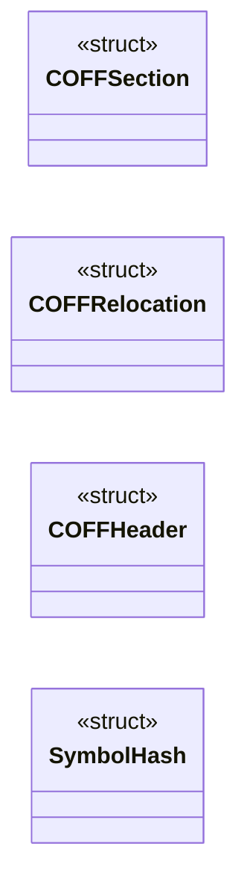

# `COFFLoader3.c`

> Source: [COFFLoader3.c:1](../../COFFLoader3.c#L1) | language `c` | coverage 12.0% | [API index](../index.md)

## Contents

- **Structs:** [`COFFSection`](#coffsection), [`COFFRelocation`](#coffrelocation), [`COFFHeader`](#coffheader), [`SymbolHash`](#symbolhash)
- **Functions:** [`handle_relocation`](#handle_relocation), [`__attribute__`](#__attribute__), [`RunCOFF`](#runcoff)
- **Macros:** [`IMAGE_REL_AMD64_ABSOLUTE`](#image_rel_amd64_absolute), [`IMAGE_REL_AMD64_ADDR64`](#image_rel_amd64_addr64), [`IMAGE_REL_AMD64_ADDR32`](#image_rel_amd64_addr32), [`IMAGE_REL_AMD64_ADDR32NB`](#image_rel_amd64_addr32nb), [`IMAGE_REL_AMD64_REL32`](#image_rel_amd64_rel32), [`IMAGE_REL_AMD64_REL32_1`](#image_rel_amd64_rel32_1), [`IMAGE_REL_AMD64_REL32_2`](#image_rel_amd64_rel32_2), [`IMAGE_REL_AMD64_REL32_3`](#image_rel_amd64_rel32_3), [`IMAGE_REL_AMD64_REL32_4`](#image_rel_amd64_rel32_4), [`IMAGE_REL_AMD64_REL32_5`](#image_rel_amd64_rel32_5), [`IMAGE_REL_AMD64_SECTION`](#image_rel_amd64_section), [`IMAGE_REL_AMD64_SECREL`](#image_rel_amd64_secrel), [`IMAGE_REL_AMD64_SECREL7`](#image_rel_amd64_secrel7), [`IMAGE_REL_AMD64_TOKEN`](#image_rel_amd64_token), [`IMAGE_REL_AMD64_SREL32`](#image_rel_amd64_srel32), [`IMAGE_REL_AMD64_PAIR`](#image_rel_amd64_pair), [`IMAGE_REL_AMD64_SSPAN32`](#image_rel_amd64_sspan32)
- **Variables:** [`__imp_BeaconPrintf`](#__imp_beaconprintf), [`__imp_BeaconOutput`](#__imp_beaconoutput), [`__imp_BeaconDataParse`](#__imp_beacondataparse), [`__imp_BeaconDataInt`](#__imp_beacondataint), [`__imp_BeaconDataShort`](#__imp_beacondatashort), [`__imp_BeaconDataExtract`](#__imp_beacondataextract), [`__imp_LoadLibraryA`](#__imp_loadlibrarya), [`__imp_LoadLibraryW`](#__imp_loadlibraryw), [`__imp_GetModuleHandleA`](#__imp_getmodulehandlea), [`__imp_GetModuleHandleW`](#__imp_getmodulehandlew), [`__imp_GetProcAddress`](#__imp_getprocaddress), [`__imp_GetLastError`](#__imp_getlasterror), [`__imp_CloseHandle`](#__imp_closehandle), [`__imp_ExitProcess`](#__imp_exitprocess), [`__imp_ExitThread`](#__imp_exitthread), [`__imp_Sleep`](#__imp_sleep), [`__imp_CreateThread`](#__imp_createthread), [`__imp_GetCurrentProcess`](#__imp_getcurrentprocess), [`__imp_GetCurrentProcessId`](#__imp_getcurrentprocessid), [`__imp_GetCurrentThreadId`](#__imp_getcurrentthreadid), [`__imp_GetTickCount`](#__imp_gettickcount), [`__imp_GetTickCount64`](#__imp_gettickcount64), [`__imp_CreateFileA`](#__imp_createfilea), [`__imp_CreateFileW`](#__imp_createfilew), [`__imp_ReadFile`](#__imp_readfile), [`__imp_WriteFile`](#__imp_writefile), [`__imp_SetFilePointer`](#__imp_setfilepointer), [`__imp_SetEndOfFile`](#__imp_setendoffile), [`__imp_DeleteFileA`](#__imp_deletefilea), [`__imp_DeleteFileW`](#__imp_deletefilew), [`__imp_MoveFileA`](#__imp_movefilea), [`__imp_MoveFileW`](#__imp_movefilew), [`__imp_CopyFileA`](#__imp_copyfilea), [`__imp_CopyFileW`](#__imp_copyfilew), [`__imp_GetFileSize`](#__imp_getfilesize), [`__imp_GetFileSizeEx`](#__imp_getfilesizeex), [`__imp_CreateDirectoryA`](#__imp_createdirectorya), [`__imp_CreateDirectoryW`](#__imp_createdirectoryw), [`__imp_RemoveDirectoryA`](#__imp_removedirectorya), [`__imp_RemoveDirectoryW`](#__imp_removedirectoryw), [`__imp_FindFirstFileA`](#__imp_findfirstfilea), [`__imp_FindFirstFileW`](#__imp_findfirstfilew), [`__imp_FindNextFileA`](#__imp_findnextfilea), [`__imp_FindNextFileW`](#__imp_findnextfilew), [`__imp_FindClose`](#__imp_findclose), [`__imp_GetFileAttributesA`](#__imp_getfileattributesa), [`__imp_GetFileAttributesW`](#__imp_getfileattributesw), [`__imp_SetFileAttributesA`](#__imp_setfileattributesa), [`__imp_SetFileAttributesW`](#__imp_setfileattributesw), [`__imp_GetSystemDirectoryA`](#__imp_getsystemdirectorya), [`__imp_GetSystemDirectoryW`](#__imp_getsystemdirectoryw), [`__imp_GetWindowsDirectoryA`](#__imp_getwindowsdirectorya), [`__imp_GetWindowsDirectoryW`](#__imp_getwindowsdirectoryw), [`__imp_GetTempPathA`](#__imp_gettemppatha), [`__imp_GetTempPathW`](#__imp_gettemppathw), [`__imp_GetComputerNameA`](#__imp_getcomputernamea), [`__imp_GetComputerNameW`](#__imp_getcomputernamew), [`__imp_GetUserNameA`](#__imp_getusernamea), [`__imp_GetUserNameW`](#__imp_getusernamew), [`__imp_GetVersionExA`](#__imp_getversionexa), [`__imp_GetVersionExW`](#__imp_getversionexw), [`__imp_GetNativeSystemInfo`](#__imp_getnativesysteminfo), [`__imp_VirtualAlloc`](#__imp_virtualalloc), [`__imp_VirtualFree`](#__imp_virtualfree), [`__imp_VirtualProtect`](#__imp_virtualprotect), [`__imp_VirtualQuery`](#__imp_virtualquery), [`__imp_HeapAlloc`](#__imp_heapalloc), [`__imp_HeapFree`](#__imp_heapfree), [`__imp_LocalAlloc`](#__imp_localalloc), [`__imp_LocalFree`](#__imp_localfree), [`__imp_GlobalAlloc`](#__imp_globalalloc), [`__imp_GlobalFree`](#__imp_globalfree), [`__imp_RtlMoveMemory`](#__imp_rtlmovememory), [`__imp_RtlCopyMemory`](#__imp_rtlcopymemory), [`__imp_RtlFillMemory`](#__imp_rtlfillmemory), [`__imp_RtlZeroMemory`](#__imp_rtlzeromemory), [`__imp_lstrlenA`](#__imp_lstrlena), [`__imp_lstrlenW`](#__imp_lstrlenw), [`__imp_lstrcpyA`](#__imp_lstrcpya), [`__imp_lstrcpyW`](#__imp_lstrcpyw), [`__imp_lstrcatA`](#__imp_lstrcata), [`__imp_lstrcatW`](#__imp_lstrcatw), [`__imp_lstrcmpA`](#__imp_lstrcmpa), [`__imp_lstrcmpW`](#__imp_lstrcmpw), [`__imp_lstrcmpiA`](#__imp_lstrcmpia), [`__imp_lstrcmpiW`](#__imp_lstrcmpiw), [`__imp_MultiByteToWideChar`](#__imp_multibytetowidechar), [`__imp_WideCharToMultiByte`](#__imp_widechartomultibyte), [`__imp_FormatMessageA`](#__imp_formatmessagea), [`__imp_FormatMessageW`](#__imp_formatmessagew), [`__imp_GetEnvironmentVariableA`](#__imp_getenvironmentvariablea), [`__imp_GetEnvironmentVariableW`](#__imp_getenvironmentvariablew), [`__imp_SetEnvironmentVariableA`](#__imp_setenvironmentvariablea), [`__imp_SetEnvironmentVariableW`](#__imp_setenvironmentvariablew), [`__imp_ExpandEnvironmentStringsA`](#__imp_expandenvironmentstringsa), [`__imp_ExpandEnvironmentStringsW`](#__imp_expandenvironmentstringsw), [`__imp_GetCommandLineA`](#__imp_getcommandlinea), [`__imp_GetCommandLineW`](#__imp_getcommandlinew), [`__imp_GetModuleFileNameA`](#__imp_getmodulefilenamea), [`__imp_GetModuleFileNameW`](#__imp_getmodulefilenamew), [`__imp_GetStartupInfoA`](#__imp_getstartupinfoa), [`__imp_GetStartupInfoW`](#__imp_getstartupinfow), [`__imp_FreeLibrary`](#__imp_freelibrary), [`__imp_GetConsoleWindow`](#__imp_getconsolewindow), [`__imp_AllocConsole`](#__imp_allocconsole), [`__imp_FreeConsole`](#__imp_freeconsole), [`__imp_AttachConsole`](#__imp_attachconsole), [`__imp_IsDebuggerPresent`](#__imp_isdebuggerpresent), [`__imp_CheckRemoteDebuggerPresent`](#__imp_checkremotedebuggerpresent), [`__imp_OutputDebugStringA`](#__imp_outputdebugstringa), [`__imp_OutputDebugStringW`](#__imp_outputdebugstringw), [`__imp_OpenProcess`](#__imp_openprocess), [`__imp_OpenProcessToken`](#__imp_openprocesstoken), [`__imp_DuplicateTokenEx`](#__imp_duplicatetokenex), [`__imp_ImpersonateLoggedOnUser`](#__imp_impersonateloggedonuser), [`__imp_RevertToSelf`](#__imp_reverttoself), [`__imp_LookupPrivilegeValueA`](#__imp_lookupprivilegevaluea), [`__imp_LookupPrivilegeValueW`](#__imp_lookupprivilegevaluew), [`__imp_AdjustTokenPrivileges`](#__imp_adjusttokenprivileges), [`__imp_CreateProcessAsUserA`](#__imp_createprocessasusera), [`__imp_CreateProcessAsUserW`](#__imp_createprocessasuserw), [`__imp_RegOpenKeyExA`](#__imp_regopenkeyexa), [`__imp_RegOpenKeyExW`](#__imp_regopenkeyexw), [`__imp_RegCreateKeyExA`](#__imp_regcreatekeyexa), [`__imp_RegCreateKeyExW`](#__imp_regcreatekeyexw), [`__imp_RegSetValueExA`](#__imp_regsetvalueexa), [`__imp_RegSetValueExW`](#__imp_regsetvalueexw), [`__imp_RegQueryValueExA`](#__imp_regqueryvalueexa), [`__imp_RegQueryValueExW`](#__imp_regqueryvalueexw), [`__imp_RegDeleteValueA`](#__imp_regdeletevaluea), [`__imp_RegDeleteValueW`](#__imp_regdeletevaluew), [`__imp_RegCloseKey`](#__imp_regclosekey), [`__imp_RegEnumKeyExA`](#__imp_regenumkeyexa), [`__imp_RegEnumKeyExW`](#__imp_regenumkeyexw), [`__imp_RegEnumValueA`](#__imp_regenumvaluea), [`__imp_RegEnumValueW`](#__imp_regenumvaluew), [`__imp_CryptAcquireContextA`](#__imp_cryptacquirecontexta), [`__imp_CryptAcquireContextW`](#__imp_cryptacquirecontextw), [`__imp_CryptCreateHash`](#__imp_cryptcreatehash), [`__imp_CryptHashData`](#__imp_crypthashdata), [`__imp_CryptDeriveKey`](#__imp_cryptderivekey), [`__imp_CryptEncrypt`](#__imp_cryptencrypt), [`__imp_CryptDecrypt`](#__imp_cryptdecrypt), [`__imp_CryptReleaseContext`](#__imp_cryptreleasecontext), [`__imp_CryptDestroyHash`](#__imp_cryptdestroyhash), [`__imp_CryptDestroyKey`](#__imp_cryptdestroykey), [`__imp_CryptGenRandom`](#__imp_cryptgenrandom), [`__imp_CoInitializeEx`](#__imp_coinitializeex), [`__imp_CoUninitialize`](#__imp_couninitialize), [`__imp_CoCreateInstance`](#__imp_cocreateinstance), [`__imp_CoTaskMemFree`](#__imp_cotaskmemfree), [`__imp_IIDFromString`](#__imp_iidfromstring), [`__imp_StringFromGUID2`](#__imp_stringfromguid2), [`__imp_VariantInit`](#__imp_variantinit), [`__imp_VariantClear`](#__imp_variantclear), [`__imp_VariantChangeType`](#__imp_variantchangetype), [`__imp_SysAllocString`](#__imp_sysallocstring), [`__imp_SysFreeString`](#__imp_sysfreestring), [`__imp_SysStringLen`](#__imp_sysstringlen), [`__imp_SHGetFolderPathA`](#__imp_shgetfolderpatha), [`__imp_SHGetFolderPathW`](#__imp_shgetfolderpathw), [`__imp_SHGetKnownFolderPath`](#__imp_shgetknownfolderpath), [`__imp_PathFileExistsA`](#__imp_pathfileexistsa), [`__imp_PathFileExistsW`](#__imp_pathfileexistsw), [`__imp_PathCombineA`](#__imp_pathcombinea), [`__imp_PathCombineW`](#__imp_pathcombinew), [`__imp_GetDesktopWindow`](#__imp_getdesktopwindow), [`__imp_GetShellWindow`](#__imp_getshellwindow), [`__imp_FindWindowA`](#__imp_findwindowa), [`__imp_FindWindowW`](#__imp_findwindoww), [`__imp_EnumWindows`](#__imp_enumwindows), [`__imp_GetWindowTextA`](#__imp_getwindowtexta), [`__imp_GetWindowTextW`](#__imp_getwindowtextw), [`__imp_GetClassNameA`](#__imp_getclassnamea), [`__imp_GetClassNameW`](#__imp_getclassnamew), [`__imp_SendMessageA`](#__imp_sendmessagea), [`__imp_SendMessageW`](#__imp_sendmessagew), [`__imp_EnumProcesses`](#__imp_enumprocesses), [`__imp_EnumProcessModules`](#__imp_enumprocessmodules), [`__imp_GetModuleBaseNameA`](#__imp_getmodulebasenamea), [`__imp_GetModuleBaseNameW`](#__imp_getmodulebasenamew), [`__imp_GetModuleInformation`](#__imp_getmoduleinformation), [`__imp_WSASocketA`](#__imp_wsasocketa), [`__imp_WSASocketW`](#__imp_wsasocketw), [`__imp_WSAStartup`](#__imp_wsastartup), [`__imp_WSACleanup`](#__imp_wsacleanup), [`__imp_bind`](#__imp_bind), [`__imp_listen`](#__imp_listen), [`__imp_accept`](#__imp_accept), [`__imp_connect`](#__imp_connect), [`__imp_send`](#__imp_send), [`__imp_recv`](#__imp_recv), [`__imp_closesocket`](#__imp_closesocket), [`__imp_ioctlsocket`](#__imp_ioctlsocket), [`__imp_gethostname`](#__imp_gethostname), [`__imp_gethostbyname`](#__imp_gethostbyname), [`__imp_getaddrinfo`](#__imp_getaddrinfo), [`__imp_freeaddrinfo`](#__imp_freeaddrinfo), [`__imp_htons`](#__imp_htons), [`__imp_ntohs`](#__imp_ntohs), [`__imp_htonl`](#__imp_htonl), [`__imp_ntohl`](#__imp_ntohl), [`__imp_NetUserEnum`](#__imp_netuserenum), [`__imp_NetLocalGroupEnum`](#__imp_netlocalgroupenum), [`__imp_NetShareEnum`](#__imp_netshareenum), [`__imp_NetWkstaUserEnum`](#__imp_netwkstauserenum), [`__imp_NetSessionEnum`](#__imp_netsessionenum), [`__imp_NetApiBufferFree`](#__imp_netapibufferfree), [`__imp_WNetOpenEnumA`](#__imp_wnetopenenuma), [`__imp_WNetOpenEnumW`](#__imp_wnetopenenumw), [`__imp_WNetEnumResourceA`](#__imp_wnetenumresourcea), [`__imp_WNetEnumResourceW`](#__imp_wnetenumresourcew), [`__imp_WNetCloseEnum`](#__imp_wnetcloseenum), [`__imp__stricmp`](#__imp__stricmp), [`__imp_Process32Next`](#__imp_process32next), [`__imp_IsWow64Process`](#__imp_iswow64process), [`__imp_Process32First`](#__imp_process32first), [`__imp_CreateToolhelp32Snapshot`](#__imp_createtoolhelp32snapshot), [`__imp_select`](#__imp_select), [`__imp_CreateProcessA`](#__imp_createprocessa), [`__imp_CreateProcessW`](#__imp_createprocessw), [`__imp_SuspendThread`](#__imp_suspendthread), [`__imp_OpenThread`](#__imp_openthread), [`__imp_Thread32First`](#__imp_thread32first), [`__imp_Thread32Next`](#__imp_thread32next), [`__imp_NtQueryInformationThread`](#__imp_ntqueryinformationthread), [`g_pNtCreateFileUnhooked`](#g_pntcreatefileunhooked), [`g_pNtWriteVirtualMemoryUnhooked`](#g_pntwritevirtualmemoryunhooked), [`g_pNtProtectVirtualMemoryUnhooked`](#g_pntprotectvirtualmemoryunhooked), [`g_pNtResumeThreadUnhooked`](#g_pntresumethreadunhooked), [`g_pNtCreateThreadExUnhooked`](#g_pntcreatethreadexunhooked)

## Type Diagram



## Call Graph

Solid arrows stay in this module, dashed arrows leave it.


## Structs

<a id="coffsection"></a>

### `COFFSection`

`struct` | [COFFLoader3.c:586](../../COFFLoader3.c#L586)

```c
typedef struct
```

---

<a id="coffrelocation"></a>

### `COFFRelocation`

`struct` | [COFFLoader3.c:599](../../COFFLoader3.c#L599)

```c
typedef struct
```

---

<a id="coffheader"></a>

### `COFFHeader`

`struct` | [COFFLoader3.c:620](../../COFFLoader3.c#L620)

```c
typedef struct
```

---

<a id="symbolhash"></a>

### `SymbolHash`

`struct` | [COFFLoader3.c:642](../../COFFLoader3.c#L642)

```c
typedef struct
```

=== Tabla de símbolos por hash ===

---

## Functions

<a id="handle_relocation"></a>

### `handle_relocation`

`function` | [COFFLoader3.c:940](../../COFFLoader3.c#L940)

```c
BOOL handle_relocation(COFFRelocation* rel, void* patch_addr, void* target, void** sections, const char* sym_name, void* base_addr)
```

**Parameters**

| Name | Type | Default | Description |
|---|---|---|---|
| `rel` | `COFFRelocation*` |  |  |
| `patch_addr` | `void*` |  |  |
| `target` | `void*` |  |  |
| `sections` | `void**` |  |  |
| `sym_name` | `char*` |  |  |
| `base_addr` | `void*` |  |  |

**Returns:** `BOOL`

*Calls:* [`IMAGE_REL_AMD64_ABSOLUTE`](#image_rel_amd64_absolute)

*Called by:* [`RunCOFF`](#runcoff)

---

<a id="__attribute__"></a>

### `__attribute__`

`function` | [COFFLoader3.c:1103](../../COFFLoader3.c#L1103)

```c
__attribute__((noinline)) static void call_go_aligned(void* func, char* arg1, int arg2)
```

**Parameters**

| Name | Type | Default | Description |
|---|---|---|---|
| `noinline` |  |  |  |

---

<a id="runcoff"></a>

### `RunCOFF`

`function` | [COFFLoader3.c:1112](../../COFFLoader3.c#L1112)

```c
int RunCOFF(const char* functionname, unsigned char* coff_data, uint32_t filesize, unsigned char* argumentdata, int argumentSize)
```

=== Cargador COFF  ===

**Parameters**

| Name | Type | Default | Description |
|---|---|---|---|
| `functionname` | `char*` |  |  |
| `coff_data` | `unsigned char*` |  |  |
| `filesize` | `uint32_t` |  |  |
| `argumentdata` | `unsigned char*` |  |  |
| `argumentSize` | `int` |  |  |

**Returns:** `int`

*Calls:* [`handle_relocation`](#handle_relocation)

---

## Macros

<a id="image_rel_amd64_absolute"></a>

### `IMAGE_REL_AMD64_ABSOLUTE`

`macro` | [COFFLoader3.c:568](../../COFFLoader3.c#L568)

```c
#define IMAGE_REL_AMD64_ABSOLUTE
```

Definiciones completas de relocaciones x64

*Called by:* [`handle_relocation`](#handle_relocation)

---

<a id="image_rel_amd64_addr64"></a>

### `IMAGE_REL_AMD64_ADDR64`

`macro` | [COFFLoader3.c:569](../../COFFLoader3.c#L569)

```c
#define IMAGE_REL_AMD64_ADDR64
```

---

<a id="image_rel_amd64_addr32"></a>

### `IMAGE_REL_AMD64_ADDR32`

`macro` | [COFFLoader3.c:570](../../COFFLoader3.c#L570)

```c
#define IMAGE_REL_AMD64_ADDR32
```

---

<a id="image_rel_amd64_addr32nb"></a>

### `IMAGE_REL_AMD64_ADDR32NB`

`macro` | [COFFLoader3.c:571](../../COFFLoader3.c#L571)

```c
#define IMAGE_REL_AMD64_ADDR32NB
```

---

<a id="image_rel_amd64_rel32"></a>

### `IMAGE_REL_AMD64_REL32`

`macro` | [COFFLoader3.c:572](../../COFFLoader3.c#L572)

```c
#define IMAGE_REL_AMD64_REL32
```

---

<a id="image_rel_amd64_rel32_1"></a>

### `IMAGE_REL_AMD64_REL32_1`

`macro` | [COFFLoader3.c:573](../../COFFLoader3.c#L573)

```c
#define IMAGE_REL_AMD64_REL32_1
```

---

<a id="image_rel_amd64_rel32_2"></a>

### `IMAGE_REL_AMD64_REL32_2`

`macro` | [COFFLoader3.c:574](../../COFFLoader3.c#L574)

```c
#define IMAGE_REL_AMD64_REL32_2
```

---

<a id="image_rel_amd64_rel32_3"></a>

### `IMAGE_REL_AMD64_REL32_3`

`macro` | [COFFLoader3.c:575](../../COFFLoader3.c#L575)

```c
#define IMAGE_REL_AMD64_REL32_3
```

---

<a id="image_rel_amd64_rel32_4"></a>

### `IMAGE_REL_AMD64_REL32_4`

`macro` | [COFFLoader3.c:576](../../COFFLoader3.c#L576)

```c
#define IMAGE_REL_AMD64_REL32_4
```

---

<a id="image_rel_amd64_rel32_5"></a>

### `IMAGE_REL_AMD64_REL32_5`

`macro` | [COFFLoader3.c:577](../../COFFLoader3.c#L577)

```c
#define IMAGE_REL_AMD64_REL32_5
```

---

<a id="image_rel_amd64_section"></a>

### `IMAGE_REL_AMD64_SECTION`

`macro` | [COFFLoader3.c:578](../../COFFLoader3.c#L578)

```c
#define IMAGE_REL_AMD64_SECTION
```

---

<a id="image_rel_amd64_secrel"></a>

### `IMAGE_REL_AMD64_SECREL`

`macro` | [COFFLoader3.c:579](../../COFFLoader3.c#L579)

```c
#define IMAGE_REL_AMD64_SECREL
```

---

<a id="image_rel_amd64_secrel7"></a>

### `IMAGE_REL_AMD64_SECREL7`

`macro` | [COFFLoader3.c:580](../../COFFLoader3.c#L580)

```c
#define IMAGE_REL_AMD64_SECREL7
```

---

<a id="image_rel_amd64_token"></a>

### `IMAGE_REL_AMD64_TOKEN`

`macro` | [COFFLoader3.c:581](../../COFFLoader3.c#L581)

```c
#define IMAGE_REL_AMD64_TOKEN
```

---

<a id="image_rel_amd64_srel32"></a>

### `IMAGE_REL_AMD64_SREL32`

`macro` | [COFFLoader3.c:582](../../COFFLoader3.c#L582)

```c
#define IMAGE_REL_AMD64_SREL32
```

---

<a id="image_rel_amd64_pair"></a>

### `IMAGE_REL_AMD64_PAIR`

`macro` | [COFFLoader3.c:583](../../COFFLoader3.c#L583)

```c
#define IMAGE_REL_AMD64_PAIR
```

---

<a id="image_rel_amd64_sspan32"></a>

### `IMAGE_REL_AMD64_SSPAN32`

`macro` | [COFFLoader3.c:584](../../COFFLoader3.c#L584)

```c
#define IMAGE_REL_AMD64_SSPAN32
```

---

## Variables

<a id="__imp_beaconprintf"></a>

### `__imp_BeaconPrintf`

`variable` `extern` | [COFFLoader3.c:332](../../COFFLoader3.c#L332)

```c
extern PVOID __imp_BeaconPrintf;
```

---

<a id="__imp_beaconoutput"></a>

### `__imp_BeaconOutput`

`variable` `extern` | [COFFLoader3.c:333](../../COFFLoader3.c#L333)

```c
extern PVOID __imp_BeaconOutput;
```

---

<a id="__imp_beacondataparse"></a>

### `__imp_BeaconDataParse`

`variable` `extern` | [COFFLoader3.c:334](../../COFFLoader3.c#L334)

```c
extern PVOID __imp_BeaconDataParse;
```

---

<a id="__imp_beacondataint"></a>

### `__imp_BeaconDataInt`

`variable` `extern` | [COFFLoader3.c:335](../../COFFLoader3.c#L335)

```c
extern PVOID __imp_BeaconDataInt;
```

---

<a id="__imp_beacondatashort"></a>

### `__imp_BeaconDataShort`

`variable` `extern` | [COFFLoader3.c:336](../../COFFLoader3.c#L336)

```c
extern PVOID __imp_BeaconDataShort;
```

---

<a id="__imp_beacondataextract"></a>

### `__imp_BeaconDataExtract`

`variable` `extern` | [COFFLoader3.c:337](../../COFFLoader3.c#L337)

```c
extern PVOID __imp_BeaconDataExtract;
```

---

<a id="__imp_loadlibrarya"></a>

### `__imp_LoadLibraryA`

`variable` `extern` | [COFFLoader3.c:338](../../COFFLoader3.c#L338)

```c
extern PVOID __imp_LoadLibraryA;
```

---

<a id="__imp_loadlibraryw"></a>

### `__imp_LoadLibraryW`

`variable` `extern` | [COFFLoader3.c:339](../../COFFLoader3.c#L339)

```c
extern PVOID __imp_LoadLibraryW;
```

---

<a id="__imp_getmodulehandlea"></a>

### `__imp_GetModuleHandleA`

`variable` `extern` | [COFFLoader3.c:340](../../COFFLoader3.c#L340)

```c
extern PVOID __imp_GetModuleHandleA;
```

---

<a id="__imp_getmodulehandlew"></a>

### `__imp_GetModuleHandleW`

`variable` `extern` | [COFFLoader3.c:341](../../COFFLoader3.c#L341)

```c
extern PVOID __imp_GetModuleHandleW;
```

---

<a id="__imp_getprocaddress"></a>

### `__imp_GetProcAddress`

`variable` `extern` | [COFFLoader3.c:342](../../COFFLoader3.c#L342)

```c
extern PVOID __imp_GetProcAddress;
```

---

<a id="__imp_getlasterror"></a>

### `__imp_GetLastError`

`variable` `extern` | [COFFLoader3.c:343](../../COFFLoader3.c#L343)

```c
extern PVOID __imp_GetLastError;
```

---

<a id="__imp_closehandle"></a>

### `__imp_CloseHandle`

`variable` `extern` | [COFFLoader3.c:344](../../COFFLoader3.c#L344)

```c
extern PVOID __imp_CloseHandle;
```

---

<a id="__imp_exitprocess"></a>

### `__imp_ExitProcess`

`variable` `extern` | [COFFLoader3.c:345](../../COFFLoader3.c#L345)

```c
extern PVOID __imp_ExitProcess;
```

---

<a id="__imp_exitthread"></a>

### `__imp_ExitThread`

`variable` `extern` | [COFFLoader3.c:346](../../COFFLoader3.c#L346)

```c
extern PVOID __imp_ExitThread;
```

---

<a id="__imp_sleep"></a>

### `__imp_Sleep`

`variable` `extern` | [COFFLoader3.c:347](../../COFFLoader3.c#L347)

```c
extern PVOID __imp_Sleep;
```

---

<a id="__imp_createthread"></a>

### `__imp_CreateThread`

`variable` `extern` | [COFFLoader3.c:348](../../COFFLoader3.c#L348)

```c
extern PVOID __imp_CreateThread;
```

---

<a id="__imp_getcurrentprocess"></a>

### `__imp_GetCurrentProcess`

`variable` `extern` | [COFFLoader3.c:349](../../COFFLoader3.c#L349)

```c
extern PVOID __imp_GetCurrentProcess;
```

---

<a id="__imp_getcurrentprocessid"></a>

### `__imp_GetCurrentProcessId`

`variable` `extern` | [COFFLoader3.c:350](../../COFFLoader3.c#L350)

```c
extern PVOID __imp_GetCurrentProcessId;
```

---

<a id="__imp_getcurrentthreadid"></a>

### `__imp_GetCurrentThreadId`

`variable` `extern` | [COFFLoader3.c:351](../../COFFLoader3.c#L351)

```c
extern PVOID __imp_GetCurrentThreadId;
```

---

<a id="__imp_gettickcount"></a>

### `__imp_GetTickCount`

`variable` `extern` | [COFFLoader3.c:352](../../COFFLoader3.c#L352)

```c
extern PVOID __imp_GetTickCount;
```

---

<a id="__imp_gettickcount64"></a>

### `__imp_GetTickCount64`

`variable` `extern` | [COFFLoader3.c:353](../../COFFLoader3.c#L353)

```c
extern PVOID __imp_GetTickCount64;
```

---

<a id="__imp_createfilea"></a>

### `__imp_CreateFileA`

`variable` `extern` | [COFFLoader3.c:354](../../COFFLoader3.c#L354)

```c
extern PVOID __imp_CreateFileA;
```

---

<a id="__imp_createfilew"></a>

### `__imp_CreateFileW`

`variable` `extern` | [COFFLoader3.c:355](../../COFFLoader3.c#L355)

```c
extern PVOID __imp_CreateFileW;
```

---

<a id="__imp_readfile"></a>

### `__imp_ReadFile`

`variable` `extern` | [COFFLoader3.c:356](../../COFFLoader3.c#L356)

```c
extern PVOID __imp_ReadFile;
```

---

<a id="__imp_writefile"></a>

### `__imp_WriteFile`

`variable` `extern` | [COFFLoader3.c:357](../../COFFLoader3.c#L357)

```c
extern PVOID __imp_WriteFile;
```

---

<a id="__imp_setfilepointer"></a>

### `__imp_SetFilePointer`

`variable` `extern` | [COFFLoader3.c:358](../../COFFLoader3.c#L358)

```c
extern PVOID __imp_SetFilePointer;
```

---

<a id="__imp_setendoffile"></a>

### `__imp_SetEndOfFile`

`variable` `extern` | [COFFLoader3.c:359](../../COFFLoader3.c#L359)

```c
extern PVOID __imp_SetEndOfFile;
```

---

<a id="__imp_deletefilea"></a>

### `__imp_DeleteFileA`

`variable` `extern` | [COFFLoader3.c:360](../../COFFLoader3.c#L360)

```c
extern PVOID __imp_DeleteFileA;
```

---

<a id="__imp_deletefilew"></a>

### `__imp_DeleteFileW`

`variable` `extern` | [COFFLoader3.c:361](../../COFFLoader3.c#L361)

```c
extern PVOID __imp_DeleteFileW;
```

---

<a id="__imp_movefilea"></a>

### `__imp_MoveFileA`

`variable` `extern` | [COFFLoader3.c:362](../../COFFLoader3.c#L362)

```c
extern PVOID __imp_MoveFileA;
```

---

<a id="__imp_movefilew"></a>

### `__imp_MoveFileW`

`variable` `extern` | [COFFLoader3.c:363](../../COFFLoader3.c#L363)

```c
extern PVOID __imp_MoveFileW;
```

---

<a id="__imp_copyfilea"></a>

### `__imp_CopyFileA`

`variable` `extern` | [COFFLoader3.c:364](../../COFFLoader3.c#L364)

```c
extern PVOID __imp_CopyFileA;
```

---

<a id="__imp_copyfilew"></a>

### `__imp_CopyFileW`

`variable` `extern` | [COFFLoader3.c:365](../../COFFLoader3.c#L365)

```c
extern PVOID __imp_CopyFileW;
```

---

<a id="__imp_getfilesize"></a>

### `__imp_GetFileSize`

`variable` `extern` | [COFFLoader3.c:366](../../COFFLoader3.c#L366)

```c
extern PVOID __imp_GetFileSize;
```

---

<a id="__imp_getfilesizeex"></a>

### `__imp_GetFileSizeEx`

`variable` `extern` | [COFFLoader3.c:367](../../COFFLoader3.c#L367)

```c
extern PVOID __imp_GetFileSizeEx;
```

---

<a id="__imp_createdirectorya"></a>

### `__imp_CreateDirectoryA`

`variable` `extern` | [COFFLoader3.c:368](../../COFFLoader3.c#L368)

```c
extern PVOID __imp_CreateDirectoryA;
```

---

<a id="__imp_createdirectoryw"></a>

### `__imp_CreateDirectoryW`

`variable` `extern` | [COFFLoader3.c:369](../../COFFLoader3.c#L369)

```c
extern PVOID __imp_CreateDirectoryW;
```

---

<a id="__imp_removedirectorya"></a>

### `__imp_RemoveDirectoryA`

`variable` `extern` | [COFFLoader3.c:370](../../COFFLoader3.c#L370)

```c
extern PVOID __imp_RemoveDirectoryA;
```

---

<a id="__imp_removedirectoryw"></a>

### `__imp_RemoveDirectoryW`

`variable` `extern` | [COFFLoader3.c:371](../../COFFLoader3.c#L371)

```c
extern PVOID __imp_RemoveDirectoryW;
```

---

<a id="__imp_findfirstfilea"></a>

### `__imp_FindFirstFileA`

`variable` `extern` | [COFFLoader3.c:372](../../COFFLoader3.c#L372)

```c
extern PVOID __imp_FindFirstFileA;
```

---

<a id="__imp_findfirstfilew"></a>

### `__imp_FindFirstFileW`

`variable` `extern` | [COFFLoader3.c:373](../../COFFLoader3.c#L373)

```c
extern PVOID __imp_FindFirstFileW;
```

---

<a id="__imp_findnextfilea"></a>

### `__imp_FindNextFileA`

`variable` `extern` | [COFFLoader3.c:374](../../COFFLoader3.c#L374)

```c
extern PVOID __imp_FindNextFileA;
```

---

<a id="__imp_findnextfilew"></a>

### `__imp_FindNextFileW`

`variable` `extern` | [COFFLoader3.c:375](../../COFFLoader3.c#L375)

```c
extern PVOID __imp_FindNextFileW;
```

---

<a id="__imp_findclose"></a>

### `__imp_FindClose`

`variable` `extern` | [COFFLoader3.c:376](../../COFFLoader3.c#L376)

```c
extern PVOID __imp_FindClose;
```

---

<a id="__imp_getfileattributesa"></a>

### `__imp_GetFileAttributesA`

`variable` `extern` | [COFFLoader3.c:377](../../COFFLoader3.c#L377)

```c
extern PVOID __imp_GetFileAttributesA;
```

---

<a id="__imp_getfileattributesw"></a>

### `__imp_GetFileAttributesW`

`variable` `extern` | [COFFLoader3.c:378](../../COFFLoader3.c#L378)

```c
extern PVOID __imp_GetFileAttributesW;
```

---

<a id="__imp_setfileattributesa"></a>

### `__imp_SetFileAttributesA`

`variable` `extern` | [COFFLoader3.c:379](../../COFFLoader3.c#L379)

```c
extern PVOID __imp_SetFileAttributesA;
```

---

<a id="__imp_setfileattributesw"></a>

### `__imp_SetFileAttributesW`

`variable` `extern` | [COFFLoader3.c:380](../../COFFLoader3.c#L380)

```c
extern PVOID __imp_SetFileAttributesW;
```

---

<a id="__imp_getsystemdirectorya"></a>

### `__imp_GetSystemDirectoryA`

`variable` `extern` | [COFFLoader3.c:381](../../COFFLoader3.c#L381)

```c
extern PVOID __imp_GetSystemDirectoryA;
```

---

<a id="__imp_getsystemdirectoryw"></a>

### `__imp_GetSystemDirectoryW`

`variable` `extern` | [COFFLoader3.c:382](../../COFFLoader3.c#L382)

```c
extern PVOID __imp_GetSystemDirectoryW;
```

---

<a id="__imp_getwindowsdirectorya"></a>

### `__imp_GetWindowsDirectoryA`

`variable` `extern` | [COFFLoader3.c:383](../../COFFLoader3.c#L383)

```c
extern PVOID __imp_GetWindowsDirectoryA;
```

---

<a id="__imp_getwindowsdirectoryw"></a>

### `__imp_GetWindowsDirectoryW`

`variable` `extern` | [COFFLoader3.c:384](../../COFFLoader3.c#L384)

```c
extern PVOID __imp_GetWindowsDirectoryW;
```

---

<a id="__imp_gettemppatha"></a>

### `__imp_GetTempPathA`

`variable` `extern` | [COFFLoader3.c:385](../../COFFLoader3.c#L385)

```c
extern PVOID __imp_GetTempPathA;
```

---

<a id="__imp_gettemppathw"></a>

### `__imp_GetTempPathW`

`variable` `extern` | [COFFLoader3.c:386](../../COFFLoader3.c#L386)

```c
extern PVOID __imp_GetTempPathW;
```

---

<a id="__imp_getcomputernamea"></a>

### `__imp_GetComputerNameA`

`variable` `extern` | [COFFLoader3.c:387](../../COFFLoader3.c#L387)

```c
extern PVOID __imp_GetComputerNameA;
```

---

<a id="__imp_getcomputernamew"></a>

### `__imp_GetComputerNameW`

`variable` `extern` | [COFFLoader3.c:388](../../COFFLoader3.c#L388)

```c
extern PVOID __imp_GetComputerNameW;
```

---

<a id="__imp_getusernamea"></a>

### `__imp_GetUserNameA`

`variable` `extern` | [COFFLoader3.c:389](../../COFFLoader3.c#L389)

```c
extern PVOID __imp_GetUserNameA;
```

---

<a id="__imp_getusernamew"></a>

### `__imp_GetUserNameW`

`variable` `extern` | [COFFLoader3.c:390](../../COFFLoader3.c#L390)

```c
extern PVOID __imp_GetUserNameW;
```

---

<a id="__imp_getversionexa"></a>

### `__imp_GetVersionExA`

`variable` `extern` | [COFFLoader3.c:391](../../COFFLoader3.c#L391)

```c
extern PVOID __imp_GetVersionExA;
```

---

<a id="__imp_getversionexw"></a>

### `__imp_GetVersionExW`

`variable` `extern` | [COFFLoader3.c:392](../../COFFLoader3.c#L392)

```c
extern PVOID __imp_GetVersionExW;
```

---

<a id="__imp_getnativesysteminfo"></a>

### `__imp_GetNativeSystemInfo`

`variable` `extern` | [COFFLoader3.c:393](../../COFFLoader3.c#L393)

```c
extern PVOID __imp_GetNativeSystemInfo;
```

---

<a id="__imp_virtualalloc"></a>

### `__imp_VirtualAlloc`

`variable` `extern` | [COFFLoader3.c:394](../../COFFLoader3.c#L394)

```c
extern PVOID __imp_VirtualAlloc;
```

---

<a id="__imp_virtualfree"></a>

### `__imp_VirtualFree`

`variable` `extern` | [COFFLoader3.c:395](../../COFFLoader3.c#L395)

```c
extern PVOID __imp_VirtualFree;
```

---

<a id="__imp_virtualprotect"></a>

### `__imp_VirtualProtect`

`variable` `extern` | [COFFLoader3.c:396](../../COFFLoader3.c#L396)

```c
extern PVOID __imp_VirtualProtect;
```

---

<a id="__imp_virtualquery"></a>

### `__imp_VirtualQuery`

`variable` `extern` | [COFFLoader3.c:397](../../COFFLoader3.c#L397)

```c
extern PVOID __imp_VirtualQuery;
```

---

<a id="__imp_heapalloc"></a>

### `__imp_HeapAlloc`

`variable` `extern` | [COFFLoader3.c:398](../../COFFLoader3.c#L398)

```c
extern PVOID __imp_HeapAlloc;
```

---

<a id="__imp_heapfree"></a>

### `__imp_HeapFree`

`variable` `extern` | [COFFLoader3.c:399](../../COFFLoader3.c#L399)

```c
extern PVOID __imp_HeapFree;
```

---

<a id="__imp_localalloc"></a>

### `__imp_LocalAlloc`

`variable` `extern` | [COFFLoader3.c:400](../../COFFLoader3.c#L400)

```c
extern PVOID __imp_LocalAlloc;
```

---

<a id="__imp_localfree"></a>

### `__imp_LocalFree`

`variable` `extern` | [COFFLoader3.c:401](../../COFFLoader3.c#L401)

```c
extern PVOID __imp_LocalFree;
```

---

<a id="__imp_globalalloc"></a>

### `__imp_GlobalAlloc`

`variable` `extern` | [COFFLoader3.c:402](../../COFFLoader3.c#L402)

```c
extern PVOID __imp_GlobalAlloc;
```

---

<a id="__imp_globalfree"></a>

### `__imp_GlobalFree`

`variable` `extern` | [COFFLoader3.c:403](../../COFFLoader3.c#L403)

```c
extern PVOID __imp_GlobalFree;
```

---

<a id="__imp_rtlmovememory"></a>

### `__imp_RtlMoveMemory`

`variable` `extern` | [COFFLoader3.c:404](../../COFFLoader3.c#L404)

```c
extern PVOID __imp_RtlMoveMemory;
```

---

<a id="__imp_rtlcopymemory"></a>

### `__imp_RtlCopyMemory`

`variable` `extern` | [COFFLoader3.c:405](../../COFFLoader3.c#L405)

```c
extern PVOID __imp_RtlCopyMemory;
```

---

<a id="__imp_rtlfillmemory"></a>

### `__imp_RtlFillMemory`

`variable` `extern` | [COFFLoader3.c:406](../../COFFLoader3.c#L406)

```c
extern PVOID __imp_RtlFillMemory;
```

---

<a id="__imp_rtlzeromemory"></a>

### `__imp_RtlZeroMemory`

`variable` `extern` | [COFFLoader3.c:407](../../COFFLoader3.c#L407)

```c
extern PVOID __imp_RtlZeroMemory;
```

---

<a id="__imp_lstrlena"></a>

### `__imp_lstrlenA`

`variable` `extern` | [COFFLoader3.c:408](../../COFFLoader3.c#L408)

```c
extern PVOID __imp_lstrlenA;
```

---

<a id="__imp_lstrlenw"></a>

### `__imp_lstrlenW`

`variable` `extern` | [COFFLoader3.c:409](../../COFFLoader3.c#L409)

```c
extern PVOID __imp_lstrlenW;
```

---

<a id="__imp_lstrcpya"></a>

### `__imp_lstrcpyA`

`variable` `extern` | [COFFLoader3.c:410](../../COFFLoader3.c#L410)

```c
extern PVOID __imp_lstrcpyA;
```

---

<a id="__imp_lstrcpyw"></a>

### `__imp_lstrcpyW`

`variable` `extern` | [COFFLoader3.c:411](../../COFFLoader3.c#L411)

```c
extern PVOID __imp_lstrcpyW;
```

---

<a id="__imp_lstrcata"></a>

### `__imp_lstrcatA`

`variable` `extern` | [COFFLoader3.c:412](../../COFFLoader3.c#L412)

```c
extern PVOID __imp_lstrcatA;
```

---

<a id="__imp_lstrcatw"></a>

### `__imp_lstrcatW`

`variable` `extern` | [COFFLoader3.c:413](../../COFFLoader3.c#L413)

```c
extern PVOID __imp_lstrcatW;
```

---

<a id="__imp_lstrcmpa"></a>

### `__imp_lstrcmpA`

`variable` `extern` | [COFFLoader3.c:414](../../COFFLoader3.c#L414)

```c
extern PVOID __imp_lstrcmpA;
```

---

<a id="__imp_lstrcmpw"></a>

### `__imp_lstrcmpW`

`variable` `extern` | [COFFLoader3.c:415](../../COFFLoader3.c#L415)

```c
extern PVOID __imp_lstrcmpW;
```

---

<a id="__imp_lstrcmpia"></a>

### `__imp_lstrcmpiA`

`variable` `extern` | [COFFLoader3.c:416](../../COFFLoader3.c#L416)

```c
extern PVOID __imp_lstrcmpiA;
```

---

<a id="__imp_lstrcmpiw"></a>

### `__imp_lstrcmpiW`

`variable` `extern` | [COFFLoader3.c:417](../../COFFLoader3.c#L417)

```c
extern PVOID __imp_lstrcmpiW;
```

---

<a id="__imp_multibytetowidechar"></a>

### `__imp_MultiByteToWideChar`

`variable` `extern` | [COFFLoader3.c:418](../../COFFLoader3.c#L418)

```c
extern PVOID __imp_MultiByteToWideChar;
```

---

<a id="__imp_widechartomultibyte"></a>

### `__imp_WideCharToMultiByte`

`variable` `extern` | [COFFLoader3.c:419](../../COFFLoader3.c#L419)

```c
extern PVOID __imp_WideCharToMultiByte;
```

---

<a id="__imp_formatmessagea"></a>

### `__imp_FormatMessageA`

`variable` `extern` | [COFFLoader3.c:420](../../COFFLoader3.c#L420)

```c
extern PVOID __imp_FormatMessageA;
```

---

<a id="__imp_formatmessagew"></a>

### `__imp_FormatMessageW`

`variable` `extern` | [COFFLoader3.c:421](../../COFFLoader3.c#L421)

```c
extern PVOID __imp_FormatMessageW;
```

---

<a id="__imp_getenvironmentvariablea"></a>

### `__imp_GetEnvironmentVariableA`

`variable` `extern` | [COFFLoader3.c:422](../../COFFLoader3.c#L422)

```c
extern PVOID __imp_GetEnvironmentVariableA;
```

---

<a id="__imp_getenvironmentvariablew"></a>

### `__imp_GetEnvironmentVariableW`

`variable` `extern` | [COFFLoader3.c:423](../../COFFLoader3.c#L423)

```c
extern PVOID __imp_GetEnvironmentVariableW;
```

---

<a id="__imp_setenvironmentvariablea"></a>

### `__imp_SetEnvironmentVariableA`

`variable` `extern` | [COFFLoader3.c:424](../../COFFLoader3.c#L424)

```c
extern PVOID __imp_SetEnvironmentVariableA;
```

---

<a id="__imp_setenvironmentvariablew"></a>

### `__imp_SetEnvironmentVariableW`

`variable` `extern` | [COFFLoader3.c:425](../../COFFLoader3.c#L425)

```c
extern PVOID __imp_SetEnvironmentVariableW;
```

---

<a id="__imp_expandenvironmentstringsa"></a>

### `__imp_ExpandEnvironmentStringsA`

`variable` `extern` | [COFFLoader3.c:426](../../COFFLoader3.c#L426)

```c
extern PVOID __imp_ExpandEnvironmentStringsA;
```

---

<a id="__imp_expandenvironmentstringsw"></a>

### `__imp_ExpandEnvironmentStringsW`

`variable` `extern` | [COFFLoader3.c:427](../../COFFLoader3.c#L427)

```c
extern PVOID __imp_ExpandEnvironmentStringsW;
```

---

<a id="__imp_getcommandlinea"></a>

### `__imp_GetCommandLineA`

`variable` `extern` | [COFFLoader3.c:428](../../COFFLoader3.c#L428)

```c
extern PVOID __imp_GetCommandLineA;
```

---

<a id="__imp_getcommandlinew"></a>

### `__imp_GetCommandLineW`

`variable` `extern` | [COFFLoader3.c:429](../../COFFLoader3.c#L429)

```c
extern PVOID __imp_GetCommandLineW;
```

---

<a id="__imp_getmodulefilenamea"></a>

### `__imp_GetModuleFileNameA`

`variable` `extern` | [COFFLoader3.c:430](../../COFFLoader3.c#L430)

```c
extern PVOID __imp_GetModuleFileNameA;
```

---

<a id="__imp_getmodulefilenamew"></a>

### `__imp_GetModuleFileNameW`

`variable` `extern` | [COFFLoader3.c:431](../../COFFLoader3.c#L431)

```c
extern PVOID __imp_GetModuleFileNameW;
```

---

<a id="__imp_getstartupinfoa"></a>

### `__imp_GetStartupInfoA`

`variable` `extern` | [COFFLoader3.c:432](../../COFFLoader3.c#L432)

```c
extern PVOID __imp_GetStartupInfoA;
```

---

<a id="__imp_getstartupinfow"></a>

### `__imp_GetStartupInfoW`

`variable` `extern` | [COFFLoader3.c:433](../../COFFLoader3.c#L433)

```c
extern PVOID __imp_GetStartupInfoW;
```

---

<a id="__imp_freelibrary"></a>

### `__imp_FreeLibrary`

`variable` `extern` | [COFFLoader3.c:434](../../COFFLoader3.c#L434)

```c
extern PVOID __imp_FreeLibrary;
```

---

<a id="__imp_getconsolewindow"></a>

### `__imp_GetConsoleWindow`

`variable` `extern` | [COFFLoader3.c:435](../../COFFLoader3.c#L435)

```c
extern PVOID __imp_GetConsoleWindow;
```

---

<a id="__imp_allocconsole"></a>

### `__imp_AllocConsole`

`variable` `extern` | [COFFLoader3.c:436](../../COFFLoader3.c#L436)

```c
extern PVOID __imp_AllocConsole;
```

---

<a id="__imp_freeconsole"></a>

### `__imp_FreeConsole`

`variable` `extern` | [COFFLoader3.c:437](../../COFFLoader3.c#L437)

```c
extern PVOID __imp_FreeConsole;
```

---

<a id="__imp_attachconsole"></a>

### `__imp_AttachConsole`

`variable` `extern` | [COFFLoader3.c:438](../../COFFLoader3.c#L438)

```c
extern PVOID __imp_AttachConsole;
```

---

<a id="__imp_isdebuggerpresent"></a>

### `__imp_IsDebuggerPresent`

`variable` `extern` | [COFFLoader3.c:439](../../COFFLoader3.c#L439)

```c
extern PVOID __imp_IsDebuggerPresent;
```

---

<a id="__imp_checkremotedebuggerpresent"></a>

### `__imp_CheckRemoteDebuggerPresent`

`variable` `extern` | [COFFLoader3.c:440](../../COFFLoader3.c#L440)

```c
extern PVOID __imp_CheckRemoteDebuggerPresent;
```

---

<a id="__imp_outputdebugstringa"></a>

### `__imp_OutputDebugStringA`

`variable` `extern` | [COFFLoader3.c:441](../../COFFLoader3.c#L441)

```c
extern PVOID __imp_OutputDebugStringA;
```

---

<a id="__imp_outputdebugstringw"></a>

### `__imp_OutputDebugStringW`

`variable` `extern` | [COFFLoader3.c:442](../../COFFLoader3.c#L442)

```c
extern PVOID __imp_OutputDebugStringW;
```

---

<a id="__imp_openprocess"></a>

### `__imp_OpenProcess`

`variable` `extern` | [COFFLoader3.c:443](../../COFFLoader3.c#L443)

```c
extern PVOID __imp_OpenProcess;
```

---

<a id="__imp_openprocesstoken"></a>

### `__imp_OpenProcessToken`

`variable` `extern` | [COFFLoader3.c:444](../../COFFLoader3.c#L444)

```c
extern PVOID __imp_OpenProcessToken;
```

---

<a id="__imp_duplicatetokenex"></a>

### `__imp_DuplicateTokenEx`

`variable` `extern` | [COFFLoader3.c:445](../../COFFLoader3.c#L445)

```c
extern PVOID __imp_DuplicateTokenEx;
```

---

<a id="__imp_impersonateloggedonuser"></a>

### `__imp_ImpersonateLoggedOnUser`

`variable` `extern` | [COFFLoader3.c:446](../../COFFLoader3.c#L446)

```c
extern PVOID __imp_ImpersonateLoggedOnUser;
```

---

<a id="__imp_reverttoself"></a>

### `__imp_RevertToSelf`

`variable` `extern` | [COFFLoader3.c:447](../../COFFLoader3.c#L447)

```c
extern PVOID __imp_RevertToSelf;
```

---

<a id="__imp_lookupprivilegevaluea"></a>

### `__imp_LookupPrivilegeValueA`

`variable` `extern` | [COFFLoader3.c:448](../../COFFLoader3.c#L448)

```c
extern PVOID __imp_LookupPrivilegeValueA;
```

---

<a id="__imp_lookupprivilegevaluew"></a>

### `__imp_LookupPrivilegeValueW`

`variable` `extern` | [COFFLoader3.c:449](../../COFFLoader3.c#L449)

```c
extern PVOID __imp_LookupPrivilegeValueW;
```

---

<a id="__imp_adjusttokenprivileges"></a>

### `__imp_AdjustTokenPrivileges`

`variable` `extern` | [COFFLoader3.c:450](../../COFFLoader3.c#L450)

```c
extern PVOID __imp_AdjustTokenPrivileges;
```

---

<a id="__imp_createprocessasusera"></a>

### `__imp_CreateProcessAsUserA`

`variable` `extern` | [COFFLoader3.c:451](../../COFFLoader3.c#L451)

```c
extern PVOID __imp_CreateProcessAsUserA;
```

---

<a id="__imp_createprocessasuserw"></a>

### `__imp_CreateProcessAsUserW`

`variable` `extern` | [COFFLoader3.c:452](../../COFFLoader3.c#L452)

```c
extern PVOID __imp_CreateProcessAsUserW;
```

---

<a id="__imp_regopenkeyexa"></a>

### `__imp_RegOpenKeyExA`

`variable` `extern` | [COFFLoader3.c:453](../../COFFLoader3.c#L453)

```c
extern PVOID __imp_RegOpenKeyExA;
```

---

<a id="__imp_regopenkeyexw"></a>

### `__imp_RegOpenKeyExW`

`variable` `extern` | [COFFLoader3.c:454](../../COFFLoader3.c#L454)

```c
extern PVOID __imp_RegOpenKeyExW;
```

---

<a id="__imp_regcreatekeyexa"></a>

### `__imp_RegCreateKeyExA`

`variable` `extern` | [COFFLoader3.c:455](../../COFFLoader3.c#L455)

```c
extern PVOID __imp_RegCreateKeyExA;
```

---

<a id="__imp_regcreatekeyexw"></a>

### `__imp_RegCreateKeyExW`

`variable` `extern` | [COFFLoader3.c:456](../../COFFLoader3.c#L456)

```c
extern PVOID __imp_RegCreateKeyExW;
```

---

<a id="__imp_regsetvalueexa"></a>

### `__imp_RegSetValueExA`

`variable` `extern` | [COFFLoader3.c:457](../../COFFLoader3.c#L457)

```c
extern PVOID __imp_RegSetValueExA;
```

---

<a id="__imp_regsetvalueexw"></a>

### `__imp_RegSetValueExW`

`variable` `extern` | [COFFLoader3.c:458](../../COFFLoader3.c#L458)

```c
extern PVOID __imp_RegSetValueExW;
```

---

<a id="__imp_regqueryvalueexa"></a>

### `__imp_RegQueryValueExA`

`variable` `extern` | [COFFLoader3.c:459](../../COFFLoader3.c#L459)

```c
extern PVOID __imp_RegQueryValueExA;
```

---

<a id="__imp_regqueryvalueexw"></a>

### `__imp_RegQueryValueExW`

`variable` `extern` | [COFFLoader3.c:460](../../COFFLoader3.c#L460)

```c
extern PVOID __imp_RegQueryValueExW;
```

---

<a id="__imp_regdeletevaluea"></a>

### `__imp_RegDeleteValueA`

`variable` `extern` | [COFFLoader3.c:461](../../COFFLoader3.c#L461)

```c
extern PVOID __imp_RegDeleteValueA;
```

---

<a id="__imp_regdeletevaluew"></a>

### `__imp_RegDeleteValueW`

`variable` `extern` | [COFFLoader3.c:462](../../COFFLoader3.c#L462)

```c
extern PVOID __imp_RegDeleteValueW;
```

---

<a id="__imp_regclosekey"></a>

### `__imp_RegCloseKey`

`variable` `extern` | [COFFLoader3.c:463](../../COFFLoader3.c#L463)

```c
extern PVOID __imp_RegCloseKey;
```

---

<a id="__imp_regenumkeyexa"></a>

### `__imp_RegEnumKeyExA`

`variable` `extern` | [COFFLoader3.c:464](../../COFFLoader3.c#L464)

```c
extern PVOID __imp_RegEnumKeyExA;
```

---

<a id="__imp_regenumkeyexw"></a>

### `__imp_RegEnumKeyExW`

`variable` `extern` | [COFFLoader3.c:465](../../COFFLoader3.c#L465)

```c
extern PVOID __imp_RegEnumKeyExW;
```

---

<a id="__imp_regenumvaluea"></a>

### `__imp_RegEnumValueA`

`variable` `extern` | [COFFLoader3.c:466](../../COFFLoader3.c#L466)

```c
extern PVOID __imp_RegEnumValueA;
```

---

<a id="__imp_regenumvaluew"></a>

### `__imp_RegEnumValueW`

`variable` `extern` | [COFFLoader3.c:467](../../COFFLoader3.c#L467)

```c
extern PVOID __imp_RegEnumValueW;
```

---

<a id="__imp_cryptacquirecontexta"></a>

### `__imp_CryptAcquireContextA`

`variable` `extern` | [COFFLoader3.c:468](../../COFFLoader3.c#L468)

```c
extern PVOID __imp_CryptAcquireContextA;
```

---

<a id="__imp_cryptacquirecontextw"></a>

### `__imp_CryptAcquireContextW`

`variable` `extern` | [COFFLoader3.c:469](../../COFFLoader3.c#L469)

```c
extern PVOID __imp_CryptAcquireContextW;
```

---

<a id="__imp_cryptcreatehash"></a>

### `__imp_CryptCreateHash`

`variable` `extern` | [COFFLoader3.c:470](../../COFFLoader3.c#L470)

```c
extern PVOID __imp_CryptCreateHash;
```

---

<a id="__imp_crypthashdata"></a>

### `__imp_CryptHashData`

`variable` `extern` | [COFFLoader3.c:471](../../COFFLoader3.c#L471)

```c
extern PVOID __imp_CryptHashData;
```

---

<a id="__imp_cryptderivekey"></a>

### `__imp_CryptDeriveKey`

`variable` `extern` | [COFFLoader3.c:472](../../COFFLoader3.c#L472)

```c
extern PVOID __imp_CryptDeriveKey;
```

---

<a id="__imp_cryptencrypt"></a>

### `__imp_CryptEncrypt`

`variable` `extern` | [COFFLoader3.c:473](../../COFFLoader3.c#L473)

```c
extern PVOID __imp_CryptEncrypt;
```

---

<a id="__imp_cryptdecrypt"></a>

### `__imp_CryptDecrypt`

`variable` `extern` | [COFFLoader3.c:474](../../COFFLoader3.c#L474)

```c
extern PVOID __imp_CryptDecrypt;
```

---

<a id="__imp_cryptreleasecontext"></a>

### `__imp_CryptReleaseContext`

`variable` `extern` | [COFFLoader3.c:475](../../COFFLoader3.c#L475)

```c
extern PVOID __imp_CryptReleaseContext;
```

---

<a id="__imp_cryptdestroyhash"></a>

### `__imp_CryptDestroyHash`

`variable` `extern` | [COFFLoader3.c:476](../../COFFLoader3.c#L476)

```c
extern PVOID __imp_CryptDestroyHash;
```

---

<a id="__imp_cryptdestroykey"></a>

### `__imp_CryptDestroyKey`

`variable` `extern` | [COFFLoader3.c:477](../../COFFLoader3.c#L477)

```c
extern PVOID __imp_CryptDestroyKey;
```

---

<a id="__imp_cryptgenrandom"></a>

### `__imp_CryptGenRandom`

`variable` `extern` | [COFFLoader3.c:478](../../COFFLoader3.c#L478)

```c
extern PVOID __imp_CryptGenRandom;
```

---

<a id="__imp_coinitializeex"></a>

### `__imp_CoInitializeEx`

`variable` `extern` | [COFFLoader3.c:479](../../COFFLoader3.c#L479)

```c
extern PVOID __imp_CoInitializeEx;
```

---

<a id="__imp_couninitialize"></a>

### `__imp_CoUninitialize`

`variable` `extern` | [COFFLoader3.c:480](../../COFFLoader3.c#L480)

```c
extern PVOID __imp_CoUninitialize;
```

---

<a id="__imp_cocreateinstance"></a>

### `__imp_CoCreateInstance`

`variable` `extern` | [COFFLoader3.c:481](../../COFFLoader3.c#L481)

```c
extern PVOID __imp_CoCreateInstance;
```

---

<a id="__imp_cotaskmemfree"></a>

### `__imp_CoTaskMemFree`

`variable` `extern` | [COFFLoader3.c:482](../../COFFLoader3.c#L482)

```c
extern PVOID __imp_CoTaskMemFree;
```

---

<a id="__imp_iidfromstring"></a>

### `__imp_IIDFromString`

`variable` `extern` | [COFFLoader3.c:483](../../COFFLoader3.c#L483)

```c
extern PVOID __imp_IIDFromString;
```

---

<a id="__imp_stringfromguid2"></a>

### `__imp_StringFromGUID2`

`variable` `extern` | [COFFLoader3.c:484](../../COFFLoader3.c#L484)

```c
extern PVOID __imp_StringFromGUID2;
```

---

<a id="__imp_variantinit"></a>

### `__imp_VariantInit`

`variable` `extern` | [COFFLoader3.c:485](../../COFFLoader3.c#L485)

```c
extern PVOID __imp_VariantInit;
```

---

<a id="__imp_variantclear"></a>

### `__imp_VariantClear`

`variable` `extern` | [COFFLoader3.c:486](../../COFFLoader3.c#L486)

```c
extern PVOID __imp_VariantClear;
```

---

<a id="__imp_variantchangetype"></a>

### `__imp_VariantChangeType`

`variable` `extern` | [COFFLoader3.c:487](../../COFFLoader3.c#L487)

```c
extern PVOID __imp_VariantChangeType;
```

---

<a id="__imp_sysallocstring"></a>

### `__imp_SysAllocString`

`variable` `extern` | [COFFLoader3.c:488](../../COFFLoader3.c#L488)

```c
extern PVOID __imp_SysAllocString;
```

---

<a id="__imp_sysfreestring"></a>

### `__imp_SysFreeString`

`variable` `extern` | [COFFLoader3.c:489](../../COFFLoader3.c#L489)

```c
extern PVOID __imp_SysFreeString;
```

---

<a id="__imp_sysstringlen"></a>

### `__imp_SysStringLen`

`variable` `extern` | [COFFLoader3.c:490](../../COFFLoader3.c#L490)

```c
extern PVOID __imp_SysStringLen;
```

---

<a id="__imp_shgetfolderpatha"></a>

### `__imp_SHGetFolderPathA`

`variable` `extern` | [COFFLoader3.c:491](../../COFFLoader3.c#L491)

```c
extern PVOID __imp_SHGetFolderPathA;
```

---

<a id="__imp_shgetfolderpathw"></a>

### `__imp_SHGetFolderPathW`

`variable` `extern` | [COFFLoader3.c:492](../../COFFLoader3.c#L492)

```c
extern PVOID __imp_SHGetFolderPathW;
```

---

<a id="__imp_shgetknownfolderpath"></a>

### `__imp_SHGetKnownFolderPath`

`variable` `extern` | [COFFLoader3.c:493](../../COFFLoader3.c#L493)

```c
extern PVOID __imp_SHGetKnownFolderPath;
```

---

<a id="__imp_pathfileexistsa"></a>

### `__imp_PathFileExistsA`

`variable` `extern` | [COFFLoader3.c:494](../../COFFLoader3.c#L494)

```c
extern PVOID __imp_PathFileExistsA;
```

---

<a id="__imp_pathfileexistsw"></a>

### `__imp_PathFileExistsW`

`variable` `extern` | [COFFLoader3.c:495](../../COFFLoader3.c#L495)

```c
extern PVOID __imp_PathFileExistsW;
```

---

<a id="__imp_pathcombinea"></a>

### `__imp_PathCombineA`

`variable` `extern` | [COFFLoader3.c:496](../../COFFLoader3.c#L496)

```c
extern PVOID __imp_PathCombineA;
```

---

<a id="__imp_pathcombinew"></a>

### `__imp_PathCombineW`

`variable` `extern` | [COFFLoader3.c:497](../../COFFLoader3.c#L497)

```c
extern PVOID __imp_PathCombineW;
```

---

<a id="__imp_getdesktopwindow"></a>

### `__imp_GetDesktopWindow`

`variable` `extern` | [COFFLoader3.c:498](../../COFFLoader3.c#L498)

```c
extern PVOID __imp_GetDesktopWindow;
```

---

<a id="__imp_getshellwindow"></a>

### `__imp_GetShellWindow`

`variable` `extern` | [COFFLoader3.c:499](../../COFFLoader3.c#L499)

```c
extern PVOID __imp_GetShellWindow;
```

---

<a id="__imp_findwindowa"></a>

### `__imp_FindWindowA`

`variable` `extern` | [COFFLoader3.c:500](../../COFFLoader3.c#L500)

```c
extern PVOID __imp_FindWindowA;
```

---

<a id="__imp_findwindoww"></a>

### `__imp_FindWindowW`

`variable` `extern` | [COFFLoader3.c:501](../../COFFLoader3.c#L501)

```c
extern PVOID __imp_FindWindowW;
```

---

<a id="__imp_enumwindows"></a>

### `__imp_EnumWindows`

`variable` `extern` | [COFFLoader3.c:502](../../COFFLoader3.c#L502)

```c
extern PVOID __imp_EnumWindows;
```

---

<a id="__imp_getwindowtexta"></a>

### `__imp_GetWindowTextA`

`variable` `extern` | [COFFLoader3.c:503](../../COFFLoader3.c#L503)

```c
extern PVOID __imp_GetWindowTextA;
```

---

<a id="__imp_getwindowtextw"></a>

### `__imp_GetWindowTextW`

`variable` `extern` | [COFFLoader3.c:504](../../COFFLoader3.c#L504)

```c
extern PVOID __imp_GetWindowTextW;
```

---

<a id="__imp_getclassnamea"></a>

### `__imp_GetClassNameA`

`variable` `extern` | [COFFLoader3.c:505](../../COFFLoader3.c#L505)

```c
extern PVOID __imp_GetClassNameA;
```

---

<a id="__imp_getclassnamew"></a>

### `__imp_GetClassNameW`

`variable` `extern` | [COFFLoader3.c:506](../../COFFLoader3.c#L506)

```c
extern PVOID __imp_GetClassNameW;
```

---

<a id="__imp_sendmessagea"></a>

### `__imp_SendMessageA`

`variable` `extern` | [COFFLoader3.c:507](../../COFFLoader3.c#L507)

```c
extern PVOID __imp_SendMessageA;
```

---

<a id="__imp_sendmessagew"></a>

### `__imp_SendMessageW`

`variable` `extern` | [COFFLoader3.c:508](../../COFFLoader3.c#L508)

```c
extern PVOID __imp_SendMessageW;
```

---

<a id="__imp_enumprocesses"></a>

### `__imp_EnumProcesses`

`variable` `extern` | [COFFLoader3.c:509](../../COFFLoader3.c#L509)

```c
extern PVOID __imp_EnumProcesses;
```

---

<a id="__imp_enumprocessmodules"></a>

### `__imp_EnumProcessModules`

`variable` `extern` | [COFFLoader3.c:510](../../COFFLoader3.c#L510)

```c
extern PVOID __imp_EnumProcessModules;
```

---

<a id="__imp_getmodulebasenamea"></a>

### `__imp_GetModuleBaseNameA`

`variable` `extern` | [COFFLoader3.c:511](../../COFFLoader3.c#L511)

```c
extern PVOID __imp_GetModuleBaseNameA;
```

---

<a id="__imp_getmodulebasenamew"></a>

### `__imp_GetModuleBaseNameW`

`variable` `extern` | [COFFLoader3.c:512](../../COFFLoader3.c#L512)

```c
extern PVOID __imp_GetModuleBaseNameW;
```

---

<a id="__imp_getmoduleinformation"></a>

### `__imp_GetModuleInformation`

`variable` `extern` | [COFFLoader3.c:513](../../COFFLoader3.c#L513)

```c
extern PVOID __imp_GetModuleInformation;
```

---

<a id="__imp_wsasocketa"></a>

### `__imp_WSASocketA`

`variable` `extern` | [COFFLoader3.c:514](../../COFFLoader3.c#L514)

```c
extern PVOID __imp_WSASocketA;
```

---

<a id="__imp_wsasocketw"></a>

### `__imp_WSASocketW`

`variable` `extern` | [COFFLoader3.c:515](../../COFFLoader3.c#L515)

```c
extern PVOID __imp_WSASocketW;
```

---

<a id="__imp_wsastartup"></a>

### `__imp_WSAStartup`

`variable` `extern` | [COFFLoader3.c:516](../../COFFLoader3.c#L516)

```c
extern PVOID __imp_WSAStartup;
```

---

<a id="__imp_wsacleanup"></a>

### `__imp_WSACleanup`

`variable` `extern` | [COFFLoader3.c:517](../../COFFLoader3.c#L517)

```c
extern PVOID __imp_WSACleanup;
```

---

<a id="__imp_bind"></a>

### `__imp_bind`

`variable` `extern` | [COFFLoader3.c:518](../../COFFLoader3.c#L518)

```c
extern PVOID __imp_bind;
```

---

<a id="__imp_listen"></a>

### `__imp_listen`

`variable` `extern` | [COFFLoader3.c:519](../../COFFLoader3.c#L519)

```c
extern PVOID __imp_listen;
```

---

<a id="__imp_accept"></a>

### `__imp_accept`

`variable` `extern` | [COFFLoader3.c:520](../../COFFLoader3.c#L520)

```c
extern PVOID __imp_accept;
```

---

<a id="__imp_connect"></a>

### `__imp_connect`

`variable` `extern` | [COFFLoader3.c:521](../../COFFLoader3.c#L521)

```c
extern PVOID __imp_connect;
```

---

<a id="__imp_send"></a>

### `__imp_send`

`variable` `extern` | [COFFLoader3.c:522](../../COFFLoader3.c#L522)

```c
extern PVOID __imp_send;
```

---

<a id="__imp_recv"></a>

### `__imp_recv`

`variable` `extern` | [COFFLoader3.c:523](../../COFFLoader3.c#L523)

```c
extern PVOID __imp_recv;
```

---

<a id="__imp_closesocket"></a>

### `__imp_closesocket`

`variable` `extern` | [COFFLoader3.c:524](../../COFFLoader3.c#L524)

```c
extern PVOID __imp_closesocket;
```

---

<a id="__imp_ioctlsocket"></a>

### `__imp_ioctlsocket`

`variable` `extern` | [COFFLoader3.c:525](../../COFFLoader3.c#L525)

```c
extern PVOID __imp_ioctlsocket;
```

---

<a id="__imp_gethostname"></a>

### `__imp_gethostname`

`variable` `extern` | [COFFLoader3.c:526](../../COFFLoader3.c#L526)

```c
extern PVOID __imp_gethostname;
```

---

<a id="__imp_gethostbyname"></a>

### `__imp_gethostbyname`

`variable` `extern` | [COFFLoader3.c:527](../../COFFLoader3.c#L527)

```c
extern PVOID __imp_gethostbyname;
```

---

<a id="__imp_getaddrinfo"></a>

### `__imp_getaddrinfo`

`variable` `extern` | [COFFLoader3.c:528](../../COFFLoader3.c#L528)

```c
extern PVOID __imp_getaddrinfo;
```

---

<a id="__imp_freeaddrinfo"></a>

### `__imp_freeaddrinfo`

`variable` `extern` | [COFFLoader3.c:529](../../COFFLoader3.c#L529)

```c
extern PVOID __imp_freeaddrinfo;
```

---

<a id="__imp_htons"></a>

### `__imp_htons`

`variable` `extern` | [COFFLoader3.c:530](../../COFFLoader3.c#L530)

```c
extern PVOID __imp_htons;
```

---

<a id="__imp_ntohs"></a>

### `__imp_ntohs`

`variable` `extern` | [COFFLoader3.c:531](../../COFFLoader3.c#L531)

```c
extern PVOID __imp_ntohs;
```

---

<a id="__imp_htonl"></a>

### `__imp_htonl`

`variable` `extern` | [COFFLoader3.c:532](../../COFFLoader3.c#L532)

```c
extern PVOID __imp_htonl;
```

---

<a id="__imp_ntohl"></a>

### `__imp_ntohl`

`variable` `extern` | [COFFLoader3.c:533](../../COFFLoader3.c#L533)

```c
extern PVOID __imp_ntohl;
```

---

<a id="__imp_netuserenum"></a>

### `__imp_NetUserEnum`

`variable` `extern` | [COFFLoader3.c:534](../../COFFLoader3.c#L534)

```c
extern PVOID __imp_NetUserEnum;
```

---

<a id="__imp_netlocalgroupenum"></a>

### `__imp_NetLocalGroupEnum`

`variable` `extern` | [COFFLoader3.c:535](../../COFFLoader3.c#L535)

```c
extern PVOID __imp_NetLocalGroupEnum;
```

---

<a id="__imp_netshareenum"></a>

### `__imp_NetShareEnum`

`variable` `extern` | [COFFLoader3.c:536](../../COFFLoader3.c#L536)

```c
extern PVOID __imp_NetShareEnum;
```

---

<a id="__imp_netwkstauserenum"></a>

### `__imp_NetWkstaUserEnum`

`variable` `extern` | [COFFLoader3.c:537](../../COFFLoader3.c#L537)

```c
extern PVOID __imp_NetWkstaUserEnum;
```

---

<a id="__imp_netsessionenum"></a>

### `__imp_NetSessionEnum`

`variable` `extern` | [COFFLoader3.c:538](../../COFFLoader3.c#L538)

```c
extern PVOID __imp_NetSessionEnum;
```

---

<a id="__imp_netapibufferfree"></a>

### `__imp_NetApiBufferFree`

`variable` `extern` | [COFFLoader3.c:539](../../COFFLoader3.c#L539)

```c
extern PVOID __imp_NetApiBufferFree;
```

---

<a id="__imp_wnetopenenuma"></a>

### `__imp_WNetOpenEnumA`

`variable` `extern` | [COFFLoader3.c:540](../../COFFLoader3.c#L540)

```c
extern PVOID __imp_WNetOpenEnumA;
```

---

<a id="__imp_wnetopenenumw"></a>

### `__imp_WNetOpenEnumW`

`variable` `extern` | [COFFLoader3.c:541](../../COFFLoader3.c#L541)

```c
extern PVOID __imp_WNetOpenEnumW;
```

---

<a id="__imp_wnetenumresourcea"></a>

### `__imp_WNetEnumResourceA`

`variable` `extern` | [COFFLoader3.c:542](../../COFFLoader3.c#L542)

```c
extern PVOID __imp_WNetEnumResourceA;
```

---

<a id="__imp_wnetenumresourcew"></a>

### `__imp_WNetEnumResourceW`

`variable` `extern` | [COFFLoader3.c:543](../../COFFLoader3.c#L543)

```c
extern PVOID __imp_WNetEnumResourceW;
```

---

<a id="__imp_wnetcloseenum"></a>

### `__imp_WNetCloseEnum`

`variable` `extern` | [COFFLoader3.c:544](../../COFFLoader3.c#L544)

```c
extern PVOID __imp_WNetCloseEnum;
```

---

<a id="__imp__stricmp"></a>

### `__imp__stricmp`

`variable` `extern` | [COFFLoader3.c:545](../../COFFLoader3.c#L545)

```c
extern PVOID __imp__stricmp;
```

---

<a id="__imp_process32next"></a>

### `__imp_Process32Next`

`variable` `extern` | [COFFLoader3.c:546](../../COFFLoader3.c#L546)

```c
extern PVOID __imp_Process32Next;
```

---

<a id="__imp_iswow64process"></a>

### `__imp_IsWow64Process`

`variable` `extern` | [COFFLoader3.c:547](../../COFFLoader3.c#L547)

```c
extern PVOID __imp_IsWow64Process;
```

---

<a id="__imp_process32first"></a>

### `__imp_Process32First`

`variable` `extern` | [COFFLoader3.c:548](../../COFFLoader3.c#L548)

```c
extern PVOID __imp_Process32First;
```

---

<a id="__imp_createtoolhelp32snapshot"></a>

### `__imp_CreateToolhelp32Snapshot`

`variable` `extern` | [COFFLoader3.c:549](../../COFFLoader3.c#L549)

```c
extern PVOID __imp_CreateToolhelp32Snapshot;
```

---

<a id="__imp_select"></a>

### `__imp_select`

`variable` `extern` | [COFFLoader3.c:550](../../COFFLoader3.c#L550)

```c
extern PVOID __imp_select;
```

---

<a id="__imp_createprocessa"></a>

### `__imp_CreateProcessA`

`variable` `extern` | [COFFLoader3.c:551](../../COFFLoader3.c#L551)

```c
extern PVOID __imp_CreateProcessA;
```

---

<a id="__imp_createprocessw"></a>

### `__imp_CreateProcessW`

`variable` `extern` | [COFFLoader3.c:552](../../COFFLoader3.c#L552)

```c
extern PVOID __imp_CreateProcessW;
```

---

<a id="__imp_suspendthread"></a>

### `__imp_SuspendThread`

`variable` `extern` | [COFFLoader3.c:553](../../COFFLoader3.c#L553)

```c
extern PVOID __imp_SuspendThread;
```

---

<a id="__imp_openthread"></a>

### `__imp_OpenThread`

`variable` `extern` | [COFFLoader3.c:554](../../COFFLoader3.c#L554)

```c
extern PVOID __imp_OpenThread;
```

---

<a id="__imp_thread32first"></a>

### `__imp_Thread32First`

`variable` `extern` | [COFFLoader3.c:555](../../COFFLoader3.c#L555)

```c
extern PVOID __imp_Thread32First;
```

---

<a id="__imp_thread32next"></a>

### `__imp_Thread32Next`

`variable` `extern` | [COFFLoader3.c:556](../../COFFLoader3.c#L556)

```c
extern PVOID __imp_Thread32Next;
```

---

<a id="__imp_ntqueryinformationthread"></a>

### `__imp_NtQueryInformationThread`

`variable` `extern` | [COFFLoader3.c:557](../../COFFLoader3.c#L557)

```c
extern PVOID __imp_NtQueryInformationThread;
```

---

<a id="g_pntcreatefileunhooked"></a>

### `g_pNtCreateFileUnhooked`

`variable` `extern` | [COFFLoader3.c:561](../../COFFLoader3.c#L561)

```c
extern PVOID g_pNtCreateFileUnhooked;
```

---

<a id="g_pntwritevirtualmemoryunhooked"></a>

### `g_pNtWriteVirtualMemoryUnhooked`

`variable` `extern` | [COFFLoader3.c:562](../../COFFLoader3.c#L562)

```c
extern PVOID g_pNtWriteVirtualMemoryUnhooked;
```

---

<a id="g_pntprotectvirtualmemoryunhooked"></a>

### `g_pNtProtectVirtualMemoryUnhooked`

`variable` `extern` | [COFFLoader3.c:563](../../COFFLoader3.c#L563)

```c
extern PVOID g_pNtProtectVirtualMemoryUnhooked;
```

---

<a id="g_pntresumethreadunhooked"></a>

### `g_pNtResumeThreadUnhooked`

`variable` `extern` | [COFFLoader3.c:564](../../COFFLoader3.c#L564)

```c
extern PVOID g_pNtResumeThreadUnhooked;
```

---

<a id="g_pntcreatethreadexunhooked"></a>

### `g_pNtCreateThreadExUnhooked`

`variable` `extern` | [COFFLoader3.c:565](../../COFFLoader3.c#L565)

```c
extern PVOID g_pNtCreateThreadExUnhooked;
```

---
