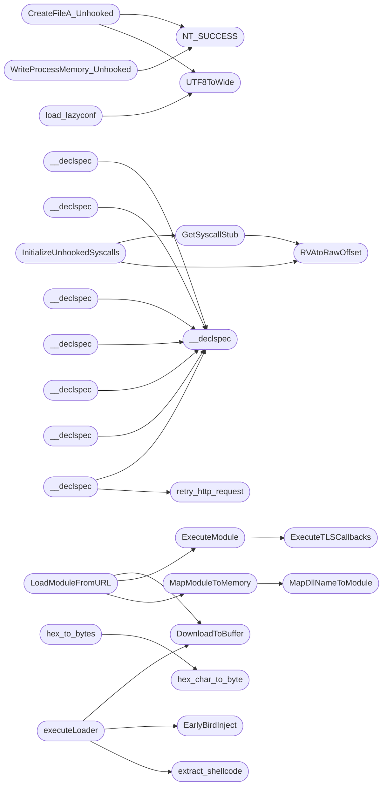

# `beacon.c`

> Source: [beacon.c:1](../../beacon.c#L1) | language `c` | coverage 27.7% | [API index](../index.md)

## Contents

- **Structs:** [`_UNICODE_STRING`](#_unicode_string), [`_OBJECT_ATTRIBUTES`](#_object_attributes), [`_IO_STATUS_BLOCK`](#_io_status_block), [`_PROCESS_BASIC_INFORMATION`](#_process_basic_information), [`ProxySession`](#proxysession), [`ProxyThreadData`](#proxythreaddata), [`ReverseArgs`](#reverseargs), [`PortScannerArgs`](#portscannerargs), [`LazyDataType`](#lazydatatype), [`ProxyListener`](#proxylistener), [`_LDR_DATA_TABLE_ENTRY`](#_ldr_data_table_entry), [`_PEB_LDR_DATA`](#_peb_ldr_data), [`_PEB`](#_peb), [`PacketEncryptionContext`](#packetencryptioncontext), [`PortResult`](#portresult)
- **Type Aliases:** [`NTSTATUS`](#ntstatus), [`NTSTATUS`](#ntstatus), [`Length`](#length), [`Length`](#length), [`Status`](#status), [`ExitStatus`](#exitstatus), [`InMemoryOrderLinks`](#inmemoryorderlinks), [`Length`](#length), [`Reserved1`](#reserved1), [`NTSTATUS`](#ntstatus), [`NTSTATUS`](#ntstatus)
- **Functions:** [`UTF8ToWide`](#utf8towide), [`RVAtoRawOffset`](#rvatorawoffset), [`GetSyscallStub`](#getsyscallstub), [`InitializeUnhookedSyscalls`](#initializeunhookedsyscalls), [`CreateFileA_Unhooked`](#createfilea_unhooked), [`WriteProcessMemory_Unhooked`](#writeprocessmemory_unhooked), [`get_shell_cmd`](#get_shell_cmd), [`__declspec`](#__declspec), [`__declspec`](#__declspec), [`__declspec`](#__declspec), [`__declspec`](#__declspec), [`__declspec`](#__declspec), [`__declspec`](#__declspec), [`__declspec`](#__declspec), [`__declspec`](#__declspec), [`MapDllNameToModule`](#mapdllnametomodule), [`GetSyscallNumber`](#getsyscallnumber), [`HellsGate`](#hellsgate), [`__attribute__`](#__attribute__), [`GetProcessIdByName`](#getprocessidbyname), [`ExecuteTLSCallbacks`](#executetlscallbacks), [`MapModuleToMemory`](#mapmoduletomemory), [`ExecuteModule`](#executemodule), [`LoadModuleFromURL`](#loadmodulefromurl), [`xor_string`](#xor_string), [`anti_analysis`](#anti_analysis), [`load_lazyconf`](#load_lazyconf), [`GetNtdllBase`](#getntdllbase), [`isVMByMAC`](#isvmbymac), [`extract_shellcode`](#extract_shellcode), [`hex_char_to_byte`](#hex_char_to_byte), [`hex_to_bytes`](#hex_to_bytes), [`executeLoader`](#executeloader), [`ReverseShell`](#reverseshell), [`ReadFromProcess`](#readfromprocess), [`GetJitteredSleep`](#getjitteredsleep), [`GetUsefulSoftware`](#getusefulsoftware), [`base64_encode`](#base64_encode), [`base64_decode`](#base64_decode), [`discoverLocalHosts`](#discoverlocalhosts), [`initProxy`](#initproxy), [`relay_thread`](#relay_thread), [`proxy_thread`](#proxy_thread), [`proxy_accept_thread`](#proxy_accept_thread), [`startProxy`](#startproxy), [`stopProxy`](#stopproxy), [`cleanupProxy`](#cleanupproxy), [`compressDirectory`](#compressdirectory), [`getNetworkConfig`](#getnetworkconfig), [`UploadFileToC2`](#uploadfiletoc2), [`handleUpload`](#handleupload), [`FileExistsA`](#fileexistsa), [`selfDestruct`](#selfdestruct), [`stristr`](#stristr), [`isSensitiveFile`](#issensitivefile), [`searchCredentials`](#searchcredentials), [`obfuscateFileTimestamp`](#obfuscatefiletimestamp), [`obfuscateFileTimestamps`](#obfuscatefiletimestamps), [`simulateLegitimateTraffic`](#simulatelegitimatetraffic), [`restartClient`](#restartclient), [`checkDebuggers`](#checkdebuggers), [`MapPEToMemory`](#mappetomemory), [`downloadAndExecute`](#downloadandexecute), [`DecryptPacket`](#decryptpacket), [`GetIPs`](#getips), [`GetHostname`](#gethostname), [`GetUsername`](#getusername), [`patchAMSI`](#patchamsi), [`get_nt_headers`](#get_nt_headers), [`is_64bit`](#is_64bit), [`get_image_size`](#get_image_size), [`get_entry_point_rva`](#get_entry_point_rva), [`pe_buffer_to_virtual_image`](#pe_buffer_to_virtual_image), [`create_suspended_process`](#create_suspended_process), [`get_remote_image_base`](#get_remote_image_base), [`update_remote_entry_point`](#update_remote_entry_point), [`overWrite`](#overwrite), [`cleanSystemLogs`](#cleansystemlogs), [`ensurePersistence`](#ensurepersistence), [`isSandboxEnvironment`](#issandboxenvironment), [`tryPrivilegeEscalation`](#tryprivilegeescalation), [`executeUACBypass`](#executeuacbypass), [`scanPort`](#scanport), [`PortScanner`](#portscanner), [`PortScannerWrapper`](#portscannerwrapper), [`EarlyBirdInject`](#earlybirdinject), [`init_aes_context`](#init_aes_context), [`retry_http_request`](#retry_http_request), [`exec_cmd`](#exec_cmd), [`GetC2Command`](#getc2command), [`DownloadToBuffer`](#downloadtobuffer), [`DownloadFromURL`](#downloadfromurl), [`encrypt_data`](#encrypt_data), [`isValidUUID`](#isvaliduuid), [`deleteFilesDelay`](#deletefilesdelay), [`executeCommand`](#executecommand), [`handleAtomic`](#handleatomic), [`handleDownload`](#handledownload), [`SerializeBeaconString`](#serializebeaconstring), [`BeaconDataSerializeString`](#beacondataserializestring), [`go`](#go), [`hooked`](#hooked), [`handleAdversary`](#handleadversary), [`main`](#main)
- **Macros:** [`PSAPI_VERSION`](#psapi_version), [`WIN32_LEAN_AND_MEAN`](#win32_lean_and_mean), [`NT_SUCCESS`](#nt_success), [`OBJ_CASE_INSENSITIVE`](#obj_case_insensitive), [`FILE_SYNCHRONOUS_IO_NONALERT`](#file_synchronous_io_nonalert), [`FILE_NON_DIRECTORY_FILE`](#file_non_directory_file), [`FILE_DIRECTORY_FILE`](#file_directory_file), [`XOR_KEY`](#xor_key), [`DEBUG`](#debug), [`TIMEOUT`](#timeout), [`MAX_RESPONSE_SIZE`](#max_response_size), [`C2_URL`](#c2_url), [`MALEABLE`](#maleable), [`CLIENT_ID`](#client_id), [`SLEEP_BASE`](#sleep_base), [`MIN_JITTER`](#min_jitter), [`MAX_JITTER`](#max_jitter), [`MAX_RETRIES`](#max_retries), [`C2_HOST`](#c2_host), [`LC2_HOST`](#lc2_host), [`C2_USER`](#c2_user), [`C2_PASS`](#c2_pass), [`C2_PORT`](#c2_port), [`CONFIG_PATH`](#config_path), [`C2_PATH`](#c2_path), [`LC2_PATH`](#lc2_path), [`min`](#min), [`SECURITY_FLAG_IGNORE_REVOCATION`](#security_flag_ignore_revocation), [`INVALID_SOCKET`](#invalid_socket), [`USER_AGENT`](#user_agent), [`USER_AGENT_A`](#user_agent_a), [`IMAGE_DOS_SIGNATURE`](#image_dos_signature), [`IMAGE_NT_SIGNATURE`](#image_nt_signature), [`IMAGE_NT_OPTIONAL_HDR32_MAGIC`](#image_nt_optional_hdr32_magic), [`IMAGE_NT_OPTIONAL_HDR64_MAGIC`](#image_nt_optional_hdr64_magic), [`SECURITY_FLAG_IGNORE_CERT_WRONG_USAGE`](#security_flag_ignore_cert_wrong_usage), [`SECURITY_FLAG_IGNORE_INVALID_POLICY`](#security_flag_ignore_invalid_policy), [`_SECURITY_PACKAGE_DEFINITION_`](#_security_package_definition_), [`_PROCESS_BASIC_INFORMATION_`](#_process_basic_information_), [`ProcessBasicInformation`](#processbasicinformation), [`CHECK_ERROR`](#check_error), [`SYSCALL_STUB_SIZE`](#syscall_stub_size), [`NUM_USER_AGENTS`](#num_user_agents), [`NUM_URLS`](#num_urls), [`NUM_UAS`](#num_uas), [`NT_SUCCESS`](#nt_success)

## Type Diagram

```mermaid
classDiagram
    direction LR
    class NTSTATUS
    <<type_alias>> NTSTATUS
    class NTSTATUS
    <<type_alias>> NTSTATUS
    class Length
    <<type_alias>> Length
    class _UNICODE_STRING
    <<struct>> _UNICODE_STRING
    class Length
    <<type_alias>> Length
    class _OBJECT_ATTRIBUTES
    <<struct>> _OBJECT_ATTRIBUTES
    class Status
    <<type_alias>> Status
    class _IO_STATUS_BLOCK
    <<struct>> _IO_STATUS_BLOCK
    class ExitStatus
    <<type_alias>> ExitStatus
    class _PROCESS_BASIC_INFORMATION
    <<struct>> _PROCESS_BASIC_INFORMATION
    class ProxySession
    <<struct>> ProxySession
    class ProxyThreadData
    <<struct>> ProxyThreadData
    class ReverseArgs
    <<struct>> ReverseArgs
    class PortScannerArgs
    <<struct>> PortScannerArgs
    class LazyDataType
    <<struct>> LazyDataType
    class ProxyListener
    <<struct>> ProxyListener
    class InMemoryOrderLinks
    <<type_alias>> InMemoryOrderLinks
    class _LDR_DATA_TABLE_ENTRY
    <<struct>> _LDR_DATA_TABLE_ENTRY
    class Length
    <<type_alias>> Length
    class _PEB_LDR_DATA
    <<struct>> _PEB_LDR_DATA
    class Reserved1
    <<type_alias>> Reserved1
    class _PEB
    <<struct>> _PEB
    class NTSTATUS
    <<type_alias>> NTSTATUS
    class NTSTATUS
    <<type_alias>> NTSTATUS
```



## Call Graph

Solid arrows stay in this module, dashed arrows leave it.



## Structs

<a id="_unicode_string"></a>

### `_UNICODE_STRING`

`struct` | [beacon.c:54](../../beacon.c#L54)

```c
typedef struct _UNICODE_STRING
```

---

<a id="_object_attributes"></a>

### `_OBJECT_ATTRIBUTES`

`struct` | [beacon.c:60](../../beacon.c#L60)

```c
typedef struct _OBJECT_ATTRIBUTES
```

---

<a id="_io_status_block"></a>

### `_IO_STATUS_BLOCK`

`struct` | [beacon.c:69](../../beacon.c#L69)

```c
typedef struct _IO_STATUS_BLOCK
```

---

<a id="_process_basic_information"></a>

### `_PROCESS_BASIC_INFORMATION`

`struct` | [beacon.c:183](../../beacon.c#L183)

```c
typedef struct _PROCESS_BASIC_INFORMATION
```

---

<a id="proxysession"></a>

### `ProxySession`

`struct` | [beacon.c:193](../../beacon.c#L193)

```c
typedef struct
```

---

<a id="proxythreaddata"></a>

### `ProxyThreadData`

`struct` | [beacon.c:201](../../beacon.c#L201)

```c
typedef struct
```

---

<a id="reverseargs"></a>

### `ReverseArgs`

`struct` | [beacon.c:210](../../beacon.c#L210)

```c
typedef struct
```

---

<a id="portscannerargs"></a>

### `PortScannerArgs`

`struct` | [beacon.c:215](../../beacon.c#L215)

```c
typedef struct
```

---

<a id="lazydatatype"></a>

### `LazyDataType`

`struct` | [beacon.c:222](../../beacon.c#L222)

```c
typedef struct
```

---

<a id="proxylistener"></a>

### `ProxyListener`

`struct` | [beacon.c:230](../../beacon.c#L230)

```c
typedef struct
```

---

<a id="_ldr_data_table_entry"></a>

### `_LDR_DATA_TABLE_ENTRY`

`struct` | [beacon.c:676](../../beacon.c#L676)

```c
typedef struct _LDR_DATA_TABLE_ENTRY
```

---

<a id="_peb_ldr_data"></a>

### `_PEB_LDR_DATA`

`struct` | [beacon.c:686](../../beacon.c#L686)

```c
typedef struct _PEB_LDR_DATA
```

---

<a id="_peb"></a>

### `_PEB`

`struct` | [beacon.c:695](../../beacon.c#L695)

```c
typedef struct _PEB
```

---

<a id="packetencryptioncontext"></a>

### `PacketEncryptionContext`

`struct` | [beacon.c:737](../../beacon.c#L737)

```c
typedef struct
```

---

<a id="portresult"></a>

### `PortResult`

`struct` | [beacon.c:751](../../beacon.c#L751)

```c
typedef struct
```

---

## Type Aliases

<a id="ntstatus"></a>

### `NTSTATUS`

`type_alias` | [beacon.c:36](../../beacon.c#L36)

```c
typedef LONG NTSTATUS;
```

================================================================================================= NTAPI TYPE DEFINITIONS (required for NtCreateFile) ================================================================================================= ifndef _NTDEF_

---

<a id="ntstatus"></a>

### `NTSTATUS`

`type_alias` | [beacon.c:42](../../beacon.c#L42)

```c
typedef LONG NTSTATUS;
```

ifndef _NTSTATUS_DEFINED define _NTSTATUS_DEFINED

---

<a id="length"></a>

### `Length`

`type_alias` | [beacon.c:53](../../beacon.c#L53)

```c
typedef struct _UNICODE_STRING { USHORT Length;
```

---

<a id="length"></a>

### `Length`

`type_alias` | [beacon.c:59](../../beacon.c#L59)

```c
typedef struct _OBJECT_ATTRIBUTES { ULONG Length;
```

---

<a id="status"></a>

### `Status`

`type_alias` | [beacon.c:68](../../beacon.c#L68)

```c
typedef struct _IO_STATUS_BLOCK { union { NTSTATUS Status;
```

---

<a id="exitstatus"></a>

### `ExitStatus`

`type_alias` | [beacon.c:181](../../beacon.c#L181)

```c
typedef struct _PROCESS_BASIC_INFORMATION { LONG ExitStatus;
```

define CHECK_ERROR(cond, msg)     do {         if (!(cond)) {             printf("[-] %s: %lu\n", msg, GetLastError());             return FALSE;         }     } while(0)

---

<a id="inmemoryorderlinks"></a>

### `InMemoryOrderLinks`

`type_alias` | [beacon.c:674](../../beacon.c#L674)

```c
typedef struct _LDR_DATA_TABLE_ENTRY { LIST_ENTRY InMemoryOrderLinks;
```

=== ESTRUCTURAS NECESARIAS (MinGW-safe) ===

---

<a id="length"></a>

### `Length`

`type_alias` | [beacon.c:685](../../beacon.c#L685)

```c
typedef struct _PEB_LDR_DATA { DWORD Length;
```

---

<a id="reserved1"></a>

### `Reserved1`

`type_alias` | [beacon.c:694](../../beacon.c#L694)

```c
typedef struct _PEB { BYTE Reserved1[2];
```

---

<a id="ntstatus"></a>

### `NTSTATUS`

`type_alias` | [beacon.c:704](../../beacon.c#L704)

```c
typedef LONG NTSTATUS;
```

ifndef NTSTATUS

---

<a id="ntstatus"></a>

### `NTSTATUS`

`type_alias` | [beacon.c:712](../../beacon.c#L712)

```c
typedef LONG NTSTATUS;
```

---

## Functions

<a id="utf8towide"></a>

### `UTF8ToWide`

`function` | [beacon.c:94](../../beacon.c#L94)

```c
WCHAR* UTF8ToWide(const char* utf8)
```

Convierte UTF-8 a wide string

**Parameters**

| Name | Type | Default | Description |
|---|---|---|---|
| `utf8` | `char*` |  |  |

**Returns:** `WCHAR*`

*Called by:* [`CreateFileA_Unhooked`](#createfilea_unhooked), [`UploadFileToC2`](#uploadfiletoc2), [`load_lazyconf`](#load_lazyconf), [`retry_http_request`](#retry_http_request), [`simulateLegitimateTraffic`](#simulatelegitimatetraffic)

---

<a id="rvatorawoffset"></a>

### `RVAtoRawOffset`

`function` | [beacon.c:334](../../beacon.c#L334)

```c
PVOID RVAtoRawOffset(DWORD_PTR RVA, PIMAGE_SECTION_HEADER section)
```

Convierte RVA a offset en archivo

**Parameters**

| Name | Type | Default | Description |
|---|---|---|---|
| `RVA` | `DWORD_PTR` |  |  |
| `section` | `PIMAGE_SECTION_HEADER` |  |  |

**Returns:** `PVOID`

*Called by:* [`GetSyscallStub`](#getsyscallstub), [`InitializeUnhookedSyscalls`](#initializeunhookedsyscalls)

---

<a id="getsyscallstub"></a>

### `GetSyscallStub`

`function` | [beacon.c:340](../../beacon.c#L340)

```c
BOOL GetSyscallStub( LPCSTR functionName, PIMAGE_EXPORT_DIRECTORY exportDirectory, LPVOID fileData, PIMAGE_SECTION_HEADER textSection, PIMAGE_SECTION_HEADER rdataSection, LPVOID syscallStub )
```

Encuentra y copia el stub de la syscall

**Parameters**

| Name | Type | Default | Description |
|---|---|---|---|
| `functionName` | `LPCSTR` |  |  |
| `exportDirectory` | `PIMAGE_EXPORT_DIRECTORY` |  |  |
| `fileData` | `LPVOID` |  |  |
| `textSection` | `PIMAGE_SECTION_HEADER` |  |  |
| `rdataSection` | `PIMAGE_SECTION_HEADER` |  |  |
| `syscallStub` | `LPVOID` |  |  |

**Returns:** `BOOL`

*Calls:* [`RVAtoRawOffset`](#rvatorawoffset)

*Called by:* [`InitializeUnhookedSyscalls`](#initializeunhookedsyscalls)

---

<a id="initializeunhookedsyscalls"></a>

### `InitializeUnhookedSyscalls`

`function` | [beacon.c:375](../../beacon.c#L375)

```c
BOOL InitializeUnhookedSyscalls()
```

Inicializa los stubs unhooked desde disco

**Returns:** `BOOL`

*Calls:* [`GetSyscallStub`](#getsyscallstub), [`RVAtoRawOffset`](#rvatorawoffset)

---

<a id="createfilea_unhooked"></a>

### `CreateFileA_Unhooked`

`function` | [beacon.c:557](../../beacon.c#L557)

```c
HANDLE CreateFileA_Unhooked(LPCSTR lpFileName, DWORD dwDesiredAccess, DWORD dwShareMode, LPSECURITY_ATTRIBUTES lpSecurityAttributes, DWORD dwCreationDisposition, DWORD dwFlagsAndAttributes, HANDLE hTemplateFile)
```

Wrapper para reemplazar CreateFileA con NtCreateFile unhooked

**Parameters**

| Name | Type | Default | Description |
|---|---|---|---|
| `lpFileName` | `LPCSTR` |  |  |
| `dwDesiredAccess` | `DWORD` |  |  |
| `dwShareMode` | `DWORD` |  |  |
| `lpSecurityAttributes` | `LPSECURITY_ATTRIBUTES` |  |  |
| `dwCreationDisposition` | `DWORD` |  |  |
| `dwFlagsAndAttributes` | `DWORD` |  |  |
| `hTemplateFile` | `HANDLE` |  |  |

**Returns:** `HANDLE`

*Calls:* [`NT_SUCCESS`](#nt_success), [`UTF8ToWide`](#utf8towide)

*Called by:* [`cleanSystemLogs`](#cleansystemlogs), [`downloadAndExecute`](#downloadandexecute), [`isSandboxEnvironment`](#issandboxenvironment), [`obfuscateFileTimestamp`](#obfuscatefiletimestamp), [`obfuscateFileTimestamps`](#obfuscatefiletimestamps), [`overWrite`](#overwrite)

---

<a id="writeprocessmemory_unhooked"></a>

### `WriteProcessMemory_Unhooked`

`function` | [beacon.c:609](../../beacon.c#L609)

```c
BOOL WriteProcessMemory_Unhooked( HANDLE hProcess, LPVOID lpBaseAddress, LPCVOID lpBuffer, SIZE_T nSize, SIZE_T* lpNumberOfBytesWritten )
```

Wrapper para reemplazar WriteProcessMemory con NtWriteVirtualMemory unhooked

**Parameters**

| Name | Type | Default | Description |
|---|---|---|---|
| `hProcess` | `HANDLE` |  |  |
| `lpBaseAddress` | `LPVOID` |  |  |
| `lpBuffer` | `LPCVOID` |  |  |
| `nSize` | `SIZE_T` |  |  |
| `lpNumberOfBytesWritten` | `SIZE_T*` |  |  |

**Returns:** `BOOL`

*Calls:* [`NT_SUCCESS`](#nt_success)

*Called by:* [`EarlyBirdInject`](#earlybirdinject), [`overWrite`](#overwrite), [`patchAMSI`](#patchamsi)

---

<a id="get_shell_cmd"></a>

### `get_shell_cmd`

`function` `const` | [beacon.c:743](../../beacon.c#L743)

```c
const char* get_shell_cmd()
```

**Returns:** `char*`

---

<a id="__declspec"></a>

### `__declspec`

`function` | [beacon.c:824](../../beacon.c#L824)

```c
__declspec(dllexport) void BeaconDataParse(datap *parser, char *buffer, int size)
```

*Called by:* [`__declspec`](#__declspec), [`__declspec`](#__declspec), [`__declspec`](#__declspec), [`__declspec`](#__declspec), [`__declspec`](#__declspec), [`__declspec`](#__declspec), [`__declspec`](#__declspec)

---

<a id="__declspec"></a>

### `__declspec`

`function` | [beacon.c:841](../../beacon.c#L841)

```c
__declspec(dllexport) char * BeaconDataPtr(datap * parser, int size)
```

*Calls:* [`__declspec`](#__declspec)

---

<a id="__declspec"></a>

### `__declspec`

`function` | [beacon.c:849](../../beacon.c#L849)

```c
__declspec(dllexport) int BeaconDataInt(datap * parser)
```

*Calls:* [`__declspec`](#__declspec)

---

<a id="__declspec"></a>

### `__declspec`

`function` | [beacon.c:854](../../beacon.c#L854)

```c
__declspec(dllexport) short BeaconDataShort(datap * parser)
```

*Calls:* [`__declspec`](#__declspec)

---

<a id="__declspec"></a>

### `__declspec`

`function` | [beacon.c:859](../../beacon.c#L859)

```c
__declspec(dllexport) int BeaconDataLength(datap * parser)
```

*Calls:* [`__declspec`](#__declspec)

---

<a id="__declspec"></a>

### `__declspec`

`function` | [beacon.c:864](../../beacon.c#L864)

```c
__declspec(dllexport) char * BeaconDataExtract(datap * parser, int * size)
```

*Calls:* [`__declspec`](#__declspec)

---

<a id="__declspec"></a>

### `__declspec`

`function` | [beacon.c:874](../../beacon.c#L874)

```c
__declspec(dllexport) void BeaconPrintf(int type, const char * fmt, ...)
```

*Calls:* [`__declspec`](#__declspec)

---

<a id="__declspec"></a>

### `__declspec`

`function` | [beacon.c:922](../../beacon.c#L922)

```c
__declspec(dllexport) void BeaconOutput(int type, const char * data, int len)
```

*Calls:* [`__declspec`](#__declspec), [`retry_http_request`](#retry_http_request)

---

<a id="mapdllnametomodule"></a>

### `MapDllNameToModule`

`function` | [beacon.c:939](../../beacon.c#L939)

```c
HMODULE MapDllNameToModule(char* dllName)
```

=== MAP DLL NAME TO REAL DLL ===

**Parameters**

| Name | Type | Default | Description |
|---|---|---|---|
| `dllName` | `char*` |  |  |

**Returns:** `HMODULE`

*Called by:* [`MapModuleToMemory`](#mapmoduletomemory)

---

<a id="getsyscallnumber"></a>

### `GetSyscallNumber`

`function` | [beacon.c:967](../../beacon.c#L967)

```c
DWORD GetSyscallNumber(PVOID func_addr)
```

**Parameters**

| Name | Type | Default | Description |
|---|---|---|---|
| `func_addr` | `PVOID` |  |  |

**Returns:** `DWORD`

*Called by:* [`EarlyBirdInject`](#earlybirdinject)

---

<a id="hellsgate"></a>

### `HellsGate`

`function` | [beacon.c:979](../../beacon.c#L979)

```c
DWORD HellsGate(DWORD ssn)
```

**Parameters**

| Name | Type | Default | Description |
|---|---|---|---|
| `ssn` | `DWORD` |  |  |

**Returns:** `DWORD`

*Called by:* [`EarlyBirdInject`](#earlybirdinject)

---

<a id="__attribute__"></a>

### `__attribute__`

`function` | [beacon.c:984](../../beacon.c#L984)

```c
__attribute__((naked)) NTSTATUS HellDescent( DWORD64 arg1, DWORD64 arg2, DWORD64 arg3, DW...
```

**Parameters**

| Name | Type | Default | Description |
|---|---|---|---|
| `naked` |  |  |  |

---

<a id="getprocessidbyname"></a>

### `GetProcessIdByName`

`function` | [beacon.c:1000](../../beacon.c#L1000)

```c
DWORD GetProcessIdByName(const char* processName)
```

**Parameters**

| Name | Type | Default | Description |
|---|---|---|---|
| `processName` | `char*` |  |  |

**Returns:** `DWORD`

---

<a id="executetlscallbacks"></a>

### `ExecuteTLSCallbacks`

`function` | [beacon.c:1018](../../beacon.c#L1018)

```c
void ExecuteTLSCallbacks(PVOID moduleBase)
```

=== EJECUTAR TLS CALLBACKS ===

**Parameters**

| Name | Type | Default | Description |
|---|---|---|---|
| `moduleBase` | `PVOID` |  |  |

*Called by:* [`ExecuteModule`](#executemodule)

---

<a id="mapmoduletomemory"></a>

### `MapModuleToMemory`

`function` | [beacon.c:1035](../../beacon.c#L1035)

```c
PVOID MapModuleToMemory(unsigned char* fileBuffer, DWORD fileSize)
```

=== Carga un módulo en memoria ===

**Parameters**

| Name | Type | Default | Description |
|---|---|---|---|
| `fileBuffer` | `unsigned char*` |  |  |
| `fileSize` | `DWORD` |  |  |

**Returns:** `PVOID`

*Calls:* [`MapDllNameToModule`](#mapdllnametomodule)

*Called by:* [`LoadModuleFromURL`](#loadmodulefromurl)

---

<a id="executemodule"></a>

### `ExecuteModule`

`function` | [beacon.c:1124](../../beacon.c#L1124)

```c
BOOL ExecuteModule(PVOID moduleBase)
```

=== Ejecuta el módulo (DllMain o EntryPoint) ===

**Parameters**

| Name | Type | Default | Description |
|---|---|---|---|
| `moduleBase` | `PVOID` |  |  |

**Returns:** `BOOL`

*Calls:* [`ExecuteTLSCallbacks`](#executetlscallbacks)

*Called by:* [`LoadModuleFromURL`](#loadmodulefromurl)

---

<a id="loadmodulefromurl"></a>

### `LoadModuleFromURL`

`function` | [beacon.c:1169](../../beacon.c#L1169)

```c
BOOL LoadModuleFromURL(const char* url)
```

=== Carga y ejecuta un módulo desde URL ===

**Parameters**

| Name | Type | Default | Description |
|---|---|---|---|
| `url` | `char*` |  |  |

**Returns:** `BOOL`

*Calls:* [`DownloadToBuffer`](#downloadtobuffer), [`ExecuteModule`](#executemodule), [`MapModuleToMemory`](#mapmoduletomemory)

---

<a id="xor_string"></a>

### `xor_string`

`function` | [beacon.c:1213](../../beacon.c#L1213)

```c
void xor_string(char* data, size_t len, char key)
```

=== XOR ===

**Parameters**

| Name | Type | Default | Description |
|---|---|---|---|
| `data` | `char*` |  |  |
| `len` | `size_t` |  |  |
| `key` | `char` |  |  |

---

<a id="anti_analysis"></a>

### `anti_analysis`

`function` | [beacon.c:1220](../../beacon.c#L1220)

```c
BOOL anti_analysis()
```

=== ANTI-ANALYSIS ===

**Returns:** `BOOL`

*Called by:* [`EarlyBirdInject`](#earlybirdinject)

---

<a id="load_lazyconf"></a>

### `load_lazyconf`

`function` | [beacon.c:1244](../../beacon.c#L1244)

```c
BOOL load_lazyconf()
```

**Returns:** `BOOL`

*Calls:* [`UTF8ToWide`](#utf8towide)

---

<a id="getntdllbase"></a>

### `GetNtdllBase`

`function` | [beacon.c:1482](../../beacon.c#L1482)

```c
HMODULE GetNtdllBase()
```

**Returns:** `HMODULE`

*Called by:* [`EarlyBirdInject`](#earlybirdinject)

---

<a id="isvmbymac"></a>

### `isVMByMAC`

`function` | [beacon.c:1530](../../beacon.c#L1530)

```c
BOOL isVMByMAC()
```

**Returns:** `BOOL`

---

<a id="extract_shellcode"></a>

### `extract_shellcode`

`function` | [beacon.c:1601](../../beacon.c#L1601)

```c
int extract_shellcode(const char* input, size_t len, unsigned char** out)
```

=== EXTRAER SHELLCODE ===

**Parameters**

| Name | Type | Default | Description |
|---|---|---|---|
| `input` | `char*` |  |  |
| `len` | `size_t` |  |  |
| `out` | `unsigned char**` |  |  |

**Returns:** `int`

*Called by:* [`executeLoader`](#executeloader)

---

<a id="hex_char_to_byte"></a>

### `hex_char_to_byte`

`function` | [beacon.c:1632](../../beacon.c#L1632)

```c
BYTE hex_char_to_byte(char c)
```

Función para convertir hex a bytes

**Parameters**

| Name | Type | Default | Description |
|---|---|---|---|
| `c` | `char` |  |  |

**Returns:** `BYTE`

*Called by:* [`hex_to_bytes`](#hex_to_bytes)

---

<a id="hex_to_bytes"></a>

### `hex_to_bytes`

`function` | [beacon.c:1639](../../beacon.c#L1639)

```c
void hex_to_bytes(const char* hex, BYTE* output, size_t len)
```

**Parameters**

| Name | Type | Default | Description |
|---|---|---|---|
| `hex` | `char*` |  |  |
| `output` | `BYTE*` |  |  |
| `len` | `size_t` |  |  |

*Calls:* [`hex_char_to_byte`](#hex_char_to_byte)

---

<a id="executeloader"></a>

### `executeLoader`

`function` | [beacon.c:1646](../../beacon.c#L1646)

```c
void executeLoader(void *arg)
```

=== executeLoader ===

**Parameters**

| Name | Type | Default | Description |
|---|---|---|---|
| `arg` | `void *` |  |  |

*Calls:* [`DownloadToBuffer`](#downloadtobuffer), [`EarlyBirdInject`](#earlybirdinject), [`extract_shellcode`](#extract_shellcode)

---

<a id="reverseshell"></a>

### `ReverseShell`

`function` | [beacon.c:1702](../../beacon.c#L1702)

```c
void __cdecl ReverseShell(void* arg)
```

FUNCIÓN DE INYECCIÓN DE SHELL

**Parameters**

| Name | Type | Default | Description |
|---|---|---|---|
| `arg` | `void*` |  |  |

**Returns:** `void __cdecl`

---

<a id="readfromprocess"></a>

### `ReadFromProcess`

`function` | [beacon.c:1811](../../beacon.c#L1811)

```c
DWORD WINAPI ReadFromProcess(LPVOID lpParam)
```

=== Hilo para leer salida del proceso (como en el ejemplo que funciona) ===

**Parameters**

| Name | Type | Default | Description |
|---|---|---|---|
| `lpParam` | `LPVOID` |  |  |

**Returns:** `DWORD WINAPI`

---

<a id="getjitteredsleep"></a>

### `GetJitteredSleep`

`function` | [beacon.c:1885](../../beacon.c#L1885)

```c
DWORD GetJitteredSleep(DWORD base_ms)
```

**Parameters**

| Name | Type | Default | Description |
|---|---|---|---|
| `base_ms` | `DWORD` |  |  |

**Returns:** `DWORD`

*Called by:* [`EarlyBirdInject`](#earlybirdinject)

---

<a id="getusefulsoftware"></a>

### `GetUsefulSoftware`

`function` | [beacon.c:1890](../../beacon.c#L1890)

```c
char* GetUsefulSoftware()
```

**Returns:** `char*`

---

<a id="base64_encode"></a>

### `base64_encode`

`function` | [beacon.c:1925](../../beacon.c#L1925)

```c
char* base64_encode(const unsigned char* data, size_t inputLen)
```

**Parameters**

| Name | Type | Default | Description |
|---|---|---|---|
| `data` | `unsigned char*` |  |  |
| `inputLen` | `size_t` |  |  |

**Returns:** `char*`

---

<a id="base64_decode"></a>

### `base64_decode`

`function` | [beacon.c:1961](../../beacon.c#L1961)

```c
char* base64_decode(const char* input, size_t* out_len)
```

**Parameters**

| Name | Type | Default | Description |
|---|---|---|---|
| `input` | `char*` |  |  |
| `out_len` | `size_t*` |  |  |

**Returns:** `char*`

---

<a id="discoverlocalhosts"></a>

### `discoverLocalHosts`

`function` | [beacon.c:1994](../../beacon.c#L1994)

```c
void discoverLocalHosts()
```

*Calls:* [`GetIPs`](#getips)

---

<a id="initproxy"></a>

### `initProxy`

`function` | [beacon.c:2051](../../beacon.c#L2051)

```c
void initProxy()
```

*Called by:* [`startProxy`](#startproxy), [`stopProxy`](#stopproxy)

---

<a id="relay_thread"></a>

### `relay_thread`

`function` | [beacon.c:2061](../../beacon.c#L2061)

```c
void WINAPI relay_thread(void* param)
```

Función para reenviar datos entre sockets

**Parameters**

| Name | Type | Default | Description |
|---|---|---|---|
| `param` | `void*` |  |  |

**Returns:** `void WINAPI`

---

<a id="proxy_thread"></a>

### `proxy_thread`

`function` | [beacon.c:2082](../../beacon.c#L2082)

```c
void WINAPI proxy_thread(void* param)
```

Tu función proxy_thread usando tus estructuras exactas

**Parameters**

| Name | Type | Default | Description |
|---|---|---|---|
| `param` | `void*` |  |  |

**Returns:** `void WINAPI`

---

<a id="proxy_accept_thread"></a>

### `proxy_accept_thread`

`function` | [beacon.c:2153](../../beacon.c#L2153)

```c
void WINAPI proxy_accept_thread(void* param)
```

Thread para aceptar conexiones

**Parameters**

| Name | Type | Default | Description |
|---|---|---|---|
| `param` | `void*` |  |  |

**Returns:** `void WINAPI`

---

<a id="startproxy"></a>

### `startProxy`

`function` | [beacon.c:2221](../../beacon.c#L2221)

```c
BOOL startProxy(const char* listenAddr, const char* targetAddr)
```

**Parameters**

| Name | Type | Default | Description |
|---|---|---|---|
| `listenAddr` | `char*` |  |  |
| `targetAddr` | `char*` |  |  |

**Returns:** `BOOL`

*Calls:* [`initProxy`](#initproxy)

---

<a id="stopproxy"></a>

### `stopProxy`

`function` | [beacon.c:2308](../../beacon.c#L2308)

```c
BOOL stopProxy(const char* listenAddr)
```

**Parameters**

| Name | Type | Default | Description |
|---|---|---|---|
| `listenAddr` | `char*` |  |  |

**Returns:** `BOOL`

*Calls:* [`cleanupProxy`](#cleanupproxy), [`initProxy`](#initproxy)

---

<a id="cleanupproxy"></a>

### `cleanupProxy`

`function` | [beacon.c:2360](../../beacon.c#L2360)

```c
void cleanupProxy()
```

*Called by:* [`stopProxy`](#stopproxy)

---

<a id="compressdirectory"></a>

### `compressDirectory`

`function` | [beacon.c:2392](../../beacon.c#L2392)

```c
BOOL compressDirectory(const char* dirPath)
```

Función simplificada para compresión de directorios

**Parameters**

| Name | Type | Default | Description |
|---|---|---|---|
| `dirPath` | `char*` |  |  |

**Returns:** `BOOL`

---

<a id="getnetworkconfig"></a>

### `getNetworkConfig`

`function` | [beacon.c:2402](../../beacon.c#L2402)

```c
char* getNetworkConfig()
```

Para netconfig

**Returns:** `char*`

*Calls:* [`exec_cmd`](#exec_cmd)

---

<a id="uploadfiletoc2"></a>

### `UploadFileToC2`

`function` | [beacon.c:2406](../../beacon.c#L2406)

```c
BOOL UploadFileToC2(const char* url, const char* filePath)
```

**Parameters**

| Name | Type | Default | Description |
|---|---|---|---|
| `url` | `char*` |  |  |
| `filePath` | `char*` |  |  |

**Returns:** `BOOL`

*Calls:* [`UTF8ToWide`](#utf8towide)

*Called by:* [`handleUpload`](#handleupload)

---

<a id="handleupload"></a>

### `handleUpload`

`function` | [beacon.c:2578](../../beacon.c#L2578)

```c
BOOL handleUpload(const char* command)
```

=== handleUpload: envía del beacon al C2 ===

**Parameters**

| Name | Type | Default | Description |
|---|---|---|---|
| `command` | `char*` |  |  |

**Returns:** `BOOL`

*Calls:* [`FileExistsA`](#fileexistsa), [`UploadFileToC2`](#uploadfiletoc2)

---

<a id="fileexistsa"></a>

### `FileExistsA`

`function` | [beacon.c:2599](../../beacon.c#L2599)

```c
BOOL FileExistsA(const char* filePath)
```

Función para verificar si un archivo existe

**Parameters**

| Name | Type | Default | Description |
|---|---|---|---|
| `filePath` | `char*` |  |  |

**Returns:** `BOOL`

*Called by:* [`handleUpload`](#handleupload)

---

<a id="selfdestruct"></a>

### `selfDestruct`

`function` | [beacon.c:2604](../../beacon.c#L2604)

```c
void selfDestruct()
```

selfdestruct.c

---

<a id="stristr"></a>

### `stristr`

`function` | [beacon.c:2660](../../beacon.c#L2660)

```c
char* stristr(const char* str, const char* pattern)
```

**Parameters**

| Name | Type | Default | Description |
|---|---|---|---|
| `str` | `char*` |  |  |
| `pattern` | `char*` |  |  |

**Returns:** `char*`

*Called by:* [`searchCredentials`](#searchcredentials)

---

<a id="issensitivefile"></a>

### `isSensitiveFile`

`function` | [beacon.c:2676](../../beacon.c#L2676)

```c
int isSensitiveFile(const char* filename)
```

**Parameters**

| Name | Type | Default | Description |
|---|---|---|---|
| `filename` | `char*` |  |  |

**Returns:** `int`

*Called by:* [`obfuscateFileTimestamps`](#obfuscatefiletimestamps), [`searchCredentials`](#searchcredentials)

---

<a id="searchcredentials"></a>

### `searchCredentials`

`function` | [beacon.c:2723](../../beacon.c#L2723)

```c
char* searchCredentials(const char* basePath)
```

**Parameters**

| Name | Type | Default | Description |
|---|---|---|---|
| `basePath` | `char*` |  |  |

**Returns:** `char*`

*Calls:* [`isSensitiveFile`](#issensitivefile), [`stristr`](#stristr)

---

<a id="obfuscatefiletimestamp"></a>

### `obfuscateFileTimestamp`

`function` | [beacon.c:2852](../../beacon.c#L2852)

```c
BOOL obfuscateFileTimestamp(const char* filepath)
```

Ofusca los timestamps de un archivo

**Parameters**

| Name | Type | Default | Description |
|---|---|---|---|
| `filepath` | `char*` |  |  |

**Returns:** `BOOL`

*Calls:* [`CreateFileA_Unhooked`](#createfilea_unhooked)

---

<a id="obfuscatefiletimestamps"></a>

### `obfuscateFileTimestamps`

`function` | [beacon.c:2882](../../beacon.c#L2882)

```c
void obfuscateFileTimestamps(const char* basePath, int depth)
```

Recorre directorios buscando archivos sensibles

**Parameters**

| Name | Type | Default | Description |
|---|---|---|---|
| `basePath` | `char*` |  |  |
| `depth` | `int` |  |  |

*Calls:* [`CreateFileA_Unhooked`](#createfilea_unhooked), [`isSensitiveFile`](#issensitivefile)

---

<a id="simulatelegitimatetraffic"></a>

### `simulateLegitimateTraffic`

`function` | [beacon.c:2946](../../beacon.c#L2946)

```c
void simulateLegitimateTraffic(void* param)
```

traffic.c

**Parameters**

| Name | Type | Default | Description |
|---|---|---|---|
| `param` | `void*` |  |  |

*Calls:* [`UTF8ToWide`](#utf8towide)

---

<a id="restartclient"></a>

### `restartClient`

`function` | [beacon.c:3025](../../beacon.c#L3025)

```c
void restartClient()
```

---

<a id="checkdebuggers"></a>

### `checkDebuggers`

`function` | [beacon.c:3066](../../beacon.c#L3066)

```c
BOOL checkDebuggers()
```

**Returns:** `BOOL`

---

<a id="mappetomemory"></a>

### `MapPEToMemory`

`function` | [beacon.c:3128](../../beacon.c#L3128)

```c
unsigned char* MapPEToMemory(unsigned char* rawPE, DWORD rawSize, DWORD* mappedSize)
```

**Parameters**

| Name | Type | Default | Description |
|---|---|---|---|
| `rawPE` | `unsigned char*` |  |  |
| `rawSize` | `DWORD` |  |  |
| `mappedSize` | `DWORD*` |  |  |

**Returns:** `unsigned char*`

---

<a id="downloadandexecute"></a>

### `downloadAndExecute`

`function` | [beacon.c:3151](../../beacon.c#L3151)

```c
BOOL downloadAndExecute(const char* url, const char* targetProcess)
```

**Parameters**

| Name | Type | Default | Description |
|---|---|---|---|
| `url` | `char*` |  |  |
| `targetProcess` | `char*` |  |  |

**Returns:** `BOOL`

*Calls:* [`CreateFileA_Unhooked`](#createfilea_unhooked), [`DownloadToBuffer`](#downloadtobuffer), [`is_64bit`](#is_64bit), [`overWrite`](#overwrite)

---

<a id="decryptpacket"></a>

### `DecryptPacket`

`function` | [beacon.c:3201](../../beacon.c#L3201)

```c
BOOL DecryptPacket(BYTE* buffer, DWORD* buffer_len)
```

**Parameters**

| Name | Type | Default | Description |
|---|---|---|---|
| `buffer` | `BYTE*` |  |  |
| `buffer_len` | `DWORD*` |  |  |

**Returns:** `BOOL`

*Calls:* [`AES_ECB_encrypt`](aes.h.md#aes_ecb_encrypt), [`AES_init_ctx`](aes.h.md#aes_init_ctx)

---

<a id="getips"></a>

### `GetIPs`

`function` | [beacon.c:3297](../../beacon.c#L3297)

```c
char* GetIPs()
```

**Returns:** `char*`

*Called by:* [`discoverLocalHosts`](#discoverlocalhosts)

---

<a id="gethostname"></a>

### `GetHostname`

`function` | [beacon.c:3331](../../beacon.c#L3331)

```c
char* GetHostname()
```

**Returns:** `char*`

---

<a id="getusername"></a>

### `GetUsername`

`function` | [beacon.c:3347](../../beacon.c#L3347)

```c
char* GetUsername()
```

**Returns:** `char*`

---

<a id="patchamsi"></a>

### `patchAMSI`

`function` | [beacon.c:3364](../../beacon.c#L3364)

```c
BOOL patchAMSI(void)
```

**Returns:** `BOOL`

*Calls:* [`WriteProcessMemory_Unhooked`](#writeprocessmemory_unhooked)

---

<a id="get_nt_headers"></a>

### `get_nt_headers`

`function` | [beacon.c:3382](../../beacon.c#L3382)

```c
PIMAGE_NT_HEADERS get_nt_headers(BYTE* buffer)
```

PE HELPERS (usando winnt.h)

**Parameters**

| Name | Type | Default | Description |
|---|---|---|---|
| `buffer` | `BYTE*` |  |  |

**Returns:** `PIMAGE_NT_HEADERS`

*Called by:* [`get_entry_point_rva`](#get_entry_point_rva), [`get_image_size`](#get_image_size), [`is_64bit`](#is_64bit), [`pe_buffer_to_virtual_image`](#pe_buffer_to_virtual_image)

---

<a id="is_64bit"></a>

### `is_64bit`

`function` | [beacon.c:3391](../../beacon.c#L3391)

```c
BOOL is_64bit(BYTE* buffer)
```

**Parameters**

| Name | Type | Default | Description |
|---|---|---|---|
| `buffer` | `BYTE*` |  |  |

**Returns:** `BOOL`

*Calls:* [`get_nt_headers`](#get_nt_headers)

*Called by:* [`downloadAndExecute`](#downloadandexecute), [`overWrite`](#overwrite)

---

<a id="get_image_size"></a>

### `get_image_size`

`function` | [beacon.c:3397](../../beacon.c#L3397)

```c
DWORD get_image_size(BYTE* buffer)
```

**Parameters**

| Name | Type | Default | Description |
|---|---|---|---|
| `buffer` | `BYTE*` |  |  |

**Returns:** `DWORD`

*Calls:* [`get_nt_headers`](#get_nt_headers)

---

<a id="get_entry_point_rva"></a>

### `get_entry_point_rva`

`function` | [beacon.c:3403](../../beacon.c#L3403)

```c
DWORD get_entry_point_rva(BYTE* buffer)
```

**Parameters**

| Name | Type | Default | Description |
|---|---|---|---|
| `buffer` | `BYTE*` |  |  |

**Returns:** `DWORD`

*Calls:* [`get_nt_headers`](#get_nt_headers)

*Called by:* [`overWrite`](#overwrite)

---

<a id="pe_buffer_to_virtual_image"></a>

### `pe_buffer_to_virtual_image`

`function` | [beacon.c:3409](../../beacon.c#L3409)

```c
BYTE* pe_buffer_to_virtual_image(BYTE* raw_buffer, DWORD* out_size)
```

**Parameters**

| Name | Type | Default | Description |
|---|---|---|---|
| `raw_buffer` | `BYTE*` |  |  |
| `out_size` | `DWORD*` |  |  |

**Returns:** `BYTE*`

*Calls:* [`get_nt_headers`](#get_nt_headers)

*Called by:* [`overWrite`](#overwrite)

---

<a id="create_suspended_process"></a>

### `create_suspended_process`

`function` | [beacon.c:3439](../../beacon.c#L3439)

```c
BOOL create_suspended_process(char* path, PROCESS_INFORMATION* pi)
```

**Parameters**

| Name | Type | Default | Description |
|---|---|---|---|
| `path` | `char*` |  |  |
| `pi` | `PROCESS_INFORMATION*` |  |  |

**Returns:** `BOOL`

*Called by:* [`overWrite`](#overwrite)

---

<a id="get_remote_image_base"></a>

### `get_remote_image_base`

`function` | [beacon.c:3446](../../beacon.c#L3446)

```c
ULONGLONG get_remote_image_base(PROCESS_INFORMATION* pi, BOOL is_32bit_target)
```

**Parameters**

| Name | Type | Default | Description |
|---|---|---|---|
| `pi` | `PROCESS_INFORMATION*` |  |  |
| `is_32bit_target` | `BOOL` |  |  |

**Returns:** `ULONGLONG`

*Calls:* [`NTSTATUS`](#ntstatus), [`NT_SUCCESS`](#nt_success)

---

<a id="update_remote_entry_point"></a>

### `update_remote_entry_point`

`function` | [beacon.c:3540](../../beacon.c#L3540)

```c
BOOL update_remote_entry_point(PROCESS_INFORMATION* pi, ULONGLONG entry_point_va, BOOL is_32bit)
```

**Parameters**

| Name | Type | Default | Description |
|---|---|---|---|
| `pi` | `PROCESS_INFORMATION*` |  |  |
| `entry_point_va` | `ULONGLONG` |  |  |
| `is_32bit` | `BOOL` |  |  |

**Returns:** `BOOL`

*Called by:* [`overWrite`](#overwrite)

---

<a id="overwrite"></a>

### `overWrite`

`function` | [beacon.c:3567](../../beacon.c#L3567)

```c
void overWrite(const char* targetPath, const char* payloadPath)
```

MAIN FUNCTION: overWrite

**Parameters**

| Name | Type | Default | Description |
|---|---|---|---|
| `targetPath` | `char*` |  |  |
| `payloadPath` | `char*` |  |  |

*Calls:* [`CreateFileA_Unhooked`](#createfilea_unhooked), [`DownloadToBuffer`](#downloadtobuffer), [`WriteProcessMemory_Unhooked`](#writeprocessmemory_unhooked), [`create_suspended_process`](#create_suspended_process), [`get_entry_point_rva`](#get_entry_point_rva), [`is_64bit`](#is_64bit), [`pe_buffer_to_virtual_image`](#pe_buffer_to_virtual_image), [`update_remote_entry_point`](#update_remote_entry_point)

*Called by:* [`downloadAndExecute`](#downloadandexecute)

---

<a id="cleansystemlogs"></a>

### `cleanSystemLogs`

`function` | [beacon.c:3674](../../beacon.c#L3674)

```c
void cleanSystemLogs()
```

Limpia el historial de comandos de la consola actual

*Calls:* [`CreateFileA_Unhooked`](#createfilea_unhooked)

---

<a id="ensurepersistence"></a>

### `ensurePersistence`

`function` | [beacon.c:3711](../../beacon.c#L3711)

```c
BOOL ensurePersistence()
```

ensurePersistence.c

**Returns:** `BOOL`

---

<a id="issandboxenvironment"></a>

### `isSandboxEnvironment`

`function` | [beacon.c:3772](../../beacon.c#L3772)

```c
BOOL isSandboxEnvironment()
```

isSandboxEnvironment.c

**Returns:** `BOOL`

*Calls:* [`CreateFileA_Unhooked`](#createfilea_unhooked)

---

<a id="tryprivilegeescalation"></a>

### `tryPrivilegeEscalation`

`function` | [beacon.c:3842](../../beacon.c#L3842)

```c
void tryPrivilegeEscalation()
```

---

<a id="executeuacbypass"></a>

### `executeUACBypass`

`function` | [beacon.c:3847](../../beacon.c#L3847)

```c
BOOL executeUACBypass(const char* payloadPath)
```

**Parameters**

| Name | Type | Default | Description |
|---|---|---|---|
| `payloadPath` | `char*` |  |  |

**Returns:** `BOOL`

---

<a id="scanport"></a>

### `scanPort`

`function` | [beacon.c:3900](../../beacon.c#L3900)

```c
void scanPort(void* arg)
```

**Parameters**

| Name | Type | Default | Description |
|---|---|---|---|
| `arg` | `void*` |  |  |

---

<a id="portscanner"></a>

### `PortScanner`

`function` | [beacon.c:3951](../../beacon.c#L3951)

```c
void PortScanner(char* targetIP, int* ports, int numPorts)
```

PortScanner.c

**Parameters**

| Name | Type | Default | Description |
|---|---|---|---|
| `targetIP` | `char*` |  |  |
| `ports` | `int*` |  |  |
| `numPorts` | `int` |  |  |

*Called by:* [`PortScannerWrapper`](#portscannerwrapper)

---

<a id="portscannerwrapper"></a>

### `PortScannerWrapper`

`function` | [beacon.c:3996](../../beacon.c#L3996)

```c
void PortScannerWrapper(void* arg)
```

**Parameters**

| Name | Type | Default | Description |
|---|---|---|---|
| `arg` | `void*` |  |  |

*Calls:* [`PortScanner`](#portscanner)

---

<a id="earlybirdinject"></a>

### `EarlyBirdInject`

`function` | [beacon.c:4019](../../beacon.c#L4019)

```c
BOOL EarlyBirdInject(unsigned char* shellcode, int shellcode_len)
```

=== INYECCIÓN EARLY BIRD + SYSCALL ===

**Parameters**

| Name | Type | Default | Description |
|---|---|---|---|
| `shellcode` | `unsigned char*` |  |  |
| `shellcode_len` | `int` |  |  |

**Returns:** `BOOL`

*Calls:* [`GetJitteredSleep`](#getjitteredsleep), [`GetNtdllBase`](#getntdllbase), [`GetSyscallNumber`](#getsyscallnumber), [`HellsGate`](#hellsgate), [`NT_SUCCESS`](#nt_success), [`WriteProcessMemory_Unhooked`](#writeprocessmemory_unhooked), [`anti_analysis`](#anti_analysis)

*Called by:* [`executeLoader`](#executeloader)

---

<a id="init_aes_context"></a>

### `init_aes_context`

`function` | [beacon.c:4228](../../beacon.c#L4228)

```c
PacketEncryptionContext* init_aes_context(const char* key_hex)
```

**Parameters**

| Name | Type | Default | Description |
|---|---|---|---|
| `key_hex` | `char*` |  |  |

**Returns:** `PacketEncryptionContext*`

---

<a id="retry_http_request"></a>

### `retry_http_request`

`function` | [beacon.c:4246](../../beacon.c#L4246)

```c
char* retry_http_request(const char* url, const char* method, const char* data, int max_retries)
```

retry_http_request.c

**Parameters**

| Name | Type | Default | Description |
|---|---|---|---|
| `url` | `char*` |  |  |
| `method` | `char*` |  |  |
| `data` | `char*` |  |  |
| `max_retries` | `int` |  |  |

**Returns:** `char*`

*Calls:* [`UTF8ToWide`](#utf8towide)

*Called by:* [`__declspec`](#__declspec)

---

<a id="exec_cmd"></a>

### `exec_cmd`

`function` | [beacon.c:4500](../../beacon.c#L4500)

```c
char* exec_cmd(const char* cmd)
```

exec_cmd.c

**Parameters**

| Name | Type | Default | Description |
|---|---|---|---|
| `cmd` | `char*` |  |  |

**Returns:** `char*`

*Called by:* [`getNetworkConfig`](#getnetworkconfig)

---

<a id="getc2command"></a>

### `GetC2Command`

`function` | [beacon.c:4528](../../beacon.c#L4528)

```c
char* GetC2Command(const char* host, const char* path)
```

c2.c (reemplaza la función actual)

**Parameters**

| Name | Type | Default | Description |
|---|---|---|---|
| `host` | `char*` |  |  |
| `path` | `char*` |  |  |

**Returns:** `char*`

---

<a id="downloadtobuffer"></a>

### `DownloadToBuffer`

`function` | [beacon.c:4675](../../beacon.c#L4675)

```c
unsigned char* DownloadToBuffer(const char* url, DWORD* fileSize)
```

**Parameters**

| Name | Type | Default | Description |
|---|---|---|---|
| `url` | `char*` |  |  |
| `fileSize` | `DWORD*` |  |  |

**Returns:** `unsigned char*`

*Called by:* [`LoadModuleFromURL`](#loadmodulefromurl), [`downloadAndExecute`](#downloadandexecute), [`executeLoader`](#executeloader), [`overWrite`](#overwrite)

---

<a id="downloadfromurl"></a>

### `DownloadFromURL`

`function` | [beacon.c:4751](../../beacon.c#L4751)

```c
BOOL DownloadFromURL(const char* url, const char* filepath)
```

**Parameters**

| Name | Type | Default | Description |
|---|---|---|---|
| `url` | `char*` |  |  |
| `filepath` | `char*` |  |  |

**Returns:** `BOOL`

---

<a id="encrypt_data"></a>

### `encrypt_data`

`function` | [beacon.c:4782](../../beacon.c#L4782)

```c
char* encrypt_data(const char* data)
```

**Parameters**

| Name | Type | Default | Description |
|---|---|---|---|
| `data` | `char*` |  |  |

**Returns:** `char*`

---

<a id="isvaliduuid"></a>

### `isValidUUID`

`function` | [beacon.c:4840](../../beacon.c#L4840)

```c
BOOL isValidUUID(const char* uuid)
```

**Parameters**

| Name | Type | Default | Description |
|---|---|---|---|
| `uuid` | `char*` |  |  |

**Returns:** `BOOL`

---

<a id="deletefilesdelay"></a>

### `deleteFilesDelay`

`function` | [beacon.c:4865](../../beacon.c#L4865)

```c
void deleteFilesDelay(void* arg)
```

**Parameters**

| Name | Type | Default | Description |
|---|---|---|---|
| `arg` | `void*` |  |  |

---

<a id="executecommand"></a>

### `executeCommand`

`function` | [beacon.c:4879](../../beacon.c#L4879)

```c
void executeCommand(void* cmdPtr)
```

**Parameters**

| Name | Type | Default | Description |
|---|---|---|---|
| `cmdPtr` | `void*` |  |  |

---

<a id="handleatomic"></a>

### `handleAtomic`

`function` | [beacon.c:4888](../../beacon.c#L4888)

```c
void handleAtomic(char* command)
```

**Parameters**

| Name | Type | Default | Description |
|---|---|---|---|
| `command` | `char*` |  |  |

---

<a id="handledownload"></a>

### `handleDownload`

`function` | [beacon.c:5011](../../beacon.c#L5011)

```c
BOOL handleDownload(const char* command)
```

=== handleDownload: descarga del C2 al beacon ===

**Parameters**

| Name | Type | Default | Description |
|---|---|---|---|
| `command` | `char*` |  |  |

**Returns:** `BOOL`

---

<a id="serializebeaconstring"></a>

### `SerializeBeaconString`

`function` | [beacon.c:5031](../../beacon.c#L5031)

```c
void SerializeBeaconString(char* buffer, int* offset, const char* str)
```

**Parameters**

| Name | Type | Default | Description |
|---|---|---|---|
| `buffer` | `char*` |  |  |
| `offset` | `int*` |  |  |
| `str` | `char*` |  |  |

---

<a id="beacondataserializestring"></a>

### `BeaconDataSerializeString`

`function` | [beacon.c:5040](../../beacon.c#L5040)

```c
void BeaconDataSerializeString(char* buffer, int* offset, const char* str)
```

**Parameters**

| Name | Type | Default | Description |
|---|---|---|---|
| `buffer` | `char*` |  |  |
| `offset` | `int*` |  |  |
| `str` | `char*` |  |  |

---

<a id="go"></a>

### `go`

`function` | [beacon.c:5048](../../beacon.c#L5048)

```c
void go(unsigned char * bof_data, int bof_size, char * args, int args_len)
```

**Parameters**

| Name | Type | Default | Description |
|---|---|---|---|
| `bof_data` | `unsigned char *` |  |  |
| `bof_size` | `int` |  |  |
| `args` | `char *` |  |  |
| `args_len` | `int` |  |  |

---

<a id="hooked"></a>

### `hooked`

`function` | [beacon.c:5065](../../beacon.c#L5065)

```c
int hooked()
```

**Returns:** `int`

---

<a id="handleadversary"></a>

### `handleAdversary`

`function` | [beacon.c:5132](../../beacon.c#L5132)

```c
void handleAdversary(char* command)
```

Función principal de manejo de comandos

**Parameters**

| Name | Type | Default | Description |
|---|---|---|---|
| `command` | `char*` |  |  |

---

<a id="main"></a>

### `main`

`function` | [beacon.c:5633](../../beacon.c#L5633)

```c
int main()
```

main.c

**Returns:** `int`

---

## Macros

<a id="psapi_version"></a>

### `PSAPI_VERSION`

`macro` | [beacon.c:1](../../beacon.c#L1)

```c
#define PSAPI_VERSION
```

---

<a id="win32_lean_and_mean"></a>

### `WIN32_LEAN_AND_MEAN`

`macro` | [beacon.c:2](../../beacon.c#L2)

```c
#define WIN32_LEAN_AND_MEAN
```

---

<a id="nt_success"></a>

### `NT_SUCCESS`

`macro` | [beacon.c:46](../../beacon.c#L46)

```c
#define NT_SUCCESS(Status)
```

*Called by:* [`CreateFileA_Unhooked`](#createfilea_unhooked), [`EarlyBirdInject`](#earlybirdinject), [`WriteProcessMemory_Unhooked`](#writeprocessmemory_unhooked), [`get_remote_image_base`](#get_remote_image_base)

---

<a id="obj_case_insensitive"></a>

### `OBJ_CASE_INSENSITIVE`

`macro` | [beacon.c:77](../../beacon.c#L77)

```c
#define OBJ_CASE_INSENSITIVE
```

---

<a id="file_synchronous_io_nonalert"></a>

### `FILE_SYNCHRONOUS_IO_NONALERT`

`macro` | [beacon.c:79](../../beacon.c#L79)

```c
#define FILE_SYNCHRONOUS_IO_NONALERT
```

---

<a id="file_non_directory_file"></a>

### `FILE_NON_DIRECTORY_FILE`

`macro` | [beacon.c:81](../../beacon.c#L81)

```c
#define FILE_NON_DIRECTORY_FILE
```

---

<a id="file_directory_file"></a>

### `FILE_DIRECTORY_FILE`

`macro` | [beacon.c:82](../../beacon.c#L82)

```c
#define FILE_DIRECTORY_FILE
```

---

<a id="xor_key"></a>

### `XOR_KEY`

`macro` | [beacon.c:125](../../beacon.c#L125)

```c
#define XOR_KEY
```

=== CONFIGURACIÓN ===

---

<a id="debug"></a>

### `DEBUG`

`macro` | [beacon.c:126](../../beacon.c#L126)

```c
#define DEBUG
```

---

<a id="timeout"></a>

### `TIMEOUT`

`macro` | [beacon.c:127](../../beacon.c#L127)

```c
#define TIMEOUT
```

---

<a id="max_response_size"></a>

### `MAX_RESPONSE_SIZE`

`macro` | [beacon.c:128](../../beacon.c#L128)

```c
#define MAX_RESPONSE_SIZE
```

---

<a id="c2_url"></a>

### `C2_URL`

`macro` | [beacon.c:129](../../beacon.c#L129)

```c
#define C2_URL
```

---

<a id="maleable"></a>

### `MALEABLE`

`macro` | [beacon.c:130](../../beacon.c#L130)

```c
#define MALEABLE
```

---

<a id="client_id"></a>

### `CLIENT_ID`

`macro` | [beacon.c:131](../../beacon.c#L131)

```c
#define CLIENT_ID
```

---

<a id="sleep_base"></a>

### `SLEEP_BASE`

`macro` | [beacon.c:132](../../beacon.c#L132)

```c
#define SLEEP_BASE
```

---

<a id="min_jitter"></a>

### `MIN_JITTER`

`macro` | [beacon.c:133](../../beacon.c#L133)

```c
#define MIN_JITTER
```

---

<a id="max_jitter"></a>

### `MAX_JITTER`

`macro` | [beacon.c:134](../../beacon.c#L134)

```c
#define MAX_JITTER
```

---

<a id="max_retries"></a>

### `MAX_RETRIES`

`macro` | [beacon.c:135](../../beacon.c#L135)

```c
#define MAX_RETRIES
```

---

<a id="c2_host"></a>

### `C2_HOST`

`macro` | [beacon.c:136](../../beacon.c#L136)

```c
#define C2_HOST
```

---

<a id="lc2_host"></a>

### `LC2_HOST`

`macro` | [beacon.c:137](../../beacon.c#L137)

```c
#define LC2_HOST
```

---

<a id="c2_user"></a>

### `C2_USER`

`macro` | [beacon.c:138](../../beacon.c#L138)

```c
#define C2_USER
```

---

<a id="c2_pass"></a>

### `C2_PASS`

`macro` | [beacon.c:139](../../beacon.c#L139)

```c
#define C2_PASS
```

---

<a id="c2_port"></a>

### `C2_PORT`

`macro` | [beacon.c:140](../../beacon.c#L140)

```c
#define C2_PORT
```

---

<a id="config_path"></a>

### `CONFIG_PATH`

`macro` | [beacon.c:141](../../beacon.c#L141)

```c
#define CONFIG_PATH
```

---

<a id="c2_path"></a>

### `C2_PATH`

`macro` | [beacon.c:142](../../beacon.c#L142)

```c
#define C2_PATH
```

---

<a id="lc2_path"></a>

### `LC2_PATH`

`macro` | [beacon.c:143](../../beacon.c#L143)

```c
#define LC2_PATH
```

---

<a id="min"></a>

### `min`

`macro` | [beacon.c:145](../../beacon.c#L145)

```c
#define min(a,b)
```

---

<a id="security_flag_ignore_revocation"></a>

### `SECURITY_FLAG_IGNORE_REVOCATION`

`macro` | [beacon.c:148](../../beacon.c#L148)

```c
#define SECURITY_FLAG_IGNORE_REVOCATION
```

---

<a id="invalid_socket"></a>

### `INVALID_SOCKET`

`macro` | [beacon.c:151](../../beacon.c#L151)

```c
#define INVALID_SOCKET
```

---

<a id="user_agent"></a>

### `USER_AGENT`

`macro` | [beacon.c:153](../../beacon.c#L153)

```c
#define USER_AGENT
```

---

<a id="user_agent_a"></a>

### `USER_AGENT_A`

`macro` | [beacon.c:154](../../beacon.c#L154)

```c
#define USER_AGENT_A
```

---

<a id="image_dos_signature"></a>

### `IMAGE_DOS_SIGNATURE`

`macro` | [beacon.c:155](../../beacon.c#L155)

```c
#define IMAGE_DOS_SIGNATURE
```

---

<a id="image_nt_signature"></a>

### `IMAGE_NT_SIGNATURE`

`macro` | [beacon.c:156](../../beacon.c#L156)

```c
#define IMAGE_NT_SIGNATURE
```

---

<a id="image_nt_optional_hdr32_magic"></a>

### `IMAGE_NT_OPTIONAL_HDR32_MAGIC`

`macro` | [beacon.c:157](../../beacon.c#L157)

```c
#define IMAGE_NT_OPTIONAL_HDR32_MAGIC
```

---

<a id="image_nt_optional_hdr64_magic"></a>

### `IMAGE_NT_OPTIONAL_HDR64_MAGIC`

`macro` | [beacon.c:158](../../beacon.c#L158)

```c
#define IMAGE_NT_OPTIONAL_HDR64_MAGIC
```

---

<a id="security_flag_ignore_cert_wrong_usage"></a>

### `SECURITY_FLAG_IGNORE_CERT_WRONG_USAGE`

`macro` | [beacon.c:160](../../beacon.c#L160)

```c
#define SECURITY_FLAG_IGNORE_CERT_WRONG_USAGE
```

---

<a id="security_flag_ignore_invalid_policy"></a>

### `SECURITY_FLAG_IGNORE_INVALID_POLICY`

`macro` | [beacon.c:163](../../beacon.c#L163)

```c
#define SECURITY_FLAG_IGNORE_INVALID_POLICY
```

---

<a id="_security_package_definition_"></a>

### `_SECURITY_PACKAGE_DEFINITION_`

`macro` | [beacon.c:166](../../beacon.c#L166)

```c
#define _SECURITY_PACKAGE_DEFINITION_
```

---

<a id="_process_basic_information_"></a>

### `_PROCESS_BASIC_INFORMATION_`

`macro` | [beacon.c:169](../../beacon.c#L169)

```c
#define _PROCESS_BASIC_INFORMATION_
```

---

<a id="processbasicinformation"></a>

### `ProcessBasicInformation`

`macro` | [beacon.c:177](../../beacon.c#L177)

```c
#define ProcessBasicInformation
```

---

<a id="check_error"></a>

### `CHECK_ERROR`

`macro` | [beacon.c:180](../../beacon.c#L180)

```c
#define CHECK_ERROR(cond, msg)
```

---

<a id="syscall_stub_size"></a>

### `SYSCALL_STUB_SIZE`

`macro` | [beacon.c:280](../../beacon.c#L280)

```c
#define SYSCALL_STUB_SIZE
```

UNHOOKED SYSCALL STUBS

---

<a id="num_user_agents"></a>

### `NUM_USER_AGENTS`

`macro` | [beacon.c:643](../../beacon.c#L643)

```c
#define NUM_USER_AGENTS
```

---

<a id="num_urls"></a>

### `NUM_URLS`

`macro` | [beacon.c:652](../../beacon.c#L652)

```c
#define NUM_URLS
```

---

<a id="num_uas"></a>

### `NUM_UAS`

`macro` | [beacon.c:659](../../beacon.c#L659)

```c
#define NUM_UAS
```

---

<a id="nt_success"></a>

### `NT_SUCCESS`

`macro` | [beacon.c:708](../../beacon.c#L708)

```c
#define NT_SUCCESS(Status)
```

---
