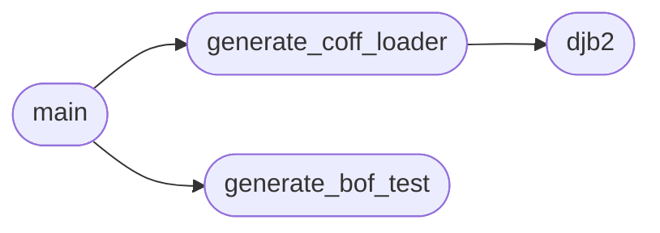

# `generate_hashs`

> Source: [generate_hashs.py:1](../../generate_hashs.py#L1) | language `py` | coverage 20.0% | [API index](../index.md)

BOF Bindings Generator for Cobalt Strike Author: Gris Iscomeback Email: grisiscomeback@gmail.com Creation Date: 13/08/2024 License: AGPL v3

Generates:
  - COFFLoader3.c: full COFF loader with DJB2 hash table
  - bof_test.c: ready-to-compile BOF with all imports and example

## Contents

- **Functions:** [`djb2`](#djb2), [`generate_coff_loader`](#generate_coff_loader), [`generate_bof_test`](#generate_bof_test), [`main`](#main)

## Call Graph

Solid arrows stay in this module, dashed arrows leave it.



## Functions

<a id="djb2"></a>

### `djb2`

`function` | [generate_hashs.py:23](../../generate_hashs.py#L23)

```python
def djb2(s: str) -> int
```

**Parameters**

| Name | Type | Default | Description |
|---|---|---|---|
| `s` | `str` |  |  |

**Returns:** `int`

*Called by:* [`generate_coff_loader`](#generate_coff_loader)

---

<a id="generate_coff_loader"></a>

### `generate_coff_loader`

`function` | [generate_hashs.py:223](../../generate_hashs.py#L223)

```python
def generate_coff_loader()
```

*Calls:* [`djb2`](#djb2)

*Called by:* [`main`](#main)

---

<a id="generate_bof_test"></a>

### `generate_bof_test`

`function` | [generate_hashs.py:491](../../generate_hashs.py#L491)

```python
def generate_bof_test()
```

*Called by:* [`main`](#main)

---

<a id="main"></a>

### `main`

`function` | [generate_hashs.py:553](../../generate_hashs.py#L553)

```python
def main()
```

*Calls:* [`generate_bof_test`](#generate_bof_test), [`generate_coff_loader`](#generate_coff_loader)

---
