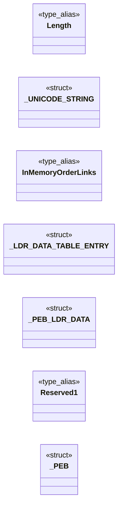
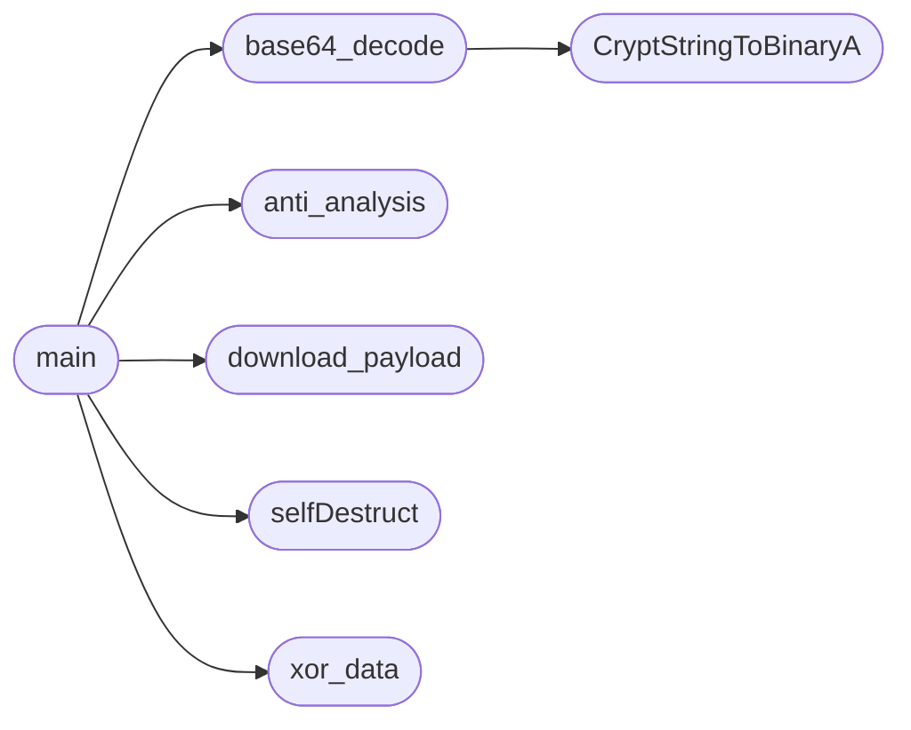

# `stub.c`

> Source: [stub.c:1](../../stub.c#L1) | language `c` | coverage 35.0% | [API index](../index.md)

## Contents

- **Structs:** [`_UNICODE_STRING`](#_unicode_string), [`_LDR_DATA_TABLE_ENTRY`](#_ldr_data_table_entry), [`_PEB_LDR_DATA`](#_peb_ldr_data), [`_PEB`](#_peb)
- **Type Aliases:** [`Length`](#length), [`InMemoryOrderLinks`](#inmemoryorderlinks), [`Length`](#length), [`Reserved1`](#reserved1)
- **Functions:** [`selfDestruct`](#selfdestruct), [`GetNtdllBase`](#getntdllbase), [`anti_analysis`](#anti_analysis), [`xor_data`](#xor_data), [`base64_decode`](#base64_decode), [`CryptStringToBinaryA`](#cryptstringtobinarya), [`download_payload`](#download_payload), [`main`](#main)
- **Macros:** [`C2_URL`](#c2_url), [`XOR_KEY`](#xor_key), [`MAX_PAYLOAD_SIZE`](#max_payload_size)

## Type Diagram



## Call Graph

Solid arrows stay in this module, dashed arrows leave it.



## Structs

<a id="_unicode_string"></a>

### `_UNICODE_STRING`

`struct` | [stub.c:16](../../stub.c#L16)

```c
typedef struct _UNICODE_STRING
```

=== STRUCTURES AND HELLGATE (for analysis evasion only) ===

---

<a id="_ldr_data_table_entry"></a>

### `_LDR_DATA_TABLE_ENTRY`

`struct` | [stub.c:22](../../stub.c#L22)

```c
typedef struct _LDR_DATA_TABLE_ENTRY
```

---

<a id="_peb_ldr_data"></a>

### `_PEB_LDR_DATA`

`struct` | [stub.c:32](../../stub.c#L32)

```c
typedef struct _PEB_LDR_DATA
```

---

<a id="_peb"></a>

### `_PEB`

`struct` | [stub.c:41](../../stub.c#L41)

```c
typedef struct _PEB
```

---

## Type Aliases

<a id="length"></a>

### `Length`

`type_alias` | [stub.c:16](../../stub.c#L16)

```c
typedef struct _UNICODE_STRING { USHORT Length;
```

=== STRUCTURES AND HELLGATE (for analysis evasion only) ===

---

<a id="inmemoryorderlinks"></a>

### `InMemoryOrderLinks`

`type_alias` | [stub.c:21](../../stub.c#L21)

```c
typedef struct _LDR_DATA_TABLE_ENTRY { LIST_ENTRY InMemoryOrderLinks;
```

---

<a id="length"></a>

### `Length`

`type_alias` | [stub.c:31](../../stub.c#L31)

```c
typedef struct _PEB_LDR_DATA { DWORD Length;
```

---

<a id="reserved1"></a>

### `Reserved1`

`type_alias` | [stub.c:40](../../stub.c#L40)

```c
typedef struct _PEB { BYTE Reserved1[2];
```

---

## Functions

<a id="selfdestruct"></a>

### `selfDestruct`

`function` | [stub.c:51](../../stub.c#L51)

```c
void selfDestruct()
```

*Called by:* [`main`](#main)

---

<a id="getntdllbase"></a>

### `GetNtdllBase`

`function` | [stub.c:107](../../stub.c#L107)

```c
HMODULE GetNtdllBase()
```

**Returns:** `HMODULE`

---

<a id="anti_analysis"></a>

### `anti_analysis`

`function` | [stub.c:142](../../stub.c#L142)

```c
BOOL anti_analysis()
```

=== ANTI-ANALYSIS ===

**Returns:** `BOOL`

*Called by:* [`main`](#main)

---

<a id="xor_data"></a>

### `xor_data`

`function` | [stub.c:168](../../stub.c#L168)

```c
void xor_data(unsigned char* data, size_t len)
```

=== XOR + BASE64 ===

**Parameters**

| Name | Type | Default | Description |
|---|---|---|---|
| `data` | `unsigned char*` |  |  |
| `len` | `size_t` |  |  |

*Called by:* [`main`](#main)

---

<a id="base64_decode"></a>

### `base64_decode`

`function` | [stub.c:174](../../stub.c#L174)

```c
BOOL base64_decode(LPCSTR input, DWORD input_len, BYTE** output, DWORD* output_len)
```

**Parameters**

| Name | Type | Default | Description |
|---|---|---|---|
| `input` | `LPCSTR` |  |  |
| `input_len` | `DWORD` |  |  |
| `output` | `BYTE**` |  |  |
| `output_len` | `DWORD*` |  |  |

**Returns:** `BOOL`

*Calls:* [`CryptStringToBinaryA`](#cryptstringtobinarya)

*Called by:* [`main`](#main)

---

<a id="cryptstringtobinarya"></a>

### `CryptStringToBinaryA`

`function` | [stub.c:178](../../stub.c#L178)

```c
return *output && CryptStringToBinaryA(input, input_len, CRYPT_STRING_BASE64, *output, output_len, NULL, NULL);
```

**Parameters**

| Name | Type | Default | Description |
|---|---|---|---|
| `output` |  |  |  |

**Returns:** `return *output &&`

*Called by:* [`base64_decode`](beacon.c.md#base64_decode), [`base64_decode`](#base64_decode)

---

<a id="download_payload"></a>

### `download_payload`

`function` | [stub.c:182](../../stub.c#L182)

```c
HGLOBAL download_payload()
```

=== DOWNLOAD ===

**Returns:** `HGLOBAL`

*Called by:* [`main`](#main)

---

<a id="main"></a>

### `main`

`function` | [stub.c:228](../../stub.c#L228)

```c
int main()
```

=== MAIN ===

**Returns:** `int`

*Calls:* [`anti_analysis`](#anti_analysis), [`base64_decode`](#base64_decode), [`download_payload`](#download_payload), [`selfDestruct`](#selfdestruct), [`xor_data`](#xor_data)

---

## Macros

<a id="c2_url"></a>

### `C2_URL`

`macro` | [stub.c:11](../../stub.c#L11)

```c
#define C2_URL
```

=== CONFIGURATION ===

---

<a id="xor_key"></a>

### `XOR_KEY`

`macro` | [stub.c:12](../../stub.c#L12)

```c
#define XOR_KEY
```

---

<a id="max_payload_size"></a>

### `MAX_PAYLOAD_SIZE`

`macro` | [stub.c:13](../../stub.c#L13)

```c
#define MAX_PAYLOAD_SIZE
```

---
