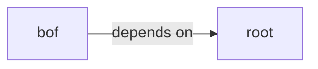

# bof/test

bof/test groups 24 files (c, h) around BEACON_H, datap, CALLBACK_OUTPUT, CALLBACK_ERROR, BEACON_H. SymbolHash: === Tabla de símbolos por hash ===

## bof (1.1)

bof groups 22 files (c, h) around BEACON_H, datap, CALLBACK_OUTPUT, CALLBACK_ERROR, BEACON_H.

## root (1.2)

root groups 2 files (c, h) around BEACON_H, datap, CALLBACK_OUTPUT, CALLBACK_ERROR, __imp_BeaconPrintf. SymbolHash: === Tabla de símbolos por hash ===

**Files**:

- COFFLoader3.c
- beacon.h
- bof/calc/beacon.h
- bof/calc/calc.c
- bof/etw/beacon.h
- bof/etw/etw.c
- bof/test/Test.c
- bof/test/amsibypass.c
- bof/test/beacon.h
- bof/test/cmdwhoami.c
- bof/test/disablelog.c
- bof/test/getenv.c
- bof/test/loadvnc.c
- bof/test/persist.c
- bof/test/persistsvc.c
- bof/test/scan_shellcode.c
- bof/test/shellcode.c
- bof/test/sock5.c
- bof/test/uacbypass.c
- bof/test/upload.c
- bof/test/vncrelay.c
- bof/test/winver.c
- bof/whoami/beacon.h
- bof/whoami/whoami.c
