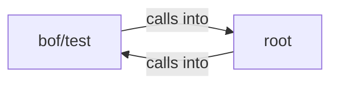

## Details

Static architecture map of 41 files (c, h, py, sh) in 2 components: bof/test, root. Structure is extracted statically without LLM calls; component prose may be enriched locally.

### bof/test (1)

bof/test groups 24 files (c, h) around BEACON_H, datap, CALLBACK_OUTPUT, CALLBACK_ERROR, BEACON_H. SymbolHash: === Tabla de símbolos por hash ===

**Related Classes/Methods**:

- <a href="../bof/test/beacon.h#L21-L24">bof/test/beacon.h::BEACON_H</a>
- <a href="../bof/test/beacon.h#L25-L40">bof/test/beacon.h::datap</a>
- <a href="../bof/test/beacon.h">bof/test/beacon.h::CALLBACK_OUTPUT</a>
- <a href="../bof/test/beacon.h#L42-L44">bof/test/beacon.h::CALLBACK_ERROR</a>
- <a href="../beacon.h#L21-L24">beacon.h::BEACON_H</a>
- <a href="../beacon.h#L25-L40">beacon.h::datap</a>
- <a href="../beacon.h">beacon.h::CALLBACK_OUTPUT</a>
- <a href="../beacon.h#L42-L44">beacon.h::CALLBACK_ERROR</a>

### root (2)

root groups 6 files (c, h) around _AES_H_, CBC, ECB, CTR, AES256. tiny-AES-c (https://github.com/kokke/tiny-AES-c)

**Related Classes/Methods**:

- <a href="../aes.h#L2-L8">aes.h::_AES_H_</a>
- <a href="../aes.h#L9-L11">aes.h::CBC</a>
- <a href="../aes.h#L12-L14">aes.h::ECB</a>
- <a href="../aes.h#L15-L17">aes.h::CTR</a>
- <a href="../aes.h#L18-L19">aes.h::AES256</a>
- <a href="../aes.h#L20-L22">aes.h::AES_BLOCKLEN</a>
- <a href="../aes.h">aes.h::AES_KEYLEN</a>
- <a href="../aes.h#L24-L25">aes.h::AES_keyExpSize</a>
